# LoreBary CSS Quick Guide

@harp, thanks for your awesome snippets 🫶🏻

---

## Choose the Correct Theme Area

LoreBary currently has two separate CSS surfaces. Their selectors are **not interchangeable**.

| Theme area | Root scope | Main attributes | Use it for |
| --- | --- | --- | --- |
| Laboratory / Chat Themes | `.lab-theme-scope` | `[data-lab]`, `[data-lab-role]` | Chat messages, the Laboratory header and footer, 2.5 composer controls, long-press menus, and chat effects |
| Profile Themes | `.profile-theme-scope` | `[data-profile]`, ARIA states and labels | Profile avatars, navigation tabs, About Me, Write a Post, Gallery, Popular Creations, and feed posts |

> **Safe workflow:** Preview first. A working preview is not the same as a saved theme, and a saved draft is not the same as a published update. Keep a copy of the current CSS before larger changes.

Use narrow, stable selectors. Avoid broad rules such as `button { ... }` or `.profile-theme-scope img { ... }` unless every matching element should really change.

---

## 📋 Table of Contents

- [Choose the Correct Theme Area](#choose-the-correct-theme-area)
- [Converting Images to Base64](#converting-images-to-base64)
  - [How to Get the data:webp Base64 Code](#how-to-get-the-datawebp-base64-code)
- [How to Import CSS Images in Lorebary](#how-to-import-css-images-in-lorebary)
- [Part I — Laboratory / Chat Themes](#part-i--laboratory--chat-themes)
- [Avatar Customization](#avatar-customization)
  - [Image around Avatar](#image-around-avatar)
  - [Avatar Glow on Hover](#avatar-glow-on-hover)
  - [Lift Hover](#lift-hover)
  - [Greyscale to Color on Hover](#greyscale-to-color-on-hover)
  - [Remove Avatar Outline/Gradient](#remove-avatar-outlinegradient)
  - [Square Avatar Boxes](#square-avatar-boxes)
  - [Small Avatars with Glowing Effect](#small-avatars-with-glowing-effect)
  - [Large Avatars Filling Portrait](#large-avatars-filling-portrait)
  - [Avatar Ring Glow](#avatar-ring-glow)
- [Visual Expressions](#visual-expressions)
  - [Custom Visual Expression Icons](#custom-visual-expression-icons)
  - [Glowing Expression Portraits](#glowing-expression-portraits)
  - [Move Expression Portraits to the Right](#move-expression-portraits-to-the-right)
  - [Floating Expression Portraits](#floating-expression-portraits)
  - [Expression Toggle Button Colors](#expression-toggle-button-colors)
- [Chat Bubble Effects](#chat-bubble-effects)
  - [Remove Bubble Message Background](#remove-bubble-message-background)
  - [Bubble Hover Lift](#bubble-hover-lift)
  - [Button Bubbles](#button-bubbles)
  - [Custom Message Bubble Backgrounds](#custom-message-bubble-backgrounds)
  - [Different User and Character Message Bubbles](#different-user-and-character-message-bubbles)
  - [Bubble Tail Effects and Removal](#bubble-tail-effects-and-removal)
  - [Bubble Transparency Without Fading Text](#bubble-transparency-without-fading-text)
  - [Decorative Message Bubble Ornaments](#decorative-message-bubble-ornaments)
  - [Message Bubble Hover Glow](#message-bubble-hover-glow)
- [Message Layout](#message-layout)
  - [Message Left Aligned](#message-left-aligned)
  - [Centered Chat Messages](#centered-chat-messages)
  - [Colorize Text Selection](#colorize-text-selection)
  - [Change the Rating Symbol](#change-the-rating-symbol)
  - [Hide Timestamp](#hide-timestamp)
  - [Move Timestamp by Name (Right Side)](#move-timestamp-by-name-right-side)
  - [Time and Page Number Styling](#time-and-page-number-styling)
  - [Message Text, Bold, and Italic](#message-text-bold-and-italic)
  - [Dialogue, Dividers, and Headings](#dialogue-dividers-and-headings)
  - [Message List Items](#message-list-items)
  - [Thinking Panel Background and Text](#thinking-panel-background-and-text)
  - [Thinking Panel Hover Effects](#thinking-panel-hover-effects)
- [Message Footer and Ratings](#message-footer-and-ratings)
  - [Message Footer and Timestamp Styling](#message-footer-and-timestamp-styling)
  - [Custom Rating Icons](#custom-rating-icons)
- [Header & Footer](#header--footer)
  - [Hide Avatars in Header](#hide-avatars-in-header)
  - [Hide Chat Name](#hide-chat-name)
  - [Remove Header Border](#remove-header-border)
  - [Remove Header Hairline Stripe](#remove-header-hairline-stripe)
  - [Transparent Footer](#transparent-footer)
  - [Smaller Visual Expression Portrait](#smaller-visual-expression-portrait)
  - [LoreBary 2.5 Footer Button Map](#lorebary-25-footer-button-map)
  - [Small Button Header](#small-button-header)
  - [Custom Header Button Icons](#custom-header-button-icons)
  - [Custom Navigation Icons](#custom-navigation-icons)
  - [Custom Footer Button Icons](#custom-footer-button-icons)
  - [Icon Glow — Search Example](#icon-glow--search-example)
  - [Rainbow Button Background — Search Example](#rainbow-button-background--search-example)
  - [Icon Hover Enlargement — Gallery Example](#icon-hover-enlargement--gallery-example)
  - [Animated Rainbow Button — Gallery Example](#animated-rainbow-button--gallery-example)
  - [Multicolor Icon Glow — Bookmarks Example](#multicolor-icon-glow--bookmarks-example)
  - [Rotating Rainbow Button Border — Bookmarks Example](#rotating-rainbow-button-border--bookmarks-example)
  - [Solid Button Border — Voice Call Example](#solid-button-border--voice-call-example)
  - [Gradient Button Border — Fullscreen Example](#gradient-button-border--fullscreen-example)
  - [Pulsing Button Glow — Fullscreen Example](#pulsing-button-glow--fullscreen-example)
  - [Bobbing Icon Animation — Statistics Example](#bobbing-icon-animation--statistics-example)
  - [Button Hover Glow — Statistics Example](#button-hover-glow--statistics-example)
  - [Shared Button Hover Brightness — Header Examples](#shared-button-hover-brightness--header-examples)
  - [Button Keyboard Focus Outlines — Header Examples](#button-keyboard-focus-outlines--header-examples)
  - [Rainbow Icon Recoloring — Gallery Example](#rainbow-icon-recoloring--gallery-example)
- [Input Controls](#input-controls)
  - [Message Action Buttons](#message-action-buttons)
  - [Composer Buttons](#composer-buttons)
  - [Breathing Send Animation](#breathing-send-animation)
  - [Input Buttons Dim Until Hover](#input-buttons-dim-until-hover)
  - [Input Buttons Coloring](#input-buttons-coloring)
  - [Coloring Menu Button](#coloring-menu-button)
  - [Glowing Menu Button](#glowing-menu-button)
  - [Individual Message Action Colors and Hover](#individual-message-action-colors-and-hover)
  - [Custom Menu Button Icon](#custom-menu-button-icon)
  - [Custom Input Button Icons](#custom-input-button-icons)
  - [Custom Draft Version Controls](#custom-draft-version-controls)
  - [Custom Message Action Icons](#custom-message-action-icons)
  - [Managing Tinting, Filters, and Icon Replacements](#managing-tinting-filters-and-icon-replacements)
- [Long-Press Menus — LoreBary 2.5](#long-press-menus--lorebary-25)
  - [Menu and Dialog Selector Map Quick Reference](#menu-and-dialog-selector-map-quick-reference)
  - [Style the Write for Me Menu](#style-the-write-for-me-menu)
  - [Write Menu Heading Colors](#write-menu-heading-colors)
  - [Write Menu Actions and Help Text](#write-menu-actions-and-help-text)
  - [Write Menu Selected, Unselected, and Keyboard-Focus States](#write-menu-selected-unselected-and-keyboard-focus-states)
  - [Custom Write Menu Action Icons](#custom-write-menu-action-icons)
  - [Style Long-Press Settings Dialogs](#style-long-press-settings-dialogs)
  - [Style Dropdowns Inside Settings](#style-dropdowns-inside-settings)
  - [Custom Scene Notes Window](#custom-scene-notes-window)
  - [Scene Notes Title and Close Button](#scene-notes-title-and-close-button)
  - [Scene Notes Template Colors](#scene-notes-template-colors)
  - [Scene Notes Selected and Hover Effects](#scene-notes-selected-and-hover-effects)
  - [Scene Notes Text Box Colors and Focus](#scene-notes-text-box-colors-and-focus)
  - [Scene Notes Additional Buttons](#scene-notes-additional-buttons)
  - [Scene Notes Keyboard Focus](#scene-notes-keyboard-focus)
  - [Custom Scene Notes Template Icons](#custom-scene-notes-template-icons)
- [Search and Bookmarks](#search-and-bookmarks)
  - [Search & Bookmarks Panel Background](#search--bookmarks-panel-background)
  - [Search & Bookmarks Header Styling](#search--bookmarks-header-styling)
  - [Search & Bookmarks Title and Description](#search--bookmarks-title-and-description)
  - [Search & Bookmarks Header Icon Glow](#search--bookmarks-header-icon-glow)
  - [Custom Search & Bookmarks Header Icons](#custom-search--bookmarks-header-icons)
  - [Custom Search Bar Colors](#custom-search-bar-colors)
  - [Search Bar Focus Effect](#search-bar-focus-effect)
  - [Bookmarks Tab Bar Background](#bookmarks-tab-bar-background)
  - [Bookmarks Tab Colors](#bookmarks-tab-colors)
  - [Selected Bookmarks Tab Styling](#selected-bookmarks-tab-styling)
  - [Bookmarks Tab Hover and Keyboard Focus](#bookmarks-tab-hover-and-keyboard-focus)
  - [Bookmarks Tab Counters](#bookmarks-tab-counters)
  - [Bookmarks Empty-State Text](#bookmarks-empty-state-text)
  - [Custom Search Empty-State Illustration](#custom-search-empty-state-illustration)
  - [Search & Bookmarks Close Button](#search--bookmarks-close-button)
  - [Search & Bookmarks Footer Styling](#search--bookmarks-footer-styling)
  - [Custom Copy and Download Icons](#custom-copy-and-download-icons)
  - [Custom Search & Bookmarks Background Images](#custom-search--bookmarks-background-images)
  - [Custom Bookmarks Tab Icons](#custom-bookmarks-tab-icons)
- [Laboratory Selector and Native Asset Reference](#laboratory-selector-and-native-asset-reference)
  - [Native Image Asset Paths](#native-image-asset-paths)
  - [UI Selector and Customization Reference](#ui-selector-and-customization-reference)
- [Part II — Profile Themes](#part-ii--profile-themes)
  - [Profile Theme Structure and Palette](#profile-theme-structure-and-palette)
  - [Fonts and Typography](#fonts-and-typography)
  - [Profile Avatar Frame](#profile-avatar-frame)
  - [Stickers and Decorative Images](#stickers-and-decorative-images)
  - [Main Profile Tabs and About Tabs](#main-profile-tabs-and-about-tabs)
  - [Moving and Framing a Status Block](#moving-and-framing-a-status-block)
  - [Write a Post](#write-a-post)
  - [SEE ALL and Popular Creations Buttons](#see-all-and-popular-creations-buttons)
  - [Comment, Share, and Like Buttons](#comment-share-and-like-buttons)
  - [Mobile Profile Repairs](#mobile-profile-repairs)
  - [Profile Selector Quick Reference](#profile-selector-quick-reference)
  - [Profile CSS Troubleshooting](#profile-css-troubleshooting)
- [Part III — Shared Animations for Laboratory and Profile Themes](#part-iii--shared-animations-for-laboratory-and-profile-themes)
- [Background Effects](#background-effects)
- [Shared Scrollable Foreground Fireflies and Stars](#shared-scrollable-foreground-fireflies-and-stars)

---

## Converting Images to Base64

### How to Get the data:webp Base64 Code

To use custom images in your CSS snippets, you'll need to convert them to Base64 format.

**Step 1: Prepare Your Image**
Get your image file ready (PNG, JPG, WebP, etc.)

**Step 2: Visit Base64 Converter**
Go to [Base64 Converter](https://base64.guru/converter/encode/image)

**Step 3: Configure Converter Settings**
Select every option like the example below:
- ☑️ Enable all available options
- Make sure settings match the configuration shown

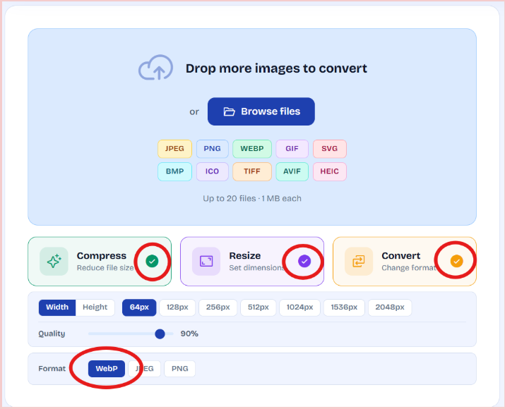


**Step 4: Upload Your Image**
Drop your image file into the converter tool

**Step 5: Copy the Code**
- Click the **Code** button to open the generated code
- Click **Copy** to copy the Base64 code to your clipboard

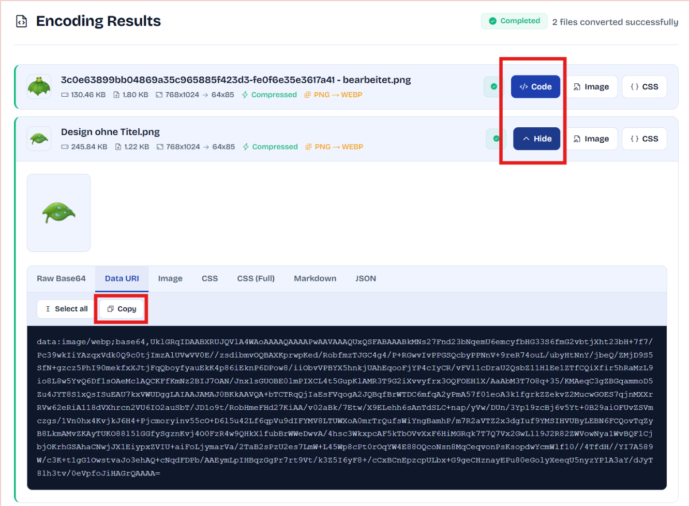

**Step 6: Use in Your CSS**
Replace `XXX` in your CSS snippet with the copied Base64 code:

```css
.lab-theme-scope {
  --character-image: url("data:image/webp;base64,XXX");
  --user-image: url("data:image/webp;base64,XXX");
}
```

**Done!** Your image is now embedded in your CSS. 🎉

---

## How to Import CSS Images in Lorebary

Learn how to upload artwork to Lorebary and use its image URL in your Laboratory CSS. 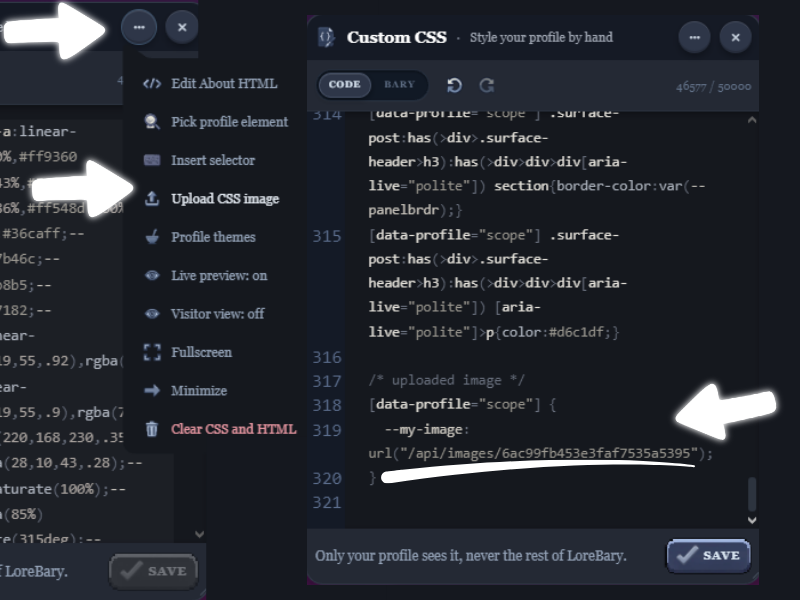

1. Upload your image using Lorebary's image upload feature. Copy the image's Lorebary-hosted URL; an uploaded image may have a path resembling `/api/images/IMAGE_ID`.
2. Open your Laboratory CSS editor and find the selector for the element you want to customize.
3. Paste the URL into `content: url(...)` when replacing an existing `` element, or into `background-image: url(...)` when decorating an element's background.
4. Save your CSS and refresh or revisit the affected Laboratory screen to check the result.

**Choosing an image source:** You can use either a LoreBary-uploaded `/api/images/...` path or a Base64 image data URL. For Base64, replace `XXX` with the complete `data:webp;base64,...` value (or the corresponding data URL for your image format). See [Converting Images to Base64](https://github.com/Caddel001/LoreBary-Theme-Snippets/blob/main/LoreBary%20CSS%20Quick%20Guide.md#converting-images-to-base64). No externally hosted image URL is required or supported here.

**Optional: Store an image source in a CSS variable**

```css
/* Set the image source once: uploaded path or Base64 data URL */
.lab-theme-scope {
  --menu-icon-image: url("XXX");
}

/* Reuse that image source on the matching icon */
img[data-lab="menu"] {
  content: var(--menu-icon-image) !important;
  object-fit: contain !important;
}
```

Replace `XXX` with `/api/images/YOUR_IMAGE_ID` or your complete Base64 data URL. The variable is optional: the direct `content: url(...)` method below works too. For other icons, choose a descriptive variable name and update the selector.

**Example: Replace an icon**

```css
img[data-lab="menu"] {
  content: url("/api/images/YOUR_IMAGE_ID") !important;
  object-fit: contain !important;
}
```

**Example: Add a background image**

```css
[data-lab="bookmarks-panel"] {
  background-image: url("/api/images/YOUR_IMAGE_ID") !important;
  background-position: center !important;
  background-size: cover !important;
}
```

**Customization:**
- `YOUR_IMAGE_ID` = replace this placeholder with the path of your uploaded image.
- `content: url(...)` = substitutes the visible image in an existing image element.
- `background-image: url(...)` = paints artwork behind the element's contents.
- `object-fit: contain` = keeps replacement artwork within its image box without stretching it.
- `background-size: cover` = fills a background area, potentially cropping its edges.
- A file path on your own computer is not a Lorebary-hosted image URL. You can also use Base64 image data instead of an uploaded image path.

---

# Part I — Laboratory / Chat Themes

All snippets in Part I use `.lab-theme-scope` and belong to the Laboratory chat theme editor.

> **LoreBary 2.5 check:** The composer, tool-row, and long-press selectors below were verified in a live 2.5 Test Chat on 2026-10-10. Legacy selectors such as `[data-lab="write-options"]` and `[data-lab="voice-bubble"]`, plus old assumptions about Enhance, Continue, and Listen buttons, have been removed.

## Avatar Customization 

### Image around Avatar

Place custom images around your avatar frame. 

```css
.lab-theme-scope {
  --character-image: url("XXX");
  --user-image: url("XXX");
}

.lab-theme-scope [data-lab-role="character"],
.lab-theme-scope [data-lab-role="user"] {
  position: relative !important;
  overflow: visible !important;
}

/* --- Character AVATAR --- */
.lab-theme-scope [data-lab-role="character"]::after {
  content: "" !important;
  display: block !important;
  position: absolute !important;
  width: 90px !important;
  height: 89px !important;
  left: -12px !important;
  top: 12px !important;
  background-image: var(--character-image) !important;
  background-size: contain !important;
  background-repeat: no-repeat !important;
  background-position: center !important;
  transform: rotate(103deg) !important;
  pointer-events: none !important;
  z-index: 99 !important;
}

/* --- USER AVATAR --- */
.lab-theme-scope [data-lab-role="user"]::after {
  content: "" !important;
  display: block !important;
  position: absolute !important;
  width: 120px !important;
  height: 100px !important;
  right: -23px !important;
  top: 16px !important;
  background-image: var(--user-image) !important;
  background-size: contain !important;
  background-repeat: no-repeat !important;
  background-position: center !important;
  transform: rotate(8deg) scaleX(-1) !important;
  pointer-events: none !important;
  z-index: 99 !important;
}
```

**Customization:**
- Replace `XXX` with `data:webp;base64,` code (see [Converting Images to Base64](#converting-images-to-base64))
- `width` + `height`: Set the size of the image
- `left`: Shift the image left and right
- `top`: Shift the image up and down
- `rotate`: Rotate the image

---

### Avatar Glow on Hover

Add a glowing effect when hovering over avatars. 

```css
[data-lab="avatar"]:hover {
  box-shadow: 0 0 10px rgba(81, 160, 222, 0.3) !important;
  transition: box-shadow 0.2s !important;
}
```

---

### Lift Hover

Lift the avatar when you hover over it with a scale effect. 

```css
[data-lab="avatar"] {
  transition: transform 0.25s ease, box-shadow 0.25s ease;
}

[data-lab="avatar"]:hover {
  transform: translateY(-2px) scale(1.05);
  box-shadow: 0 4px 14px rgba(0, 0, 0, 0.4);
}
```

---

### Greyscale to Color on Hover

Transform avatar from greyscale to color when you hover over it. 

```css
[data-lab="avatar"] img {
  filter: grayscale(100%) !important;
  transition: filter 0.3s !important;
}

[data-lab="avatar"]:hover img {
  filter: grayscale(0%) !important;
}
```

**Customization:**
- `img` = default version
- `hover img` = touching version
- `grayscale`: 0 = full color, 100 = no color

---

### Remove Avatar Outline/Gradient

Remove the default avatar outline styling. 

```css
[data-lab="avatar"] {
  background: none !important;
  padding: 0 !important;
}
```

---

### Square Avatar Boxes

Change avatar corners from rounded to square. 

```css
[data-lab="avatar"] {
  border-radius: 8px !important;
}
```

**Customization:**
- Adjust the `px` value for different corner radius (0 = perfectly square)

---

### Small Avatars with Glowing Effect

Create small circular avatars with a glowing colored ring effect.

```css
/* Small Avatars glowing */
[data-lab="avatar"] {
  border-radius: 50% !important;
  border: 1px solid rgba(255, 112, 74, 0.78) !important;
  box-shadow: 0 0 4px rgba(255,112,74,.88),
              0 0 14px rgba(255,112,74,.36),
              0 0 24px rgba(255,59,220,.16) !important;
}

[data-lab-role="user"] [data-lab="avatar"] {
  border-color: rgba(0, 223, 255, 0.82) !important;
  box-shadow: 0 0 4px rgba(0,223,255,.92),
              0 0 14px rgba(0,223,255,.42),
              0 0 24px rgba(255,59,220,.16) !important;
}
```

**Customization:**
- Change the `rgba()` values to customize the glow colors
- Adjust the `border-radius` for different shapes

---

### Large Avatars Filling Portrait

Make portrait avatars larger and fill the bubble space with no frame.

```css
/* Big Avatars filling Portrait */
[data-lab="portrait"],
[data-lab="portrait"] img {
  border: none !important;
  border-radius: 10px !important;
  box-shadow: none !important;
  object-fit: contain !important;
  object-position: center !important;
  background-size: contain !important;
  background-position: center !important;
  background-repeat: no-repeat !important;
}

[data-lab="bubble"]:has([data-lab="portrait"]) {
  min-height: clamp(260px, 20vw, 400px) !important;
}
```

**Customization:**
- `border-radius`: Adjust corner roundness
- `min-height`: Adjust the height of the portrait bubble

---

### Avatar Ring Glow

Add colored glowing rings to user and character avatars.

```css
[data-lab-role="user"] [data-lab="avatar"] {
  border-color: rgba(0, 223, 255, 0.82) !important;
  box-shadow: 0 0 4px rgba(0,223,255,.92),
              0 0 14px rgba(0,223,255,.42),
              0 0 24px rgba(255,59,220,.16) !important;
}

[data-lab-role="character"] [data-lab="avatar"] {
  border-color: rgba(0, 223, 255, 0.82) !important;
  box-shadow: 0 0 4px rgba(0,223,255,.92),
              0 0 14px rgba(0,223,255,.42),
              0 0 24px rgba(255,59,220,.16) !important;
}
```

**Customization:**
- Modify `rgba()` values to change glow colors for each role

---

## Visual Expressions

### Custom Visual Expression Icons

Replace the Visual Expressions toggle and management icon; optionally add an image overlay to the expression portrait.

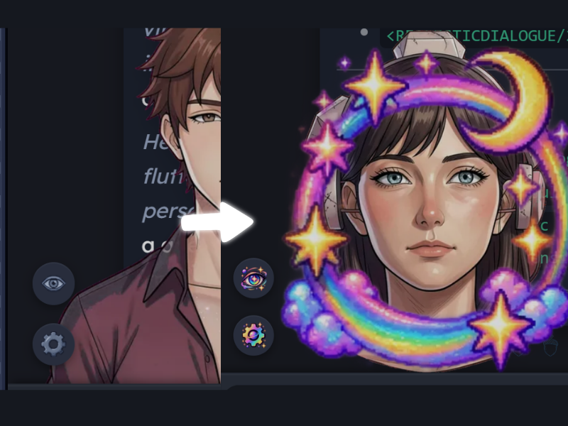

```css
/* Hide the original expression toggle image */
[data-lab="expression-toggle"] img {
  visibility: hidden !important;
}

/* Expression toggle replacement artwork */
[data-lab="expression-toggle"] span {
  width: 20px !important;
  height: 20px !important;
  background-image:
    url("/api/images/6ac8997342880c652f056e23") !important;
  background-repeat: no-repeat !important;
  background-position: center !important;
  background-size: contain !important;
}

/* Manage Expressions */
[data-lab="expression-manage"] img {
  content: url("/api/images/6ac8997ed2d7799fdce4e72a") !important;
  object-fit:contain!important;
}

/* Optional portrait decoration */
[data-lab="expression"]::after {
  content: "" !important;
  position: absolute !important;
  inset: 0 !important;
  background:
    url("/api/images/6ac8999c42880c652f0572b8")
    center bottom / contain no-repeat !important;
  pointer-events: none !important;
}
```

**Customization:**
- `visibility: hidden` = hides the original toggle image while keeping the element present.
- `background-image` = displays replacement artwork on the toggle span.
- `content: url(...)` = replaces the Manage icon.
- `::after` = overlays decorative artwork without blocking pointer interactions.
- Replace the sample image URLs with your own.

**Note:** The portrait overlay is decorative rather than a button icon; remove its block if you only want icon replacements.

---

---

### Glowing Expression Portraits

Add a layered neon glow around a character expression image. 

```css
[data-lab="expression"] img {
  filter: drop-shadow(0 0 8px #ff69c9)
          drop-shadow(0 0 14px #70dfff)
          drop-shadow(0 0 20px #a78bfa) !important;
}
```

**Customization:**
- Each `drop-shadow` adds another color and blur radius.
- Reduce the radii or remove layers for a subtler effect.

---

---

### Move Expression Portraits to the Right

Anchor the expression portrait on the right side of the chat. 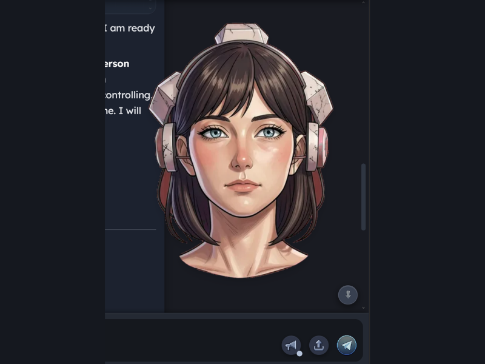

```css
[data-lab="expression"] {
  left: auto !important;
  right: 0 !important;
  bottom: 0 !important;
}
```

**Customization:**
- `right: 0` anchors the portrait to the right.
- `bottom: 0` aligns it to the bottom.
- `left: auto` releases the original left positioning.

**Compatibility:** Portrait placement examples are alternatives. Combine their positioning declarations deliberately rather than pasting all portrait-position rules together.

---

---

### Floating Expression Portraits

Lift and resize the portrait to create a floating side accent.

```css
[data-lab="expression"] {
  left: auto !important;
  right: 0 !important;
  bottom: 50px !important;
  width: clamp(16rem, 30vw, 28rem) !important;
  height: min(55dvh / var(--content-ui-scale, 1), 100%) !important;
  max-height: 32rem !important;
}
```

**Customization:**
- `bottom` controls how high the portrait floats.
- `width: clamp(...)` makes its width responsive.
- `max-height` limits its size.

---

---

### Expression Toggle Button Colors

Recolor the visual-expression toggle and its active state. 

```css
[data-lab="expression-toggle"] {
  background: #27214c !important;
  border: 2px solid #ff84d5 !important;
  box-shadow: 0 0 8px #ff84d566 !important;
}

[data-lab="expression-toggle"][aria-pressed="true"] {
  background: #623c7d !important;
}
```

**Customization:**
- `background` sets the normal button color.
- `border` and `box-shadow` provide the pink accent.
- `aria-pressed="true"` changes the background while active.

---

## Chat Bubble Effects

### Remove Bubble Message Background

Make chat bubbles completely transparent.  

```css
[data-lab="bubble"] {
  background: transparent !important;
  border: none !important;
  box-shadow: none !important;
  padding: 0 !important;
}
```

---

### Bubble Hover Lift

Lift chat bubbles slightly when you hover over them. 

```css
[data-lab="bubble"] {
  transition: transform 0.2s ease, box-shadow 0.2s ease !important;
}

[data-lab="bubble"]:hover {
  transform: translateY(-2px) !important;
  box-shadow: 0 4px 12px rgba(0, 0, 0, 0.2) !important;
}
```

---

### Button Bubbles

Style swipe buttons and mini actions on chat bubbles with custom colors and hover effects.

```css
/* Swipe-Buttons and mini actions on the chat bubbles */
[data-lab="swipe"],
[data-lab="action"] {
  color: #fff0d4 !important;
  background: linear-gradient(
    145deg,
    rgba(65, 48, 40, .91),
    rgba(31, 38, 37, .91)
  ) !important;
  border: 1px solid rgba(235, 173, 117, .48) !important;
  border-radius: 999px !important;
  box-shadow:
    inset 0 1px 0 rgba(255, 255, 255, .16),
    0 4px 12px rgba(44, 27, 19, .25) !important;
}

/* Hover */
[data-lab="swipe"]:hover,
[data-lab="action"]:hover {
  background: linear-gradient(
    145deg,
    rgba(90, 58, 42, .94),
    rgba(37, 79, 74, .92)
  ) !important;
  border-color: rgba(71, 145, 136, .78) !important;
}

/* Image icons */
[data-lab="swipe"] img,
[data-lab="action"] img,
img[data-lab="swipe"],
img[data-lab="action"] {
  filter: sepia(.62) saturate(.72) hue-rotate(335deg)
    brightness(1.18) contrast(.96) !important;
  opacity: 1 !important;
}

/* SVG icons */
[data-lab="swipe"] svg,
[data-lab="swipe"] svg *,
[data-lab="action"] svg,
[data-lab="action"] svg * {
  color: #fff0d4 !important;
  stroke: #fff0d4 !important;
}
```

---

### Custom Message Bubble Backgrounds

Change the default message bubble background and border without changing the text. 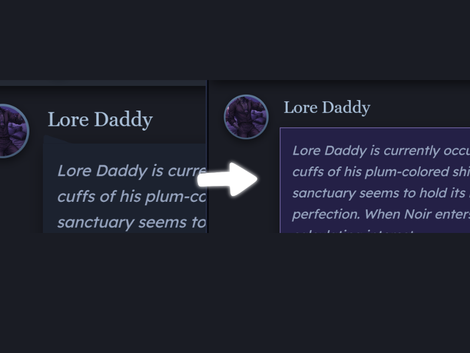

```css
[data-lab="bubble"] {
  background: #232047 !important;
  border: 1px solid #7063a4 !important;
}
```

**Customization:**
- `background` sets the bubble fill.
- `border` adds an outline; change its color and width to match your theme.


---

---

### Different User and Character Message Bubbles

Give user and character messages different colors using LoreBary's built-in bubble variables. 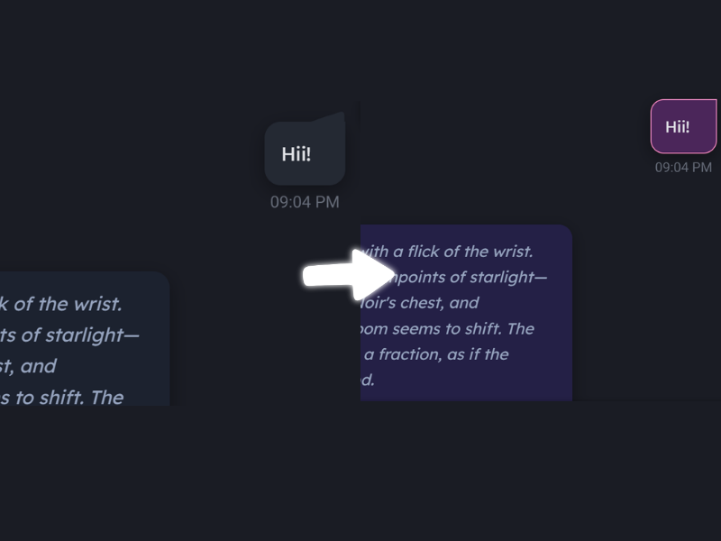

```css
[data-lab="bubble"] {
  --lab-bubble-user-bg: #ff79ca;
  --lab-bubble-user-border-color: #8deaff;
  --lab-bubble-bg: #211b31;
  --lab-bubble-border-color: #ff79ca;
  --lab-bubble-border-width: 3px;
  --lab-bubble-border-style: solid;
}
```

**Customization:**
- `--lab-bubble-user-bg` and `--lab-bubble-user-border-color` style user messages.
- `--lab-bubble-bg` and `--lab-bubble-border-color` style character messages.
- `--lab-bubble-border-width` and `--lab-bubble-border-style` are shared by both.
- Bubble tails use the corresponding background variable, so their fill follows the bubble color.


---

---

### Bubble Tail Effects and Removal

LoreBary exposes the speech-bubble pointer as `[data-lab="bubble-tail"]`. Add a glow, or hide the pointer entirely.

```css
/* Optional glowing tails */
[data-lab="bubble-tail"] {
  filter: drop-shadow(0 0 5px #ff79ca) !important;
  transition: filter .2s ease !important;
}
@media (hover: hover) {
  [data-lab="bubble"]:hover > [data-lab="bubble-tail"] {
    filter: drop-shadow(0 0 9px #8deaff) !important;
  }
}
```

To **hide tails instead**, use this alternative:

```css
[data-lab="bubble-tail"] { display: none !important; }
```


---

---

### Bubble Transparency Without Fading Text

`--lab-bubble-opacity` controls the **entire bubble**, including its text and action buttons. For translucent backgrounds with crisp text, use alpha-transparent background colors and restore full opacity:

```css
[data-lab="bubble"] {
  --lab-bubble-opacity: 1;
  --lab-bubble-user-bg: #ff79ca55;
  --lab-bubble-bg: #8deaff33;
  --lab-bubble-user-border-color: #ff79ca;
  --lab-bubble-border-color: #8deaff;
  --lab-bubble-border-width: 2px;
  --lab-bubble-border-style: solid;
}
```


---

---

### Decorative Message Bubble Ornaments

Add a line of decorative symbols above each message. 

```css
[data-lab="bubble"] {
  position: relative !important;
  padding-top: 48px !important;
}

[data-lab="bubble"]::before {
  content: "✦ · ✧ · ✦" !important;
  position: absolute !important;
  top: 12px;
  left: 18px;
  right: 18px;
  text-align: center;
  color: #ff8bd8;
  pointer-events: none;
}
```

**Customization:**
- `content` sets the decorative characters.
- `padding-top` makes room so the ornament does not overlap text.
- `top`, `left`, and `right` control placement.
- `color` recolors the symbols.

**Note:** Check long messages and narrow/mobile layouts. This is an ornament above the text, not an uploaded-image replacement.

---

---

### Message Bubble Hover Glow

Highlight a message bubble when a pointer moves over it.

```css
[data-lab="bubble"] {
  transition: box-shadow .2s ease !important;
}

@media (hover: hover) {
  [data-lab="bubble"]:hover {
    box-shadow: 0 0 12px #ff85c466 !important;
  }
}

@media (prefers-reduced-motion: reduce) {
  [data-lab="bubble"] {
    transition: none !important;
  }
}
```

**Customization:**
- `box-shadow` sets the hover glow.
- `.2s` controls transition speed.
- `@media (hover: hover)` limits the effect to hover-capable devices.


**Compatibility:** This is an alternative hover shadow to **Bubble Hover Lift** above. Both set the bubble’s hover `box-shadow`; combine their shadow values if you want both effects.

---

## Message Layout

### Message Left Aligned

Align user messages to the left side instead of the right. 

Default:  right side: 

```css
[data-lab-role="user"] {
  justify-content: flex-start !important;
}

[data-lab-role="user"] [data-lab="avatar"] {
  order: 0 !important;
}

[data-lab-role="user"] .max-w-\[65\%\] {
  order: 1 !important;
  text-align: left !important;
}
```

**Customization:**
- `order: 0` = avatar appears first (right side)
- Default behavior has avatar on left side like Bary

---

### Centered Chat Messages

Center chat messages with equal room on both sides. 

```css
[data-lab="message"] {
  max-width: 90% !important;
  margin-left: auto !important;
  margin-right: auto !important;
}
```

**Customization:**
- `max-width`: Adjust how close the text should be (100 = default, 90 = closer to center)

---

### Colorize Text Selection

Add color to selected text with a custom background. 

```css
.lab-theme-scope ::selection {
  background: rgba(174, 153, 255, 0.3);
  color: #fff;
}
```

**Customization:**
- `rgba()`: Set your preferred color (RGBA format)

---

### Change the Rating Symbol

Changes the rating acorns to sparkles


```css
[data-lab="rating"] img {
  content: url("data:image/svg+xml,%3Csvg xmlns='http://www.w3.org/2000/svg' viewBox='0 0 24 24' fill='none' stroke='%23ffffff' stroke-width='1.6' stroke-linejoin='round'%3E%3Cpath d='M12 2l2.2 6.6L21[...]
  width: 16px !important;
  height: 16px !important;
} 
```

---

### Hide Timestamp

Hide timestamps from all messages. 

```css
[data-lab="time"] {
  display: none !important;
}
```

---

### Move Timestamp by Name (Right Side)

Move timestamps to appear above the chat bubble on the right side. 

```css
[data-lab="message"] > div:has([data-lab="bubble"]) {
  position: relative !important;
}

[data-lab="time"] {
  position: absolute !important;
  top: 4px !important;
  right: 8px !important;
  font-size: 0.7em !important;
}
```

**For left side, change to:**


```css
[data-lab="time"] {
  position: absolute !important;
  top: 4px !important;
  left: 120px !important;
}
```

**Customization:**
- `font-size`: Changes the timestamp size
- `right`: Delete to set the timestamp to the left
- `top`: Delete to set the timestamp below the chat bubble

---

### Time and Page Number Styling

Style the time display and page numbering between swipe buttons with custom fonts and colors.

```css
/* Time and Page number between the swipe buttons */
[data-lab="time"],
.lab-theme-scope :has(> [data-lab="swipe"]) {
  color: #f1e5cf !important;
  -webkit-text-fill-color: #f1e5cf !important;
  font-family: 'Kalam', 'Trebuchet MS', sans-serif !important;
  font-size: .82rem !important;
  font-weight: 600 !important;
  letter-spacing: .03em !important;
  text-shadow: none !important;
  opacity: .9 !important;
}
```

**Customization:**
- `color`: Change the text color
- `font-family`: Use different fonts
- `font-size`: Adjust text size

---

### Message Text, Bold, and Italic

```css
[data-lab="message-body"] > div[data-selection-root="true"] [data-lab="text"] {
  color: #ff79ca !important;
  text-shadow: 0 0 5px #ff79ca88 !important;
}
[data-lab="message-body"] > div[data-selection-root="true"] [data-lab="bold"] {
  color: #8deaff !important;
}
[data-lab="message-body"] > div[data-selection-root="true"] [data-lab="italic"] {
  color: #ffe17b !important;
}
```


---

---

### Dialogue, Dividers, and Headings

```css
[data-lab="message-body"] > div[data-selection-root="true"] [data-lab="dialog"] {
  color: #ff79ca !important;
  text-shadow: 0 0 5px #ff79ca88 !important;
}
[data-lab="message-body"] > div[data-selection-root="true"] [data-lab="rule"] {
  background: #ffe17b !important;
  height: 3px !important;
  box-shadow: 0 0 7px #ffe17b !important;
}
[data-lab="message-body"] > div[data-selection-root="true"] [data-lab="heading"] {
  border-bottom: 2px solid #8deaff !important;
  padding-bottom: 4px !important;
}
```


---

---

### Message List Items

```css
[data-lab="message-body"] > div[data-selection-root="true"] [data-lab="list-item"] {
  background: #ff79ca22 !important;
  border-left: 3px solid #ff79ca !important;
  border-radius: 6px !important;
  padding: 5px 8px !important;
  margin: 5px 0 !important;
  transition: background-color .2s ease !important;
}
@media (hover: hover) {
  [data-lab="message-body"] > div[data-selection-root="true"] [data-lab="list-item"]:hover {
    background: #8deaff33 !important;
  }
}
```


---

### Thinking Panel Background and Text

Recolor the Thinking panel independently of the main message body. 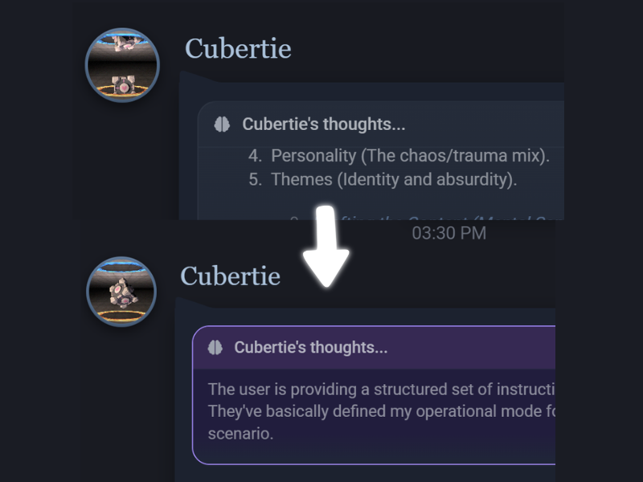

```css
/* Panel and header */
[data-lab="thoughts"] {
  background: #211b31 !important;
  border: 2px solid #ff79ca !important;
  border-radius: 12px !important;
  box-shadow: 0 0 10px #ff79ca55 !important;
}
[data-lab="thoughts-toggle"] {
  background: #ff79ca33 !important;
  border-bottom: 1px solid #ff79ca !important;
}
/* Header title and icons */
[data-lab="thoughts-toggle"] > span {
  color: #ff79ca !important;
  font-weight: 700 !important;
  text-shadow: 0 0 6px #ff79ca !important;
}
[data-lab="thoughts-toggle"] > i {
  color: #8deaff !important;
  filter: drop-shadow(0 0 4px #8deaff) !important;
}
/* Thinking content */
[data-lab="thoughts-text"] {
  background: #211b31 !important;
  border-left: 3px solid #ff79ca !important;
  border-radius: 6px !important;
  padding: 10px !important;
}
[data-lab="thoughts-text"] [data-lab="text"] {
  color: #8deaff !important;
  text-shadow: 0 0 4px #8deaff88 !important;
}
[data-lab="thoughts-text"] [data-lab="italic"] {
  color: #ffe17b !important;
}
```


---

---

### Thinking Panel Hover Effects

```css
[data-lab="thoughts"] {
  transition: box-shadow .25s ease, border-color .25s ease !important;
}
@media (hover: hover) {
  [data-lab="thoughts"]:hover {
    border-color: #8deaff !important;
    box-shadow: 0 0 10px #8deaff88, 0 0 20px #ff79ca55 !important;
  }
  [data-lab="thoughts-toggle"]:hover {
    background: #ff79ca22 !important;
  }
}
```


---

## Message Footer and Ratings

### Message Footer and Timestamp Styling

Style the footer container and its timestamp independently:

```css
[data-lab="message-footer"] {
  background: #211b31 !important;
  border: 2px solid #ff79ca !important;
  border-radius: 10px !important;
  padding: 6px 10px !important;
}
[data-lab="message-footer"] [data-lab="time"] {
  color: #8deaff !important;
  font-weight: 700 !important;
  text-shadow: 0 0 6px #8deaff !important;
  transition: color .2s ease, text-shadow .2s ease, transform .2s ease !important;
}
@media (hover: hover) {
  [data-lab="message-footer"] [data-lab="time"]:hover {
    color: #ff79ca !important;
    text-shadow: 0 0 8px #ff79ca !important;
    transform: scale(1.12) !important;
  }
}
```


---

---

### Custom Rating Icons

Replace each of the five rating symbols with a different uploaded image. 

```css
/* Rating 1 of 5 */
[data-lab="rating"] button[aria-label="Rate 1 of 5"] img {
  content: url("/api/images/6ac898fd42880c652f055e95") !important;
}

/* Rating 2 of 5 */
[data-lab="rating"] button[aria-label="Rate 2 of 5"] img {
  content: url("/api/images/6ac8991542880c652f0562cb") !important;
}

/* Rating 3 of 5 */
[data-lab="rating"] button[aria-label="Rate 3 of 5"] img {
  content: url("/api/images/6ac8992042880c652f05646f") !important;
}

/* Rating 4 of 5 */
[data-lab="rating"] button[aria-label="Rate 4 of 5"] img {
  content: url("/api/images/6ac8995ad2d7799fdce4e272") !important;
}

/* Rating 5 of 5 */
[data-lab="rating"] button[aria-label="Rate 5 of 5"] img {
  content: url("/api/images/6ac8996500c414e8e2a2153e") !important;
}

/* Shared rating image styling */
[data-lab="rating"] button img {
  object-fit:contain!important;
  filter:none!important;
}
```

**Customization:**
- `Rate 1 of 5` through `Rate 5 of 5` = each individual rating button.
- `filter: none` = preserves the original colors of the uploaded artwork.
- Replace all five image URLs with your own images.

---

## Header & Footer

### Hide Avatars in Header

Remove avatar display from the chat header. 

```css
[data-lab="header"] [data-lab="avatar"],
[data-lab="header"] [data-lab="avatar"] + div {
  display: none !important;
}
```

---

### Hide Chat Name

Hide the chat name/title in the header. 

```css
[data-lab="header-title"] > :first-child {
  font-size: 0 !important;
}
```

---

### Remove Header Border

Remove the border or shadow beneath the header. 

```css
[data-lab="header"] {
  border-bottom: none !important;
  box-shadow: none !important;
}
```

---

### Remove Header Hairline Stripe

Remove the decorative hairline stripe from the header. 

```css
[data-lab="header"] > [aria-hidden="true"],
[aria-hidden="true"][style*="repeating-linear-gradient"] {
  display: none !important;
}
```

---

### Transparent Footer

Make the footer transparent with a frosted glass effect. 

```css
[data-lab="footer"] {
  background: rgba(0, 0, 0, 0.25) !important;
  backdrop-filter: blur(12px) !important;
  box-shadow: none !important;
  border: none !important;
}

/* Taller input box */
[data-lab="textbox"] {
  min-height: 52px !important;
}
```

**Customization:**
- `background`: Set a custom color (RGBA format)
- `min-height`: Adjust input box height

---

### Smaller Visual Expression Portrait

Scale down the expression portrait display. 

Default  Example: 

```css
[data-lab="expression"] {
  scale: 0.7 !important;
  transform-origin: bottom left !important;
  margin-left: 20px !important;
  margin-bottom: 10px !important;
}
```

**Customization:**
- `scale`: Set the scale factor
- `margin-left`: Set further left/right
- `margin-bottom`: Set further up/down

---

### LoreBary 2.5 Footer Button Map

LoreBary 2.5 gives every composer and toolbar control a stable `data-lab` selector. Use these instead of old class-based selectors or title-text guesses.

#### Composer row

| Control | Selector |
| --- | --- |
| Write for me | `[data-lab="write"]` |
| Scene notes | `[data-lab="guidance-toggle"]` |
| Attach a file | `[data-lab="attach-image"]` |
| Send / hold to talk | `[data-lab="send"]` |
| Composer action group | `[data-lab="composer-actions"]` |

#### Tool row

| Control | Selector | Long-press settings |
| --- | --- | --- |
| Time skip | `[data-lab="time-skip"]` | Yes |
| Dice roll | `[data-lab="dice-roll"]` | Yes |
| Auto conversation | `[data-lab="auto-mode"]` | No |
| Director Pass | `[data-lab="director-pass"]` | No |
| HTML Mode | `[data-lab="html-mode"]` | Yes |
| Visual Expressions | `[data-lab="visual-expressions"]` | Yes |
| Web Search | `[data-lab="web-search"]` | No |
| Polish replies | `[data-lab="review-mode"]` | Yes |
| Scene music | `[data-lab="scene-music"]` | Yes |
| Reply choices | `[data-lab="reply-options"]` | Yes |

```css
/* Complete LoreBary 2.5 tool row */
.lab-theme-scope [data-lab="toolbar"] {
  gap: 0.55rem !important;
}

.lab-theme-scope :is(
  [data-lab="time-skip"],
  [data-lab="dice-roll"],
  [data-lab="auto-mode"],
  [data-lab="director-pass"],
  [data-lab="html-mode"],
  [data-lab="visual-expressions"],
  [data-lab="web-search"],
  [data-lab="review-mode"],
  [data-lab="scene-music"],
  [data-lab="reply-options"]
) {
  color: #f6dfb5 !important;
  background: #2f2418 !important;
  border: 1px solid #b8894f !important;
  box-shadow: inset 0 1px 0 rgba(255, 255, 255, .14),
              0 3px 8px rgba(0, 0, 0, .34) !important;
}

/* Enabled controls and controls whose settings are open */
.lab-theme-scope [data-lab="toolbar"] button[aria-pressed="true"],
.lab-theme-scope [data-lab="toolbar"] button[aria-expanded="true"] {
  color: #fff7dc !important;
  background: #76512f !important;
  border-color: #e8bf78 !important;
  box-shadow: 0 0 0 1px rgba(255, 230, 170, .28),
              0 0 12px rgba(232, 191, 120, .32) !important;
}

.lab-theme-scope [data-lab="toolbar"] button:hover {
  transform: translateY(-1px);
  filter: brightness(1.12);
}
```

The `aria-pressed="true"` state marks enabled toggle buttons. `aria-expanded="true"` marks controls whose pop-up or settings panel is currently open.

---

### Small Button Header

Style small buttons in the header with custom text color.

```css
[data-lab="header"] button,
[data-lab="header"] [role="button"],
[data-lab="back"] {
  color: #de3517 !important;
}
```

**Customization:**
- Change `#de3517` to your desired button color

---

### Custom Header Button Icons

Replace the six standard chat header icons without changing their buttons. 

```css
/* Voice Call */
[data-lab="header-action"][aria-label="Voice call"] img {
  content: url("/api/images/6ac89c4900c414e8e2a275d5") !important;
}

/* Fullscreen */
[data-lab="header-action"][aria-label*="fullscreen" i] img {
  content: url("/api/images/6ac89c361a947bf5aa447504") !important;
}

/* Statistics & Export */
[data-lab="header-action"][aria-label="Chat statistics & export"] img {
  content: url("/api/images/6ac89c3f42880c652f05d37b") !important;
}

/* Search */
[data-lab="header-action"][aria-label="Search this chat"] img {
  content: url("/api/images/6ac897301a947bf5aa43d1c8") !important;
}

/* Scene Gallery */
[data-lab="header-action"][aria-label="Scene gallery"] img {
  content: url("/api/images/6ac896c642880c652f0508b0") !important;
}

/* Bookmarks */
[data-lab="header-action"][aria-label="Message bookmarks"] img {
  content: url("/api/images/6ac897231a947bf5aa43cf04") !important;
}
```

**Customization:**
- `aria-label` = identifies the particular header button.
- `content: url(...)` = the replacement image.
- You may keep only the button rules you want to customize.
- Replace each uploaded image URL with your own.

---

---

### Custom Navigation Icons

Replace the Back, Scroll Down, Previous Version, and Next Version icons. 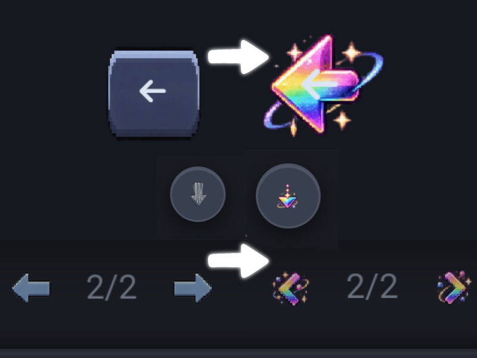

```css
/* Back */
[data-lab="back"] img {
  content: url("/api/images/6ac8975242880c652f051da0") !important;
  object-fit:contain!important;
}

/* Scroll Down */
[data-lab="scroll-down"] img {
  content: url("/api/images/6ac896f900c414e8e2a1bffd") !important;
  object-fit:contain!important;
  transform: none !important;
}

/* Previous Version */
[data-lab="swipe"][aria-label="Previous version"] img {
  content: url("/api/images/6ac896e875e1eb8796dcf891") !important;
  object-fit:contain!important;
  transform: none !important;
  filter:none!important;
}

/* Next Version */
[data-lab="swipe"][aria-label="Next version"] img {
  content: url("/api/images/6ac896dc75e1eb8796dcf708") !important;
  object-fit:contain!important;
  transform: none !important;
  filter:none!important;
}
```

**Customization:**
- `aria-label` = distinguishes previous and next message versions.
- `transform: none` = removes a pre-existing transformation on selected navigation images.
- Replace the sample URLs with your own.

---

---

### Custom Footer Button Icons

Replace the footer control icons for Web Search, Director Pass, Auto Mode, Review Mode, Scene Music, Visual Expressions, Dice Roll, HTML Mode, Time Skip, and Reply Options. 

```css
/* Web Search */
[data-lab="web-search"] img {
  content: url("/api/images/6ac89bb142880c652f05bb82") !important;
  object-fit: contain !important;
}

/* Director Pass */
[data-lab="director-pass"] img {
  content: url("/api/images/6ac89bbd00c414e8e2a263df") !important;
  object-fit: contain !important;
}

/* Auto Mode */
[data-lab="auto-mode"] img {
  content: url("/api/images/6ac89bc942880c652f05befd") !important;
  object-fit: contain !important;
}

/* Review Mode */
[data-lab="review-mode"] img {
  content: url("/api/images/6ac89bd5aab27ff458cf5f00") !important;
  object-fit: contain !important;
}

/* Scene Music */
[data-lab="scene-music"] img {
  content: url("/api/images/6ac89bffaab27ff458cf636e") !important;
  object-fit: contain !important;
}

/* Visual Expressions */
[data-lab="visual-expressions"] img {
  content: url("/api/images/6ac89c09d2d7799fdce54ff7") !important;
  object-fit: contain !important;
}

/* Dice Roll */
[data-lab="dice-roll"] img {
  content: url("/api/images/6ac89c1400c414e8e2a26e15") !important;
  object-fit: contain !important;
}

/* HTML Mode */
[data-lab="html-mode"] img {
  content: url("/api/images/6ac8a0a61a947bf5aa45143c") !important;
  object-fit: contain !important;
  filter: none !important;
}

/* Time Skip */
[data-lab="time-skip"] img {
  content: url("/api/images/6ac89bdf75e1eb8796dd8d1a") !important;
  object-fit: contain !important;
}

/* Reply Options / Reply Choices */
[data-lab="reply-options"] img {
  content: url("/api/images/6ac89bf3d2d7799fdce54db2") !important;
  object-fit: contain !important;
}
```

**Customization:**
- Each `data-lab` selector targets one footer button; remove rules for controls you don't want to change.
- `content: url(...)` = the uploaded replacement image for that button.
- `object-fit: contain` = keeps the image proportional within its existing icon box.
- `filter: none` = prevents inherited filters from changing HTML Mode's image colors.
- Replace the sample `/api/images/...` URLs with your own uploaded artwork.

---

---

### Icon Glow — Search Example

Give an icon a neon halo, using Search as the example. 

```css
[data-lab="header-action"][aria-label="Search this chat"] img {
  filter: drop-shadow(0 0 3px #ff79ca)
          drop-shadow(0 0 7px #ff79ca) !important;
}
```

**Customization:**
- Change `#ff79ca` to recolor both glow layers.
- Increase the blur radii for a softer, wider halo.

**Compatibility:** Other icon tint rules also set `filter`. Combine tint and glow in one `filter` declaration instead of applying separate competing rules.

---

---

### Rainbow Button Background — Search Example

Apply a stationary pastel rainbow to a button. Change the `aria-label` selector to target a different button. 

```css
[data-lab="header-action"][aria-label="Search this chat"] {
  background: linear-gradient(135deg,
    #ff7a9c 0%, #ffdc79 20%, #8ee8b3 40%,
    #7fdfff 60%, #b69cff 80%, #ff8bd3 100%) !important;
  border: 1px solid #ffe2f3 !important;
}
```

**Customization:**
- Edit the gradient stops to choose a different rainbow.
- Change `135deg` to turn the gradient.
- Adjust `border` for a stronger or subtler outline.

---

---

### Icon Hover Enlargement — Gallery Example

Enlarge an icon on hover. The Scene gallery selector below is one example; change the `aria-label` to target another header action.

```css
[data-lab="header-action"][aria-label="Scene gallery"] img {
  transition: transform .2s ease !important;
}
@media (hover: hover) {
  [data-lab="header-action"][aria-label="Scene gallery"]:hover img {
    transform: scale(1.35) !important;
  }
}
@media (prefers-reduced-motion: reduce) {
  [data-lab="header-action"][aria-label="Scene gallery"] img {
    transition: none !important;
  }
}
```

**Customization:**
- `scale(1.35)` determines the hover enlargement.
- `.2s` controls the transition speed.

---

---

### Animated Rainbow Button — Gallery Example

Cycle the colors of a rainbow button background, using Gallery as the example. 


```css
[data-lab="header-action"][aria-label="Scene gallery"] {
  background: conic-gradient(from 0deg,
    #ff7a9c, #ffdc79, #8ee8b3,
    #7fdfff, #b69cff, #ff8bd3, #ff7a9c) !important;
  background-size: 100% 100% !important;
  border: 1px solid #d5b8f5 !important;
  animation: lab-gallery-rainbow-spin 4s linear infinite !important;
}
@keyframes lab-gallery-rainbow-spin {
  0% { filter: hue-rotate(0deg); }
  100% { filter: hue-rotate(360deg); }
}
@media (prefers-reduced-motion: reduce) {
  [data-lab="header-action"][aria-label="Scene gallery"] {
    animation: none !important;
  }
}
```

**Customization:**
- `4s` sets the full color-cycle duration.
- Change the gradient colors to customize the palette.

**Note:** This confirmed method animates `filter` on the whole button, so the icon colors can shift too. A separate hover `filter: brightness(...)` rule can interrupt the hue-cycle while hovered; see the optional shared hover tutorial below.

---

---

### Multicolor Icon Glow — Bookmarks Example

Surround an icon with multicolor light on hover, using Bookmarks as the example. 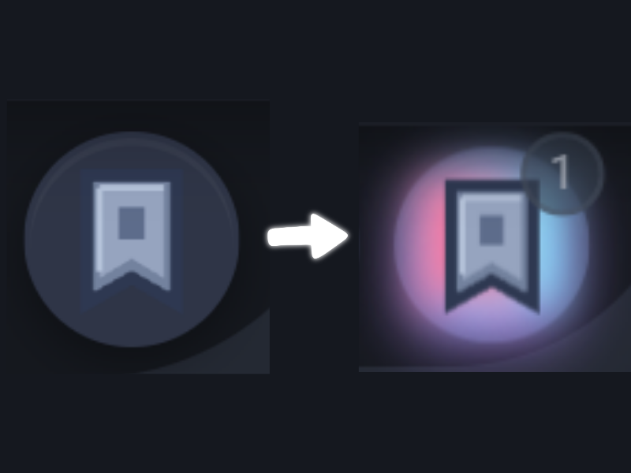

```css
[data-lab="header-action"][aria-label="Message bookmarks"] img {
  transition: filter .2s ease !important;
}
@media (hover: hover) {
  [data-lab="header-action"][aria-label="Message bookmarks"]:hover img {
    filter: drop-shadow(-3px 0 3px #ff6b9e)
            drop-shadow(3px 0 3px #75e8ff)
            drop-shadow(0 3px 4px #b78aff) !important;
  }
}
@media (prefers-reduced-motion: reduce) {
  [data-lab="header-action"][aria-label="Message bookmarks"] img {
    transition: none !important;
  }
}
```

**Customization:**
- The three hex values set the left, right, and lower glow colors.
- The shadow offsets determine where each color appears.

---

---

### Rotating Rainbow Button Border — Bookmarks Example

Build a rotating rainbow ring around a button while keeping its icon stationary, using Bookmarks as the example. 

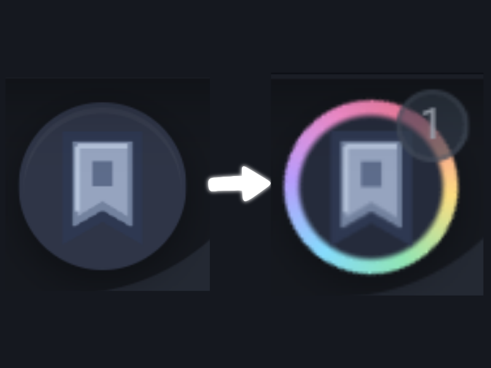

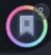

```css
[data-lab="header-action"][aria-label="Message bookmarks"] {
  position: relative !important;
  isolation: isolate !important;
  overflow: visible !important;
  background: #242b3c !important;
  border: 2px solid transparent !important;
  border-radius: 50% !important;
  animation: none !important;
}
[data-lab="header-action"][aria-label="Message bookmarks"]::before {
  content: "" !important;
  position: absolute !important;
  inset: -2px !important;
  border-radius: 50% !important;
  pointer-events: none !important;
  z-index: -1 !important;
  background: conic-gradient(
    #ff7a9c, #ffdc79, #8ee8b3,
    #7fdfff, #b69cff, #ff8bd3, #ff7a9c) !important;
  -webkit-mask: radial-gradient(farthest-side,
    transparent calc(100% - 3px), #000 calc(100% - 2px)) !important;
  mask: radial-gradient(farthest-side,
    transparent calc(100% - 3px), #000 calc(100% - 2px)) !important;
  animation: lab-bookmark-ring-spin 3s linear infinite !important;
}
@keyframes lab-bookmark-ring-spin {
  to { transform: rotate(360deg); }
}
@media (hover: hover) {
  [data-lab="header-action"][aria-label="Message bookmarks"]:hover::before {
    animation-play-state: paused !important;
  }
}
@media (prefers-reduced-motion: reduce) {
  [data-lab="header-action"][aria-label="Message bookmarks"]::before {
    animation: none !important;
  }
}
```

**Customization:**
- `3s` controls rotation speed.
- Change the conic-gradient colors for a different ring.
- The mask creates the narrow ring; its pixel values control thickness.

**Note:** The pseudo-element and its mask are both needed. Keep this tutorial together; replacing only the gradient will not reproduce the ring.

---

---

### Solid Button Border — Voice Call Example

Frame a button with a solid circular border, using Voice Call as the example. 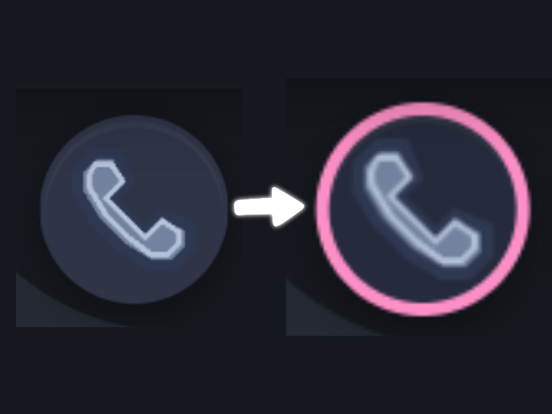

```css
[data-lab="header-action"][aria-label="Voice call"] {
  background: #242b3c !important;
  border: 2px solid #ff88c8 !important;
  border-radius: 50% !important;
}
```

**Customization:**
- `#242b3c` sets the inner fill.
- `#ff88c8` sets the outline color.
- `2px` sets the border thickness.

---

---

### Gradient Button Border — Fullscreen Example

Give a button a gradient border without filling its center with a gradient, using Fullscreen as the example. 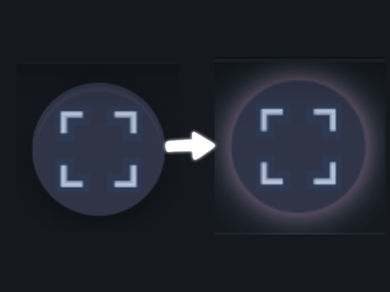

```css
[data-lab="header-action"][aria-label*="fullscreen" i] {
  border: 2px solid transparent !important;
  border-radius: 50% !important;
  background: linear-gradient(#242b3c, #242b3c) padding-box,
              linear-gradient(135deg, #ff89ca, #76e7ff) border-box !important;
}
```

**Customization:**
- Change the two `border-box` colors to alter the gradient.
- Change `#242b3c` in both positions to recolor the center.
- `135deg` controls the gradient direction.

---

---

### Pulsing Button Glow — Fullscreen Example

Add a gentle two-color pulse around a button, using Fullscreen as the example. 

```css
[data-lab="header-action"][aria-label*="fullscreen" i] {
  animation: lab-border-pulse 2.8s ease-in-out infinite !important;
}
@keyframes lab-border-pulse {
  0%, 100% {
    box-shadow: 0 0 3px #ff89ca55, 0 0 6px #76e7ff33;
  }
  50% {
    box-shadow: 0 0 8px #ff89caaa, 0 0 15px #76e7ff88;
  }
}
@media (prefers-reduced-motion: reduce) {
  [data-lab="header-action"][aria-label*="fullscreen" i] {
    animation: none !important;
  }
}
```

**Customization:**
- `2.8s` sets the pulse period.
- The two `box-shadow` colors set pink and cyan glows.

**Note:** Pairs with the Gradient Fullscreen Button Border tutorial; the border itself is not animated.

---

---

### Bobbing Icon Animation — Statistics Example

Give an icon a gentle floating motion, using Statistics as the example.

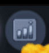

```css
[data-lab="header-action"][aria-label="Chat statistics & export"] img {
  animation: lab-icon-float 2.6s ease-in-out infinite !important;
}
@keyframes lab-icon-float {
  0%, 100% { transform: translateY(0); }
  50% { transform: translateY(-3px); }
}
@media (prefers-reduced-motion: reduce) {
  [data-lab="header-action"][aria-label="Chat statistics & export"] img {
    animation: none !important;
  }
}
```

**Customization:**
- `-3px` controls how far the icon rises.
- `2.6s` controls the motion speed.

---

---

### Button Hover Glow — Statistics Example

Outline a button only while hovered, using Statistics as the example. 


```css
[data-lab="header-action"][aria-label="Chat statistics & export"] {
  border: 2px solid transparent !important;
  border-radius: 50% !important;
  transition: border-color .2s ease, box-shadow .2s ease !important;
}
@media (hover: hover) {
  [data-lab="header-action"][aria-label="Chat statistics & export"]:hover {
    border-color: #8de8c0 !important;
    box-shadow: 0 0 9px #8de8c066 !important;
  }
}
@media (prefers-reduced-motion: reduce) {
  [data-lab="header-action"][aria-label="Chat statistics & export"] {
    transition: none !important;
  }
}
```

**Customization:**
- Change `#8de8c0` to recolor the mint border.
- `9px` adjusts glow spread.

---

---

### Shared Button Hover Brightness — Header Examples

Lighten selected header buttons when hovered.

```css
@media (hover: hover) {
  [data-lab="header-action"]:is(
    [aria-label="Voice call"],
    [aria-label*="fullscreen" i],
    [aria-label="Search this chat"],
    [aria-label="Scene gallery"]
  ):hover {
    filter: brightness(1.12) !important;
  }
}
```

**Customization:**
- `brightness(1.12)` controls the intensity.
- Remove a button label from `:is(...)` to exclude that control.

**Note:** Optional source rule. It sets `filter` on the Gallery button, the same property used by the Gallery hue-cycle animation; test their combined hover behavior before publishing them together.

---

---

### Button Keyboard Focus Outlines — Header Examples

Give keyboard users a visible pale-yellow outline on the main header actions.

```css
[data-lab="header-action"]:is(
  [aria-label="Voice call"],
  [aria-label*="fullscreen" i],
  [aria-label="Search this chat"],
  [aria-label="Scene gallery"],
  [aria-label="Chat statistics & export"],
  [aria-label="Message bookmarks"]
):focus-visible {
  outline: 2px solid #fff0a6 !important;
  outline-offset: 3px !important;
}
```

**Customization:**
- `#fff0a6` sets the focus-ring color.
- `outline-offset: 3px` adds breathing room around the button.

**Note:** This is keyboard focus, not a selected or toggled state. A screenshot may require navigating with Tab rather than clicking.

---

---

### Rainbow Icon Recoloring — Gallery Example


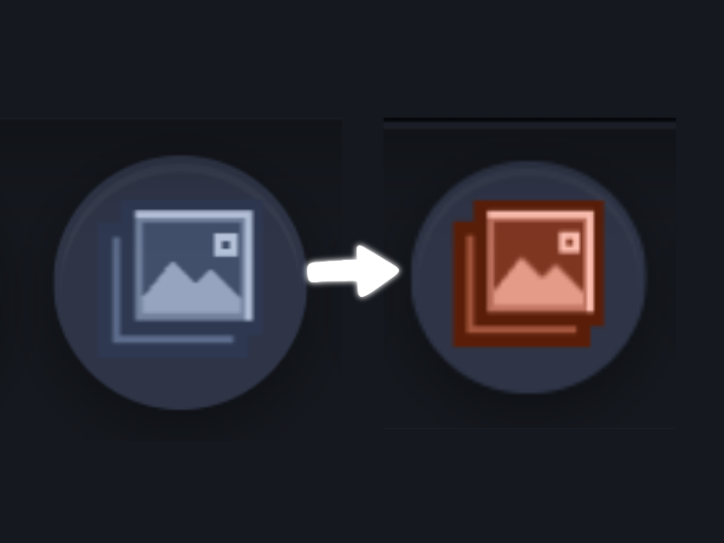
```css
/* Recolor the icon itself. */
[data-lab="header-action"][aria-label="Scene gallery"] img {
  filter: hue-rotate(145deg) saturate(1.8) contrast(1.2) !important;
}

/* Add this to the animated Gallery button tutorial above:
   its existing parent-button hue-rotate animation remains in place. */
```

**Customization:**
- `hue-rotate(145deg)` shifts the icon's colors before the button animation runs.
- `saturate(1.8)` strengthens the icon colors; `contrast(1.2)` sharpens their separation.
- The existing **Animated Rainbow Gallery Button** tutorial animates `filter: hue-rotate(...)` on the *parent button*. This icon filter is static on the child image; together they create the observed changing rainbow icon.


---

## Input Controls

### Message Action Buttons

`[data-lab="action"]` now targets the controls attached to individual messages, such as Bookmark, Edit, Delete, Branch, Regenerate, and More actions. It does **not** target the LoreBary 2.5 composer toolbar.

Use the shared selector for a consistent appearance:

```css
.lab-theme-scope [data-lab="action"] {
  color: #f6dfb5 !important;
  background: rgba(47, 36, 24, .92) !important;
  border: 1px solid rgba(184, 137, 79, .7) !important;
  border-radius: 999px !important;
}

.lab-theme-scope [data-lab="action"]:hover {
  color: #fff7dc !important;
  background: #76512f !important;
  border-color: #e8bf78 !important;
}
```

In LoreBary 2.5, Enhance, Continue, and Listen are no longer separate visible message buttons. They are inside the **More actions** menu:

```css
[role="menu"][aria-label="More actions"] {
  color: #f6dfb5 !important;
  background: #1d1710 !important;
  border: 1px solid #b8894f !important;
  border-radius: 12px !important;
  box-shadow: 0 12px 28px rgba(0, 0, 0, .5) !important;
}

[role="menu"][aria-label="More actions"] [role="menuitem"] {
  color: #d8c49d !important;
  background: transparent !important;
}

[role="menu"][aria-label="More actions"] [role="menuitem"]:hover,
[role="menu"][aria-label="More actions"] [role="menuitem"][aria-expanded="true"] {
  color: #fff7dc !important;
  background: rgba(118, 81, 47, .82) !important;
}
```

Enhance opens a second menu containing More details, More dialogue, and More action. That submenu currently has no unique `data-lab` or ARIA label, so avoid targeting its temporary utility classes. A broad `[role="menu"] [role="menuitem"]` rule will reach it, but may also affect other LoreBary menus.

---

### Composer Buttons

Style the four controls inside the message box without affecting the separate tool row below it.

```css
.lab-theme-scope :is(
  [data-lab="write"],
  [data-lab="guidance-toggle"],
  [data-lab="attach-image"],
  [data-lab="send"]
) {
  color: #f6dfb5 !important;
  background: #2f2418 !important;
  border: 1px solid rgba(184, 137, 79, .72) !important;
  border-radius: 999px !important;
  box-shadow: inset 0 1px 0 rgba(255, 255, 255, .12),
              0 3px 8px rgba(0, 0, 0, .3) !important;
}

.lab-theme-scope :is(
  [data-lab="write"],
  [data-lab="guidance-toggle"],
  [data-lab="attach-image"],
  [data-lab="send"]
):hover {
  color: #fff7dc !important;
  border-color: #e8bf78 !important;
  filter: brightness(1.12);
}
```

---

### Breathing Send Animation

Make the send button dim and brighten continuously like breathing. 

```css
@keyframes breathe {
  0%, 100% { opacity: 0.5; }
  50%      { opacity: 1; }
}

[data-lab="send"] {
  animation: breathe 2.5s ease infinite !important;
}
```

---

### Input Buttons Dim Until Hover

Dim the current LoreBary 2.5 composer and toolbar buttons until hover.

```css
.lab-theme-scope :is(
  [data-lab="write"],
  [data-lab="guidance-toggle"],
  [data-lab="attach-image"],
  [data-lab="send"],
  [data-lab="toolbar"] button
) {
  opacity: 0.4 !important;
  transition: opacity 0.2s !important;
}

.lab-theme-scope :is(
  [data-lab="write"],
  [data-lab="guidance-toggle"],
  [data-lab="attach-image"],
  [data-lab="send"],
  [data-lab="toolbar"] button
):hover,
.lab-theme-scope [data-lab="toolbar"] button[aria-pressed="true"],
.lab-theme-scope [data-lab="toolbar"] button[aria-expanded="true"] {
  opacity: 1 !important;
}
```

**Customization:**
- `opacity`: Set the dimness/brightness (1 = bright, 0.1 = dark)

---

### Input Buttons Coloring

Apply a custom color filter to the icons in both LoreBary 2.5 button rows.

```css
.lab-theme-scope :is(
  [data-lab="write"],
  [data-lab="guidance-toggle"],
  [data-lab="attach-image"],
  [data-lab="send"],
  [data-lab="toolbar"] button
) :is(img, svg) {
  filter: brightness(1) sepia(0) saturate(1) hue-rotate(170deg) brightness(1.2) !important;
  opacity: 1 !important;
}
```

---

### Coloring Menu Button

Apply custom color to the menu button. 

```css
img[data-lab="menu"] {
  filter: brightness(0.5) sepia(1) saturate(20) hue-rotate(165deg) brightness(0.9) !important;
  opacity: 1 !important;
}
```

**Customization:**
- `brightness`: 1 = dark, 99 = brightest
- `sepia`: 1 = default, 2 = sepia mode
- `saturate`: 0 = off, 99 = brightest shine
- `hue-rotate`: Adjusts the color

---

### Glowing Menu Button

Add a glowing effect to the menu button. 

```css
[data-lab="menu"] {
  filter: drop-shadow(0 0 8px rgba(255, 255, 255, 0.6)) !important;
}
```

**Customization:**
- `rgba()`: Set the glow color

---

### Individual Message Action Colors and Hover

Target the individual actions by their confirmed labels. Branch is present on character messages in the supplied sample but not on the user message.

```css
[data-lab="bubble"] [data-lab="action"][aria-label="Bookmark message"] { background: #ff79ca !important; }
[data-lab="bubble"] [data-lab="action"][aria-label="Edit message"] { background: #8deaff !important; }
[data-lab="bubble"] [data-lab="action"][aria-label="Delete message"] { background: #ffb36b !important; }
[data-lab="bubble"] [data-lab="action"][aria-label="Branch chat"] { background: #b49aff !important; }

[data-lab="bubble"] [data-lab="action"] {
  transition: transform .2s ease, box-shadow .2s ease, filter .2s ease !important;
}
@media (hover: hover) {
  [data-lab="bubble"] [data-lab="action"]:hover {
    transform: scale(1.2) !important;
    box-shadow: 0 0 10px #ff79ca !important;
    filter: brightness(1.3) !important;
  }
}
@media (prefers-reduced-motion: reduce) {
  [data-lab="bubble"] [data-lab="action"] { transition: none !important; }
}
```


---

---

### Custom Menu Button Icon

Replace the standard menu icon and the mobile More Chat Tools icon with your own artwork. 

```css
/* Menu */
img[data-lab="menu"] {
  content: url("/api/images/6ac8974542880c652f051b0e") !important;
  object-fit:contain!important;
}

/* Mobile More Chat Tools */
[data-lab="header-action"][aria-label="More chat tools"] img {
  content: url("/api/images/6ac8cbd875e1eb8796e3a987") !important;
  object-fit: contain !important;
  filter: none !important;
}
```

**Customization:**
- `content: url(...)` = your uploaded menu artwork.
- `object-fit: contain` = preserves the image proportions.
- The mobile **More Chat Tools** control is a separate button from the main menu; each can use different artwork.
- Replace the sample `/api/images/...` URLs with your own.

---

---

### Custom Input Button Icons

Replace the composer icons for Send, Stop, Write, Upload Image, Scene Notes, and Toolbar Toggle. 

```css
/* Send (excluding Stop) */
[data-lab="send"] img:not([src*="icon_stop"]) {
  content: url("/api/images/6ac8971700c414e8e2a1c37b") !important;
  object-fit:contain!important;
}

/* Stop */
[data-lab="send"] img[src*="icon_stop"],
[data-lab="stop"] img {
  content: url("/api/images/6ac8a09475e1eb8796de21e5") !important;
  object-fit:contain!important;
  filter:none!important;
}

/* Write */
[data-lab="write"] img {
  content: url("/api/images/6ac8970875e1eb8796dcfc4f") !important;
  object-fit:contain!important;
}

/* Upload Image */
[data-lab="attach-image"] img {
  content: url("/api/images/6ac89c2575e1eb8796dd935f") !important;
  object-fit:contain!important;
}

/* Scene Notes / Guidance */
[data-lab="guidance-toggle"] img {
  content: url("/api/images/6ac8967a1a947bf5aa43be05") !important;
  object-fit:contain!important;
}

/* Toolbar Toggle */
[data-lab="toolbar-toggle"] img {
  content: url("/api/images/6ac896b91a947bf5aa43c355") !important;
  object-fit:contain!important;
}
```

**Customization:**
- `data-lab` = identifies each composer control.
- The Send and Stop selectors are separated so their artwork can differ.
- `content: url(...)` = the image you uploaded.
- Replace the sample URLs with your own.

---

---

### Custom Draft Version Controls

Customize the separate draft-version navigation row, including its Previous, Next, Regenerate, and Keep Draft controls. This row uses `[data-lab="draft-versions"]` and is **not** the same as the normal message-version swipe controls. 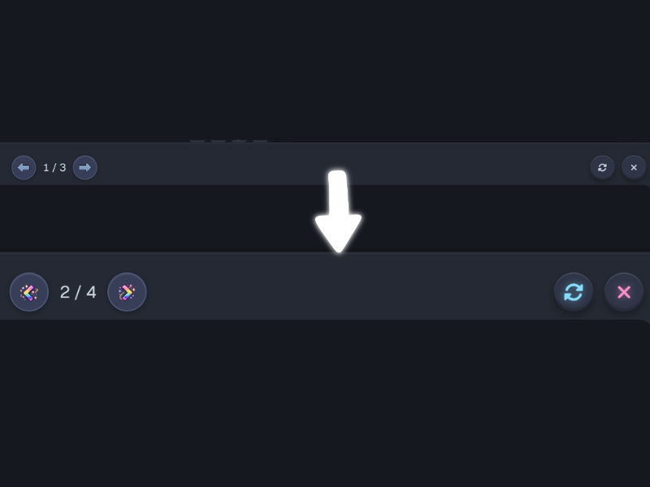

```css
/* Previous draft — use artwork facing left */
[data-lab="draft-versions"] button[aria-label="Previous draft version"] img {
  content: url("/api/images/6ac896e875e1eb8796dcf891") !important;
  object-fit: contain !important;
  transform: none !important;
  filter: none !important;
}

/* Next draft — use artwork facing right */
[data-lab="draft-versions"] button[aria-label="Next draft version"] img {
  content: url("/api/images/6ac896dc75e1eb8796dcf708") !important;
  object-fit: contain !important;
  transform: none !important;
  filter: none !important;
}

/* Regenerate draft — this is a Font Awesome <i>, not an  */
[data-lab="draft-versions"] button[aria-label="Regenerate draft versions"] i {
  color: #7fdfff !important;
  font-size: 14px !important;
  text-shadow: 0 0 5px #7fdfff88 !important;
}

/* Keep draft and close — also a Font Awesome <i> */
[data-lab="draft-versions"] button[aria-label="Keep draft and close versions"] i {
  color: #ff89ca !important;
  font-size: 14px !important;
  text-shadow: 0 0 5px #ff89ca88 !important;
}
```

**Customization:**
- `draft-versions` = limits changes to the draft-version controls, not ordinary message swipes or message regeneration.
- `Previous draft version` and `Next draft version` = separate buttons with their own images.
- `transform: none` = removes the default mirrored-arrow transformation; use correctly oriented replacement artwork.
- `Regenerate draft versions` and `Keep draft and close versions` = Font Awesome icons rendered with `<i>`, so `content: url(...)` image replacement is **not** used for them here.
- `color`, `font-size`, and `text-shadow` = recolor and emphasize those two icons without changing their symbols.

**Tip:** These controls belong to the draft-version row, not the regular message actions. Preview the example with draft versions visible before keeping it.

---

---

### Custom Message Action Icons

Desktop and mobile controls may use different images. For example, desktop Regenerate uses `/img/Icons/icon_regenerate.webp`, while mobile Regenerate uses `/img/pixel/msg-regenerate.webp` with a separate `/img/pixel/settings.webp` badge.

Replace the icons on individual chat messages, including Bookmark, Regenerate, Branch, Delete, Edit, and More Actions. 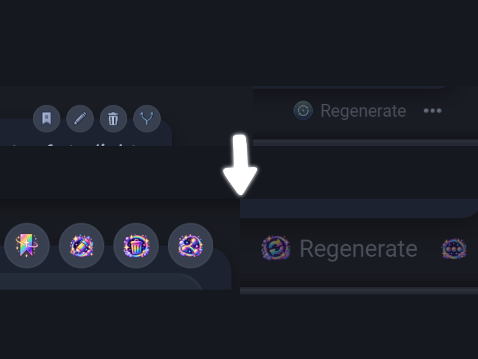

```css
/* Bookmark Message */
[data-lab="action"][aria-label="Bookmark message"] img {
  content: url("/api/images/6ac897231a947bf5aa43cf04") !important;
  object-fit:contain!important;
  filter:none!important;
}

/* Regenerate */
[data-lab="action"][aria-label="Regenerate"]
> span > img {
  content: url("/api/images/6ac8cba55a1227b9442bfe5a") !important;
  object-fit:contain!important;
  filter:none!important;
}

/* Branch Chat */
[data-lab="action"][aria-label="Branch chat"] img {
  content: url("/api/images/6ac8cbb442880c652f0bc31f") !important;
  object-fit:contain!important;
  filter:none!important;
}

/* Delete Message */
[data-lab="action"][aria-label="Delete message"] img {
  content: url("/api/images/6ac8cbc275e1eb8796e3a83d") !important;
  object-fit:contain!important;
  filter:none!important;
}

/* Edit Message */
[data-lab="action"][aria-label="Edit message"] img {
  content: url("/api/images/6ac8cbcf5a1227b9442c03e1") !important;
  object-fit:contain!important;
  filter:none!important;
}

/* More Actions */
[data-lab="action"][aria-label="More actions"] img {
  content: url("/api/images/6ac8cbd875e1eb8796e3a987") !important;
  object-fit:contain!important;
  filter:none!important;
}
```

**Customization:**
- `aria-label` = selects the message action to replace.
- The Regenerate selector targets the main image inside its button rather than other nested artwork.
- `filter: none` = preserves your image colors.
- Replace each sample image URL with your own.

---

---

### Managing Tinting, Filters, and Icon Replacements

A quick reference for choosing an approach.

| Goal | Use | Important distinction |
|---|---|---|
| Change the button's background | `background` / gradients on the button | Does not recolor the icon pixels |
| Tint the icon image | `filter` on `img` | Affects all visible image pixels together |
| Invert the icon | `invert()` on `img` | Reverses original colors, not a guaranteed target tint |
| Glow around icon artwork | `drop-shadow()` on `img` | Follows the image's visible silhouette |
| Rainbow-cycle icon and button together | `hue-rotate()` animation on the parent button | Also shifts the colors of rendered children |
| Replace the icon artwork entirely | `content: url(...)` on `img` | Covered in Phase 1; new artwork may respond differently to filters |

**Combining filters:** A single element has one computed `filter` property. Two matching CSS rules do **not** merge their filter functions automatically: the winning declaration replaces the other. For example, a tint and glow on the same icon must be combined:

```css
[data-lab="header-action"][aria-label="Search this chat"] img {
  filter: brightness(0) saturate(100%)
          invert(60%) sepia(75%) saturate(2500%)
          hue-rotate(290deg) brightness(105%)
          drop-shadow(0 0 3px #ff79ca)
          drop-shadow(0 0 7px #ff79ca) !important;
}
```

**Customization:**
- Put color-changing functions **before** `drop-shadow()` if you want to preserve the specified shadow color.
- If Phase 1 replaces an icon, test the filter again: the replacement image's starting colors affect the result.
- A multicolored image is not converted into a clean, independently controlled rainbow by `hue-rotate()` alone. True gradient-filled icon silhouettes generally require an asset-specific mask technique; our earlier icon-mask idea was **not validated**, so no working mask recipe is claimed here.


**Tip:** Combine icon replacement with filters and glow when you want a different finish without changing the surrounding button.

---

## Long-Press Menus — LoreBary 2.5

Several LoreBary 2.5 controls perform one action on a normal click and open settings when held. The settings panels may be rendered outside `.lab-theme-scope`, so target their dedicated root selectors directly.

### Menu and Dialog Selector Map Quick Reference

| Control | Menu or settings selector | Notes |
| --- | --- | --- |
| Write for me | `[data-lab="write-menu"]` | Inline menu with point of view, length, provider, and enhance instructions |
| Write for me choices | `[data-lab="write-option"]` | Uses `aria-checked="true"` for the selected choice |
| Scene notes panel | `[data-lab="input"] > div:has(#lab-scene-notes)` | Inline panel opened by Scene notes |
| Scene notes field | `#lab-scene-notes` | Hidden guidance textarea |
| Time skip | `[data-lab="time-skip-menu"]` | Dialog-style form |
| Time skip details | `[data-lab="time-skip-details"]` | Optional mood/location input |
| Time skip submit | `[data-lab="time-skip-submit"]` | Skip button |
| Dice roll | `[data-lab="dice-roll-menu"]` | Dialog-style form |
| HTML Mode | `[data-lab="html-settings"]` | Fixed settings dialog |
| Polish replies | `[data-lab="review-settings"]` | Fixed settings dialog |
| Scene music | `[data-lab="scene-music-settings"]` | Fixed settings dialog |
| Reply choices | `[data-lab="reply-settings"]` | Fixed settings dialog |
| Visual Expressions | `[role="dialog"][aria-label="Expression Studio"]` | Uses an accessible dialog label instead of `data-lab` |
| More actions | `[role="menu"][aria-label="More actions"]` | Contains Enhance, Continue, and Listen |
| Select dropdown | `[role="listbox"]` | Portaled menu used by settings fields |
| Select option | `[role="option"]` | Uses `aria-selected="true"` for the selected item |

Auto conversation, Director Pass, and Web Search are direct toggles and currently have no separate long-press settings panel.

The Bookmark hold menu exposes Quick bookmark and Manual bookmark, but its panel currently has no stable `data-lab`, role, or ARIA label. Style the Bookmark trigger through `[data-lab="action"][aria-label="Bookmark message"]`; avoid copying the menu's generated utility classes into a theme.

### Style the Write for Me Menu

```css
[data-lab="write-menu"] {
  color: #f6dfb5 !important;
  background: linear-gradient(
    135deg,
    rgba(47, 36, 24, .98),
    rgba(22, 17, 12, .98)
  ) !important;
  border: 1px solid rgba(184, 137, 79, .78) !important;
  border-radius: 14px !important;
  box-shadow: 0 12px 28px rgba(0, 0, 0, .48) !important;
}

[data-lab="write-menu"] [data-lab="write-option"] {
  color: #ead8b2 !important;
  background: transparent !important;
  border-radius: 9px !important;
}

[data-lab="write-menu"] [data-lab="write-option"]:hover,
[data-lab="write-menu"] [data-lab="write-option"][aria-checked="true"] {
  color: #fff7dc !important;
  background: rgba(118, 81, 47, .78) !important;
}
```

---

### Write Menu Heading Colors

Recolor the two section headings inside the Write menu. 

```css
[data-lab="write-menu"] > div:first-child
> div > div:first-child {
  color: #ffb4db !important;
}
[data-lab="write-menu"] > div:nth-child(2)
> div > div:first-child {
  color: #84dff0 !important;
}
```

**Customization:**
- `color` changes each heading independently.

**Tip:** These selectors depend on the menu’s child order and may need updating if the layout changes.

---

---

### Write Menu Actions and Help Text


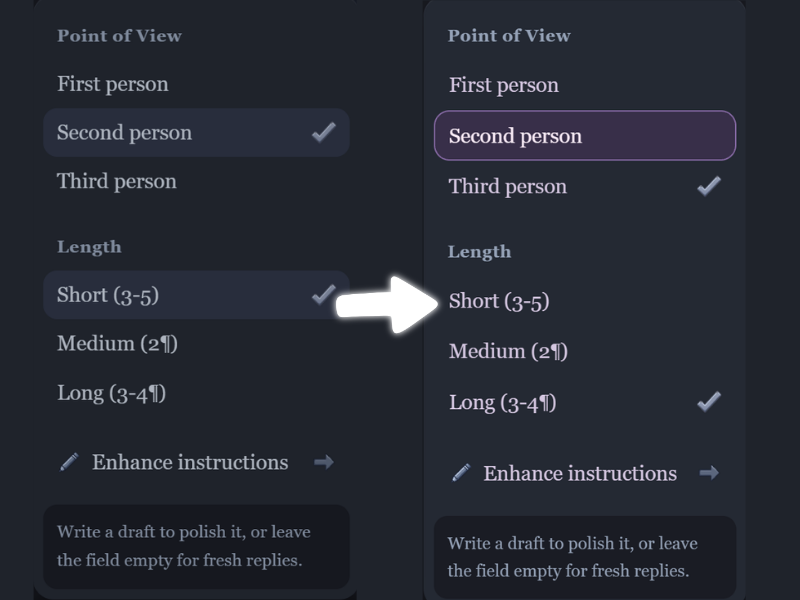
Recolor menu action rows and the information area at the bottom of the Write menu. 

```css
[data-lab="write-menu"] [data-lab="write-option"] {
  color: #f1d9ec !important;
}
[data-lab="write-menu"] [data-lab="write-option"]:hover {
  background: #3c3050 !important;
  border-color: #b88ddd !important;
}
[data-lab="write-menu"] > div:last-child {
  background: #141b2c !important;
  border: 1px solid #645477 !important;
  border-radius: 10px !important;
  color: #b9b7d0 !important;
}
```

**Customization:** `[data-lab="write-option"]` targets the menu options. The help-text area uses a structural selector.

---

### Write Menu Selected, Unselected, and Keyboard-Focus States


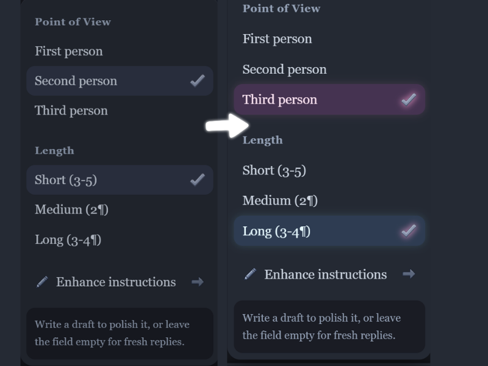
Use the tested `aria-checked` state to distinguish the active choice from inactive choices. Keyboard focus remains independently visible.

```css
[data-lab="write-menu"] [data-lab="write-option"][aria-checked="true"] {
  background: #ff79ca !important;
  color: #211b31 !important;
  outline: 2px solid #8deaff !important;
  outline-offset: -2px !important;
  border-radius: 8px !important;
}
[data-lab="write-menu"] [data-lab="write-option"][aria-checked="false"] {
  opacity: .65 !important;
}
[data-lab="write-menu"] [data-lab="write-option"]:focus-visible {
  outline: 2px solid #8deaff !important;
  outline-offset: 2px !important;
}
```

**Customization:** `aria-checked="true"` styles the selected option, while `aria-checked="false"` styles the others. `:focus-visible` adds keyboard feedback. Use this in place of the earlier selected-state example if the colors conflict.

---

---

### Custom Write Menu Action Icons

Replace the Write menu pencil and arrow icons with uploaded artwork. 

```css
[data-lab="write-menu"]
[data-lab="write-option"]
img[src*="/pixel/pencil.webp"] {
  content: url("/api/images/6ac8cbcf5a1227b9442c03e1") !important;
  object-fit: contain !important;
  filter: none !important;
}
[data-lab="write-menu"]
[data-lab="write-option"]
img[src*="/pixel/arrow-right-v2.webp"] {
  content: url("/api/images/6ac896dc75e1eb8796dcf708") !important;
  object-fit: contain !important;
  transform: none !important;
  filter: none !important;
}
```

**Customization:**
- `content: url(...)` sets the replacement artwork.
- `object-fit: contain` maintains image proportions.
- `filter: none` prevents existing filters from recoloring the images.
- `transform: none` removes the arrow image’s inherited transform.

**2.5 selector note:** The updated guide uses `[data-lab="write-menu"]` and `[data-lab="write-option"]` for the Write for Me menu. Verify any older icon-specific selectors against the current menu.

---


### Style Long-Press Settings Dialogs

This grouped rule keeps every new settings panel visually consistent. Remove any selector from `:is()` when that panel should keep LoreBary's default design.

```css
:is(
  [data-lab="input"] > div:has(#lab-scene-notes),
  [data-lab="time-skip-menu"],
  [data-lab="dice-roll-menu"],
  [data-lab="html-settings"],
  [data-lab="review-settings"],
  [data-lab="scene-music-settings"],
  [data-lab="reply-settings"],
  [role="dialog"][aria-label="Expression Studio"]
) {
  color: #f6dfb5 !important;
  background: linear-gradient(
    145deg,
    rgba(47, 36, 24, .99),
    rgba(20, 16, 12, .99)
  ) !important;
  border: 1px solid #b8894f !important;
  border-radius: 16px !important;
  box-shadow: 0 18px 44px rgba(0, 0, 0, .58) !important;
}

:is(
  [data-lab="input"] > div:has(#lab-scene-notes),
  [data-lab="time-skip-menu"],
  [data-lab="dice-roll-menu"],
  [data-lab="html-settings"],
  [data-lab="review-settings"],
  [data-lab="scene-music-settings"],
  [data-lab="reply-settings"]
) :is(input, textarea) {
  color: #fff1cf !important;
  caret-color: #e8bf78 !important;
  background: rgba(18, 14, 10, .9) !important;
  border: 1px solid rgba(184, 137, 79, .62) !important;
}

:is(
  [data-lab="input"] > div:has(#lab-scene-notes),
  [data-lab="time-skip-menu"],
  [data-lab="dice-roll-menu"],
  [data-lab="html-settings"],
  [data-lab="review-settings"],
  [data-lab="scene-music-settings"],
  [data-lab="reply-settings"]
) :is(input, textarea)::placeholder {
  color: #9f8d72 !important;
  opacity: 1 !important;
}
```

The Save, Skip, toggle, slider, and close controls remain functional because these examples change presentation only.

---

### Style Dropdowns Inside Settings

Prompt mode, sound choice, time choice, and similar dropdowns are portaled to the document body. Style them through their ARIA roles rather than unstable utility classes.

```css
[role="listbox"] {
  color: #f6dfb5 !important;
  background: #1d1710 !important;
  border: 1px solid #b8894f !important;
  border-radius: 12px !important;
  box-shadow: 0 12px 28px rgba(0, 0, 0, .5) !important;
}

[role="listbox"] [role="option"] {
  color: #d8c49d !important;
  background: transparent !important;
}

[role="listbox"] [role="option"]:hover,
[role="listbox"] [role="option"][aria-selected="true"] {
  color: #fff7dc !important;
  background: rgba(118, 81, 47, .82) !important;
}
```

Use `[aria-selected="true"]`, `[aria-checked="true"]`, `[aria-pressed="true"]`, and `[aria-expanded="true"]` to style selected choices, enabled tools, and open menus without relying on temporary CSS class names.

---

### Custom Scene Notes Window

Change the Scene Notes window background, outline, corners, and shadow. 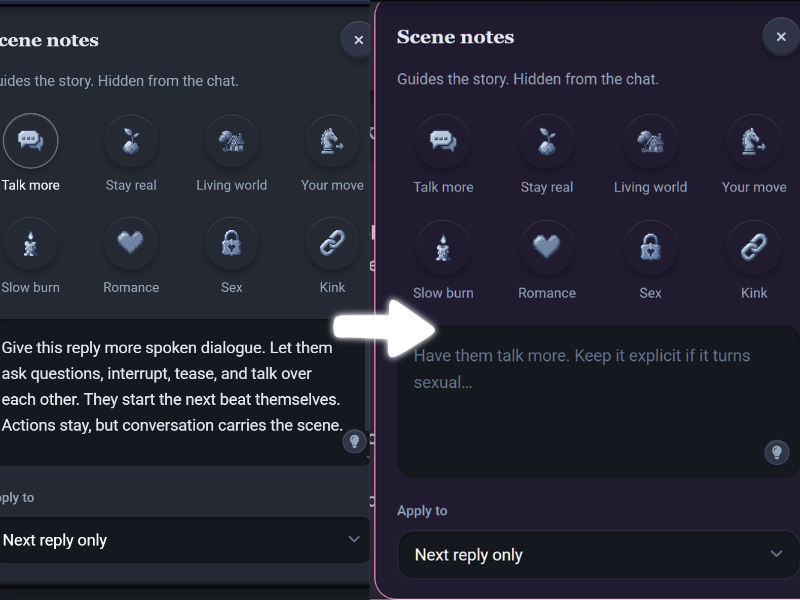

```css
[data-lab="input"] > div:has(#lab-scene-notes) {
  background: #211b31 !important;
  border: 1px solid #ee8ec9 !important;
  border-radius: 16px !important;
  box-shadow: 0 0 14px #ed83c32b, 0 12px 32px #00000080 !important;
}
```

**Customization:** The verified Scene Notes panel selector replaces the older label-wrapper traversal. Change `background`, `border`, `border-radius`, and `box-shadow` to customize the window.

---

---

### Scene Notes Title and Close Button


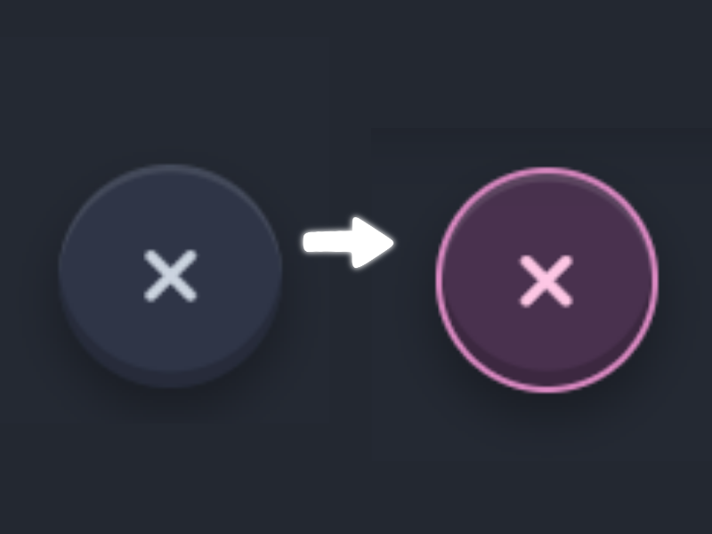
Recolor the Scene Notes title and close button.

```css
[data-lab="input"] > div:has(#lab-scene-notes)
label[for="lab-scene-notes"] {
  color: #ffd5ec !important;
  text-shadow: 0 0 7px #f98ac566 !important;
}
[data-lab="input"] > div:has(#lab-scene-notes)
label[for="lab-scene-notes"] + button {
  background: #49304f !important;
  color: #ffc5e6 !important;
  border: 1px solid #dc85c3 !important;
}
```

**Customization:** Style the Scene Notes heading and its close button independently. The close button follows the heading in the current panel layout and also has `aria-label="Close scene notes"`.

---

---

### Scene Notes Template Colors

Assign different accent colors to the eight Scene Notes templates and their icon frames. 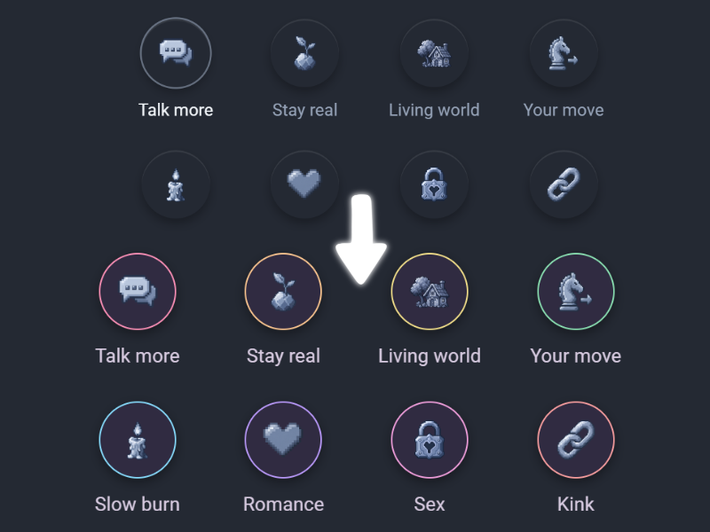

```css
[aria-label="Scene note templates"]
button {
  color: #d8cbe2 !important;
}
[aria-label="Scene note templates"]
button > span:first-child {
  background: #302b42 !important;
  border: 1px solid #7f719d !important;
  box-shadow: 0 2px 6px #0006 !important;
}
[aria-label="Select Talk more template"] {
  --note-color: #ff89b7;
}
[aria-label="Select Stay real template"] {
  --note-color: #ffc38b;
}
[aria-label="Select Living world template"] {
  --note-color: #f6df83;
}
[aria-label="Select Your move template"] {
  --note-color: #88e5b1;
}
[aria-label="Select Slow burn template"] {
  --note-color: #80dfff;
}
[aria-label="Select Romance template"] {
  --note-color: #b99aff;
}
[aria-label="Select Sex template"] {
  --note-color: #f39bdf;
}
[aria-label="Select Kink template"] {
  --note-color: #ff9a9f;
}
[aria-label="Scene note templates"]
button > span:first-child {
  border-color: var(--note-color, #7f719d) !important;
}
```

**Customization:**
- `--note-color` is the accent color assigned to each template.
- `button > span:first-child` styles the template icon frame.
- Change individual hex values to build your own palette.

---

---

### Scene Notes Selected and Hover Effects

Give the selected Scene Notes template a clearly visible pink glow and a slight enlargement, with a separate hover highlight for other templates. 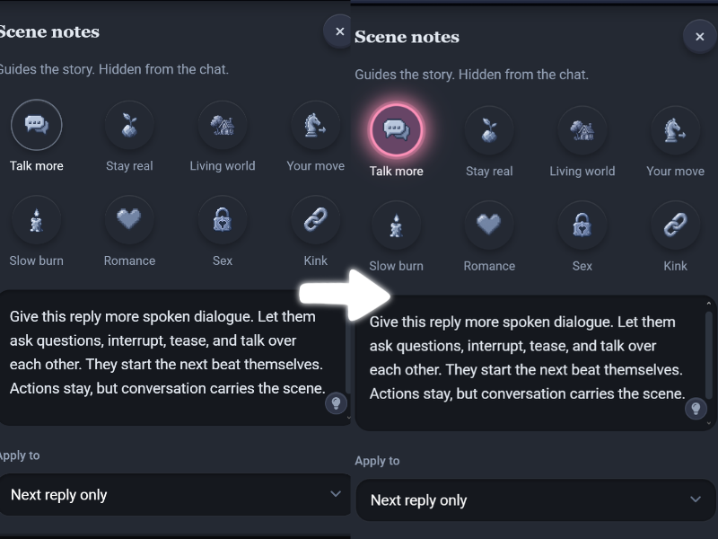

```css
/* Selected template — confirmed working */
[aria-label="Scene note templates"]
button[aria-pressed="true"] > span:first-child {
  background: #674467 !important;
  border: 2px solid #ff89b7 !important;
  box-shadow:
    0 0 0 2px #ff89b755,
    0 0 12px 4px #ff89b7aa,
    0 0 22px #ff89b766 !important;
  transform: scale(1.08) !important;
}

/* Hover over templates that are not selected */
@media (hover: hover) {
  [aria-label="Scene note templates"]
  button:not([aria-pressed="true"]):hover > span:first-child {
    background: #3a304d !important;
    box-shadow: 0 0 9px var(--note-color, #ff89b7) !important;
  }
}
```

**Customization:**
- `[aria-pressed="true"]` identifies the selected template.
- `#674467` sets the selected icon circle's background; `#ff89b7` is the selected border color.
- The three `box-shadow` layers create a visible pink ring and glow. Reduce their blur, spread, or opacity for a softer effect.
- `scale(1.08)` enlarges the selected circle slightly; use `scale(1)` to remove the enlargement.
- The hover rule uses each template's `--note-color` when **Scene Notes Template Colors** is also installed, with pink as a fallback.
- `:not([aria-pressed="true"])` keeps hover styling from overriding the selected appearance.

**Tip:** The hover adjustment keeps the selected glow visible while the pointer is over a template.

---

---

### Scene Notes Text Box Colors and Focus

Customize the Scene Notes text area, placeholder, and focused appearance. 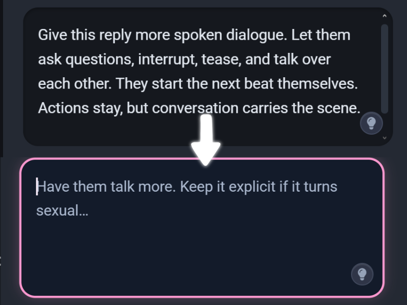

```css
[data-lab="input"] #lab-scene-notes {
  background: #121b2b !important;
  color: #f3e7f6 !important;
  border: 1px solid #6bcde5 !important;
  border-radius: 12px !important;
  box-shadow: inset 0 2px 6px #0007 !important;
}
[data-lab="input"] #lab-scene-notes::placeholder {
  color: #a9b8ce !important;
}
[data-lab="input"] #lab-scene-notes:focus-visible {
  outline: 2px solid #ff92d0 !important;
  outline-offset: 2px !important;
}
```

**Customization:**
- `background` and `color` set the editor colors.
- `::placeholder` styles the hint text.
- `:focus-visible` shows the focus outline when the browser determines a visible focus indicator is needed.

---

---

### Scene Notes Additional Buttons


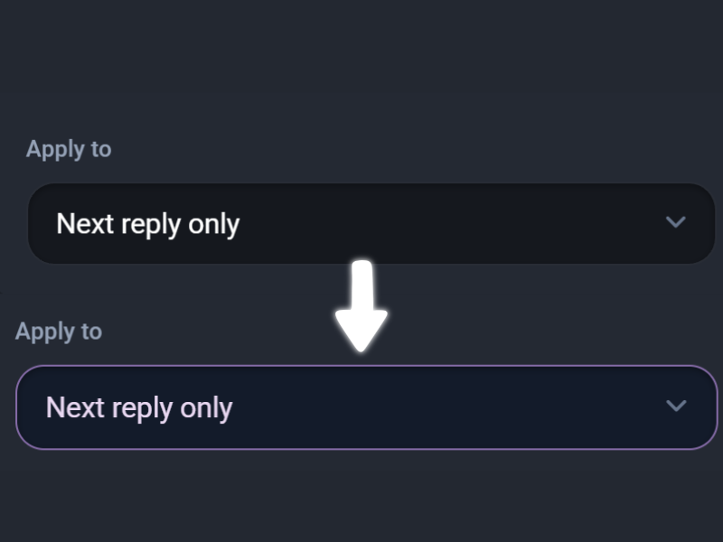
Recolor the saved-template button and the Apply To control, including its hover state. 

```css
[data-lab="input"] > div:has(#lab-scene-notes)
button[aria-label="Open saved scene note templates"] {
  background: #453457 !important;
  border: 1px solid #c49bff !important;
  color: #f0cfff !important;
  border-radius: 50% !important;
}
@media (hover: hover) {
  [data-lab="input"] > div:has(#lab-scene-notes)
  button[aria-label="Open saved scene note templates"]:hover {
    background: #674467 !important;
  }
}
/* Apply To dropdown: inspected structure, verified live */
[data-lab="input"] > div:has(#lab-scene-notes)
div:has(> #lab-scene-notes) ~ div button {
  background: #121b2b !important;
  border: 1px solid #846aa9 !important;
  color: #e8d7f2 !important;
  border-radius: 12px !important;
}
```

**Customization:** Use the lightbulb button selector to style its appearance. The Apply To dropdown uses a structural selector in this example; its `aria-label="Apply to"` can also be used for more direct targeting.

---

---

### Scene Notes Keyboard Focus

Give Scene Notes controls a visible keyboard-focus outline.

```css
[aria-label="Scene note templates"] button:focus-visible,
[data-lab="input"] > div:has(#lab-scene-notes) button[aria-label="Apply to"]:focus-visible,
[data-lab="input"] > div:has(#lab-scene-notes) button[aria-label="Close scene notes"]:focus-visible {
  outline: 2px solid #ff92d0 !important;
  outline-offset: 2px !important;
}
```

**Customization:**
- `focus-visible` shows the outline during keyboard navigation.
- `outline-offset` creates space between the outline and control.

---

---

### Custom Scene Notes Template Icons

The eight native template icons are `scene-talk-more.webp`, `scene-stay-real.webp`, `scene-living-world.webp`, `scene-your-move.webp`, `scene-slow-burn.webp`, `scene-romance.webp`, `scene-intimacy.webp` (Sex), and `scene-kink.webp`, all under `/img/pixel/`.

Replace the artwork for all eight Scene Notes templates. 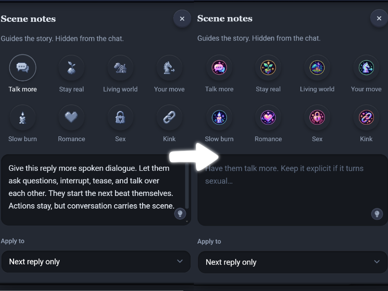

```css
[aria-label="Select Talk more template"] img {
  content: url("/api/images/6ac933d9774248b6e840f548") !important;
  object-fit: contain !important;
}
[aria-label="Select Stay real template"] img {
  content: url("/api/images/6ac933bc774248b6e840f1a4") !important;
  object-fit: contain !important;
}
[aria-label="Select Living world template"] img {
  content: url("/api/images/6ac9337f71408e65b12b8235") !important;
  object-fit: contain !important;
}
[aria-label="Select Your move template"] img {
  content: url("/api/images/6ac9339a774248b6e840ec7c") !important;
  object-fit: contain !important;
}
[aria-label="Select Slow burn template"] img {
  content: url("/api/images/6ac933e874200038737ef983") !important;
  object-fit: contain !important;
}
[aria-label="Select Romance template"] img {
  content: url("/api/images/6ac933a88825371476f13213") !important;
  object-fit: contain !important;
}
[aria-label="Select Sex template"] img {
  content: url("/api/images/6ac93403041fbd15cfcc8e14") !important;
  object-fit: contain !important;
}
[aria-label="Select Kink template"] img {
  content: url("/api/images/6ac933f742849615a40a8ab3") !important;
  object-fit: contain !important;
}
```

**Customization:**
- Each `aria-label` selects one template.
- `content: url(...)` replaces its icon.
- Replace each `/api/images/...` address with your own uploaded image URL.

---

## Search and Bookmarks

### Search & Bookmarks Panel Background

Change the main background, side border, and shadow of the shared Search and Bookmarks panel. 

```css
:is([data-lab="search-panel"], [data-lab="bookmarks-panel"]) {
  background: #171b2b !important;
  border-left: 2px solid #73d9ff !important;
  box-shadow: -8px 0 24px #0009, inset 2px 0 0 #ff7ecb55 !important;
}
```

**Customization:** `background`, `border-left`, and `box-shadow` style both panels. Both panel hooks were verified in the live tester.

---

---

### Search & Bookmarks Header Styling

Customize the panel header background, divider, and shadow. 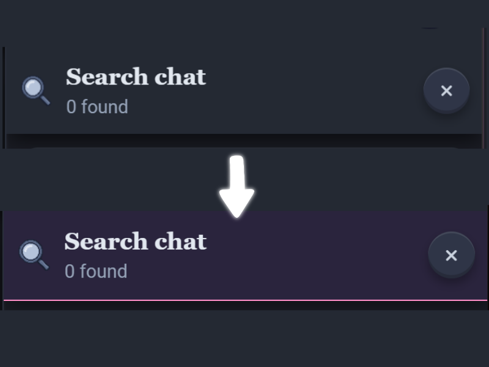

```css
:is([data-lab="search-panel"], [data-lab="bookmarks-panel"]) .surface-header {
  background: #29243e !important;
  border-bottom: 1px solid #ff88c7 !important;
  box-shadow: 0 4px 12px #0006 !important;
}
```

**Customization:** Change the header `background`, divider, and `box-shadow`. The `.surface-header` class was verified in both panels.

---

---

### Search & Bookmarks Title and Description

Recolor the panel heading and its supporting description. 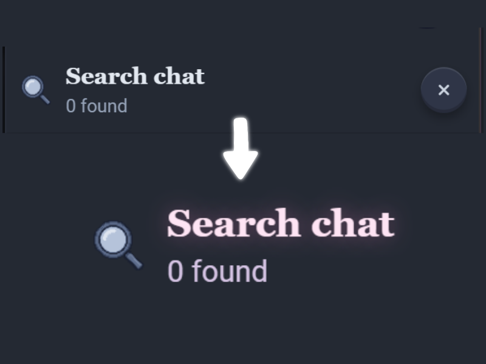

```css
:is([data-lab="search-panel"], [data-lab="bookmarks-panel"]) .surface-header h3 {
  color: #ffe3f4 !important;
  text-shadow: 0 0 8px #ff7fc866 !important;
}
:is([data-lab="search-panel"], [data-lab="bookmarks-panel"]) .surface-header p {
  color: #d7c5e7 !important;
}
```

**Customization:** `h3` targets the title; `p` targets the supporting description. Both were verified.

---

---

### Search & Bookmarks Header Icon Glow

Resize and glow the pixel-art icons in both panel headers.

```css
:is([data-lab="search-panel"], [data-lab="bookmarks-panel"]) .surface-header img {
  width: 28px !important;
  height: 28px !important;
  object-fit: contain !important;
  image-rendering: pixelated !important;
  filter: drop-shadow(0 0 5px #ff79ca) !important;
  transition: transform .2s ease !important;
}
@media (hover: hover) {
  :is([data-lab="search-panel"], [data-lab="bookmarks-panel"]) .surface-header img:hover {
    transform: scale(1.2) !important;
  }
}
```

**Tip:** This glow affects the header icons, not the search-field magnifying glass or empty-state illustration.

---

---

### Custom Search & Bookmarks Header Icons

Replace the large artwork beside the **Search chat** and **Bookmarks** titles. These are the **panel header icons**, not the smaller icons inside the Messages and Marked tabs. 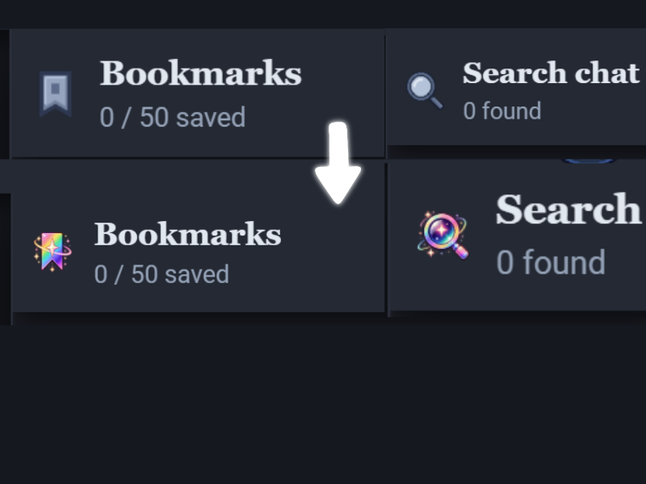

```css
/* Search panel — header icon artwork */
[data-lab="search-panel"] .surface-header img {
  content: url("/api/images/6ac897301a947bf5aa43d1c8") !important;
  object-fit: contain !important;
  filter: none !important;
}

/* Bookmarks panel — header icon artwork */
[data-lab="bookmarks-panel"] .surface-header img {
  content: url("/api/images/6ac897231a947bf5aa43cf04") !important;
  object-fit: contain !important;
  filter: none !important;
}
```

**Customization:** Replace the sample image URLs with your own artwork. The `.surface-header img` selector changes panel header icons; [Custom Bookmarks Tab Icons](#custom-bookmarks-tab-icons) changes the Messages and Marked tab images. For glow effects, see [Search & Bookmarks Header Icon Glow](#search--bookmarks-header-icon-glow).

---

---

### Custom Search Bar Colors

Style the search field, typed text, cursor, placeholder, and search icon. 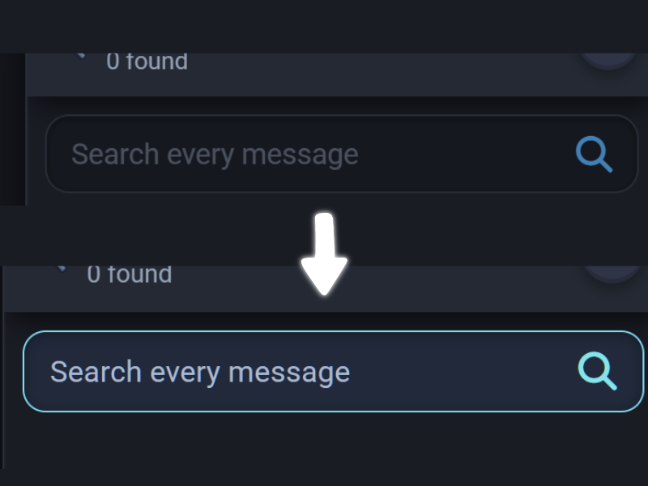

```css
.header-search:has(
  .header-search-input:is(
    [aria-label="Search this chat"],
    [aria-label="Search marked text"]
  )
) {
  background: #202a3b !important;
  border: 1px solid #79d9ef !important;
  border-radius: 10px !important;
  box-shadow: inset 0 1px 5px #0005 !important;
}
.header-search-input:is(
    [aria-label="Search this chat"],
    [aria-label="Search marked text"]
  ) {
  background: transparent !important;
  border: none !important;
  box-shadow: none !important;
  outline: none !important;
  color: #f1eaff !important;
  caret-color: #ff8dd3 !important;
}
.header-search-input:is(
    [aria-label="Search this chat"],
    [aria-label="Search marked text"]
  )::placeholder {
  color: #a9bdd5 !important;
  opacity: 1 !important;
}
.header-search:has(
  .header-search-input:is(
    [aria-label="Search this chat"],
    [aria-label="Search marked text"]
  )
) > i.fa-search {
  color: #82e5ed !important;
  filter: drop-shadow(0 0 5px #82e5ed) !important;
}
```

**Customization:** The outer `.header-search` wrapper controls the full visible box, including the icon area. The input controls typed text, caret, and placeholder; `> i.fa-search` controls the magnifying glass. Both search variants were verified by their distinct ARIA labels. For placeholder styling, the tested `::placeholder` selector also supports `font-style: italic` and `letter-spacing: .4px` alongside `color` and `opacity`; add those declarations if desired.

---

---

### Search Bar Focus Effect

Highlight the search field when someone clicks or tabs into it.

```css
.header-search:has(
  .header-search-input:is(
    [aria-label="Search this chat"],
    [aria-label="Search marked text"]
  ):focus-visible
) {
  outline: 2px solid #ff92d5 !important;
  outline-offset: 2px !important;
  box-shadow: 0 0 10px #ff92d555 !important;
}
```

**Customization:** Keyboard focus on either input highlights the entire outer search box. Verified in both Search and Bookmarks.

---

---

### Bookmarks Tab Bar Background

Customize the container behind the Messages and Marks tabs.

```css
[data-lab="bookmarks-panel"] [role="tablist"] {
  background: #121b2c !important;
  border: 1px solid #6a83a6 !important;
  border-radius: 12px !important;
}
```

**Customization:**
- `background` changes the tab-bar backdrop.
- `border` defines its outline.

---

---

### Bookmarks Tab Colors


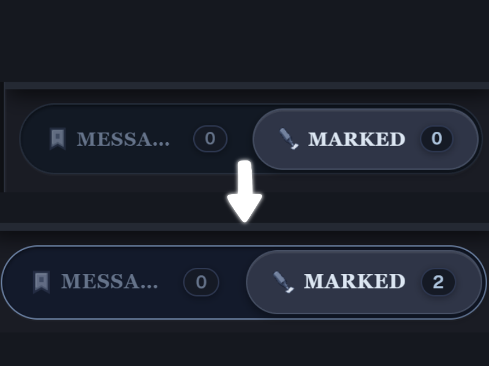
Set the normal appearance of the Messages and Marks tabs.

```css
[data-lab="bookmarks-panel"] [role="tab"] {
  color: #b5c4db !important;
  border: 1px solid transparent !important;
  border-radius: 9px !important;
  background: transparent !important;
}
```

**Customization:**
- `color` changes the tab labels.
- `background` controls the unselected fill.
- `[role="tab"]` applies the same rule to both Messages and Marked tabs.

---

---

### Selected Bookmarks Tab Styling


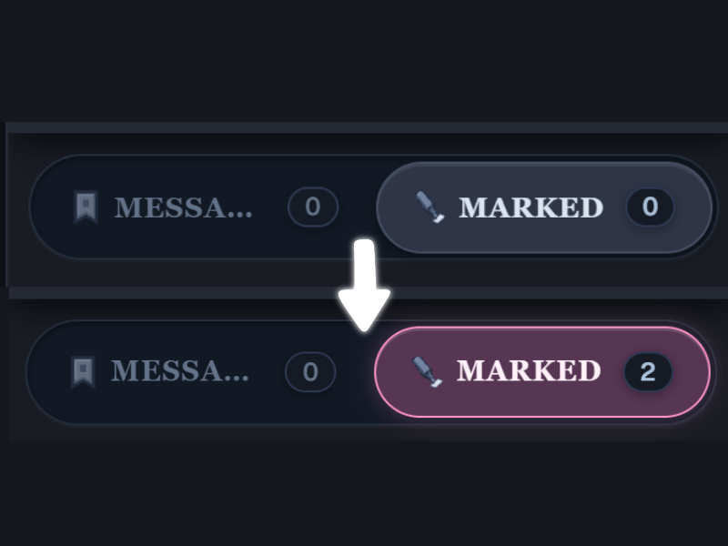
Give the active Messages or Marks tab its own color, border, and glow.

```css
[data-lab="bookmarks-panel"] [role="tab"][aria-selected="true"] {
  color: #fff0f8 !important;
  background: #563454 !important;
  border-color: #ff8dc8 !important;
  box-shadow: inset 0 1px 0 #ffffff24, 0 0 9px #ff8dc844 !important;
}
```

**Customization:**
- `[aria-selected="true"]` targets whichever tab is currently active.
- `background` and `border-color` identify the active tab.
- `box-shadow` adds a subtle highlight and glow.

---

---

### Bookmarks Tab Hover and Keyboard Focus

Add separate visual feedback for mouse hover and keyboard navigation.

```css
@media (hover: hover) {
  [data-lab="bookmarks-panel"] [role="tab"]:hover {
    color: #fff0f8 !important;
    border-color: #a4a4eb !important;
  }
}
[data-lab="bookmarks-panel"] [role="tab"]:focus-visible {
  outline: 2px solid #8be8ed !important;
  outline-offset: 2px !important;
}
```

**Customization:**
- `@media (hover: hover)` limits hover styling to hover-capable devices.
- `:focus-visible` highlights keyboard focus.
- `outline-offset` adds breathing room around the focus outline.

---

---

### Bookmarks Tab Counters

Style the number badges independently of their tabs. The selected counter follows the active tab.

```css
[data-lab="bookmarks-panel"] [role="tab"] > span:last-child {
  background: #211b31 !important;
  color: #ff79ca !important;
  border: 1px solid #8deaff !important;
  border-radius: 999px !important;
  box-shadow: 0 0 8px #ff79ca66 !important;
}
[data-lab="bookmarks-panel"] [role="tab"][aria-selected="true"] > span:last-child {
  background: #ff79ca !important;
  color: #211b31 !important;
  border-color: #ff79ca !important;
  box-shadow: 0 0 10px #ff79ca88 !important;
}
```

**Tip:** The final direct `span` inside each tab is its counter.

---

---

### Bookmarks Empty-State Text

Recolor the message shown when the Bookmarks list has no saved entries.

```css
#lab-bookmarks-list > div:has(> p + p) {
  background: #171b2b !important;
  border: 2px dashed #8deaff !important;
  border-radius: 12px !important;
  padding: 16px !important;
}
#lab-bookmarks-list > div:has(> p + p) > p:first-of-type {
  color: #f3dcf4 !important;
  font-weight: 800 !important;
}
#lab-bookmarks-list > div:has(> p + p) > p:nth-of-type(2) {
  color: #b8c5dc !important;
}
```

**Customization:** These selectors style the empty-state content box and its two text lines rather than the whole panel. They depend on the empty-state HTML structure, so check them if the interface changes.

---

---

### Custom Search Empty-State Illustration

Replace the Search view’s default Bary illustration with uploaded artwork. 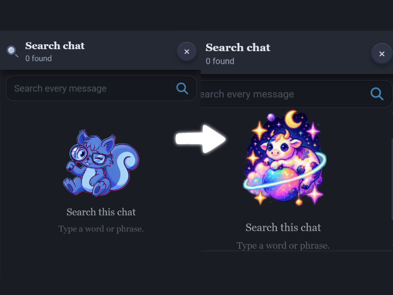

```css
[data-lab="bookmarks-panel"] img[src*="bary_search.webp"] {
  content: url("/api/images/6ac899a700c414e8e2a21d73") !important;
  width: 112px !important;
  height: 138px !important;
  object-fit: contain !important;
  filter: none !important;
}
```

**Customization:**
- `img[src*="bary_search.webp"]` selects the Search illustration.
- `content: url(...)` replaces the image.
- `width` and `height` control its display box.
- `object-fit: contain` preserves the replacement proportions.

**Tip:** The Search empty-state illustration lives inside the shared `bookmarks-panel` wrapper. Its native image is `/img/bary/bary_search.webp`.

---

---

### Search & Bookmarks Close Button


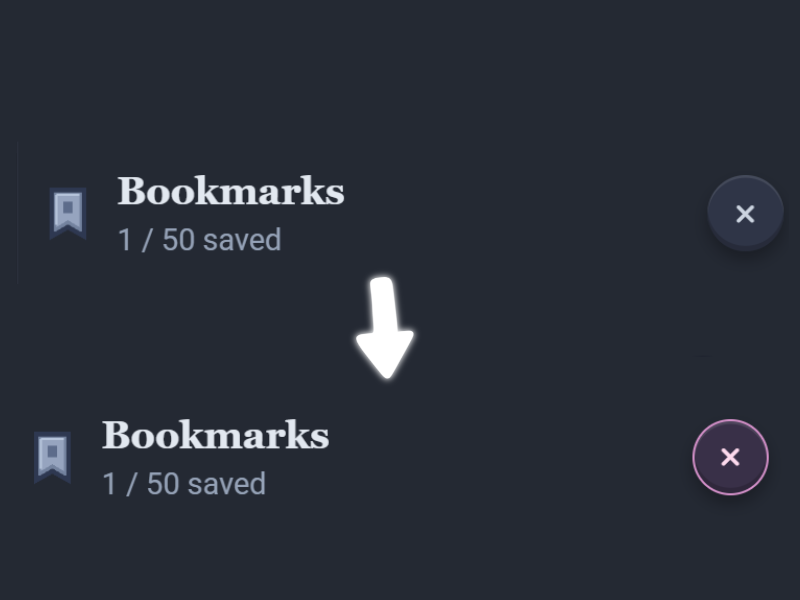
Recolor the panel’s close button and add a hover glow.

```css
:is([data-lab="search-panel"], [data-lab="bookmarks-panel"]) .surface-header button[aria-label="Close bookmarks"] {
  background: #393049 !important;
  color: #ffd8ee !important;
  border: 1px solid #d58dcb !important;
  border-radius: 8px !important;
}
@media (hover: hover) {
  :is([data-lab="search-panel"], [data-lab="bookmarks-panel"]) .surface-header button[aria-label="Close bookmarks"]:hover {
    background: #583a62 !important;
    box-shadow: 0 0 10px #ff89d266 !important;
  }
}
```

**Customization:** Both Search and Bookmarks currently use `Close bookmarks` as the close button’s ARIA label.

---

---

### Search & Bookmarks Footer Styling

Change the footer background, text, and top border. 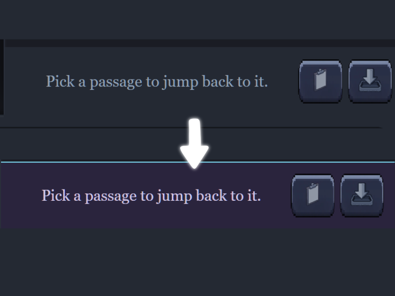

```css
:is([data-lab="search-panel"], [data-lab="bookmarks-panel"]) .surface-footer {
  background: #29243e !important;
  border-top: 1px solid #74d9f0 !important;
  box-shadow: 0 -4px 12px #ff89d244 !important;
}
:is([data-lab="search-panel"], [data-lab="bookmarks-panel"]) .surface-footer > span {
  color: #d4c9e9 !important;
  font-style: italic !important;
  text-shadow: 0 0 6px #8deaff66 !important;
}
```

**Customization:** `.surface-footer` styles the strip; its direct `span` styles the message text. Change or remove `font-style` and `text-shadow` to control the optional italic/glow treatment. Tested across the displayed footer variants.

---

---

### Custom Copy and Download Icons

Replace the action images used to copy or download marked passages. 

```css
[data-lab="bookmarks-panel"]
button[aria-label="Copy marked passages"]
img[src="/img/pixel/copy.webp"] {
  content: url("/api/images/6ac8970875e1eb8796dcfc4f") !important;
  object-fit: contain !important;
  filter: none !important;
}

[data-lab="bookmarks-panel"]
button[aria-label="Download marked passages"]
img[src="/img/pixel/download.webp"] {
  content: url("/api/images/6ac896f900c414e8e2a1bffd") !important;
  object-fit: contain !important;
  filter: none !important;
  transform: none !important;
}
```

**Customization:**
- `Copy marked passages` targets the Copy control.
- `Download marked passages` targets the Download control.
- `content: url(...)` selects the replacement artwork.
- `transform: none` prevents the Download image from inheriting an unwanted transform.

---

---

### Custom Search & Bookmarks Background Images


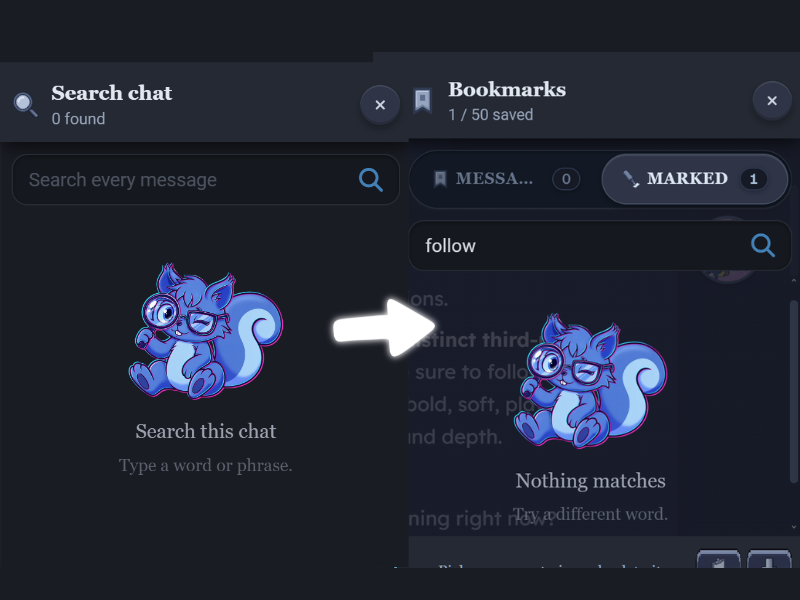
Optionally use uploaded artwork beneath a translucent color overlay instead of a solid panel background. 

```css
/* Optional variation: use instead of the solid panel background */
[data-lab="bookmarks-panel"] {
  background: linear-gradient(#171b2bcc, #171b2bcc),
              url("/api/images/YOUR_IMAGE_ID")
              center / cover no-repeat !important;
  border-left: 2px solid #73d9ff !important;
}

/* Optional: allow the image to show through the list area */
[data-lab="bookmarks-panel"] #lab-bookmarks-list {
  background: transparent !important;
}
```

**Customization:**
- `YOUR_IMAGE_ID` is the reader’s own uploaded image.
- `linear-gradient(...)` adds a translucent readability overlay.
- `cover` fills the panel and may crop the artwork.
- `background: transparent` allows the list area to reveal the panel artwork.

**Optional / not yet tested:** The header and footer have independent opaque backgrounds in the source theme. Keep them solid for readability or customize them separately. This example is a proposed image-background variation, not a verified finished effect.

---

---

### Custom Bookmarks Tab Icons

The original Messages icon is `/img/pixel/lab-bookmark.webp`; the Marked icon is `/img/pixel/lab-mark.webp`. Each tab can use different replacement artwork.

Replace the small artwork inside the **Messages** and **Marked** tabs in the Bookmarks panel. The **Marked** icon is the pencil beside the MARKED label—not the Copy or Download controls. The screenshot for the separate [header icon replacement tutorial](#custom-search--bookmarks-header-icons) does **not** show these tab icons.

```css
/* Messages tab icon */
[data-lab="bookmarks-panel"]
#lab-bookmarks-tab-messages img {
  content: url("/api/images/YOUR_MESSAGES_ICON_ID") !important;
  object-fit: contain !important;
  filter: none !important;
}

/* Marked tab icon (pencil beside MARKED) */
[data-lab="bookmarks-panel"]
#lab-bookmarks-tab-marks img {
  content: url("/api/images/YOUR_MARKED_ICON_ID") !important;
  object-fit: contain !important;
  filter: none !important;
}
```

**Customization:**
- `YOUR_MESSAGES_ICON_ID` replaces the Messages tab artwork.
- `YOUR_MARKED_ICON_ID` replaces the Marked tab artwork.
- The tab IDs target each button independently (`#lab-bookmarks-tab-messages` and `#lab-bookmarks-tab-marks`); `content` supplies your replacement artwork.
- These examples use [LoreBary-uploaded images](#how-to-import-css-images-in-lorebary). You can also use [Base64 image data](https://github.com/Caddel001/LoreBary-Theme-Snippets/blob/main/LoreBary%20CSS%20Quick%20Guide.md#converting-images-to-base64).
- Tab colors, counters, hover, and selected states have their own tutorials above. Copy and Download icon replacements are covered in [Custom Copy and Download Icons](#custom-copy-and-download-icons).

## Laboratory Selector and Native Asset Reference

The following tables provide a quick reference to LoreBary’s native image paths and Laboratory UI selectors. The first lists built-in image assets; the second identifies interface elements and CSS targets for customization. The numbered UI groups organize the selector table by interface area.

> **Compatibility note:** Native asset paths and selectors may change between LoreBary versions. Inspect the current interface and test a selector before relying on it in a published theme.

### Native Image Asset Paths

| **Image / function** | **Native asset path** | **File type** | **Area** |
| --- | --- | --- | --- |
| Settings gear | `/img/Icons/Icon_Settings.webp` | WEBP | Interface / inspect context |
| Pixel plate artwork | `/img/Icons/btn_pixel_plate_24.webp` | WEBP | Interface / inspect context |
| Empty icon placeholder | `/img/Icons/icon_acon_emtpy.webp` | WEBP | Interface / inspect context |
| Regenerate | `/img/Icons/icon_regenerate.webp` | WEBP | Interface / inspect context |
| Send | `/img/Icons/icon_send.webp` | WEBP | Interface / inspect context |
| Analytics | `/img/pixel/analytics.webp` | WEBP | Interface / inspect context |
| Copy | `/img/pixel/copy.webp` | WEBP | Interface / inspect context |
| Dialogue | `/img/pixel/dialogue.webp` | WEBP | Interface / inspect context |
| Download | `/img/pixel/download.webp` | WEBP | Interface / inspect context |
| Expression upload | `/img/pixel/expression-upload.webp` | WEBP | Interface / inspect context |
| Fork / branch | `/img/pixel/fork-v1.webp` | WEBP | Interface / inspect context |
| Headphones | `/img/pixel/headphones.webp` | WEBP | Interface / inspect context |
| Auto chat | `/img/pixel/lab-autochat.webp` | WEBP | Interface / inspect context |
| Bookmarks → Messages tab | `/img/pixel/lab-bookmark.webp` | WEBP | Bookmarks |
| Call | `/img/pixel/lab-call.webp` | WEBP | Interface / inspect context |
| Dice roll | `/img/pixel/lab-d20.webp` | WEBP | Interface / inspect context |
| Director | `/img/pixel/lab-director.webp` | WEBP | Interface / inspect context |
| Expressions | `/img/pixel/lab-expressions.webp` | WEBP | Interface / inspect context |
| Fullscreen | `/img/pixel/lab-fullscreen.webp` | WEBP | Interface / inspect context |
| Scene gallery | `/img/pixel/lab-gallery.webp` | WEBP | Interface / inspect context |
| Guidance | `/img/pixel/lab-guidance.webp` | WEBP | Interface / inspect context |
| HTML | `/img/pixel/lab-html.webp` | WEBP | Interface / inspect context |
| Bookmarks → Marked tab | `/img/pixel/lab-mark.webp` | WEBP | Bookmarks |
| More actions | `/img/pixel/lab-more.webp` | WEBP | Interface / inspect context |
| Review | `/img/pixel/lab-review.svg` | SVG | Interface / inspect context |
| Search chat | `/img/pixel/lab-search.webp` | WEBP | Interface / inspect context |
| Time skip | `/img/pixel/lab-timeskip.webp` | WEBP | Interface / inspect context |
| Web search | `/img/pixel/lab-web-search.webp` | WEBP | Interface / inspect context |
| Write menu | `/img/pixel/lab-write.webp` | WEBP | Interface / inspect context |
| Pencil / edit | `/img/pixel/pencil.webp` | WEBP | Interface / inspect context |
| Scene talk more | `/img/pixel/scene-talk-more.webp` | WEBP | Scene Notes / scene |
| Trash / delete | `/img/pixel/trash.webp` | WEBP | Interface / inspect context |
| Down arrow | `/img/sketch/arrow_down.webp` | WEBP | Interface / inspect context |
| Bary — empty Search panel | `/img/bary/bary_search.webp` | WEBP | Search panel |
| Scene Notes — Stay real | `/img/pixel/scene-stay-real.webp` | WEBP | Scene Notes |
| Scene Notes — Living world | `/img/pixel/scene-living-world.webp` | WEBP | Scene Notes |
| Scene Notes — Your move | `/img/pixel/scene-your-move.webp` | WEBP | Scene Notes |
| Scene Notes — Slow burn | `/img/pixel/scene-slow-burn.webp` | WEBP | Scene Notes |
| Scene Notes — Romance | `/img/pixel/scene-romance.webp` | WEBP | Scene Notes |
| Scene Notes — Sex (asset named intimacy) | `/img/pixel/scene-intimacy.webp` | WEBP | Scene Notes |
| Scene Notes — Kink | `/img/pixel/scene-kink.webp` | WEBP | Scene Notes |
| Write menu — selected indicator | `/img/pixel/check.webp` | WEBP | Write menu |
| Write menu — submenu arrow | `/img/pixel/arrow-right-v2.webp` | WEBP | Write menu |
| Marked passage — Share as quote | `/img/Icons/feed_action_share.webp` | WEBP | Bookmarks |
| Mobile — Regenerate | `/img/pixel/msg-regenerate.webp` | WEBP | Mobile message actions |
| Mobile — Regenerate options badge | `/img/pixel/settings.webp` | WEBP | Mobile message actions |
| Composer — chat tools | `/img/pixel/box.webp` | WEBP | Composer |
| Composer — Send | `/img/pixel/lab-send.webp` | WEBP | Composer |

### UI Selector and Customization Reference

| **UI area**                        | **Individual asset**           | **CSS selector / target**                                             | **What can change**                                              |
| ---------------------------------- | ------------------------------ | --------------------------------------------------------------------- | ---------------------------------------------------------------- |
| 01 Header & navigation             | Back button                    | `[data-lab="back"]` | Icon replacement or tint; button surface, glow, hover, animation |
| 01 Header & navigation             | Header shell                   | `[data-lab="header"]` | Icon replacement or tint; button surface, glow, hover, animation |
| 01 Header & navigation             | Chat title                     | `[data-lab="header-title"]` | Icon replacement or tint; button surface, glow, hover, animation |
| 01 Header & navigation             | Voice call                     | `[data-lab="header-action"][aria-label="Voice call"]` | Icon replacement or tint; button surface, glow, hover, animation |
| 01 Header & navigation             | Fullscreen                     | `[data-lab="header-action"][aria-label*="fullscreen" i]` | Icon replacement or tint; button surface, glow, hover, animation |
| 01 Header & navigation             | Statistics & export            | `[data-lab="header-action"][aria-label="Chat statistics & export"]` | Icon replacement or tint; button surface, glow, hover, animation |
| 01 Header & navigation             | Search                         | `[data-lab="header-action"][aria-label="Search this chat"]` | Icon replacement or tint; button surface, glow, hover, animation |
| 01 Header & navigation             | Scene gallery                  | `[data-lab="header-action"][aria-label="Scene gallery"]` | Icon replacement or tint; button surface, glow, hover, animation |
| 01 Header & navigation             | Bookmarks                      | `[data-lab="header-action"][aria-label="Message bookmarks"]` | Icon replacement or tint; button surface, glow, hover, animation |
| 01 Header & navigation             | Menu icon                      | `img[data-lab="menu"]` | Icon replacement or tint; button surface, glow, hover, animation |
| 01 Header & navigation             | Scroll down                    | `[data-lab="scroll-down"]` | Icon replacement or tint; button surface, glow, hover, animation |
| 02 Messages & bubbles              | Chat message                   | `[data-lab="message"]` | Colors, layout, typography, spacing, transparency, effects       |
| 02 Messages & bubbles              | Bubble shell                   | `[data-lab="bubble"]` | Colors, layout, typography, spacing, transparency, effects       |
| 02 Messages & bubbles              | User bubble                    | `[data-lab-role="user"] [data-lab="bubble"]` | Colors, layout, typography, spacing, transparency, effects       |
| 02 Messages & bubbles              | Character bubble               | `[data-lab-role="character"] [data-lab="bubble"]` | Colors, layout, typography, spacing, transparency, effects       |
| 02 Messages & bubbles              | Avatar                         | `[data-lab="avatar"]` | Colors, layout, typography, spacing, transparency, effects       |
| 02 Messages & bubbles              | User avatar                    | `[data-lab-role="user"] [data-lab="avatar"]` | Colors, layout, typography, spacing, transparency, effects       |
| 02 Messages & bubbles              | Character avatar               | `[data-lab-role="character"] [data-lab="avatar"]` | Colors, layout, typography, spacing, transparency, effects       |
| 02 Messages & bubbles              | Portrait                       | `[data-lab="portrait"]` | Colors, layout, typography, spacing, transparency, effects       |
| 02 Messages & bubbles              | Message text                   | `[data-lab="text"]` | Colors, layout, typography, spacing, transparency, effects       |
| 02 Messages & bubbles              | Timestamp                      | `[data-lab="time"]` | Colors, layout, typography, spacing, transparency, effects       |
| 02 Messages & bubbles              | Rating                         | `[data-lab="rating"]` | Colors, layout, typography, spacing, transparency, effects       |
| 02 Messages & bubbles              | Previous version               | `[data-lab="swipe"][aria-label="Previous version"]` | Colors, layout, typography, spacing, transparency, effects       |
| 02 Messages & bubbles              | Next version                   | `[data-lab="swipe"][aria-label="Next version"]` | Colors, layout, typography, spacing, transparency, effects       |
| 02 Messages & bubbles              | Message footer                 | `[data-lab="message-footer"]` | Colors, layout, typography, spacing, transparency, effects       |
| 03 Thinking                        | Thinking panel                 | `[data-lab="thoughts"]` | Background, text, icons, hover                                   |
| 03 Thinking                        | Thinking toggle                | `[data-lab="thoughts-toggle"]` | Background, text, icons, hover                                   |
| 03 Thinking                        | Thinking text                  | `[data-lab="thoughts-text"]` | Background, text, icons, hover                                   |
| 04 Message actions                 | Bookmark message               | `[data-lab="action"][aria-label="Bookmark message"]` | Icon replacement, tint, background, hover                        |
| 04 Message actions                 | Edit message                   | `[data-lab="action"][aria-label="Edit message"]` | Icon replacement, tint, background, hover                        |
| 04 Message actions                 | Delete message                 | `[data-lab="action"][aria-label="Delete message"]` | Icon replacement, tint, background, hover                        |
| 04 Message actions                 | Branch message                 | `[data-lab="action"][aria-label="Branch message"]` | Icon replacement, tint, background, hover                        |
| 04 Message actions                 | Regenerate message             | `[data-lab="action"][aria-label="Regenerate message"]` | Icon replacement, tint, background, hover                        |
| 04 Message actions                 | More actions                   | `[data-lab="action"][aria-label="More actions"]` | Icon replacement, tint, background, hover                        |
| 04 Message actions                 | All message actions            | `[data-lab="action"]` | Color, background, border, shadow, size, hover/focus             |
| 04 Message actions                 | More actions menu              | `[role="menu"][aria-label="More actions"]` | Surface, items, hover                                            |
| 04 Message actions                 | More actions items             | `[role="menu"][aria-label="More actions"] [role="menuitem"]` | Text, hover, background                                          |
| 05 Composer & toolbar              | Footer shell                   | `[data-lab="footer"]` | Button icon, color, background, border, glow, selected state     |
| 05 Composer & toolbar              | Textbox                        | `[data-lab="textbox"]` | Button icon, color, background, border, glow, selected state     |
| 05 Composer & toolbar              | Composer action group          | `[data-lab="composer-actions"]` | Button icon, color, background, border, glow, selected state     |
| 05 Composer & toolbar              | Write for Me                   | `[data-lab="write"]` | Button icon, color, background, border, glow, selected state     |
| 05 Composer & toolbar              | Scene Notes toggle             | `[data-lab="guidance-toggle"]` | Button icon, color, background, border, glow, selected state     |
| 05 Composer & toolbar              | Attach image                   | `[data-lab="attach-image"]` | Button icon, color, background, border, glow, selected state     |
| 05 Composer & toolbar              | Send / talk                    | `[data-lab="send"]` | Button icon, color, background, border, glow, selected state     |
| 05 Composer & toolbar              | Toolbar shell                  | `[data-lab="toolbar"]` | Button icon, color, background, border, glow, selected state     |
| 05 Composer & toolbar              | Time skip                      | `[data-lab="time-skip"]` | Button icon, color, background, border, glow, selected state     |
| 05 Composer & toolbar              | Dice roll                      | `[data-lab="dice-roll"]` | Button icon, color, background, border, glow, selected state     |
| 05 Composer & toolbar              | Auto conversation              | `[data-lab="auto-mode"]` | Button icon, color, background, border, glow, selected state     |
| 05 Composer & toolbar              | Director Pass                  | `[data-lab="director-pass"]` | Button icon, color, background, border, glow, selected state     |
| 05 Composer & toolbar              | HTML Mode                      | `[data-lab="html-mode"]` | Button icon, color, background, border, glow, selected state     |
| 05 Composer & toolbar              | Visual Expressions             | `[data-lab="visual-expressions"]` | Button icon, color, background, border, glow, selected state     |
| 05 Composer & toolbar              | Web Search                     | `[data-lab="web-search"]` | Button icon, color, background, border, glow, selected state     |
| 05 Composer & toolbar              | Polish replies                 | `[data-lab="review-mode"]` | Button icon, color, background, border, glow, selected state     |
| 05 Composer & toolbar              | Scene music                    | `[data-lab="scene-music"]` | Button icon, color, background, border, glow, selected state     |
| 05 Composer & toolbar              | Reply choices                  | `[data-lab="reply-options"]` | Button icon, color, background, border, glow, selected state     |
| 06 Write for Me                    | Write menu                     | `[data-lab="write-menu"]` | Text, icon, background, border, hover, focus                     |
| 06 Write for Me                    | Write choice                   | `[data-lab="write-option"]` | Text, icon, background, border, hover, focus                     |
| 06 Write for Me                    | Selected choice                | `[data-lab="write-option"][aria-checked="true"]` | Text, icon, background, border, hover, focus                     |
| 06 Write for Me                    | Unselected choice              | `[data-lab="write-option"][aria-checked="false"]` | Text, icon, background, border, hover, focus                     |
| 06 Write for Me                    | Choice hover                   | `[data-lab="write-option"]:hover` | Text, icon, background, border, hover, focus                     |
| 06 Write for Me                    | Choice focus                   | `[data-lab="write-option"]:focus-visible` | Text, icon, background, border, hover, focus                     |
| 06 Write for Me                    | Enhance instruction            | `[data-lab="write-menu"] [role="menuitem"]` | Text, icon, background, border, hover, focus                     |
| 07 Search & bookmarks              | Search panel                   | `[data-lab="search-panel"]` | Text, surface, icon, background, hover, focus                    |
| 07 Search & bookmarks              | Bookmarks panel                | `[data-lab="bookmarks-panel"]` | Text, surface, icon, background, hover, focus                    |
| 07 Search & bookmarks              | Panel header                   | `[data-lab="search-panel"] .surface-header` | Text, surface, icon, background, hover, focus                    |
| 07 Search & bookmarks              | Panel title                    | `[data-lab="search-panel"] .surface-header h3` | Text, surface, icon, background, hover, focus                    |
| 07 Search & bookmarks              | Panel description              | `[data-lab="search-panel"] .surface-header p` | Text, surface, icon, background, hover, focus                    |
| 07 Search & bookmarks              | Search field                   | `[data-lab="search-panel"] .header-search-input` | Text, surface, icon, background, hover, focus                    |
| 07 Search & bookmarks              | Search field icon              | `[data-lab="search-panel"] .header-search > i.fa-search` | Text, surface, icon, background, hover, focus                    |
| 07 Search & bookmarks              | Search field focus             | `[data-lab="search-panel"] .header-search:focus-within` | Text, surface, icon, background, hover, focus                    |
| 07 Search & bookmarks              | Bookmarks tab strip            | `[data-lab="bookmarks-panel"] [role="tablist"]` | Text, surface, icon, background, hover, focus                    |
| 07 Search & bookmarks              | Bookmarks tab                  | `[data-lab="bookmarks-panel"] [role="tab"]` | Text, surface, icon, background, hover, focus                    |
| 07 Search & bookmarks              | Selected tab                   | `[data-lab="bookmarks-panel"] [role="tab"][aria-selected="true"]` | Text, surface, icon, background, hover, focus                    |
| 07 Search & bookmarks              | Unselected tab                 | `[data-lab="bookmarks-panel"] [role="tab"][aria-selected="false"]` | Text, surface, icon, background, hover, focus                    |
| 07 Search & bookmarks              | Tab hover                      | `[data-lab="bookmarks-panel"] [role="tab"]:hover` | Text, surface, icon, background, hover, focus                    |
| 07 Search & bookmarks              | Tab keyboard focus             | `[data-lab="bookmarks-panel"] [role="tab"]:focus-visible` | Text, surface, icon, background, hover, focus                    |
| 07 Search & bookmarks              | Bookmarks empty state          | `#lab-bookmarks-list > div:has(> p + p)` | Text, surface, icon, background, hover, focus                    |
| 07 Search & bookmarks              | Panel footer                   | `[data-lab="bookmarks-panel"] .surface-footer` | Text, surface, icon, background, hover, focus                    |
| 07 Search & bookmarks              | Search panel footer            | `[data-lab="search-panel"] .surface-footer` | Text, surface, icon, background, hover, focus                    |
| 07 Search & bookmarks              | Search header image            | `[data-lab="search-panel"] .surface-header img` | Text, surface, icon, background, hover, focus                    |
| 07 Search & bookmarks              | Bookmarks header image         | `[data-lab="bookmarks-panel"] .surface-header img` | Text, surface, icon, background, hover, focus                    |
| 08 Scene Notes                     | Scene Notes window             | `[data-lab="input"] > div:has(#lab-scene-notes)` | Colors, border, icon, focus, surface                             |
| 08 Scene Notes                     | Scene Notes textarea           | `#lab-scene-notes` | Colors, border, icon, focus, surface                             |
| 08 Scene Notes                     | Scene Notes label              | `[for="lab-scene-notes"]` | Colors, border, icon, focus, surface                             |
| 08 Scene Notes                     | Open saved templates           | `button[aria-label="Open saved scene note templates"]` | Colors, border, icon, focus, surface                             |
| 08 Scene Notes                     | Scene Notes focus              | `#lab-scene-notes:focus` | Colors, border, icon, focus, surface                             |
| 09 Visual Expressions              | Expression portrait            | `[data-lab="expression"]` | Size, position, glow, icon, colors                               |
| 09 Visual Expressions              | Expression toggle              | `[data-lab="visual-expressions"]` | Size, position, glow, icon, colors                               |
| 09 Visual Expressions              | Expression Studio dialog       | `[role="dialog"][aria-label="Expression Studio"]` | Size, position, glow, icon, colors                               |
| 10 Settings panels                 | Time skip dialog               | `[data-lab="time-skip-menu"]` | Background, text, borders, inputs, states                        |
| 10 Settings panels                 | Time skip details              | `[data-lab="time-skip-details"]` | Background, text, borders, inputs, states                        |
| 10 Settings panels                 | Time skip submit               | `[data-lab="time-skip-submit"]` | Background, text, borders, inputs, states                        |
| 10 Settings panels                 | Dice roll dialog               | `[data-lab="dice-roll-menu"]` | Background, text, borders, inputs, states                        |
| 10 Settings panels                 | HTML settings                  | `[data-lab="html-settings"]` | Background, text, borders, inputs, states                        |
| 10 Settings panels                 | Polish settings                | `[data-lab="review-settings"]` | Background, text, borders, inputs, states                        |
| 10 Settings panels                 | Music settings                 | `[data-lab="scene-music-settings"]` | Background, text, borders, inputs, states                        |
| 10 Settings panels                 | Reply settings                 | `[data-lab="reply-settings"]` | Background, text, borders, inputs, states                        |
| 10 Settings panels                 | Dropdown list                  | `[role="listbox"]` | Text, background, selected state                                 |
| 10 Settings panels                 | Dropdown option                | `[role="option"]` | Text, background, selected state                                 |
| 10 Settings panels                 | Selected dropdown option       | `[role="option"][aria-selected="true"]` | Text, background, selected state                                 |
| 11 Additional documented selectors | Bold                           | `[data-lab="bold"]` | Inspect matching tutorial for supported CSS properties           |
| 11 Additional documented selectors | Bubble Tail                    | `[data-lab="bubble-tail"]` | Inspect matching tutorial for supported CSS properties           |
| 11 Additional documented selectors | Dialog                         | `[data-lab="dialog"]` | Inspect matching tutorial for supported CSS properties           |
| 11 Additional documented selectors | Draft Versions                 | `[data-lab="draft-versions"]` | Inspect matching tutorial for supported CSS properties           |
| 11 Additional documented selectors | Expression Manage              | `[data-lab="expression-manage"]` | Inspect matching tutorial for supported CSS properties           |
| 11 Additional documented selectors | Expression Toggle              | `[data-lab="expression-toggle"]` | Inspect matching tutorial for supported CSS properties           |
| 11 Additional documented selectors | Heading                        | `[data-lab="heading"]` | Inspect matching tutorial for supported CSS properties           |
| 11 Additional documented selectors | Italic                         | `[data-lab="italic"]` | Inspect matching tutorial for supported CSS properties           |
| 11 Additional documented selectors | List Item                      | `[data-lab="list-item"]` | Inspect matching tutorial for supported CSS properties           |
| 11 Additional documented selectors | Message Body                   | `[data-lab="message-body"]` | Inspect matching tutorial for supported CSS properties           |
| 11 Additional documented selectors | Rule                           | `[data-lab="rule"]` | Inspect matching tutorial for supported CSS properties           |
| 11 Additional documented selectors | Stop                           | `[data-lab="stop"]` | Inspect matching tutorial for supported CSS properties           |
| 11 Additional documented selectors | Toolbar Toggle                 | `[data-lab="toolbar-toggle"]` | Inspect matching tutorial for supported CSS properties           |
| 01 Header & navigation             | Voice call icon image          | `[data-lab="header-action"][aria-label="Voice call"] img` | content: url(/api/images/...) or data URL; filter, transform     |
| 01 Header & navigation             | Fullscreen icon image          | `[data-lab="header-action"][aria-label*="fullscreen" i] img` | content: url(/api/images/...) or data URL; filter, transform     |
| 01 Header & navigation             | Statistics & export icon image | `[data-lab="header-action"][aria-label="Chat statistics & export"] img` | content: url(/api/images/...) or data URL; filter, transform     |
| 01 Header & navigation             | Search icon image              | `[data-lab="header-action"][aria-label="Search this chat"] img` | content: url(/api/images/...) or data URL; filter, transform     |
| 01 Header & navigation             | Gallery icon image             | `[data-lab="header-action"][aria-label="Scene gallery"] img` | content: url(/api/images/...) or data URL; filter, transform     |
| 01 Header & navigation             | Bookmarks icon image           | `[data-lab="header-action"][aria-label="Message bookmarks"] img` | content: url(/api/images/...) or data URL; filter, transform     |
| 05 Composer & toolbar              | Send icon image                | `[data-lab="send"] img` | Replace artwork via content:url(...); tint, scale, glow          |
| 05 Composer & toolbar              | Write icon image               | `[data-lab="write"] img` | Replace artwork via content:url(...); tint, scale, glow          |
| 05 Composer & toolbar              | Scene Notes icon image         | `[data-lab="guidance-toggle"] img` | Replace artwork via content:url(...); tint, scale, glow          |
| 05 Composer & toolbar              | Attach icon image              | `[data-lab="attach-image"] img` | Replace artwork via content:url(...); tint, scale, glow          |
| 05 Composer & toolbar              | Time skip icon image           | `[data-lab="time-skip"] img` | Replace artwork via content:url(...); tint, scale, glow          |
| 05 Composer & toolbar              | Dice roll icon image           | `[data-lab="dice-roll"] img` | Replace artwork via content:url(...); tint, scale, glow          |
| 05 Composer & toolbar              | Auto mode icon image           | `[data-lab="auto-mode"] img` | Replace artwork via content:url(...); tint, scale, glow          |
| 05 Composer & toolbar              | Director Pass icon image       | `[data-lab="director-pass"] img` | Replace artwork via content:url(...); tint, scale, glow          |
| 05 Composer & toolbar              | HTML mode icon image           | `[data-lab="html-mode"] img` | Replace artwork via content:url(...); tint, scale, glow          |
| 05 Composer & toolbar              | Visual Expressions icon image  | `[data-lab="visual-expressions"] img` | Replace artwork via content:url(...); tint, scale, glow          |
| 05 Composer & toolbar              | Web Search icon image          | `[data-lab="web-search"] img` | Replace artwork via content:url(...); tint, scale, glow          |
| 05 Composer & toolbar              | Review icon image              | `[data-lab="review-mode"] img` | Replace artwork via content:url(...); tint, scale, glow          |
| 05 Composer & toolbar              | Scene Music icon image         | `[data-lab="scene-music"] img` | Replace artwork via content:url(...); tint, scale, glow          |
| 05 Composer & toolbar              | Reply Options icon image       | `[data-lab="reply-options"] img` | Replace artwork via content:url(...); tint, scale, glow          |

---

# Part II — Profile Themes

Profile themes use `.profile-theme-scope` and `[data-profile="..."]`. Keep every profile rule inside the profile scope so it does not recolor LoreBary navigation, dialogs, or Laboratory chats.

## Profile Theme Structure and Palette

### Core component map

| Selector | Component |
| --- | --- |
| `[data-profile="scope"]` | Root of the themed profile |
| `[data-profile="hero"]` | Banner and identity area |
| `[data-profile="avatar-wrap"]` | Positioning anchor for a decorative avatar frame |
| `[data-profile="avatar"]` | Clipped avatar circle or shape |
| `[data-profile="avatar-img"]` | Actual portrait image |
| `[data-profile="tabs"]` / `[data-profile="tab"]` | Main profile navigation |
| `[data-profile="about"]` | About Me area and its icon tabs |
| `[data-profile="composer-slot"]` | Write a Post placement area |
| `[data-profile="gallery-preview"]` | Gallery preview panel |
| `[data-profile="popular-content"]` | Popular Creations panel and carousel |
| `[data-profile="feed-list"]` | Profile post feed |

### Reusable color variables

Change this small palette first. The component snippets below reuse these values.

```css
.profile-theme-scope[data-profile="scope"] {
  --theme-bg: #171512;
  --theme-panel: #2c241c;
  --theme-panel-2: #3b2e21;
  --theme-text: #fff1cf;
  --theme-muted: #c9b58f;
  --theme-edge: #a77b3f;
  --theme-accent: #d7ad63;
  --theme-shadow: 0 8px 24px rgba(0, 0, 0, .45);

  color: var(--theme-text) !important;
  background-color: var(--theme-bg) !important;
}
```

### Safe hover and keyboard focus

Use `:hover` for pointers and `:focus-visible` for keyboard navigation. Do not remove the focus outline without providing a visible replacement.

```css
@media (hover: hover) {
  .profile-theme-scope .theme-button:hover {
    color: #ffffff !important;
    background: #765034 !important;
    border-color: #f0cc83 !important;
    transform: translateY(-1px);
  }
}

.profile-theme-scope .theme-button:focus-visible {
  outline: 2px solid #fff1a8 !important;
  outline-offset: 2px;
}

.profile-theme-scope .theme-button:active {
  transform: translateY(1px);
}
```

---

## Fonts and Typography

Use a readable body font and reserve decorative fonts for names, headings, and selected labels. Always include fallback fonts because remote fonts can fail to load or may be blocked by the editor.

### Safe system-font setup

This method needs no external font file and works offline.

```css
.profile-theme-scope[data-profile="scope"] {
  --profile-font-body: Georgia, "Times New Roman", serif;
  --profile-font-title: "Trebuchet MS", Arial, sans-serif;
  font-family: var(--profile-font-body) !important;
}

.profile-theme-scope [data-profile="display-name"],
.profile-theme-scope [data-profile="display-name"] *,
.profile-theme-scope [data-profile="composer-header"] h3,
.profile-theme-scope section:has([data-profile="about-card"])
  > header :is(h2, span),
.profile-theme-scope [data-profile="gallery-preview"] h2,
.profile-theme-scope [data-profile="popular-content"] h2 {
  font-family: var(--profile-font-title) !important;
  letter-spacing: .08em;
}

.profile-theme-scope [data-profile="tab"],
.profile-theme-scope [data-profile="about-card"],
.profile-theme-scope [data-profile="composer-editor"] {
  font-family: var(--profile-font-body) !important;
}
```

### Laboratory font variables

Laboratory already exposes useful font variables. Set them on the Laboratory scope instead of repeating `font-family` on every message element.

```css
.lab-theme-scope {
  --lab-font-family: Georgia, "Times New Roman", serif;
  --lab-char-name-font: "Trebuchet MS", Arial, sans-serif;
  --lab-persona-name-font: "Trebuchet MS", Arial, sans-serif;
}
```

### Optional web font

Remote imports work only when the theme editor and the font host permit them. An `@import` rule must sit at the very top of the stylesheet, before normal CSS rules. Keep the fallback stack even when the import works.

```css
@import url("https://fonts.googleapis.com/css2?family=Cinzel:wght@600;700&family=Lexend:wght@400;600&display=swap");

.profile-theme-scope[data-profile="scope"] {
  --profile-font-body: Lexend, Arial, sans-serif;
  --profile-font-title: Cinzel, Georgia, serif;
}
```

If `@import` is rejected by the safety checker, use system fonts or embed a properly licensed WOFF2 file with `@font-face` and a Base64 data URL. Do not remove the fallback fonts.

### Useful typography properties

| Property | Purpose |
| --- | --- |
| `font-family` | Selects the font and fallbacks |
| `font-size` | Changes text size |
| `font-weight` | Controls regular, semibold, or bold text |
| `font-style` | Adds or removes italics |
| `letter-spacing` | Opens or tightens heading letters |
| `line-height` | Improves paragraph readability |
| `text-transform` | Uppercase, lowercase, or normal case |
| `text-shadow` | Separates text from textured backgrounds |

---

## Profile Avatar Frame

The most reliable profile frame is a transparent PNG or WebP attached to the outer avatar wrapper. Keep the portrait, the decorative frame, and the action buttons on separate layers.

| Before: portrait without the decorative frame | After: transparent frame aligned to the portrait |
| --- | --- |
| 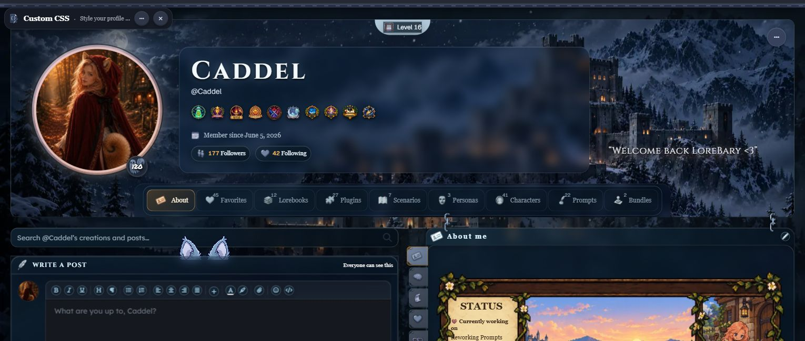 | 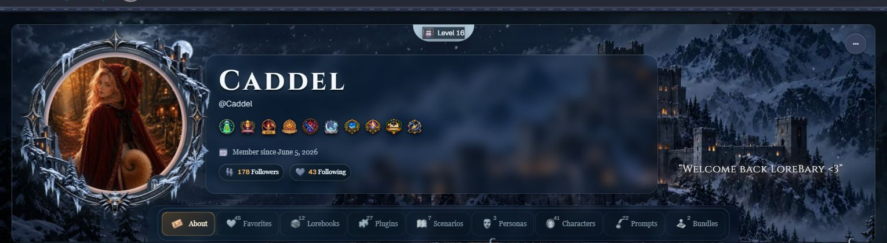 |

### Centered decorative frame

```css
.profile-theme-scope [data-profile="avatar-wrap"] {
  position: relative;
  overflow: visible !important;
  isolation: isolate;
}

.profile-theme-scope [data-profile="avatar"] {
  position: relative;
  z-index: 1;
  overflow: hidden;
  border: 2px solid #d1b781 !important;
  background: #2e261d !important;
}

.profile-theme-scope [data-profile="avatar-wrap"]::after {
  content: "";
  position: absolute;
  inset: -5%;
  z-index: 3;
  pointer-events: none;
  background: url("YOUR-TRANSPARENT-FRAME.png") center / contain no-repeat;
}

.profile-theme-scope [data-profile="avatar-actions"] {
  position: relative;
  z-index: 5;
}
```

`pointer-events: none` is important: the transparent rectangle around the artwork must not block avatar or remove-button clicks.

### Fit the portrait inside the frame opening

Use the same inset for the portrait and its click overlay. Absolute positioning is more reliable than compensating with margins.

```css
.profile-theme-scope [data-profile="avatar"]
  > [data-profile="avatar-img"] {
  position: absolute !important;
  inset: 14% !important;
  width: 72% !important;
  height: 72% !important;
  margin: 0 !important;
  object-fit: cover !important;
  border-radius: 50% !important;
}

.profile-theme-scope [data-profile="avatar"] > div.absolute {
  inset: 14% !important;
}
```

### Asymmetrical frame artwork

Use this pattern when flowers, horns, a lantern, a skull, or another ornament extends farther on one side. Align the visible opening, not the full transparent image bounds.

```css
.profile-theme-scope [data-profile="avatar-wrap"]::after {
  content: "";
  position: absolute;
  width: 150%;
  height: 150%;
  left: -33%;
  top: -39%;
  z-index: 3;
  pointer-events: none;
  background: url("ASYMMETRICAL-FRAME.png") center / 100% 100% no-repeat;
}
```

### Mobile avatar alignment

```css
@media (max-width: 767px) {
  .profile-theme-scope [data-profile="avatar-wrap"]::after {
    inset: -5%;
  }

  .profile-theme-scope [data-profile="avatar"]
    > [data-profile="avatar-img"],
  .profile-theme-scope [data-profile="avatar"] > div.absolute {
    inset: 14% !important;
  }
}
```

If the artwork is asymmetrical, give its mobile rule its own `width`, `height`, `left`, and `top` values instead of reusing `inset`.

---

## Stickers and Decorative Images

The cleanest CSS-only sticker is a transparent PNG or WebP placed in a pseudo-element. Attach it to the nearest stable component, make that component `position: relative`, and keep the sticker click-through.

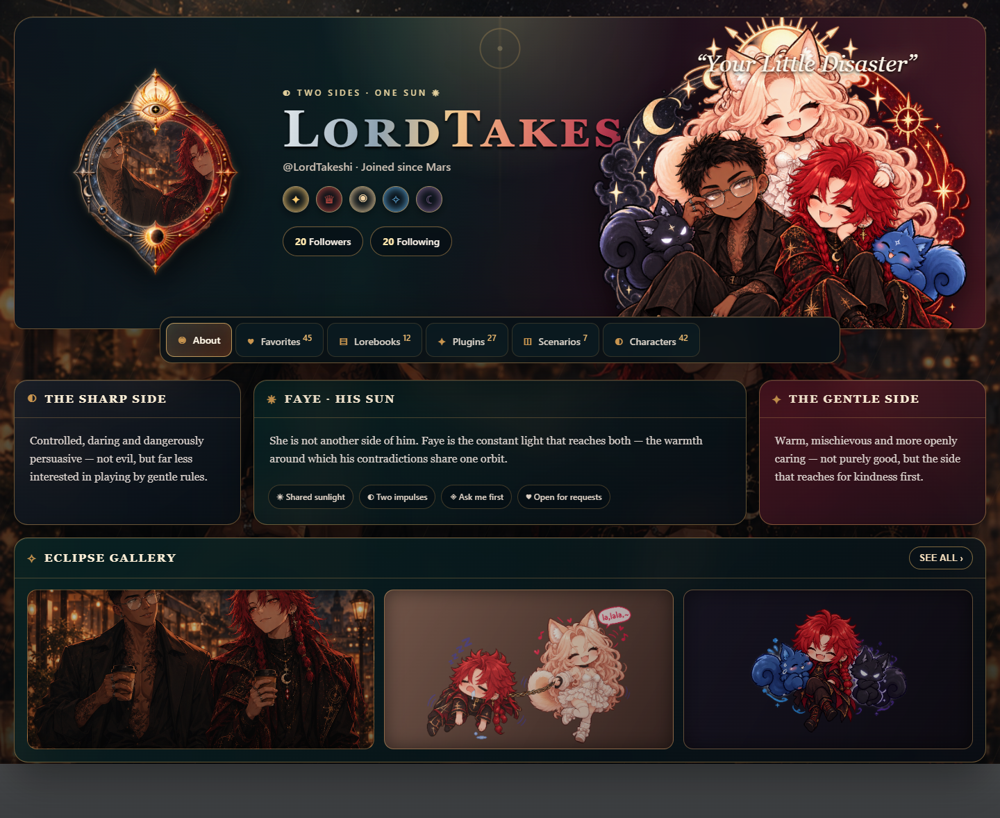

### Reusable sticker variable

```css
.profile-theme-scope[data-profile="scope"] {
  --profile-sticker: url("YOUR-TRANSPARENT-STICKER.png");
}
```

### Sticker above the About Me panel

```css
.profile-theme-scope section:has([data-profile="about-card"]) {
  position: relative;
  overflow: visible !important;
  isolation: isolate;
}

.profile-theme-scope
  section:has([data-profile="about-card"])::after {
  content: "";
  position: absolute;
  top: -54px;
  right: 18px;
  width: clamp(74px, 8vw, 108px);
  aspect-ratio: 1 / 1;
  z-index: 20;
  pointer-events: none;
  background: var(--profile-sticker) center / contain no-repeat;
  transform: rotate(8deg);
  filter: drop-shadow(0 7px 6px rgba(0, 0, 0, .55));
}
```

### Sticker in the center of the profile body

```css
.profile-theme-scope [data-profile="body-inner"] {
  position: relative;
  overflow: visible !important;
}

.profile-theme-scope [data-profile="body-inner"]::after {
  content: "";
  position: absolute;
  left: 50%;
  top: 330px;
  width: 340px;
  aspect-ratio: 4 / 3;
  z-index: 60;
  pointer-events: none;
  transform: translateX(-50%);
  background: var(--profile-sticker) center / contain no-repeat;
  filter: drop-shadow(0 12px 14px rgba(0, 0, 0, .66));
}
```

### How to move the sticker

| Change | Property |
| --- | --- |
| Move down | Increase `top` |
| Move up | Decrease `top` or use a negative value |
| Move right | Increase `left`, or decrease `right` |
| Move left | Decrease `left`, or increase `right` |
| Resize | Change `width`; keep `height: auto` or an `aspect-ratio` |
| Tilt | Change `rotate(...)` inside `transform` |
| Place above other layers | Increase `z-index` on the sticker and its positioned parent |

Do not set `left` and `right` together unless you intentionally want the browser to stretch the box. When centering with `left: 50%`, keep `translateX(-50%)` in the same `transform` declaration as any rotation.

### Mobile sticker rule

Large desktop stickers often overlap the composer on mobile. Reposition or hide them deliberately.

```css
@media (max-width: 767px) {
  .profile-theme-scope
    section:has([data-profile="about-card"])::after {
    top: -32px;
    right: 8px;
    width: 70px;
    transform: rotate(5deg);
  }

  .profile-theme-scope [data-profile="body-inner"]::after {
    display: none;
  }
}
```

One element provides only one `::before` and one `::after`. If both are already used for borders or particles, anchor the sticker to another stable container instead of overwriting the existing decoration.

### Laboratory sticker equivalent

The same positioning system works in Laboratory. Only the anchor changes.

```css
.lab-theme-scope {
  --lab-sticker: url("YOUR-TRANSPARENT-STICKER.png");
}

.lab-theme-scope [data-lab="header"] {
  position: relative;
  overflow: visible !important;
}

.lab-theme-scope [data-lab="header"]::after {
  content: "";
  position: absolute;
  top: -28px;
  right: 18px;
  width: 84px;
  aspect-ratio: 1 / 1;
  z-index: 20;
  pointer-events: none;
  background: var(--lab-sticker) center / contain no-repeat;
  transform: rotate(6deg);
}
```

---

## Main Profile Tabs and About Tabs

The main profile navigation and the five About Me icon tabs are separate components. Style them independently.


### Main profile tabs, selected state, and counts

```css
.profile-theme-scope [data-profile="tab"] {
  min-height: 36px;
  padding: 7px 12px !important;
  margin: 0 2px;
  color: #eadcc7 !important;
  background: linear-gradient(#3f3328, #2c241d) !important;
  border: 1px solid rgba(205, 164, 95, .45) !important;
  border-radius: 7px !important;
}

@media (hover: hover) {
  .profile-theme-scope [data-profile="tab"]:hover {
    background: #594634 !important;
    border-color: #d9b978 !important;
  }
}

.profile-theme-scope
  [data-profile="tab"][aria-selected="true"] {
  color: #fff4d2 !important;
  background: linear-gradient(#7c8766, #535f4d) !important;
  border-color: #d8c49d !important;
}

.profile-theme-scope [data-profile="tab-count"] {
  color: #fff4d2 !important;
  background: #6d5e4b !important;
}
```

### About Me icon tabs

```css
.profile-theme-scope [data-profile="about"] [role="tab"] {
  margin-left: 0 !important;
  color: #f0e5d0 !important;
  background: linear-gradient(#4b3c2c, #33291f) !important;
  border: 1px solid rgba(213, 168, 93, .55) !important;
  border-radius: 8px 8px 0 0 !important;
}

/* Hide only the paper plate, not the visible tab icons. */
.profile-theme-scope [data-profile="about"]
  [role="tab"] img[src*="paper-tab.webp"] {
  opacity: 0 !important;
}

.profile-theme-scope [data-profile="about"]
  [role="tab"][aria-selected="true"] {
  background: #6c7656 !important;
  border-color: #ebcd8c !important;
}
```

---

## Moving and Framing a Status Block

There are two different cases: moving the complete native About Me card, or styling only a custom status block inside your About content.

### Move and frame the complete native About Me card

Margins keep the card in the normal page flow and are the safest way to move it.

```css
.profile-theme-scope section:has([data-profile="about-card"]) {
  position: relative;
  margin-top: 18px;
  margin-left: 24px;
  width: calc(100% - 24px);
  padding: 8px;
  border: 1px solid var(--theme-edge) !important;
  border-radius: 16px !important;
  background: rgba(23, 21, 18, .72) !important;
  box-shadow: var(--theme-shadow) !important;
}

.profile-theme-scope [data-profile="about-card"] {
  overflow: hidden;
  border: 1px solid rgba(215, 173, 99, .55) !important;
  border-radius: 12px !important;
  background: var(--theme-panel) !important;
}
```

For a small visual adjustment that should not change document flow, use `transform`. Remember that the original layout space remains where it was.

```css
.profile-theme-scope [data-profile="about-card"] {
  transform: translate(18px, -10px);
}
```

### Create a separate custom status box

If the About editor accepts custom HTML, give the status its own class. CSS cannot reliably select an element only because its visible text says “STATUS”.

```html
<section class="lb-profile-status">
  <h3 class="lb-profile-status__title">STATUS</h3>
  <p><strong>Currently working on</strong><br>Updating plugins</p>
  <p><strong>Coming next</strong><br>N/A</p>
  <p><strong>Energy level</strong><br>Tired</p>
</section>
```

```css
.profile-theme-scope .lb-profile-status {
  box-sizing: border-box;
  width: min(100%, 360px);
  margin: 22px auto;
  padding: 18px 20px;
  color: var(--theme-text);
  background:
    linear-gradient(145deg, rgba(59, 46, 33, .97), rgba(31, 25, 20, .97));
  border: 1px solid var(--theme-edge);
  border-left: 4px solid var(--theme-accent);
  border-radius: 14px;
  box-shadow: var(--theme-shadow);
}

.profile-theme-scope .lb-profile-status__title {
  margin: 0 0 12px;
  color: var(--theme-accent);
  font-family: var(--profile-font-title, Georgia, serif);
  letter-spacing: .12em;
}

.profile-theme-scope .lb-profile-status p {
  margin: 10px 0;
  line-height: 1.45;
}
```

### Move only the custom status box

```css
@media (min-width: 1024px) {
  .profile-theme-scope .lb-profile-status {
    position: relative;
    left: 28px;
    top: -14px;
  }
}

@media (max-width: 767px) {
  .profile-theme-scope section:has([data-profile="about-card"]) {
    margin-left: 0;
    width: 100%;
    padding: 5px;
  }

  .profile-theme-scope [data-profile="about-card"],
  .profile-theme-scope .lb-profile-status {
    left: auto;
    top: auto;
    width: 100%;
    transform: none;
  }
}
```

If the status is a single image rather than HTML, apply the frame to its wrapper and use `object-fit: contain` on the image so it remains readable instead of being cropped.

---

## Write a Post

The composer is not one box. It contains a card shell, header, option buttons, body, formatting toolbar, editor, placeholder, footer, switch, and Post button. Style each layer explicitly.

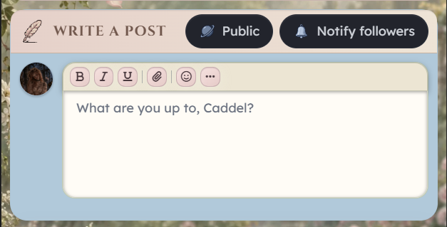

### Component map

| Selector | Component |
| --- | --- |
| `[data-profile="composer-slot"] > .surface-post` | Outer composer card |
| `[data-profile="composer-header"]` | WRITE A POST title row and top controls |
| `[data-profile="composer-header"] button` | Public and Notify followers buttons |
| `[data-profile="composer-body"]` | Avatar and editor area |
| `[data-profile="composer-toolbar"]` | Formatting toolbar |
| `[data-profile="composer-toolbar"] button` | Bold, italic, underline, attachment, emoji, and more |
| `[data-profile="composer-editor"]` | Editable text field |
| `[data-placeholder]::before` | Placeholder text |
| `[data-profile="composer-footer"]` | Terms, switch, and Post button area |

### Card shell and header

```css
.profile-theme-scope [data-profile="composer-slot"]
  > .surface-post {
  overflow: hidden;
  color: var(--theme-text) !important;
  background: var(--theme-panel) !important;
  border: 1px solid var(--theme-edge) !important;
  border-radius: 12px !important;
  box-shadow: var(--theme-shadow) !important;
}

.profile-theme-scope [data-profile="composer-header"] {
  color: #fff1cf !important;
  background: linear-gradient(100deg, #5b3a24, #38251a) !important;
  border-bottom: 1px solid rgba(213, 168, 93, .65) !important;
  border-radius: 11px 11px 0 0 !important;
}

.profile-theme-scope [data-profile="composer-header"] h3 {
  color: inherit !important;
  letter-spacing: .08em;
}

.profile-theme-scope [data-profile="composer-header"] button {
  color: #fff1cf !important;
  background: #30291f !important;
  border: 1px solid rgba(213, 168, 93, .55) !important;
}
```

### Body, toolbar, editor, and placeholder

```css
.profile-theme-scope [data-profile="composer-body"] {
  background: #c7ddeb !important;
  padding: 12px !important;
}

.profile-theme-scope [data-profile="composer-toolbar"] {
  color: #f6ead2 !important;
  background: #3b3026 !important;
  border-color: rgba(213, 168, 93, .55) !important;
}

.profile-theme-scope [data-profile="composer-toolbar"] button {
  color: #f6ead2 !important;
  background: #564331 !important;
  border: 1px solid rgba(235, 205, 140, .55) !important;
}

.profile-theme-scope [data-profile="composer-toolbar"]
  button[aria-pressed="true"] {
  color: #ffffff !important;
  background: #7c8766 !important;
  border-color: #f0d99f !important;
}

.profile-theme-scope [data-profile="composer-editor"] {
  min-height: 150px;
  color: #2b231d !important;
  background: #fff8e9 !important;
  border-color: rgba(137, 101, 48, .55) !important;
  caret-color: #6f3138;
}

.profile-theme-scope [data-profile="composer-editor"]
  [data-placeholder]::before {
  color: #7e746c !important;
  opacity: 1 !important;
}
```

### Footer switch

```css
.profile-theme-scope [data-profile="composer-footer"] {
  color: var(--theme-muted) !important;
}

.profile-theme-scope [data-profile="composer-footer"]
  input[type="checkbox"] + div {
  background: #665744 !important;
  border-color: #a78f6a !important;
}

.profile-theme-scope [data-profile="composer-footer"]
  input[type="checkbox"] + div::after {
  background: #fff3d3 !important;
}

.profile-theme-scope [data-profile="composer-footer"]
  input[type="checkbox"]:checked + div {
  background: #71805c !important;
}
```

Keep editor text and placeholder contrast high. Decorative textures should never make typed text difficult to read.

---

## SEE ALL and Popular Creations Buttons

These controls contain raster image plates and icons. Style the button image and the label separately.

| SEE ALL button | Popular Creations carousel arrow |
| --- | --- |
| 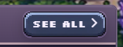 | 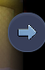 |

### SEE ALL plate and label

```css
.profile-theme-scope [data-profile="gallery-preview"]
  .dashboard-action-button img[src*="btn_pixel_plate"],
.profile-theme-scope [data-profile="popular-content"]
  .dashboard-action-button img[src*="btn_pixel_plate"] {
  filter: sepia(.92) saturate(1.75) hue-rotate(346deg)
          brightness(.86) contrast(1.28)
          drop-shadow(0 2px 2px rgba(0, 0, 0, .5)) !important;
}

.profile-theme-scope [data-profile="gallery-preview"]
  .dashboard-action-button span,
.profile-theme-scope [data-profile="popular-content"]
  .dashboard-action-button span {
  color: #fff1cf !important;
  text-shadow: 0 1px 2px rgba(0, 0, 0, .88) !important;
}
```

### Popular Creations scroll arrows

```css
.profile-theme-scope
  button[aria-label^="Scroll popular creations"] {
  background: #5b3a24 !important;
  border: 1px solid #d5a85d !important;
  box-shadow: inset 0 1px rgba(255, 241, 200, .35),
              0 2px 5px rgba(0, 0, 0, .5) !important;
}

.profile-theme-scope
  button[aria-label^="Scroll popular creations"] img {
  filter: sepia(1) saturate(1.8) hue-rotate(345deg)
          brightness(1.35) contrast(1.1) !important;
}

@media (hover: hover) {
  .profile-theme-scope
    button[aria-label^="Scroll popular creations"]:hover {
    background: #765034 !important;
    border-color: #f0cc83 !important;
  }
}
```

The `^=` operator matches both arrow labels because both begin with the same phrase.

---

## Comment, Share, and Like Buttons

```css
.profile-theme-scope [data-profile="post-like"],
.profile-theme-scope [data-profile="post-likes"],
.profile-theme-scope [data-profile="post-engagement"]
  button[aria-label="Comments"],
.profile-theme-scope [data-profile="post-engagement"]
  button[aria-label="Share"] {
  color: #fff1cf !important;
  background: linear-gradient(#5a432f, #3a2b20) !important;
  border: 1px solid #bd9457 !important;
  border-radius: 8px !important;
}

.profile-theme-scope [data-profile="post-engagement"]
  img[src*="feed_action_"],
.profile-theme-scope [data-profile="post-engagement"]
  img[src*="feed_filter_"] {
  filter: sepia(1) saturate(1.4) hue-rotate(345deg)
          brightness(1.35) !important;
}

.profile-theme-scope [data-profile="post-like"][aria-pressed="true"] {
  color: #ffffff !important;
  background: #71805c !important;
  border-color: #f0d99f !important;
}
```

### Recoloring raster UI icons

CSS `color` does not recolor the pixels of a PNG or WebP. Use a scoped `filter` on known UI assets instead.

```css
/* Good: only pixel icons inside the main profile tabs. */
.profile-theme-scope [data-profile="tab"]
  img[src*="/img/pixel/"] {
  filter: grayscale(1) sepia(.5) saturate(.6)
          brightness(1.9) contrast(.8) !important;
}

/* Avoid: this would also recolor portraits and gallery covers. */
/* .profile-theme-scope img { filter: sepia(1); } */
```

Useful starting points:

| Target | Filter |
| --- | --- |
| Warm gold | `sepia(1) saturate(1.8) hue-rotate(345deg) brightness(1.35) contrast(1.1)` |
| Cream | `grayscale(1) sepia(.5) saturate(.6) brightness(1.9) contrast(.8)` |
| Muted moss | `sepia(.8) saturate(.8) hue-rotate(55deg) brightness(.85) contrast(1.15)` |
| Burgundy | `sepia(1) saturate(2.2) hue-rotate(305deg) brightness(.72) contrast(1.25)` |
| Moon blue | `grayscale(.3) sepia(.4) saturate(1.7) hue-rotate(165deg) brightness(1.05)` |

Filter functions run from left to right. The same filter can look different on a blue plate and a gray icon.

---

## Mobile Profile Repairs

Start with the desktop component and override only what becomes too wide, clipped, or misaligned below the breakpoint.

### Responsive result example

**Desktop**


**Mobile**

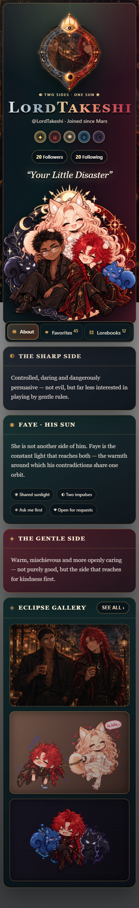

```css
@media (max-width: 767px) {
  .profile-theme-scope [data-profile="tabs"] {
    display: flex !important;
    overflow-x: auto;
    gap: 4px;
    scrollbar-width: none;
  }

  .profile-theme-scope [data-profile="tab"] {
    flex: 0 0 auto;
    min-width: 52px;
    padding: 6px 8px !important;
    font-size: 10px !important;
  }

  .profile-theme-scope [data-profile="composer-header"] {
    display: flex !important;
    flex-wrap: wrap;
    gap: 8px;
    padding: 9px !important;
  }

  .profile-theme-scope [data-profile="composer-body"] {
    padding: 9px !important;
  }

  .profile-theme-scope [data-profile="composer-editor"] {
    min-height: 140px;
  }

  .profile-theme-scope [data-profile="about"] [role="tablist"] {
    display: grid !important;
    grid-template-columns: repeat(5, minmax(0, 1fr));
    gap: 3px;
  }

  .profile-theme-scope [data-profile="about"] [role="tab"] {
    width: 100% !important;
    min-width: 0 !important;
    margin: 0 !important;
  }
}
```

Mobile failure checklist:

- A fixed pixel width is wider than the viewport.
- A flex row cannot wrap.
- A decorative pseudo-element creates horizontal overflow.
- The frame was scaled but the portrait inset was not.
- A desktop margin still pushes the avatar or composer sideways.
- Text is present but has insufficient contrast on the mobile background.
- The browser window looks narrow, but the real viewport is still wider than `767px`.

## Profile Selector Quick Reference

### Identity and navigation

| Selector | Use |
| --- | --- |
| `[data-profile="hero"]` | Banner and identity block |
| `[data-profile="avatar-wrap"]` | Decorative avatar-frame anchor |
| `[data-profile="avatar"]` | Avatar crop, border, and shadow |
| `[data-profile="avatar-img"]` | Portrait size and `object-fit` |
| `[data-profile="avatar-actions"]` | Avatar action controls and stacking layer |
| `[data-profile="avatar-remove"]` | Remove-avatar control |
| `[data-profile="level"]` / `[data-profile="level-icon"]` | Level label and icon |
| `[data-profile="streak"]` / `[data-profile="streak-icon"]` | Streak counter and icon |
| `[data-profile="member-since-icon"]` | Calendar icon |
| `[data-profile="count-followers"]` | Followers button |
| `[data-profile="count-following"]` | Following button |
| `[data-profile="tabs"]` / `[data-profile="tab"]` | Main navigation |
| `[data-profile="tab-notch"]` | Decorative tab notch |
| `[data-profile="tab-count"]` | Number shown on a tab |

### Content, composer, and actions

| Selector | Use |
| --- | --- |
| `[data-profile="about"]` | About Me section root |
| `[data-profile="about-card"]` | Native About Me content card |
| `[data-profile="body-inner"]` | Main body positioning anchor for large stickers |
| `[data-profile="about-edit"]` | Edit About Me button |
| `[data-profile="about-more"]` | Show more button |
| `[data-profile="additional-info"]` | Role, availability, gender, and relationship information |
| `[data-profile="gallery-preview"]` | Gallery preview shell |
| `[data-profile="gallery-grid"]` | Gallery image grid |
| `[data-profile="popular-content"]` | Popular Creations shell and carousel |
| `[data-profile="feed-list"]` | Post feed container |
| `[data-profile="post"]` | One post card |
| `[data-profile="post-header"]` | Post author and metadata row |
| `[data-profile="post-body"]` | Main post content |
| `[data-profile="post-engagement"]` | Like, comment, and share row |
| `[data-profile="post-like"]` / `[data-profile="post-likes"]` | Like controls and reactions |
| `[data-profile="post-comment-count"]` | Comment count text |
| `[data-profile="composer-slot"]` | Write a Post placement area |
| `[data-profile="composer-header"]` | Composer title and options row |
| `[data-profile="composer-body"]` | Composer avatar and editor body |
| `[data-profile="composer-toolbar"]` | Formatting controls |
| `[data-profile="composer-editor"]` | Editable text field |
| `[data-profile="composer-footer"]` | Terms, switch, and Post action area |

### Useful attribute patterns

| Pattern | Use |
| --- | --- |
| `[aria-selected="true"]` | Currently selected tab |
| `[aria-pressed="true"]` | Pressed toolbar or like button |
| `button[aria-label="Comments"]` | Comment action |
| `button[aria-label="Share"]` | Share action |
| `button[aria-label^="Scroll popular creations"]` | Both Popular Creations arrows |
| `img[src*="btn_pixel_plate"]` | Pixel plate behind dashboard buttons |
| `img[src*="pixel_arrow.webp"]` | Pixel arrow image |
| `img[src*="paper-tab.webp"]` | Paper plate behind About icons |
| `input[type="checkbox"] + div` | Visual track after a custom checkbox |
| `[data-placeholder]::before` | Editor placeholder pseudo-element |

Attribute matching operators:

```css
[attr="exact value"]   /* exact match */
[attr^="starts with"]  /* begins with */
[attr$="ends with"]    /* ends with */
[attr*="contains"]     /* contains text */
```

---

## Profile CSS Troubleshooting

### If the safety checker reports incomplete CSS

1. Look at the end of the CSS first. An abrupt ending often identifies the broken rule.
2. Search for a property with no value, such as `background-color:` followed by `}` or the end of the file.
3. Check that every opening `{` has a closing `}`.
4. Check that comments contain both `/*` and `*/`.
5. Check that every quoted `url("...")` has a closing quote and parenthesis.
6. Remove only the newest block temporarily and preview again. Keep the original draft intact.

```css
/* Broken: missing value */
.card { background-color: }

/* Broken: missing closing brace */
.card {
  color: #fff;

/* Broken: unfinished URL */
.frame { background-image: url("frame.png; }

/* Valid */
.card {
  color: #fff;
  background-color: #231d18;
}
```

### Final profile test checklist

- Test desktop and a verified viewport at or below `767px`.
- Check every main tab and every About Me icon tab.
- Check Write a Post while empty, focused, and containing text.
- Check Public, Notify followers, the switch, and the Post button.
- Check SEE ALL, both carousel arrows, comment, share, and like states.
- Confirm that avatar art does not cover the remove button, level, or streak badge.
- Confirm that decorative layers do not block clicks.
- Confirm that portraits and gallery covers are not caught by broad image filters.
- Preview, save, and publish as separate deliberate steps.

---

# Part III — Shared Animations for Laboratory and Profile Themes

CSS animation mechanics and @keyframes work in both editors. The visual effect can stay the same; only the element that carries the pseudo-element may differ. The collection below remains unchanged and is now grouped at the end of the handbook.

> The existing full-page examples use html::before and html::after, so the same snippet can run from either editor. For a component-scoped, scrollable foreground layer, use the final shared firefly/star recipe in this section.

## Background Effects

### Animated Fireshine

Create an animated fire effect at the bottom of the screen.

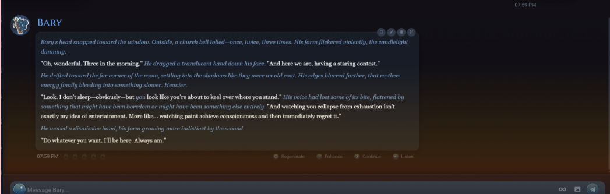

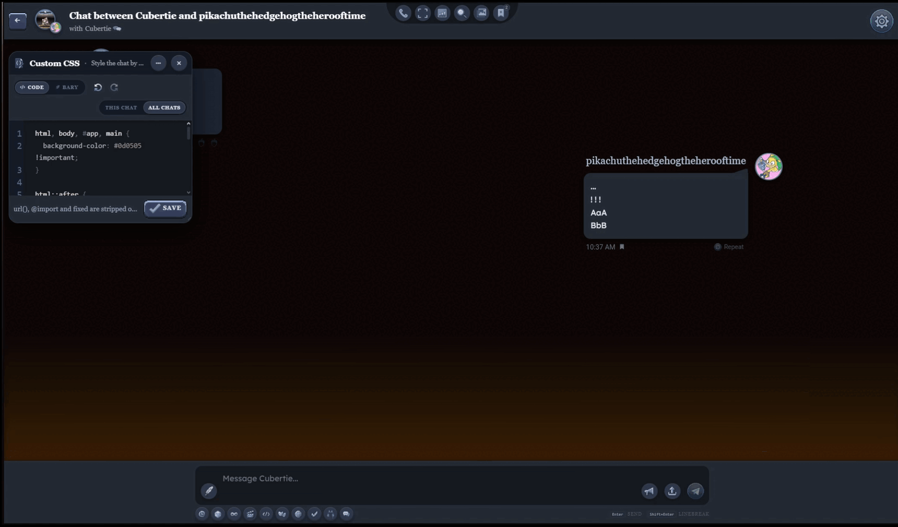

```css
html, body, #app, main {
  background-color: #0d0505 !important;
}

html::after {
  content: "";
  position: fixed;
  bottom: 0;
  left: 0;
  width: 100vw;
  height: 35vh; /* How high the fire should reach */
  pointer-events: none;
  z-index: 1;
  
  background: linear-gradient(to top, rgba(242, 76, 0, 0.35), rgba(242, 153, 0, 0.15), transparent);
  filter: blur(8px);
  
  animation: lorebaryFire 0.15s ease-in-out infinite alternate;
}

@keyframes lorebaryFire {
  0% {
    transform: scaleY(1);
    opacity: 0.85;
  }
  100% {
    transform: scaleY(1.12) scaleX(1.01);
    opacity: 1;
  }
}

div[class*="chat"], div[class*="message"], .messages-container {
  position: relative;
  z-index: 5 !important;
}
```

---

### Animated Rain

Create a gentle animated rain effect as a background.

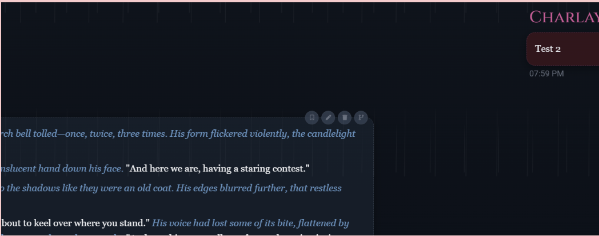

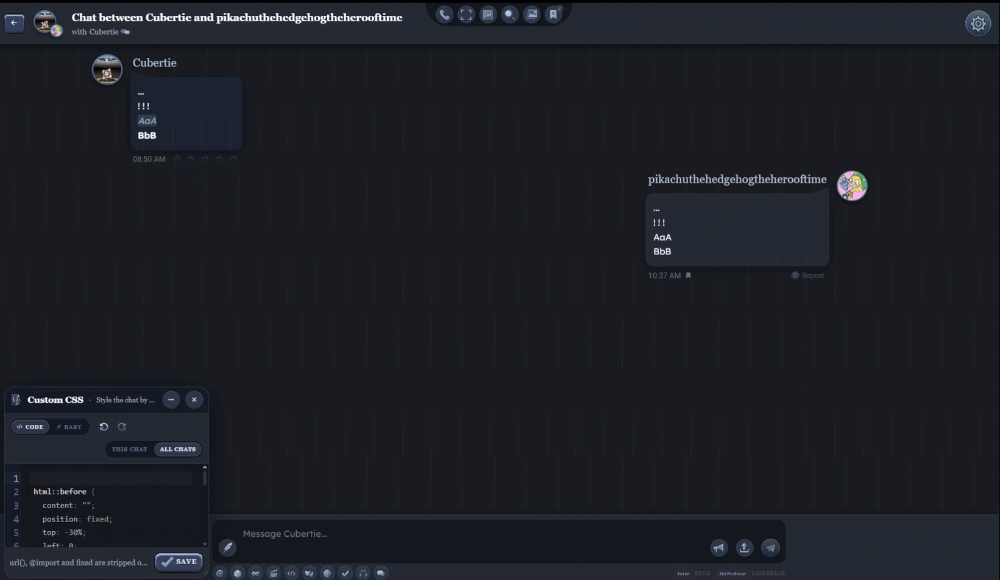

```css
html, body, #app, main {
  background-color: #06080c !important;
  position: relative;
}

html::before {
  content: "";
  position: fixed;
  top: -30%;
  left: 0;
  width: 100vw;
  height: 160vh;
  pointer-events: none;
  z-index: 1;
  opacity: 0.12; /* Brightness of first layer */

  background: conic-gradient(from 180deg at 50% 50%, 
    transparent 0deg, 
    rgba(255, 255, 255, 0.5) 0.5deg, 
    transparent 1deg
  );
  background-size: 50px 220px;

  animation: gentleSummerRain1 1.2s linear infinite !important;
}

html::after {
  content: "";
  position: fixed;
  top: -30%;
  left: 0;
  width: 100vw;
  height: 160vh;
  pointer-events: none;
  z-index: 1;
  opacity: 0.10;

  background: conic-gradient(from 180deg at 50% 50%, 
    transparent 0deg, 
    rgba(255, 255, 255, 0.5) 0.5deg, 
    transparent 1deg
  );
  background-size: 45px 240px;

  animation: gentleSummerRain2 1.1s linear infinite !important;
}

@keyframes gentleSummerRain1 {
  0% {
    transform: translateY(0px);
    background-position: 0px 0px;
  }
  100% {
    transform: translateY(220px);
    background-position: 0px 440px;
  }
}

@keyframes gentleSummerRain2 {
  0% {
    transform: translateY(0px);
    background-position: 25px 0px;
  }
  100% {
    transform: translateY(240px);
    background-position: 25px 480px;
  }
}

div[class*="chat"], div[class*="message"], .messages-container, .chat-layout {
  position: relative;
  z-index: 5 !important;
}
```

---

### Animated Fog

Create a gentle fog over the whole screen

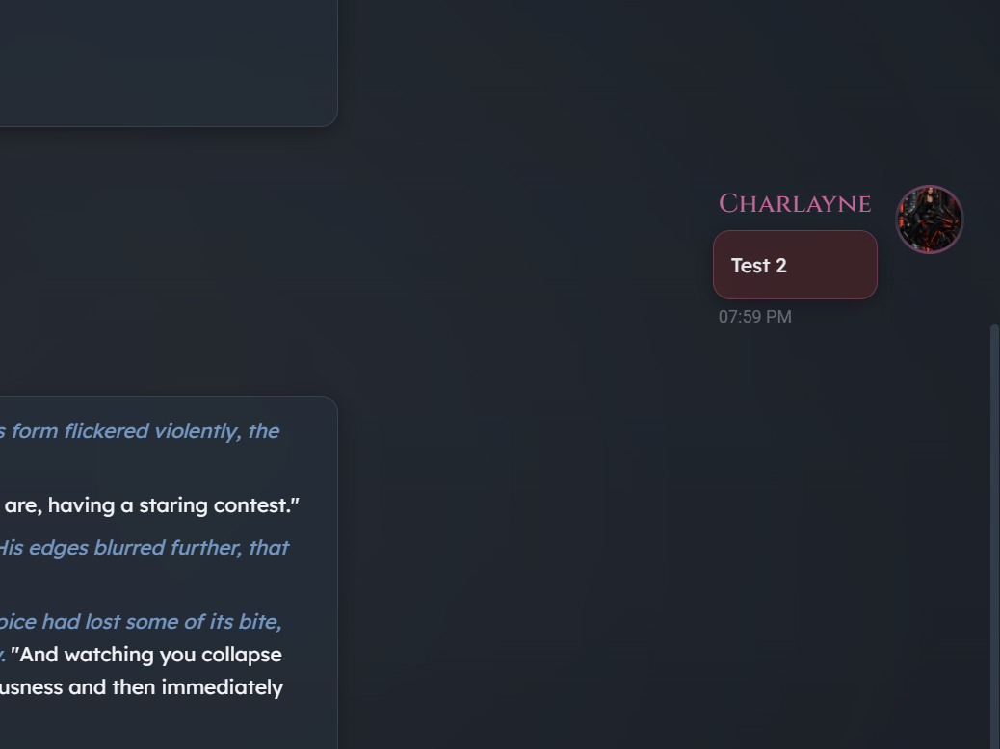

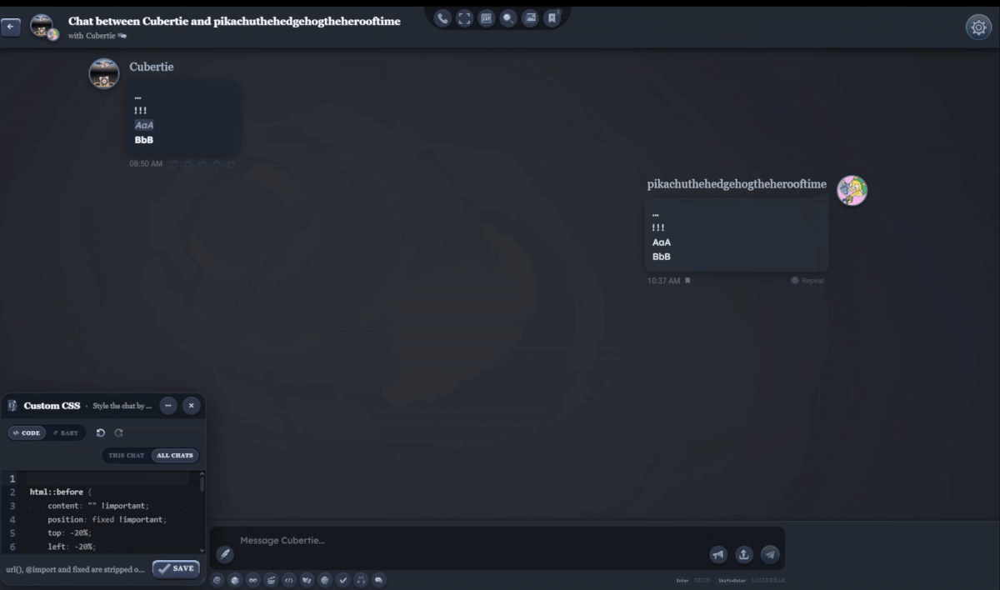

```css
html, body, #app, main {
    background-color: #0b0d11 !important; /* Dark blue-gray as base */
    position: relative;
    overflow: hidden;
}

html::before {
    content: "" !important;
    position: fixed !important;
    top: -20%;
    left: -20%;
    width: 140vw;
    height: 140vh;
    pointer-events: none;
    z-index: 1 !important;
    opacity: 0.18; 

    background-image: 
        radial-gradient(circle at 30% 40%, rgba(200, 210, 220, 0.4) 0%, transparent 60%),
        radial-gradient(circle at 70% 60%, rgba(180, 195, 210, 0.3) 0%, transparent 70%);
    filter: blur(40px);
    animation: laboratoryFogMoving1 25s ease-in-out infinite alternate !important;
}

html::after {
    content: "" !important;
    position: fixed !important;
    top: -30%;
    left: -30%;
    width: 160vw;
    height: 160vh;
    pointer-events: none;
    z-index: 2 !important;
    opacity: 0.12;

    background-image: 
        radial-gradient(circle at 50% 50%, rgba(220, 225, 235, 0.3) 0%, transparent 65%),
        radial-gradient(circle at 20% 80%, rgba(160, 175, 190, 0.2) 0%, transparent 55%);
    filter: blur(60px);
    animation: laboratoryFogMoving2 35s ease-in-out infinite alternate !important;
}

@keyframes laboratoryFogMoving1 {
    0% {
        transform: translate(0px, 0px) scale(1) rotate(0deg);
    }
    50% {
        transform: translate(40px, 30px) scale(1.1) rotate(3deg);
    }
    100% {
        transform: translate(-20px, 50px) scale(0.95) rotate(-2deg);
    }
}

@keyframes laboratoryFogMoving2 {
    0% {
        transform: translate(0px, 0px) scale(1) rotate(0deg);
    }
    50% {
        transform: translate(-50px, 40px) scale(1.05) rotate(-4deg);
    }
    100% {
        transform: translate(30px, -20px) scale(1) rotate(2deg);
    }
}

div[class*="chat"], div[class*="message"], .messages-container, .chat-layout {
    position: relative;
    z-index: 5 !important;
}
```

---

### Animated Snow

Let gentle snow fall in the background.


```css
html, body, #app, main {
    background-color: #060810 !important;
    position: relative;
    overflow: hidden;
}

html::before {
    content: "" !important;
    position: fixed !important;
    top: -10%;
    left: -10%;
    width: 120vw;
    height: 120vh;
    pointer-events: none;
    z-index: 1 !important;
    opacity: 0.22;
    background-image: 
        radial-gradient(circle, #ffffff 10%, transparent 11%),
        radial-gradient(circle, #ffffff 7%, transparent 8%),
        radial-gradient(circle, #ffffff 9%, transparent 10%),
        radial-gradient(circle, #ffffff 6%, transparent 7%);
    background-size: 140px 140px; 
    background-position: 13px 27px, 89px 113px, 47px 71px, 119px 43px;

    animation: 
        endlessSnow1 22s linear infinite,
        snowWobble1 7s ease-in-out infinite alternate !important;
}

html::after {
    content: "" !important;
    position: fixed !important;
    top: -10%;
    left: -10%;
    width: 120vw;
    height: 120vh;
    pointer-events: none;
    z-index: 2 !important;
    opacity: 0.14;
    background-image: 
        radial-gradient(circle, #ffffff 6%, transparent 7%),
        radial-gradient(circle, #ffffff 4%, transparent 5%),
        radial-gradient(circle, #ffffff 5%, transparent 6%),
        radial-gradient(circle, #ffffff 3%, transparent 4%);
    background-size: 110px 110px;
    background-position: 7px 83px, 53px 19px, 97px 61px, 29px 101px;

    animation: 
        endlessSnow2 34s linear infinite,
        snowWobble2 11s ease-in-out infinite alternate !important;
}

@keyframes endlessSnow1 {
    0% { 
        background-position: 13px 27px, 89px 113px, 47px 71px, 119px 43px; 
    }
    100% { 
        background-position: 13px 447px, 89px 533px, 47px 491px, 119px 463px; 
    }
}

@keyframes endlessSnow2 {
    0% { 
        background-position: 7px 83px, 53px 19px, 97px 61px, 29px 101px; 
    }
    100% { 
        background-position: 7px 413px, 53px 349px, 97px 391px, 29px 431px; 
    }
}

@keyframes snowWobble1 {
    0% { transform: translateX(0px) rotate(0deg) scale(1); }
    50% { transform: translateX(30px) rotate(1deg) scale(1.04); }
    100% { transform: translateX(-20px) rotate(-1deg) scale(0.96); }
}

@keyframes snowWobble2 {
    0% { transform: translateX(15px) rotate(0deg); }
    100% { transform: translateX(-35px) rotate(2deg); }
}

div[class*="chat"], div[class*="message"], .messages-container, .chat-layout {
    position: relative;
    z-index: 5 !important;
}
```

---

### Animated Fireflies

Let fireflies fly through your screen


```css
html::before,
html::after {
  content: "" !important;
  position: fixed !important;
  inset: 0;
  width: 100vw;
  height: 100vh;
  height: 100dvh;
  pointer-events: none;
  z-index: 1 !important;
  background-repeat: repeat;
  will-change: background-position, opacity;
}

html::before {
  background-image:
    radial-gradient(circle, rgba(204,255,51,1) 0 1px, rgba(204,255,51,.32) 2px, transparent 7px),
    radial-gradient(circle, rgba(175,255,40,.95) 0 1px, rgba(175,255,40,.20) 2px, transparent 6px),
    radial-gradient(circle, rgba(220,255,80,.90) 0 1px, rgba(220,255,80,.26) 3px, transparent 8px),
    radial-gradient(circle, rgba(204,255,51,.82) 0 1px, rgba(204,255,51,.14) 2px, transparent 5px);
  background-size: 277px 331px, 349px 283px, 421px 367px, 313px 397px;
  background-position: 43px 287px, 213px 161px, 127px 343px, 267px 119px;
  animation:
    fireflyDriftA 43s linear infinite,
    fireflyPulseA 7.4s ease-in-out infinite !important;
  animation-delay: -17s, -2.6s !important;
}

html::after {
  background-image:
    radial-gradient(circle, rgba(255,244,120,.92) 0 1px, rgba(255,244,120,.22) 2px, transparent 7px),
    radial-gradient(circle, rgba(167,255,67,.86) 0 1px, rgba(167,255,67,.16) 3px, transparent 6px),
    radial-gradient(circle, rgba(224,255,137,.76) 0 1px, rgba(224,255,137,.12) 2px, transparent 5px);
  background-size: 389px 457px, 293px 419px, 463px 347px;
  background-position: 319px 391px, 91px 247px, 241px 79px;
  animation:
    fireflyDriftB 58s linear infinite,
    fireflyPulseB 10.8s ease-in-out infinite !important;
  animation-delay: -31s, -7.1s !important;
}

@keyframes fireflyDriftA {
  0% {
    background-position: 43px 287px, 213px 161px, 127px 343px, 267px 119px;
  }
  36% {
    background-position: 72px 91px, 187px -31px, 158px 172px, 239px -102px;
  }
  71% {
    background-position: 31px -142px, 249px -271px, 109px -79px, 296px -314px;
  }
  100% {
    background-position: 86px -389px, 169px -497px, 181px -286px, 231px -541px;
  }
}

@keyframes fireflyDriftB {
  0% {
    background-position: 319px 391px, 91px 247px, 241px 79px;
  }
  44% {
    background-position: 281px 103px, 128px -17px, 207px -186px;
  }
  76% {
    background-position: 337px -151px, 73px -273px, 269px -397px;
  }
  100% {
    background-position: 263px -487px, 146px -612px, 219px -731px;
  }
}

@keyframes fireflyPulseA {
  0%, 100% { opacity: .12; }
  18% { opacity: .42; }
  37% { opacity: .20; }
  61% { opacity: .50; }
  79% { opacity: .16; }
}

@keyframes fireflyPulseB {
  0%, 100% { opacity: .08; }
  26% { opacity: .30; }
  49% { opacity: .12; }
  73% { opacity: .36; }
  89% { opacity: .10; }
}
```

---

### Animated Dustparticle

Let dust hover across the screen


```css
html, body, #app, main {
    background-color: #020204 !important; 
    position: relative;
    overflow: hidden;
}

html::before {
    content: "" !important;
    position: fixed !important;
    width: 1.5px !important;
    height: 1.5px !important;
    top: 0;
    left: 0;
    background: transparent;
    pointer-events: none;
    z-index: 2 !important;
    box-shadow: 
        120px 240px #ffffff,   340px 80px rgba(255,255,255,0.8),  560px 420px #ffffff,
        780px 150px rgba(255,255,255,0.9),  910px 620px #ffffff,  210px 710px rgba(255,255,255,0.7),
        430px 890px #ffffff,   850px 330px rgba(255,255,255,0.8),  620px 780px #ffffff,
        150px 520px rgba(255,255,255,0.9),  950px 210px #ffffff,  710px 920px rgba(255,255,255,0.7),
        1100px 110px #ffffff,  1250px 480px rgba(255,255,255,0.8), 1380px 750px #ffffff,
        1520px 310px rgba(255,255,255,0.9), 1680px 820px #ffffff, 1850px 190px rgba(255,255,255,0.7),
        50vw 25vh #ffffff,     85vw 60vh rgba(255,255,255,0.9),   15vw 75vh #ffffff;

    animation: naturalCosmosTwinkle 4s ease-in-out infinite alternate !important;
}

html::after {
    content: "" !important;
    position: fixed !important;
    top: -30%;
    left: -30%;
    width: 160vw;
    height: 160vh;
    pointer-events: none;
    z-index: 1 !important;
    opacity: 0.22;

    background-image: 
        radial-gradient(circle at 25% 25%, rgba(138, 43, 226, 0.3) 0%, transparent 55%),  
        radial-gradient(circle at 75% 65%, rgba(0, 102, 204, 0.25) 0%, transparent 60%);  
    
    filter: blur(60px);
    animation: cosmosNebulaMove 50s ease-in-out infinite alternate !important;
}

@keyframes naturalCosmosTwinkle {
    0% {
        opacity: 0.25;
        transform: scale(0.98);
    }
    100% {
        opacity: 0.75;
        transform: scale(1.02); 
    }
}

/* --- ANIMATION: NEBULA SWIRL --- */
@keyframes cosmosNebulaMove {
    0% { transform: translate(0px, 0px) rotate(0deg); }
    100% { transform: translate(30px, 40px) rotate(1deg); }
}

div[class*="chat"], div[class*="message"], .messages-container, .chat-layout {
    position: relative;
    z-index: 5 !important;
}
```

---

### Animated Stars

Let stars twinkle in your background


```css
html, body, #app, main {
    background-color: #020204 !important; 
    position: relative;
    overflow: hidden;
}

html::before {
    content: "" !important;
    position: fixed !important;
    width: 1.2px !important;
    height: 1.2px !important;
    top: 0;
    left: 0;
    background: transparent;
    pointer-events: none;
    z-index: 2 !important;
    border-radius: 50% !important;

    box-shadow: 
        120px 240px #ffffff,   340px 80px rgba(255,255,255,0.4),  560px 420px #ffffff,
        780px 150px rgba(255,255,255,0.7),  910px 620px #ffffff,  210px 710px rgba(255,255,255,0.3),
        430px 890px #ffffff,   850px 330px rgba(255,255,255,0.5),  620px 780px #ffffff,
        150px 520px rgba(255,255,255,0.6),  950px 210px #ffffff,  710px 920px rgba(255,255,255,0.4),
        1100px 110px #ffffff,  1250px 480px rgba(255,255,255,0.5), 1380px 750px #ffffff,
        1520px 310px rgba(255,255,255,0.7), 1680px 820px #ffffff, 1850px 190px rgba(255,255,255,0.3),
        50vw 25vh rgba(255,255,255,0.8),     85vw 60vh #ffffff,   15vw 75vh rgba(255,255,255,0.5),
        250px 180px rgba(255,255,255,0.4), 680px 50px #ffffff,   1150px 800px rgba(255,255,255,0.5),
        1420px 910px #ffffff,  1710px 430px rgba(255,255,255,0.6),
        250px 350px 0 1.2px #ffffff,        
        1450px 180px 0 1.5px #ffffff,       
        650px 600px 0 1.3px rgba(255,255,255,0.9), 
        80vw 80vh 0 1.4px #ffffff,          
        35vw 75vh 0 1.2px rgba(255,255,255,0.9);   

    animation: staticCosmosTwinkle 5s ease-in-out infinite alternate !important;
}

html::after {
    content: "" !important;
    position: fixed !important;
    top: -30%;
    left: -30%;
    width: 160vw;
    height: 160vh;
    pointer-events: none;
    z-index: 1 !important;
    opacity: 0.20;

    background-image: 
        radial-gradient(circle at 25% 25%, rgba(138, 43, 226, 0.3) 0%, transparent 55%),  
        radial-gradient(circle at 75% 65%, rgba(0, 102, 204, 0.25) 0%, transparent 60%);  
    
    filter: blur(60px);
    animation: cosmosNebulaMove 60s ease-in-out infinite alternate !important;
}

@keyframes staticCosmosTwinkle {
    0% { opacity: 0.3; }
    100% { opacity: 0.85; }
}

@keyframes cosmosNebulaMove {
    0% { transform: translate(0px, 0px) rotate(0deg); }
    100% { transform: translate(20px, 30px) rotate(0.5deg); }
}

div[class*="chat"], div[class*="message"], .messages-container, .chat-layout {
    position: relative;
    z-index: 5 !important;
}
```

---

### Animated Sunshine Underwater

Sunshine under water with small rising bubbles


```css
html, body, #app, main {
    background-color: #080a10 !important; 
    position: relative;
    overflow: hidden;
}

html::before {
    content: "" !important;
    position: fixed !important;
    bottom: -20% !important;
    left: -10vw !important;
    width: 120vw !important;
    height: 140vh !important;
    pointer-events: none !important;
    z-index: 1 !important;
    opacity: 0.35;

    background-image: 
        radial-gradient(circle at 120px 280px, #ffffff 1px, transparent 2px),
        radial-gradient(circle at 120px 280px, transparent 2px, rgba(255, 255, 255, 0.3) 3px, transparent 4px),
        radial-gradient(circle at 380px 140px, #ffffff 0.5px, transparent 1.5px),
        radial-gradient(circle at 380px 140px, transparent 1.5px, rgba(255, 255, 255, 0.25) 2.5px, transparent 3.5px);
    
    background-size: 500px 500px, 700px 700px !important;
    background-repeat: repeat !important;

    animation: 
        bubblesUltraSlowRise 65s linear infinite,
        bubblesUltraSlowWobble 9s ease-in-out infinite alternate !important;
}

html::after {
    content: "" !important;
    position: fixed !important;
    top: -20% !important; 
    left: 10% !important; 
    width: 100vw !important;
    height: 70vh !important; 
    pointer-events: none !important;
    z-index: 2 !important; 
    background: linear-gradient(135deg, 
        rgba(255, 255, 255, 0.22) 0%, 
        rgba(255, 255, 255, 0.12) 15%, 
        rgba(255, 255, 255, 0.04) 40%, 
        transparent 70%
    );

    filter: blur(45px) !important;
    animation: holyLightGlow 8s ease-in-out infinite alternate !important;
    transform-origin: top center !important;
}

@keyframes bubblesUltraSlowRise {
    0% { background-position: 0px 0px, 200px 0px; }
    100% { background-position: 0px -3500px, 200px -3500px; }
}

@keyframes bubblesUltraSlowWobble {
    0% { transform: translateX(0px); }
    50% { transform: translateX(20px); }
    100% { transform: translateX(-15px); }
}

@keyframes holyLightGlow {
    0% {
        opacity: 0.40; 
        transform: scale(0.95) rotate(0deg);
    }
    50% {
        opacity: 0.85; 
        transform: scale(1.05) rotate(1deg); 
    }
    100% {
        opacity: 0.50;
        transform: scale(0.98) rotate(-0.5deg);
    }
}

div[class*="chat"], div[class*="message"], .messages-container, .chat-layout {
    position: relative;
    z-index: 5 !important;
}
```

---

### Animated Soft Godly Light

Creates a soft shine at the top of the screen.


```css
html, body, #app, main {
    background-color: #06080c !important; 
    position: relative;
    overflow: hidden;
}

html::after {
    content: "" !important;
    position: fixed !important;
    top: -25% !important; 
    left: 0 !important;
    right: 0 !important;
    margin: 0 auto !important; 
    width: 85vw !important; 
    height: 80vh !important; 
    pointer-events: none !important;
    z-index: 1 !important; 
    background: linear-gradient(to bottom, 
        rgba(255, 210, 120, 0.26) 0%, 
        rgba(255, 185, 80, 0.16) 20%, 
        rgba(230, 150, 50, 0.05) 50%, 
        transparent 85%
    );

    filter: blur(55px) !important;
    animation: holyGoldenGlow 9s ease-in-out infinite alternate !important;
    transform-origin: top center !important;
}

@keyframes holyGoldenGlow {
    0% {
        opacity: 0.45; 
        transform: scaleX(0.92) scaleY(0.96); 
    }
    50% {
        transform: scaleX(1.06) scaleY(1.03); 
    }
    100% {
        opacity: 0.55;
        transform: scaleX(0.96) scaleY(0.98);
    }
}

div[class*="chat"], div[class*="message"], .messages-container, .chat-layout {
    position: relative;
    z-index: 5 !important;
}
```

---

## Shared Scrollable Foreground Fireflies and Stars

The `@keyframes` and gradient particles are identical in Laboratory and Profile Themes. Only the two mounting selectors differ. Use `position: absolute`, not `fixed`, when the particles should move with the themed content while scrolling.


```css
/* The scrolling container in each theme area. */
.lab-theme-scope,
.profile-theme-scope[data-profile="scope"] {
  position: relative;
}

/* The same visual layer is mounted on both theme roots. */
.lab-theme-scope::before,
.profile-theme-scope[data-profile="scope"]::before {
  content: "";
  position: absolute;
  inset: 0;
  z-index: 40;
  pointer-events: none;
  background:
    radial-gradient(circle, #fff6a9 0 18%, #d7ff75 24%, transparent 65%)
      12% 18% / 10px 10px no-repeat,
    radial-gradient(circle, #fff8bf 0 16%, #b9ff75 26%, transparent 67%)
      72% 42% / 8px 8px no-repeat,
    radial-gradient(circle, #ffffff 0 15%, #ffe89a 25%, transparent 68%)
      88% 74% / 7px 7px no-repeat;
  animation: shared-particle-drift 7s ease-in-out infinite alternate,
             shared-particle-blink 2.4s ease-in-out infinite;
}

@keyframes shared-particle-drift {
  from { transform: translate3d(-5px, 0, 0); }
  to   { transform: translate3d(8px, -12px, 0); }
}

@keyframes shared-particle-blink {
  0%, 100% { opacity: .35; filter: brightness(.9); }
  45%      { opacity: 1; filter: brightness(1.6); }
}

@media (prefers-reduced-motion: reduce) {
  .lab-theme-scope::before,
  .profile-theme-scope[data-profile="scope"]::before {
    animation: none !important;
    opacity: .65;
  }
}
```

Keep the particle count and size modest on mobile. `pointer-events: none` prevents the foreground layer from blocking controls. `transform`, `filter`, and `opacity` can create stacking contexts, so check that menus and dialogs still appear above the decoration.

### Reusing any animation in both editors

1. Keep the visual properties and `@keyframes` unchanged.
2. Replace the original mounting selector with both theme roots, separated by a comma.
3. Use `absolute` for an effect that scrolls with the themed content.
4. Use `fixed` only when an effect should remain attached to the viewport.
5. Add a `prefers-reduced-motion` rule for moving effects.

---

## Changelog

- **2026-10-11:** Added a number of snippets from @pikachuthehedgehogtheherooftime
- **2026-10-10:** Replaced legacy Laboratory button snippets with the live-verified LoreBary 2.5 composer and tool-row selectors. Added dedicated styling maps for Write for me, Time skip, Dice roll, HTML Mode, Visual Expressions, Polish replies, Scene music, Reply choices, and their long-press settings and dropdowns.
- **2026-10-10:** Added Part II for Profile Themes with example images, typography, sticker positioning, status-card layout, and before/after comparisons. Moved the animation collection to Part III and added a shared Laboratory/Profile foreground-particle recipe.
- **2026-07-17:** Previous Laboratory / Chat Themes guide update.

**Last Updated:** 2026-10-11
