# LoreBary CSS Quick Guide

@harp, thanks for your awesome snippets 🫶🏻

---

## Choose the Correct Theme Area

LoreBary currently has two separate CSS surfaces. Their selectors are **not interchangeable**.

| Theme area | Root scope | Main attributes | Use it for |
| --- | --- | --- | --- |
| Laboratory / Chat Themes | `.lab-theme-scope` | `[data-lab]`, `[data-lab-role]` | Chat messages, the Laboratory header and footer, 2.5 composer controls, long-press menus, and chat effects |
| Profile Themes | `.profile-theme-scope` | `[data-profile]`, ARIA states and labels | Profile avatars, navigation tabs, About Me, Write a Post, Gallery, Popular Creations, and feed posts |

> **Safe workflow:** Preview first. A working preview is not the same as a saved theme, and a saved draft is not the same as a published update. Keep a copy of the current CSS before larger changes.

Use narrow, stable selectors. Avoid broad rules such as `button { ... }` or `.profile-theme-scope img { ... }` unless every matching element should really change.

---

## 📋 Table of Contents

- [Choose the Correct Theme Area](#choose-the-correct-theme-area)
- [Converting Images to Base64](#converting-images-to-base64)
  - [How to Get the data:webp Base64 Code](#how-to-get-the-datawebp-base64-code)
- [How to Import CSS Images in Lorebary](#how-to-import-css-images-in-lorebary)
- [Part I — Laboratory / Chat Themes](#part-i--laboratory--chat-themes)
- [Avatar Customization](#avatar-customization)
  - [Image around Avatar](#image-around-avatar)
  - [Avatar Glow on Hover](#avatar-glow-on-hover)
  - [Lift Hover](#lift-hover)
  - [Greyscale to Color on Hover](#greyscale-to-color-on-hover)
  - [Remove Avatar Outline/Gradient](#remove-avatar-outlinegradient)
  - [Square Avatar Boxes](#square-avatar-boxes)
  - [Small Avatars with Glowing Effect](#small-avatars-with-glowing-effect)
  - [Large Avatars Filling Portrait](#large-avatars-filling-portrait)
  - [Avatar Ring Glow](#avatar-ring-glow)
- [Visual Expressions](#visual-expressions)
  - [Custom Visual Expression Icons](#custom-visual-expression-icons)
  - [Glowing Expression Portraits](#glowing-expression-portraits)
  - [Move Expression Portraits to the Right](#move-expression-portraits-to-the-right)
  - [Floating Expression Portraits](#floating-expression-portraits)
  - [Expression Toggle Button Colors](#expression-toggle-button-colors)
- [Chat Bubble Effects](#chat-bubble-effects)
  - [Remove Bubble Message Background](#remove-bubble-message-background)
  - [Bubble Hover Lift](#bubble-hover-lift)
  - [Button Bubbles](#button-bubbles)
  - [Custom Message Bubble Backgrounds](#custom-message-bubble-backgrounds)
  - [Different User and Character Message Bubbles](#different-user-and-character-message-bubbles)
  - [Bubble Tail Effects and Removal](#bubble-tail-effects-and-removal)
  - [Bubble Transparency Without Fading Text](#bubble-transparency-without-fading-text)
  - [Decorative Message Bubble Ornaments](#decorative-message-bubble-ornaments)
  - [Message Bubble Hover Glow](#message-bubble-hover-glow)
- [Message Layout](#message-layout)
  - [Message Left Aligned](#message-left-aligned)
  - [Centered Chat Messages](#centered-chat-messages)
  - [Colorize Text Selection](#colorize-text-selection)
  - [Change the Rating Symbol](#change-the-rating-symbol)
  - [Hide Timestamp](#hide-timestamp)
  - [Move Timestamp by Name (Right Side)](#move-timestamp-by-name-right-side)
  - [Time and Page Number Styling](#time-and-page-number-styling)
  - [Message Text, Bold, and Italic](#message-text-bold-and-italic)
  - [Dialogue, Dividers, and Headings](#dialogue-dividers-and-headings)
  - [Message List Items](#message-list-items)
  - [Thinking Panel Background and Text](#thinking-panel-background-and-text)
  - [Thinking Panel Hover Effects](#thinking-panel-hover-effects)
- [Message Footer and Ratings](#message-footer-and-ratings)
  - [Message Footer and Timestamp Styling](#message-footer-and-timestamp-styling)
  - [Custom Rating Icons](#custom-rating-icons)
- [Header & Footer](#header--footer)
  - [Hide Avatars in Header](#hide-avatars-in-header)
  - [Hide Chat Name](#hide-chat-name)
  - [Remove Header Border](#remove-header-border)
  - [Remove Header Hairline Stripe](#remove-header-hairline-stripe)
  - [Transparent Footer](#transparent-footer)
  - [Smaller Visual Expression Portrait](#smaller-visual-expression-portrait)
  - [LoreBary 2.5 Footer Button Map](#lorebary-25-footer-button-map)
  - [Small Button Header](#small-button-header)
  - [Custom Header Button Icons](#custom-header-button-icons)
  - [Custom Navigation Icons](#custom-navigation-icons)
  - [Custom Footer Button Icons](#custom-footer-button-icons)
  - [Icon Glow — Search Example](#icon-glow--search-example)
  - [Rainbow Button Background — Search Example](#rainbow-button-background--search-example)
  - [Icon Hover Enlargement — Gallery Example](#icon-hover-enlargement--gallery-example)
  - [Animated Rainbow Button — Gallery Example](#animated-rainbow-button--gallery-example)
  - [Multicolor Icon Glow — Bookmarks Example](#multicolor-icon-glow--bookmarks-example)
  - [Rotating Rainbow Button Border — Bookmarks Example](#rotating-rainbow-button-border--bookmarks-example)
  - [Solid Button Border — Voice Call Example](#solid-button-border--voice-call-example)
  - [Gradient Button Border — Fullscreen Example](#gradient-button-border--fullscreen-example)
  - [Pulsing Button Glow — Fullscreen Example](#pulsing-button-glow--fullscreen-example)
  - [Bobbing Icon Animation — Statistics Example](#bobbing-icon-animation--statistics-example)
  - [Button Hover Glow — Statistics Example](#button-hover-glow--statistics-example)
  - [Shared Button Hover Brightness — Header Examples](#shared-button-hover-brightness--header-examples)
  - [Button Keyboard Focus Outlines — Header Examples](#button-keyboard-focus-outlines--header-examples)
  - [Rainbow Icon Recoloring — Gallery Example](#rainbow-icon-recoloring--gallery-example)
- [Input Controls](#input-controls)
  - [Message Action Buttons](#message-action-buttons)
  - [Composer Buttons](#composer-buttons)
  - [Breathing Send Animation](#breathing-send-animation)
  - [Input Buttons Dim Until Hover](#input-buttons-dim-until-hover)
  - [Input Buttons Coloring](#input-buttons-coloring)
  - [Coloring Menu Button](#coloring-menu-button)
  - [Glowing Menu Button](#glowing-menu-button)
  - [Individual Message Action Colors and Hover](#individual-message-action-colors-and-hover)
  - [Custom Menu Button Icon](#custom-menu-button-icon)
  - [Custom Input Button Icons](#custom-input-button-icons)
  - [Custom Draft Version Controls](#custom-draft-version-controls)
  - [Custom Message Action Icons](#custom-message-action-icons)
  - [Managing Tinting, Filters, and Icon Replacements](#managing-tinting-filters-and-icon-replacements)
- [Long-Press Menus — LoreBary 2.5](#long-press-menus--lorebary-25)
  - [Menu and Dialog Selector Map Quick Reference](#menu-and-dialog-selector-map-quick-reference)
  - [Style the Write for Me Menu](#style-the-write-for-me-menu)
  - [Write Menu Heading Colors](#write-menu-heading-colors)
  - [Write Menu Actions and Help Text](#write-menu-actions-and-help-text)
  - [Write Menu Selected, Unselected, and Keyboard-Focus States](#write-menu-selected-unselected-and-keyboard-focus-states)
  - [Custom Write Menu Action Icons](#custom-write-menu-action-icons)
  - [Style Long-Press Settings Dialogs](#style-long-press-settings-dialogs)
  - [Style Dropdowns Inside Settings](#style-dropdowns-inside-settings)
  - [Custom Scene Notes Window](#custom-scene-notes-window)
  - [Scene Notes Title and Close Button](#scene-notes-title-and-close-button)
  - [Scene Notes Template Colors](#scene-notes-template-colors)
  - [Scene Notes Selected and Hover Effects](#scene-notes-selected-and-hover-effects)
  - [Scene Notes Text Box Colors and Focus](#scene-notes-text-box-colors-and-focus)
  - [Scene Notes Additional Buttons](#scene-notes-additional-buttons)
  - [Scene Notes Keyboard Focus](#scene-notes-keyboard-focus)
  - [Custom Scene Notes Template Icons](#custom-scene-notes-template-icons)
- [Search and Bookmarks](#search-and-bookmarks)
  - [Search & Bookmarks Panel Background](#search--bookmarks-panel-background)
  - [Search & Bookmarks Header Styling](#search--bookmarks-header-styling)
  - [Search & Bookmarks Title and Description](#search--bookmarks-title-and-description)
  - [Search & Bookmarks Header Icon Glow](#search--bookmarks-header-icon-glow)
  - [Custom Search & Bookmarks Header Icons](#custom-search--bookmarks-header-icons)
  - [Custom Search Bar Colors](#custom-search-bar-colors)
  - [Search Bar Focus Effect](#search-bar-focus-effect)
  - [Bookmarks Tab Bar Background](#bookmarks-tab-bar-background)
  - [Bookmarks Tab Colors](#bookmarks-tab-colors)
  - [Selected Bookmarks Tab Styling](#selected-bookmarks-tab-styling)
  - [Bookmarks Tab Hover and Keyboard Focus](#bookmarks-tab-hover-and-keyboard-focus)
  - [Bookmarks Tab Counters](#bookmarks-tab-counters)
  - [Bookmarks Empty-State Text](#bookmarks-empty-state-text)
  - [Custom Search Empty-State Illustration](#custom-search-empty-state-illustration)
  - [Search & Bookmarks Close Button](#search--bookmarks-close-button)
  - [Search & Bookmarks Footer Styling](#search--bookmarks-footer-styling)
  - [Custom Copy and Download Icons](#custom-copy-and-download-icons)
  - [Custom Search & Bookmarks Background Images](#custom-search--bookmarks-background-images)
  - [Custom Bookmarks Tab Icons](#custom-bookmarks-tab-icons)
- [Laboratory Selector and Native Asset Reference](#laboratory-selector-and-native-asset-reference)
  - [Native Image Asset Paths](#native-image-asset-paths)
  - [UI Selector and Customization Reference](#ui-selector-and-customization-reference)
- [Part II — Profile Themes](#part-ii--profile-themes)
- [Profile Theme Structure and Palette](#profile-theme-structure-and-palette)
  - [Core component map](#core-component-map)
  - [Reusable color variables](#reusable-color-variables)
  - [Safe hover and keyboard focus](#safe-hover-and-keyboard-focus)
  - [Additional Banner and Identity Targets](#additional-banner-and-identity-targets)
  - [Identity Rows and Individual Surface Treatments](#identity-rows-and-individual-surface-treatments)
  - [Level and Navigation Notches](#level-and-navigation-notches)
  - [Member-Since Artwork and Followers/Following Counts](#member-since-artwork-and-followersfollowing-counts)
  - [Profile View-State Targets](#profile-view-state-targets)
- [Profile Background and Layout](#profile-background-and-layout)
  - [Background Size, Position, and Tint](#background-size-position-and-tint)
  - [Body and Grid Spacing](#body-and-grid-spacing)
- [Fonts and Typography](#fonts-and-typography)
  - [Safe system-font setup](#safe-system-font-setup)
  - [Laboratory font variables](#laboratory-font-variables)
  - [Optional web font](#optional-web-font)
  - [Useful typography properties](#useful-typography-properties)
  - [Display Name, Username, and Quote Treatments](#display-name-username-and-quote-treatments)
  - [Inherited and Explicit Text Colors](#inherited-and-explicit-text-colors)
- [Profile Avatar Frame](#profile-avatar-frame)
  - [Centered decorative frame](#centered-decorative-frame)
  - [Fit the portrait inside the frame opening](#fit-the-portrait-inside-the-frame-opening)
  - [Asymmetrical frame artwork](#asymmetrical-frame-artwork)
  - [Mobile avatar alignment](#mobile-avatar-alignment)
  - [Change-Avatar Overlay and Upload Artwork](#change-avatar-overlay-and-upload-artwork)
  - [Streak and Badge Artwork](#streak-and-badge-artwork)
- [Stickers and Decorative Images](#stickers-and-decorative-images)
  - [Reusable sticker variable](#reusable-sticker-variable)
  - [Sticker above the About Me panel](#sticker-above-the-about-me-panel)
  - [Sticker in the center of the profile body](#sticker-in-the-center-of-the-profile-body)
  - [How to move the sticker](#how-to-move-the-sticker)
  - [Mobile sticker rule](#mobile-sticker-rule)
  - [Laboratory sticker equivalent](#laboratory-sticker-equivalent)
  - [Native Decorations and Layer Choice](#native-decorations-and-layer-choice)
- [Main Profile Tabs and About Tabs](#main-profile-tabs-and-about-tabs)
  - [Main profile tabs, selected state, and counts](#main-profile-tabs-selected-state-and-counts)
  - [About Me icon tabs](#about-me-icon-tabs)
  - [Individual Main Tabs and Their Artwork](#individual-main-tabs-and-their-artwork)
  - [Individual About Subtabs and Paper Artwork](#individual-about-subtabs-and-paper-artwork)
  - [Main Navigation Scroll Arrows](#main-navigation-scroll-arrows)
  - [About Chain Decorations](#about-chain-decorations)
- [Moving and Framing a Status Block](#moving-and-framing-a-status-block)
  - [Move and frame the complete native About Me card](#move-and-frame-the-complete-native-about-me-card)
  - [Create a separate custom status box](#create-a-separate-custom-status-box)
  - [Move only the custom status box](#move-only-the-custom-status-box)
  - [About Header, Biography, and Overview Details](#about-header-biography-and-overview-details)
  - [About Information Cards](#about-information-cards)
  - [About Me Editor](#about-me-editor)
- [Profile Actions](#profile-actions)
  - [Letter, Wave, Follow, and Alerts](#letter-wave-follow-and-alerts)
- [Write a Post](#write-a-post)
  - [Component map](#component-map)
  - [Card shell and header](#card-shell-and-header)
  - [Body, toolbar, editor, and placeholder](#body-toolbar-editor-and-placeholder)
  - [Additional Composer Placement, Artwork, and Placeholder Targets](#additional-composer-placement-artwork-and-placeholder-targets)
  - [Individual Formatting Buttons and Font Icons](#individual-formatting-buttons-and-font-icons)
  - [Privacy Labels and Both Notify Followers Layouts](#privacy-labels-and-both-notify-followers-layouts)
  - [Footer Text, Submit Artwork, and Disabled State](#footer-text-submit-artwork-and-disabled-state)
  - [Composer Bary Artwork: Recolor or Hide](#composer-bary-artwork-recolor-or-hide)
  - [Poll Composer, Answers, End Date, and Submission](#poll-composer-answers-end-date-and-submission)
- [SEE ALL and Popular Creations Buttons](#see-all-and-popular-creations-buttons)
  - [SEE ALL plate and label](#see-all-plate-and-label)
  - [Popular Creations scroll arrows](#popular-creations-scroll-arrows)
- [Gallery Preview and Full Gallery](#gallery-preview-and-full-gallery)
  - [Gallery Folder Toolbar](#gallery-folder-toolbar)
  - [Selected Gallery Folder](#selected-gallery-folder)
  - [Empty Gallery Folder](#empty-gallery-folder)
  - [Gallery Action Controls](#gallery-action-controls)
- [Content Sections](#content-sections)
  - [Content Panels, Headers, and Counts](#content-panels-headers-and-counts)
  - [Section Search, Filter, and Sort](#section-search-filter-and-sort)
  - [Search Results: Card, Header, Empty State, and Result Groups](#search-results-card-header-empty-state-and-result-groups)
  - [Section Grids, Scrolling, Empty States, and Footer](#section-grids-scrolling-empty-states-and-footer)
  - [Individual Sections and Card-Type Targets](#individual-sections-and-card-type-targets)
  - [Featured Content and Favorite Creators](#featured-content-and-favorite-creators)
- [Content Cards](#content-cards)
  - [Card Layers, Frames, Covers, and Overlays](#card-layers-frames-covers-and-overlays)
  - [Card Text, Tags, Statistics, and Ratings](#card-text-tags-statistics-and-ratings)
  - [Vines, Featured Artwork, and Fallbacks](#vines-featured-artwork-and-fallbacks)
  - [Profile-Style Preview Cards](#profile-style-preview-cards)
  - [Bundle Cards Without Standard Hooks](#bundle-cards-without-standard-hooks)
- [Published Posts, Polls, and Media](#published-posts-polls-and-media)
  - [Post Structure, Author, Body, and Privacy](#post-structure-author-body-and-privacy)
  - [Pinned Tape and Post Options](#pinned-tape-and-post-options)
  - [Featured Creator Links](#featured-creator-links)
  - [Level Up, Relationship, and Glorp Events](#level-up-relationship-and-glorp-events)
  - [Published and Updated Content Embeds](#published-and-updated-content-embeds)
  - [Post Media, Reveal Wrappers, and Native Artwork](#post-media-reveal-wrappers-and-native-artwork)
  - [Published Polls, Results, and Tape](#published-polls-results-and-tape)
- [Comment, Share, and Like Buttons](#comment-share-and-like-buttons)
  - [Reaction Counts and Share Artwork](#reaction-counts-and-share-artwork)
  - [Recoloring raster UI icons](#recoloring-raster-ui-icons)
- [Rich Text and Dividers](#rich-text-and-dividers)
  - [Rich-Text Scope and Text Colors](#rich-text-scope-and-text-colors)
  - [Blockquotes](#blockquotes)
  - [Collapsible Sections](#collapsible-sections)
  - [Spoilers](#spoilers)
  - [Tables](#tables)
  - [Solid, Dotted, and Paw Dividers](#solid-dotted-and-paw-dividers)
- [Experimental Profile Dialogs](#experimental-profile-dialogs)
  - [Mobile Gallery Panel](#mobile-gallery-panel)
  - [New Folder Dialog](#new-folder-dialog)
  - [Folder Color and Privacy Choices](#folder-color-and-privacy-choices)
  - [Mobile Post and Comments Sheet](#mobile-post-and-comments-sheet)
  - [Comment Reactions and Reply Controls](#comment-reactions-and-reply-controls)
  - [Mobile Comment Composer Preview](#mobile-comment-composer-preview)
  - [Mobile About Me Editor](#mobile-about-me-editor)
  - [Experimental: Followers and Following Dialogs](#experimental-followers-and-following-dialogs)
  - [Experimental: Followers and Following Close Button](#experimental-followers-and-following-close-button)
  - [Experimental: Send a Wave](#experimental-send-a-wave)
  - [Experimental: Section Dialogs](#experimental-section-dialogs)
- [Mobile Profile Repairs](#mobile-profile-repairs)
  - [Responsive result example](#responsive-result-example)
- [Profile Selector Quick Reference](#profile-selector-quick-reference)
  - [Identity and navigation](#identity-and-navigation)
  - [Content, composer, and actions](#content-composer-and-actions)
  - [Useful attribute patterns](#useful-attribute-patterns)
  - [Additional Component and State Selectors](#additional-component-and-state-selectors)
  - [Current Mobile and Rail Selectors](#current-mobile-and-rail-selectors)
  - [Native Artwork Paths and Reuse](#native-artwork-paths-and-reuse)
- [Profile CSS Troubleshooting](#profile-css-troubleshooting)
  - [If the safety checker reports incomplete CSS](#if-the-safety-checker-reports-incomplete-css)
  - [Final profile test checklist](#final-profile-test-checklist)
- [Part III — Shared Animations for Laboratory and Profile Themes](#part-iii--shared-animations-for-laboratory-and-profile-themes)
- [Background Effects](#background-effects)
  - [Animated Fireshine](#animated-fireshine)
  - [Animated Rain](#animated-rain)
  - [Animated Fog](#animated-fog)
  - [Animated Snow](#animated-snow)
  - [Animated Fireflies](#animated-fireflies)
  - [Animated Dustparticle](#animated-dustparticle)
  - [Animated Stars](#animated-stars)
  - [Animated Sunshine Underwater](#animated-sunshine-underwater)
  - [Animated Soft Godly Light](#animated-soft-godly-light)
- [Shared Scrollable Foreground Fireflies and Stars](#shared-scrollable-foreground-fireflies-and-stars)
  - [Reusing any animation in both editors](#reusing-any-animation-in-both-editors)
- [Changelog](#changelog)

## Converting Images to Base64

### How to Get the data:webp Base64 Code

To use custom images in your CSS snippets, you'll need to convert them to Base64 format.

**Step 1: Prepare Your Image**
Get your image file ready (PNG, JPG, WebP, etc.)

**Step 2: Visit Base64 Converter**
Go to [Base64 Converter](https://base64.guru/converter/encode/image)

**Step 3: Configure Converter Settings**
Select every option like the example below:
- ☑️ Enable all available options
- Make sure settings match the configuration shown


**Step 4: Upload Your Image**
Drop your image file into the converter tool

**Step 5: Copy the Code**
- Click the **Code** button to open the generated code
- Click **Copy** to copy the Base64 code to your clipboard


**Step 6: Use in Your CSS**
Replace `XXX` in your CSS snippet with the copied Base64 code:

```css
.lab-theme-scope {
  --character-image: url("data:image/webp;base64,XXX");
  --user-image: url("data:image/webp;base64,XXX");
}
```

**Done!** Your image is now embedded in your CSS. 🎉

---

## How to Import CSS Images in Lorebary

Learn how to upload artwork to Lorebary and use its image URL in your Laboratory CSS. 

1. Upload your image using Lorebary's image upload feature. Copy the image's Lorebary-hosted URL; an uploaded image may have a path resembling `/api/images/IMAGE_ID`.
2. Open your Laboratory CSS editor and find the selector for the element you want to customize.
3. Paste the URL into `content: url(...)` when replacing an existing `` element, or into `background-image: url(...)` when decorating an element's background.
4. Save your CSS and refresh or revisit the affected Laboratory screen to check the result.

**Choosing an image source:** You can use either a LoreBary-uploaded `/api/images/...` path or a Base64 image data URL. For Base64, replace `XXX` with the complete `data:webp;base64,...` value (or the corresponding data URL for your image format). See [Converting Images to Base64](https://github.com/Caddel001/LoreBary-Theme-Snippets/blob/main/LoreBary%20CSS%20Quick%20Guide.md#converting-images-to-base64). No externally hosted image URL is required or supported here.

**Optional: Store an image source in a CSS variable**

```css
/* Set the image source once: uploaded path or Base64 data URL */
.lab-theme-scope {
  --menu-icon-image: url("XXX");
}

/* Reuse that image source on the matching icon */
img[data-lab="menu"] {
  content: var(--menu-icon-image) !important;
  object-fit: contain !important;
}
```

Replace `XXX` with `/api/images/YOUR_IMAGE_ID` or your complete Base64 data URL. The variable is optional: the direct `content: url(...)` method below works too. For other icons, choose a descriptive variable name and update the selector.

**Example: Replace an icon**

```css
img[data-lab="menu"] {
  content: url("/api/images/YOUR_IMAGE_ID") !important;
  object-fit: contain !important;
}
```

**Example: Add a background image**

```css
[data-lab="bookmarks-panel"] {
  background-image: url("/api/images/YOUR_IMAGE_ID") !important;
  background-position: center !important;
  background-size: cover !important;
}
```

**Customization:**
- `YOUR_IMAGE_ID` = replace this placeholder with the path of your uploaded image.
- `content: url(...)` = substitutes the visible image in an existing image element.
- `background-image: url(...)` = paints artwork behind the element's contents.
- `object-fit: contain` = keeps replacement artwork within its image box without stretching it.
- `background-size: cover` = fills a background area, potentially cropping its edges.
- A file path on your own computer is not a Lorebary-hosted image URL. You can also use Base64 image data instead of an uploaded image path.

---

# Part I — Laboratory / Chat Themes

All snippets in Part I use `.lab-theme-scope` and belong to the Laboratory chat theme editor.

> **LoreBary 2.5 check:** The composer, tool-row, and long-press selectors below were verified in a live 2.5 Test Chat on 2026-10-10. Legacy selectors such as `[data-lab="write-options"]` and `[data-lab="voice-bubble"]`, plus old assumptions about Enhance, Continue, and Listen buttons, have been removed.

## Avatar Customization 

### Image around Avatar

Place custom images around your avatar frame. 

```css
.lab-theme-scope {
  --character-image: url("XXX");
  --user-image: url("XXX");
}

.lab-theme-scope [data-lab-role="character"],
.lab-theme-scope [data-lab-role="user"] {
  position: relative !important;
  overflow: visible !important;
}

/* --- Character AVATAR --- */
.lab-theme-scope [data-lab-role="character"]::after {
  content: "" !important;
  display: block !important;
  position: absolute !important;
  width: 90px !important;
  height: 89px !important;
  left: -12px !important;
  top: 12px !important;
  background-image: var(--character-image) !important;
  background-size: contain !important;
  background-repeat: no-repeat !important;
  background-position: center !important;
  transform: rotate(103deg) !important;
  pointer-events: none !important;
  z-index: 99 !important;
}

/* --- USER AVATAR --- */
.lab-theme-scope [data-lab-role="user"]::after {
  content: "" !important;
  display: block !important;
  position: absolute !important;
  width: 120px !important;
  height: 100px !important;
  right: -23px !important;
  top: 16px !important;
  background-image: var(--user-image) !important;
  background-size: contain !important;
  background-repeat: no-repeat !important;
  background-position: center !important;
  transform: rotate(8deg) scaleX(-1) !important;
  pointer-events: none !important;
  z-index: 99 !important;
}
```

**Customization:**
- Replace `XXX` with `data:webp;base64,` code (see [Converting Images to Base64](#converting-images-to-base64))
- `width` + `height`: Set the size of the image
- `left`: Shift the image left and right
- `top`: Shift the image up and down
- `rotate`: Rotate the image

---

### Avatar Glow on Hover

Add a glowing effect when hovering over avatars. 

```css
[data-lab="avatar"]:hover {
  box-shadow: 0 0 10px rgba(81, 160, 222, 0.3) !important;
  transition: box-shadow 0.2s !important;
}
```

---

### Lift Hover

Lift the avatar when you hover over it with a scale effect. 

```css
[data-lab="avatar"] {
  transition: transform 0.25s ease, box-shadow 0.25s ease;
}

[data-lab="avatar"]:hover {
  transform: translateY(-2px) scale(1.05);
  box-shadow: 0 4px 14px rgba(0, 0, 0, 0.4);
}
```

---

### Greyscale to Color on Hover

Transform avatar from greyscale to color when you hover over it. 

```css
[data-lab="avatar"] img {
  filter: grayscale(100%) !important;
  transition: filter 0.3s !important;
}

[data-lab="avatar"]:hover img {
  filter: grayscale(0%) !important;
}
```

**Customization:**
- `img` = default version
- `hover img` = touching version
- `grayscale`: 0 = full color, 100 = no color

---

### Remove Avatar Outline/Gradient

Remove the default avatar outline styling. 

```css
[data-lab="avatar"] {
  background: none !important;
  padding: 0 !important;
}
```

---

### Square Avatar Boxes

Change avatar corners from rounded to square. 

```css
[data-lab="avatar"] {
  border-radius: 8px !important;
}
```

**Customization:**
- Adjust the `px` value for different corner radius (0 = perfectly square)

---

### Small Avatars with Glowing Effect

Create small circular avatars with a glowing colored ring effect.

```css
/* Small Avatars glowing */
[data-lab="avatar"] {
  border-radius: 50% !important;
  border: 1px solid rgba(255, 112, 74, 0.78) !important;
  box-shadow: 0 0 4px rgba(255,112,74,.88),
              0 0 14px rgba(255,112,74,.36),
              0 0 24px rgba(255,59,220,.16) !important;
}

[data-lab-role="user"] [data-lab="avatar"] {
  border-color: rgba(0, 223, 255, 0.82) !important;
  box-shadow: 0 0 4px rgba(0,223,255,.92),
              0 0 14px rgba(0,223,255,.42),
              0 0 24px rgba(255,59,220,.16) !important;
}
```

**Customization:**
- Change the `rgba()` values to customize the glow colors
- Adjust the `border-radius` for different shapes

---

### Large Avatars Filling Portrait

Make portrait avatars larger and fill the bubble space with no frame.

```css
/* Big Avatars filling Portrait */
[data-lab="portrait"],
[data-lab="portrait"] img {
  border: none !important;
  border-radius: 10px !important;
  box-shadow: none !important;
  object-fit: contain !important;
  object-position: center !important;
  background-size: contain !important;
  background-position: center !important;
  background-repeat: no-repeat !important;
}

[data-lab="bubble"]:has([data-lab="portrait"]) {
  min-height: clamp(260px, 20vw, 400px) !important;
}
```

**Customization:**
- `border-radius`: Adjust corner roundness
- `min-height`: Adjust the height of the portrait bubble

---

### Avatar Ring Glow

Add colored glowing rings to user and character avatars.

```css
[data-lab-role="user"] [data-lab="avatar"] {
  border-color: rgba(0, 223, 255, 0.82) !important;
  box-shadow: 0 0 4px rgba(0,223,255,.92),
              0 0 14px rgba(0,223,255,.42),
              0 0 24px rgba(255,59,220,.16) !important;
}

[data-lab-role="character"] [data-lab="avatar"] {
  border-color: rgba(0, 223, 255, 0.82) !important;
  box-shadow: 0 0 4px rgba(0,223,255,.92),
              0 0 14px rgba(0,223,255,.42),
              0 0 24px rgba(255,59,220,.16) !important;
}
```

**Customization:**
- Modify `rgba()` values to change glow colors for each role

---

## Visual Expressions

### Custom Visual Expression Icons

Replace the Visual Expressions toggle and management icon; optionally add an image overlay to the expression portrait.


```css
/* Hide the original expression toggle image */
[data-lab="expression-toggle"] img {
  visibility: hidden !important;
}

/* Expression toggle replacement artwork */
[data-lab="expression-toggle"] span {
  width: 20px !important;
  height: 20px !important;
  background-image:
    url("/api/images/6ac8997342880c652f056e23") !important;
  background-repeat: no-repeat !important;
  background-position: center !important;
  background-size: contain !important;
}

/* Manage Expressions */
[data-lab="expression-manage"] img {
  content: url("/api/images/6ac8997ed2d7799fdce4e72a") !important;
  object-fit:contain!important;
}

/* Optional portrait decoration */
[data-lab="expression"]::after {
  content: "" !important;
  position: absolute !important;
  inset: 0 !important;
  background:
    url("/api/images/6ac8999c42880c652f0572b8")
    center bottom / contain no-repeat !important;
  pointer-events: none !important;
}
```

**Customization:**
- `visibility: hidden` = hides the original toggle image while keeping the element present.
- `background-image` = displays replacement artwork on the toggle span.
- `content: url(...)` = replaces the Manage icon.
- `::after` = overlays decorative artwork without blocking pointer interactions.
- Replace the sample image URLs with your own.

**Note:** The portrait overlay is decorative rather than a button icon; remove its block if you only want icon replacements.

---

---

### Glowing Expression Portraits

Add a layered neon glow around a character expression image. 

```css
[data-lab="expression"] img {
  filter: drop-shadow(0 0 8px #ff69c9)
          drop-shadow(0 0 14px #70dfff)
          drop-shadow(0 0 20px #a78bfa) !important;
}
```

**Customization:**
- Each `drop-shadow` adds another color and blur radius.
- Reduce the radii or remove layers for a subtler effect.

---

---

### Move Expression Portraits to the Right

Anchor the expression portrait on the right side of the chat. 

```css
[data-lab="expression"] {
  left: auto !important;
  right: 0 !important;
  bottom: 0 !important;
}
```

**Customization:**
- `right: 0` anchors the portrait to the right.
- `bottom: 0` aligns it to the bottom.
- `left: auto` releases the original left positioning.

**Compatibility:** Portrait placement examples are alternatives. Combine their positioning declarations deliberately rather than pasting all portrait-position rules together.

---

---

### Floating Expression Portraits

Lift and resize the portrait to create a floating side accent.

```css
[data-lab="expression"] {
  left: auto !important;
  right: 0 !important;
  bottom: 50px !important;
  width: clamp(16rem, 30vw, 28rem) !important;
  height: min(55dvh / var(--content-ui-scale, 1), 100%) !important;
  max-height: 32rem !important;
}
```

**Customization:**
- `bottom` controls how high the portrait floats.
- `width: clamp(...)` makes its width responsive.
- `max-height` limits its size.

---

---

### Expression Toggle Button Colors

Recolor the visual-expression toggle and its active state. 

```css
[data-lab="expression-toggle"] {
  background: #27214c !important;
  border: 2px solid #ff84d5 !important;
  box-shadow: 0 0 8px #ff84d566 !important;
}

[data-lab="expression-toggle"][aria-pressed="true"] {
  background: #623c7d !important;
}
```

**Customization:**
- `background` sets the normal button color.
- `border` and `box-shadow` provide the pink accent.
- `aria-pressed="true"` changes the background while active.

---

## Chat Bubble Effects

### Remove Bubble Message Background

Make chat bubbles completely transparent.  

```css
[data-lab="bubble"] {
  background: transparent !important;
  border: none !important;
  box-shadow: none !important;
  padding: 0 !important;
}
```

---

### Bubble Hover Lift

Lift chat bubbles slightly when you hover over them. 

```css
[data-lab="bubble"] {
  transition: transform 0.2s ease, box-shadow 0.2s ease !important;
}

[data-lab="bubble"]:hover {
  transform: translateY(-2px) !important;
  box-shadow: 0 4px 12px rgba(0, 0, 0, 0.2) !important;
}
```

---

### Button Bubbles

Style swipe buttons and mini actions on chat bubbles with custom colors and hover effects.

```css
/* Swipe-Buttons and mini actions on the chat bubbles */
[data-lab="swipe"],
[data-lab="action"] {
  color: #fff0d4 !important;
  background: linear-gradient(
    145deg,
    rgba(65, 48, 40, .91),
    rgba(31, 38, 37, .91)
  ) !important;
  border: 1px solid rgba(235, 173, 117, .48) !important;
  border-radius: 999px !important;
  box-shadow:
    inset 0 1px 0 rgba(255, 255, 255, .16),
    0 4px 12px rgba(44, 27, 19, .25) !important;
}

/* Hover */
[data-lab="swipe"]:hover,
[data-lab="action"]:hover {
  background: linear-gradient(
    145deg,
    rgba(90, 58, 42, .94),
    rgba(37, 79, 74, .92)
  ) !important;
  border-color: rgba(71, 145, 136, .78) !important;
}

/* Image icons */
[data-lab="swipe"] img,
[data-lab="action"] img,
img[data-lab="swipe"],
img[data-lab="action"] {
  filter: sepia(.62) saturate(.72) hue-rotate(335deg)
    brightness(1.18) contrast(.96) !important;
  opacity: 1 !important;
}

/* SVG icons */
[data-lab="swipe"] svg,
[data-lab="swipe"] svg *,
[data-lab="action"] svg,
[data-lab="action"] svg * {
  color: #fff0d4 !important;
  stroke: #fff0d4 !important;
}
```

---

### Custom Message Bubble Backgrounds

Change the default message bubble background and border without changing the text. 

```css
[data-lab="bubble"] {
  background: #232047 !important;
  border: 1px solid #7063a4 !important;
}
```

**Customization:**
- `background` sets the bubble fill.
- `border` adds an outline; change its color and width to match your theme.


---

---

### Different User and Character Message Bubbles

Give user and character messages different colors using LoreBary's built-in bubble variables. 

```css
[data-lab="bubble"] {
  --lab-bubble-user-bg: #ff79ca;
  --lab-bubble-user-border-color: #8deaff;
  --lab-bubble-bg: #211b31;
  --lab-bubble-border-color: #ff79ca;
  --lab-bubble-border-width: 3px;
  --lab-bubble-border-style: solid;
}
```

**Customization:**
- `--lab-bubble-user-bg` and `--lab-bubble-user-border-color` style user messages.
- `--lab-bubble-bg` and `--lab-bubble-border-color` style character messages.
- `--lab-bubble-border-width` and `--lab-bubble-border-style` are shared by both.
- Bubble tails use the corresponding background variable, so their fill follows the bubble color.


---

---

### Bubble Tail Effects and Removal

LoreBary exposes the speech-bubble pointer as `[data-lab="bubble-tail"]`. Add a glow, or hide the pointer entirely.

```css
/* Optional glowing tails */
[data-lab="bubble-tail"] {
  filter: drop-shadow(0 0 5px #ff79ca) !important;
  transition: filter .2s ease !important;
}
@media (hover: hover) {
  [data-lab="bubble"]:hover > [data-lab="bubble-tail"] {
    filter: drop-shadow(0 0 9px #8deaff) !important;
  }
}
```

To **hide tails instead**, use this alternative:

```css
[data-lab="bubble-tail"] { display: none !important; }
```


---

---

### Bubble Transparency Without Fading Text

`--lab-bubble-opacity` controls the **entire bubble**, including its text and action buttons. For translucent backgrounds with crisp text, use alpha-transparent background colors and restore full opacity:

```css
[data-lab="bubble"] {
  --lab-bubble-opacity: 1;
  --lab-bubble-user-bg: #ff79ca55;
  --lab-bubble-bg: #8deaff33;
  --lab-bubble-user-border-color: #ff79ca;
  --lab-bubble-border-color: #8deaff;
  --lab-bubble-border-width: 2px;
  --lab-bubble-border-style: solid;
}
```


---

---

### Decorative Message Bubble Ornaments

Add a line of decorative symbols above each message. 

```css
[data-lab="bubble"] {
  position: relative !important;
  padding-top: 48px !important;
}

[data-lab="bubble"]::before {
  content: "✦ · ✧ · ✦" !important;
  position: absolute !important;
  top: 12px;
  left: 18px;
  right: 18px;
  text-align: center;
  color: #ff8bd8;
  pointer-events: none;
}
```

**Customization:**
- `content` sets the decorative characters.
- `padding-top` makes room so the ornament does not overlap text.
- `top`, `left`, and `right` control placement.
- `color` recolors the symbols.

**Note:** Check long messages and narrow/mobile layouts. This is an ornament above the text, not an uploaded-image replacement.

---

---

### Message Bubble Hover Glow

Highlight a message bubble when a pointer moves over it.

```css
[data-lab="bubble"] {
  transition: box-shadow .2s ease !important;
}

@media (hover: hover) {
  [data-lab="bubble"]:hover {
    box-shadow: 0 0 12px #ff85c466 !important;
  }
}

@media (prefers-reduced-motion: reduce) {
  [data-lab="bubble"] {
    transition: none !important;
  }
}
```

**Customization:**
- `box-shadow` sets the hover glow.
- `.2s` controls transition speed.
- `@media (hover: hover)` limits the effect to hover-capable devices.


**Compatibility:** This is an alternative hover shadow to **Bubble Hover Lift** above. Both set the bubble’s hover `box-shadow`; combine their shadow values if you want both effects.

---

## Message Layout

### Message Left Aligned

Align user messages to the left side instead of the right. 

Default:  right side: 

```css
[data-lab-role="user"] {
  justify-content: flex-start !important;
}

[data-lab-role="user"] [data-lab="avatar"] {
  order: 0 !important;
}

[data-lab-role="user"] .max-w-\[65\%\] {
  order: 1 !important;
  text-align: left !important;
}
```

**Customization:**
- `order: 0` = avatar appears first (right side)
- Default behavior has avatar on left side like Bary

---

### Centered Chat Messages

Center chat messages with equal room on both sides. 

```css
[data-lab="message"] {
  max-width: 90% !important;
  margin-left: auto !important;
  margin-right: auto !important;
}
```

**Customization:**
- `max-width`: Adjust how close the text should be (100 = default, 90 = closer to center)

---

### Colorize Text Selection

Add color to selected text with a custom background. 

```css
.lab-theme-scope ::selection {
  background: rgba(174, 153, 255, 0.3);
  color: #fff;
}
```

**Customization:**
- `rgba()`: Set your preferred color (RGBA format)

---

### Change the Rating Symbol

Changes the rating acorns to sparkles


```css
[data-lab="rating"] img {
  content: url("data:image/svg+xml,%3Csvg xmlns='http://www.w3.org/2000/svg' viewBox='0 0 24 24' fill='none' stroke='%23ffffff' stroke-width='1.6' stroke-linejoin='round'%3E%3Cpath d='M12 2l2.2 6.6L21[...]
  width: 16px !important;
  height: 16px !important;
} 
```

---

### Hide Timestamp

Hide timestamps from all messages. 

```css
[data-lab="time"] {
  display: none !important;
}
```

---

### Move Timestamp by Name (Right Side)

Move timestamps to appear above the chat bubble on the right side. 

```css
[data-lab="message"] > div:has([data-lab="bubble"]) {
  position: relative !important;
}

[data-lab="time"] {
  position: absolute !important;
  top: 4px !important;
  right: 8px !important;
  font-size: 0.7em !important;
}
```

**For left side, change to:**


```css
[data-lab="time"] {
  position: absolute !important;
  top: 4px !important;
  left: 120px !important;
}
```

**Customization:**
- `font-size`: Changes the timestamp size
- `right`: Delete to set the timestamp to the left
- `top`: Delete to set the timestamp below the chat bubble

---

### Time and Page Number Styling

Style the time display and page numbering between swipe buttons with custom fonts and colors.

```css
/* Time and Page number between the swipe buttons */
[data-lab="time"],
.lab-theme-scope :has(> [data-lab="swipe"]) {
  color: #f1e5cf !important;
  -webkit-text-fill-color: #f1e5cf !important;
  font-family: 'Kalam', 'Trebuchet MS', sans-serif !important;
  font-size: .82rem !important;
  font-weight: 600 !important;
  letter-spacing: .03em !important;
  text-shadow: none !important;
  opacity: .9 !important;
}
```

**Customization:**
- `color`: Change the text color
- `font-family`: Use different fonts
- `font-size`: Adjust text size

---

### Message Text, Bold, and Italic

```css
[data-lab="message-body"] > div[data-selection-root="true"] [data-lab="text"] {
  color: #ff79ca !important;
  text-shadow: 0 0 5px #ff79ca88 !important;
}
[data-lab="message-body"] > div[data-selection-root="true"] [data-lab="bold"] {
  color: #8deaff !important;
}
[data-lab="message-body"] > div[data-selection-root="true"] [data-lab="italic"] {
  color: #ffe17b !important;
}
```


---

---

### Dialogue, Dividers, and Headings

```css
[data-lab="message-body"] > div[data-selection-root="true"] [data-lab="dialog"] {
  color: #ff79ca !important;
  text-shadow: 0 0 5px #ff79ca88 !important;
}
[data-lab="message-body"] > div[data-selection-root="true"] [data-lab="rule"] {
  background: #ffe17b !important;
  height: 3px !important;
  box-shadow: 0 0 7px #ffe17b !important;
}
[data-lab="message-body"] > div[data-selection-root="true"] [data-lab="heading"] {
  border-bottom: 2px solid #8deaff !important;
  padding-bottom: 4px !important;
}
```


---

---

### Message List Items

```css
[data-lab="message-body"] > div[data-selection-root="true"] [data-lab="list-item"] {
  background: #ff79ca22 !important;
  border-left: 3px solid #ff79ca !important;
  border-radius: 6px !important;
  padding: 5px 8px !important;
  margin: 5px 0 !important;
  transition: background-color .2s ease !important;
}
@media (hover: hover) {
  [data-lab="message-body"] > div[data-selection-root="true"] [data-lab="list-item"]:hover {
    background: #8deaff33 !important;
  }
}
```


---

### Thinking Panel Background and Text

Recolor the Thinking panel independently of the main message body. 

```css
/* Panel and header */
[data-lab="thoughts"] {
  background: #211b31 !important;
  border: 2px solid #ff79ca !important;
  border-radius: 12px !important;
  box-shadow: 0 0 10px #ff79ca55 !important;
}
[data-lab="thoughts-toggle"] {
  background: #ff79ca33 !important;
  border-bottom: 1px solid #ff79ca !important;
}
/* Header title and icons */
[data-lab="thoughts-toggle"] > span {
  color: #ff79ca !important;
  font-weight: 700 !important;
  text-shadow: 0 0 6px #ff79ca !important;
}
[data-lab="thoughts-toggle"] > i {
  color: #8deaff !important;
  filter: drop-shadow(0 0 4px #8deaff) !important;
}
/* Thinking content */
[data-lab="thoughts-text"] {
  background: #211b31 !important;
  border-left: 3px solid #ff79ca !important;
  border-radius: 6px !important;
  padding: 10px !important;
}
[data-lab="thoughts-text"] [data-lab="text"] {
  color: #8deaff !important;
  text-shadow: 0 0 4px #8deaff88 !important;
}
[data-lab="thoughts-text"] [data-lab="italic"] {
  color: #ffe17b !important;
}
```


---

---

### Thinking Panel Hover Effects

```css
[data-lab="thoughts"] {
  transition: box-shadow .25s ease, border-color .25s ease !important;
}
@media (hover: hover) {
  [data-lab="thoughts"]:hover {
    border-color: #8deaff !important;
    box-shadow: 0 0 10px #8deaff88, 0 0 20px #ff79ca55 !important;
  }
  [data-lab="thoughts-toggle"]:hover {
    background: #ff79ca22 !important;
  }
}
```


---

## Message Footer and Ratings

### Message Footer and Timestamp Styling

Style the footer container and its timestamp independently:

```css
[data-lab="message-footer"] {
  background: #211b31 !important;
  border: 2px solid #ff79ca !important;
  border-radius: 10px !important;
  padding: 6px 10px !important;
}
[data-lab="message-footer"] [data-lab="time"] {
  color: #8deaff !important;
  font-weight: 700 !important;
  text-shadow: 0 0 6px #8deaff !important;
  transition: color .2s ease, text-shadow .2s ease, transform .2s ease !important;
}
@media (hover: hover) {
  [data-lab="message-footer"] [data-lab="time"]:hover {
    color: #ff79ca !important;
    text-shadow: 0 0 8px #ff79ca !important;
    transform: scale(1.12) !important;
  }
}
```


---

---

### Custom Rating Icons

Replace each of the five rating symbols with a different uploaded image. 

```css
/* Rating 1 of 5 */
[data-lab="rating"] button[aria-label="Rate 1 of 5"] img {
  content: url("/api/images/6ac898fd42880c652f055e95") !important;
}

/* Rating 2 of 5 */
[data-lab="rating"] button[aria-label="Rate 2 of 5"] img {
  content: url("/api/images/6ac8991542880c652f0562cb") !important;
}

/* Rating 3 of 5 */
[data-lab="rating"] button[aria-label="Rate 3 of 5"] img {
  content: url("/api/images/6ac8992042880c652f05646f") !important;
}

/* Rating 4 of 5 */
[data-lab="rating"] button[aria-label="Rate 4 of 5"] img {
  content: url("/api/images/6ac8995ad2d7799fdce4e272") !important;
}

/* Rating 5 of 5 */
[data-lab="rating"] button[aria-label="Rate 5 of 5"] img {
  content: url("/api/images/6ac8996500c414e8e2a2153e") !important;
}

/* Shared rating image styling */
[data-lab="rating"] button img {
  object-fit:contain!important;
  filter:none!important;
}
```

**Customization:**
- `Rate 1 of 5` through `Rate 5 of 5` = each individual rating button.
- `filter: none` = preserves the original colors of the uploaded artwork.
- Replace all five image URLs with your own images.

---

## Header & Footer

### Hide Avatars in Header

Remove avatar display from the chat header. 

```css
[data-lab="header"] [data-lab="avatar"],
[data-lab="header"] [data-lab="avatar"] + div {
  display: none !important;
}
```

---

### Hide Chat Name

Hide the chat name/title in the header. 

```css
[data-lab="header-title"] > :first-child {
  font-size: 0 !important;
}
```

---

### Remove Header Border

Remove the border or shadow beneath the header. 

```css
[data-lab="header"] {
  border-bottom: none !important;
  box-shadow: none !important;
}
```

---

### Remove Header Hairline Stripe

Remove the decorative hairline stripe from the header. 

```css
[data-lab="header"] > [aria-hidden="true"],
[aria-hidden="true"][style*="repeating-linear-gradient"] {
  display: none !important;
}
```

---

### Transparent Footer

Make the footer transparent with a frosted glass effect. 

```css
[data-lab="footer"] {
  background: rgba(0, 0, 0, 0.25) !important;
  backdrop-filter: blur(12px) !important;
  box-shadow: none !important;
  border: none !important;
}

/* Taller input box */
[data-lab="textbox"] {
  min-height: 52px !important;
}
```

**Customization:**
- `background`: Set a custom color (RGBA format)
- `min-height`: Adjust input box height

---

### Smaller Visual Expression Portrait

Scale down the expression portrait display. 

Default  Example: 

```css
[data-lab="expression"] {
  scale: 0.7 !important;
  transform-origin: bottom left !important;
  margin-left: 20px !important;
  margin-bottom: 10px !important;
}
```

**Customization:**
- `scale`: Set the scale factor
- `margin-left`: Set further left/right
- `margin-bottom`: Set further up/down

---

### LoreBary 2.5 Footer Button Map

LoreBary 2.5 gives every composer and toolbar control a stable `data-lab` selector. Use these instead of old class-based selectors or title-text guesses.

#### Composer row

| Control | Selector |
| --- | --- |
| Write for me | `[data-lab="write"]` |
| Scene notes | `[data-lab="guidance-toggle"]` |
| Attach a file | `[data-lab="attach-image"]` |
| Send / hold to talk | `[data-lab="send"]` |
| Composer action group | `[data-lab="composer-actions"]` |

#### Tool row

| Control | Selector | Long-press settings |
| --- | --- | --- |
| Time skip | `[data-lab="time-skip"]` | Yes |
| Dice roll | `[data-lab="dice-roll"]` | Yes |
| Auto conversation | `[data-lab="auto-mode"]` | No |
| Director Pass | `[data-lab="director-pass"]` | No |
| HTML Mode | `[data-lab="html-mode"]` | Yes |
| Visual Expressions | `[data-lab="visual-expressions"]` | Yes |
| Web Search | `[data-lab="web-search"]` | No |
| Polish replies | `[data-lab="review-mode"]` | Yes |
| Scene music | `[data-lab="scene-music"]` | Yes |
| Reply choices | `[data-lab="reply-options"]` | Yes |

```css
/* Complete LoreBary 2.5 tool row */
.lab-theme-scope [data-lab="toolbar"] {
  gap: 0.55rem !important;
}

.lab-theme-scope :is(
  [data-lab="time-skip"],
  [data-lab="dice-roll"],
  [data-lab="auto-mode"],
  [data-lab="director-pass"],
  [data-lab="html-mode"],
  [data-lab="visual-expressions"],
  [data-lab="web-search"],
  [data-lab="review-mode"],
  [data-lab="scene-music"],
  [data-lab="reply-options"]
) {
  color: #f6dfb5 !important;
  background: #2f2418 !important;
  border: 1px solid #b8894f !important;
  box-shadow: inset 0 1px 0 rgba(255, 255, 255, .14),
              0 3px 8px rgba(0, 0, 0, .34) !important;
}

/* Enabled controls and controls whose settings are open */
.lab-theme-scope [data-lab="toolbar"] button[aria-pressed="true"],
.lab-theme-scope [data-lab="toolbar"] button[aria-expanded="true"] {
  color: #fff7dc !important;
  background: #76512f !important;
  border-color: #e8bf78 !important;
  box-shadow: 0 0 0 1px rgba(255, 230, 170, .28),
              0 0 12px rgba(232, 191, 120, .32) !important;
}

.lab-theme-scope [data-lab="toolbar"] button:hover {
  transform: translateY(-1px);
  filter: brightness(1.12);
}
```

The `aria-pressed="true"` state marks enabled toggle buttons. `aria-expanded="true"` marks controls whose pop-up or settings panel is currently open.

---

### Small Button Header

Style small buttons in the header with custom text color.

```css
[data-lab="header"] button,
[data-lab="header"] [role="button"],
[data-lab="back"] {
  color: #de3517 !important;
}
```

**Customization:**
- Change `#de3517` to your desired button color

---

### Custom Header Button Icons

Replace the six standard chat header icons without changing their buttons. 


```css
/* Voice Call */
[data-lab="header-action"][aria-label="Voice call"] img {
  content: url("/api/images/6ac89c4900c414e8e2a275d5") !important;
}

/* Fullscreen */
[data-lab="header-action"][aria-label*="fullscreen" i] img {
  content: url("/api/images/6ac89c361a947bf5aa447504") !important;
}

/* Statistics & Export */
[data-lab="header-action"][aria-label="Chat statistics & export"] img {
  content: url("/api/images/6ac89c3f42880c652f05d37b") !important;
}

/* Search */
[data-lab="header-action"][aria-label="Search this chat"] img {
  content: url("/api/images/6ac897301a947bf5aa43d1c8") !important;
}

/* Scene Gallery */
[data-lab="header-action"][aria-label="Scene gallery"] img {
  content: url("/api/images/6ac896c642880c652f0508b0") !important;
}

/* Bookmarks */
[data-lab="header-action"][aria-label="Message bookmarks"] img {
  content: url("/api/images/6ac897231a947bf5aa43cf04") !important;
}
```

**Customization:**
- `aria-label` = identifies the particular header button.
- `content: url(...)` = the replacement image.
- You may keep only the button rules you want to customize.
- Replace each uploaded image URL with your own.

---

---

### Custom Navigation Icons

Replace the Back, Scroll Down, Previous Version, and Next Version icons. 


```css
/* Back */
[data-lab="back"] img {
  content: url("/api/images/6ac8975242880c652f051da0") !important;
  object-fit:contain!important;
}

/* Scroll Down */
[data-lab="scroll-down"] img {
  content: url("/api/images/6ac896f900c414e8e2a1bffd") !important;
  object-fit:contain!important;
  transform: none !important;
}

/* Previous Version */
[data-lab="swipe"][aria-label="Previous version"] img {
  content: url("/api/images/6ac896e875e1eb8796dcf891") !important;
  object-fit:contain!important;
  transform: none !important;
  filter:none!important;
}

/* Next Version */
[data-lab="swipe"][aria-label="Next version"] img {
  content: url("/api/images/6ac896dc75e1eb8796dcf708") !important;
  object-fit:contain!important;
  transform: none !important;
  filter:none!important;
}
```

**Customization:**
- `aria-label` = distinguishes previous and next message versions.
- `transform: none` = removes a pre-existing transformation on selected navigation images.
- Replace the sample URLs with your own.

---

---

### Custom Footer Button Icons

Replace the footer control icons for Web Search, Director Pass, Auto Mode, Review Mode, Scene Music, Visual Expressions, Dice Roll, HTML Mode, Time Skip, and Reply Options. 


```css
/* Web Search */
[data-lab="web-search"] img {
  content: url("/api/images/6ac89bb142880c652f05bb82") !important;
  object-fit: contain !important;
}

/* Director Pass */
[data-lab="director-pass"] img {
  content: url("/api/images/6ac89bbd00c414e8e2a263df") !important;
  object-fit: contain !important;
}

/* Auto Mode */
[data-lab="auto-mode"] img {
  content: url("/api/images/6ac89bc942880c652f05befd") !important;
  object-fit: contain !important;
}

/* Review Mode */
[data-lab="review-mode"] img {
  content: url("/api/images/6ac89bd5aab27ff458cf5f00") !important;
  object-fit: contain !important;
}

/* Scene Music */
[data-lab="scene-music"] img {
  content: url("/api/images/6ac89bffaab27ff458cf636e") !important;
  object-fit: contain !important;
}

/* Visual Expressions */
[data-lab="visual-expressions"] img {
  content: url("/api/images/6ac89c09d2d7799fdce54ff7") !important;
  object-fit: contain !important;
}

/* Dice Roll */
[data-lab="dice-roll"] img {
  content: url("/api/images/6ac89c1400c414e8e2a26e15") !important;
  object-fit: contain !important;
}

/* HTML Mode */
[data-lab="html-mode"] img {
  content: url("/api/images/6ac8a0a61a947bf5aa45143c") !important;
  object-fit: contain !important;
  filter: none !important;
}

/* Time Skip */
[data-lab="time-skip"] img {
  content: url("/api/images/6ac89bdf75e1eb8796dd8d1a") !important;
  object-fit: contain !important;
}

/* Reply Options / Reply Choices */
[data-lab="reply-options"] img {
  content: url("/api/images/6ac89bf3d2d7799fdce54db2") !important;
  object-fit: contain !important;
}
```

**Customization:**
- Each `data-lab` selector targets one footer button; remove rules for controls you don't want to change.
- `content: url(...)` = the uploaded replacement image for that button.
- `object-fit: contain` = keeps the image proportional within its existing icon box.
- `filter: none` = prevents inherited filters from changing HTML Mode's image colors.
- Replace the sample `/api/images/...` URLs with your own uploaded artwork.

---

---

### Icon Glow — Search Example

Give an icon a neon halo, using Search as the example. 

```css
[data-lab="header-action"][aria-label="Search this chat"] img {
  filter: drop-shadow(0 0 3px #ff79ca)
          drop-shadow(0 0 7px #ff79ca) !important;
}
```

**Customization:**
- Change `#ff79ca` to recolor both glow layers.
- Increase the blur radii for a softer, wider halo.

**Compatibility:** Other icon tint rules also set `filter`. Combine tint and glow in one `filter` declaration instead of applying separate competing rules.

---

---

### Rainbow Button Background — Search Example

Apply a stationary pastel rainbow to a button. Change the `aria-label` selector to target a different button. 


```css
[data-lab="header-action"][aria-label="Search this chat"] {
  background: linear-gradient(135deg,
    #ff7a9c 0%, #ffdc79 20%, #8ee8b3 40%,
    #7fdfff 60%, #b69cff 80%, #ff8bd3 100%) !important;
  border: 1px solid #ffe2f3 !important;
}
```

**Customization:**
- Edit the gradient stops to choose a different rainbow.
- Change `135deg` to turn the gradient.
- Adjust `border` for a stronger or subtler outline.

---

---

### Icon Hover Enlargement — Gallery Example

Enlarge an icon on hover. The Scene gallery selector below is one example; change the `aria-label` to target another header action.

```css
[data-lab="header-action"][aria-label="Scene gallery"] img {
  transition: transform .2s ease !important;
}
@media (hover: hover) {
  [data-lab="header-action"][aria-label="Scene gallery"]:hover img {
    transform: scale(1.35) !important;
  }
}
@media (prefers-reduced-motion: reduce) {
  [data-lab="header-action"][aria-label="Scene gallery"] img {
    transition: none !important;
  }
}
```

**Customization:**
- `scale(1.35)` determines the hover enlargement.
- `.2s` controls the transition speed.

---

---

### Animated Rainbow Button — Gallery Example

Cycle the colors of a rainbow button background, using Gallery as the example. 

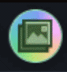

```css
[data-lab="header-action"][aria-label="Scene gallery"] {
  background: conic-gradient(from 0deg,
    #ff7a9c, #ffdc79, #8ee8b3,
    #7fdfff, #b69cff, #ff8bd3, #ff7a9c) !important;
  background-size: 100% 100% !important;
  border: 1px solid #d5b8f5 !important;
  animation: lab-gallery-rainbow-spin 4s linear infinite !important;
}
@keyframes lab-gallery-rainbow-spin {
  0% { filter: hue-rotate(0deg); }
  100% { filter: hue-rotate(360deg); }
}
@media (prefers-reduced-motion: reduce) {
  [data-lab="header-action"][aria-label="Scene gallery"] {
    animation: none !important;
  }
}
```

**Customization:**
- `4s` sets the full color-cycle duration.
- Change the gradient colors to customize the palette.

**Note:** This confirmed method animates `filter` on the whole button, so the icon colors can shift too. A separate hover `filter: brightness(...)` rule can interrupt the hue-cycle while hovered; see the optional shared hover tutorial below.

---

---

### Multicolor Icon Glow — Bookmarks Example

Surround an icon with multicolor light on hover, using Bookmarks as the example. 


```css
[data-lab="header-action"][aria-label="Message bookmarks"] img {
  transition: filter .2s ease !important;
}
@media (hover: hover) {
  [data-lab="header-action"][aria-label="Message bookmarks"]:hover img {
    filter: drop-shadow(-3px 0 3px #ff6b9e)
            drop-shadow(3px 0 3px #75e8ff)
            drop-shadow(0 3px 4px #b78aff) !important;
  }
}
@media (prefers-reduced-motion: reduce) {
  [data-lab="header-action"][aria-label="Message bookmarks"] img {
    transition: none !important;
  }
}
```

**Customization:**
- The three hex values set the left, right, and lower glow colors.
- The shadow offsets determine where each color appears.

---

---

### Rotating Rainbow Button Border — Bookmarks Example

Build a rotating rainbow ring around a button while keeping its icon stationary, using Bookmarks as the example. 


```css
[data-lab="header-action"][aria-label="Message bookmarks"] {
  position: relative !important;
  isolation: isolate !important;
  overflow: visible !important;
  background: #242b3c !important;
  border: 2px solid transparent !important;
  border-radius: 50% !important;
  animation: none !important;
}
[data-lab="header-action"][aria-label="Message bookmarks"]::before {
  content: "" !important;
  position: absolute !important;
  inset: -2px !important;
  border-radius: 50% !important;
  pointer-events: none !important;
  z-index: -1 !important;
  background: conic-gradient(
    #ff7a9c, #ffdc79, #8ee8b3,
    #7fdfff, #b69cff, #ff8bd3, #ff7a9c) !important;
  -webkit-mask: radial-gradient(farthest-side,
    transparent calc(100% - 3px), #000 calc(100% - 2px)) !important;
  mask: radial-gradient(farthest-side,
    transparent calc(100% - 3px), #000 calc(100% - 2px)) !important;
  animation: lab-bookmark-ring-spin 3s linear infinite !important;
}
@keyframes lab-bookmark-ring-spin {
  to { transform: rotate(360deg); }
}
@media (hover: hover) {
  [data-lab="header-action"][aria-label="Message bookmarks"]:hover::before {
    animation-play-state: paused !important;
  }
}
@media (prefers-reduced-motion: reduce) {
  [data-lab="header-action"][aria-label="Message bookmarks"]::before {
    animation: none !important;
  }
}
```

**Customization:**
- `3s` controls rotation speed.
- Change the conic-gradient colors for a different ring.
- The mask creates the narrow ring; its pixel values control thickness.

**Note:** The pseudo-element and its mask are both needed. Keep this tutorial together; replacing only the gradient will not reproduce the ring.

---

---

### Solid Button Border — Voice Call Example

Frame a button with a solid circular border, using Voice Call as the example. 

```css
[data-lab="header-action"][aria-label="Voice call"] {
  background: #242b3c !important;
  border: 2px solid #ff88c8 !important;
  border-radius: 50% !important;
}
```

**Customization:**
- `#242b3c` sets the inner fill.
- `#ff88c8` sets the outline color.
- `2px` sets the border thickness.

---

---

### Gradient Button Border — Fullscreen Example

Give a button a gradient border without filling its center with a gradient, using Fullscreen as the example. 

```css
[data-lab="header-action"][aria-label*="fullscreen" i] {
  border: 2px solid transparent !important;
  border-radius: 50% !important;
  background: linear-gradient(#242b3c, #242b3c) padding-box,
              linear-gradient(135deg, #ff89ca, #76e7ff) border-box !important;
}
```

**Customization:**
- Change the two `border-box` colors to alter the gradient.
- Change `#242b3c` in both positions to recolor the center.
- `135deg` controls the gradient direction.

---

---

### Pulsing Button Glow — Fullscreen Example

Add a gentle two-color pulse around a button, using Fullscreen as the example.

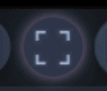

```css
[data-lab="header-action"][aria-label*="fullscreen" i] {
  animation: lab-border-pulse 2.8s ease-in-out infinite !important;
}
@keyframes lab-border-pulse {
  0%, 100% {
    box-shadow: 0 0 3px #ff89ca55, 0 0 6px #76e7ff33;
  }
  50% {
    box-shadow: 0 0 8px #ff89caaa, 0 0 15px #76e7ff88;
  }
}
@media (prefers-reduced-motion: reduce) {
  [data-lab="header-action"][aria-label*="fullscreen" i] {
    animation: none !important;
  }
}
```

**Customization:**
- `2.8s` sets the pulse period.
- The two `box-shadow` colors set pink and cyan glows.

**Note:** Pairs with the Gradient Fullscreen Button Border tutorial; the border itself is not animated.

---

---

### Bobbing Icon Animation — Statistics Example

Give an icon a gentle floating motion, using Statistics as the example.


```css
[data-lab="header-action"][aria-label="Chat statistics & export"] img {
  animation: lab-icon-float 2.6s ease-in-out infinite !important;
}
@keyframes lab-icon-float {
  0%, 100% { transform: translateY(0); }
  50% { transform: translateY(-3px); }
}
@media (prefers-reduced-motion: reduce) {
  [data-lab="header-action"][aria-label="Chat statistics & export"] img {
    animation: none !important;
  }
}
```

**Customization:**
- `-3px` controls how far the icon rises.
- `2.6s` controls the motion speed.

---

---

### Button Hover Glow — Statistics Example

Outline a button only while hovered, using Statistics as the example. 


```css
[data-lab="header-action"][aria-label="Chat statistics & export"] {
  border: 2px solid transparent !important;
  border-radius: 50% !important;
  transition: border-color .2s ease, box-shadow .2s ease !important;
}
@media (hover: hover) {
  [data-lab="header-action"][aria-label="Chat statistics & export"]:hover {
    border-color: #8de8c0 !important;
    box-shadow: 0 0 9px #8de8c066 !important;
  }
}
@media (prefers-reduced-motion: reduce) {
  [data-lab="header-action"][aria-label="Chat statistics & export"] {
    transition: none !important;
  }
}
```

**Customization:**
- Change `#8de8c0` to recolor the mint border.
- `9px` adjusts glow spread.

---

---

### Shared Button Hover Brightness — Header Examples

Lighten selected header buttons when hovered.

```css
@media (hover: hover) {
  [data-lab="header-action"]:is(
    [aria-label="Voice call"],
    [aria-label*="fullscreen" i],
    [aria-label="Search this chat"],
    [aria-label="Scene gallery"]
  ):hover {
    filter: brightness(1.12) !important;
  }
}
```

**Customization:**
- `brightness(1.12)` controls the intensity.
- Remove a button label from `:is(...)` to exclude that control.

**Note:** Optional source rule. It sets `filter` on the Gallery button, the same property used by the Gallery hue-cycle animation; test their combined hover behavior before publishing them together.

---

---

### Button Keyboard Focus Outlines — Header Examples

Give keyboard users a visible pale-yellow outline on the main header actions.

```css
[data-lab="header-action"]:is(
  [aria-label="Voice call"],
  [aria-label*="fullscreen" i],
  [aria-label="Search this chat"],
  [aria-label="Scene gallery"],
  [aria-label="Chat statistics & export"],
  [aria-label="Message bookmarks"]
):focus-visible {
  outline: 2px solid #fff0a6 !important;
  outline-offset: 3px !important;
}
```

**Customization:**
- `#fff0a6` sets the focus-ring color.
- `outline-offset: 3px` adds breathing room around the button.

**Note:** This is keyboard focus, not a selected or toggled state. A screenshot may require navigating with Tab rather than clicking.

---

---

### Rainbow Icon Recoloring — Gallery Example


```css
/* Recolor the icon itself. */
[data-lab="header-action"][aria-label="Scene gallery"] img {
  filter: hue-rotate(145deg) saturate(1.8) contrast(1.2) !important;
}

/* Add this to the animated Gallery button tutorial above:
   its existing parent-button hue-rotate animation remains in place. */
```

**Customization:**
- `hue-rotate(145deg)` shifts the icon's colors before the button animation runs.
- `saturate(1.8)` strengthens the icon colors; `contrast(1.2)` sharpens their separation.
- The existing **Animated Rainbow Gallery Button** tutorial animates `filter: hue-rotate(...)` on the *parent button*. This icon filter is static on the child image; together they create the observed changing rainbow icon.


---

## Input Controls

### Message Action Buttons

`[data-lab="action"]` now targets the controls attached to individual messages, such as Bookmark, Edit, Delete, Branch, Regenerate, and More actions. It does **not** target the LoreBary 2.5 composer toolbar.

Use the shared selector for a consistent appearance:

```css
.lab-theme-scope [data-lab="action"] {
  color: #f6dfb5 !important;
  background: rgba(47, 36, 24, .92) !important;
  border: 1px solid rgba(184, 137, 79, .7) !important;
  border-radius: 999px !important;
}

.lab-theme-scope [data-lab="action"]:hover {
  color: #fff7dc !important;
  background: #76512f !important;
  border-color: #e8bf78 !important;
}
```

In LoreBary 2.5, Enhance, Continue, and Listen are no longer separate visible message buttons. They are inside the **More actions** menu:

```css
[role="menu"][aria-label="More actions"] {
  color: #f6dfb5 !important;
  background: #1d1710 !important;
  border: 1px solid #b8894f !important;
  border-radius: 12px !important;
  box-shadow: 0 12px 28px rgba(0, 0, 0, .5) !important;
}

[role="menu"][aria-label="More actions"] [role="menuitem"] {
  color: #d8c49d !important;
  background: transparent !important;
}

[role="menu"][aria-label="More actions"] [role="menuitem"]:hover,
[role="menu"][aria-label="More actions"] [role="menuitem"][aria-expanded="true"] {
  color: #fff7dc !important;
  background: rgba(118, 81, 47, .82) !important;
}
```

Enhance opens a second menu containing More details, More dialogue, and More action. That submenu currently has no unique `data-lab` or ARIA label, so avoid targeting its temporary utility classes. A broad `[role="menu"] [role="menuitem"]` rule will reach it, but may also affect other LoreBary menus.

---

### Composer Buttons

Style the four controls inside the message box without affecting the separate tool row below it.

```css
.lab-theme-scope :is(
  [data-lab="write"],
  [data-lab="guidance-toggle"],
  [data-lab="attach-image"],
  [data-lab="send"]
) {
  color: #f6dfb5 !important;
  background: #2f2418 !important;
  border: 1px solid rgba(184, 137, 79, .72) !important;
  border-radius: 999px !important;
  box-shadow: inset 0 1px 0 rgba(255, 255, 255, .12),
              0 3px 8px rgba(0, 0, 0, .3) !important;
}

.lab-theme-scope :is(
  [data-lab="write"],
  [data-lab="guidance-toggle"],
  [data-lab="attach-image"],
  [data-lab="send"]
):hover {
  color: #fff7dc !important;
  border-color: #e8bf78 !important;
  filter: brightness(1.12);
}
```

---

### Breathing Send Animation

Make the send button dim and brighten continuously like breathing. 

```css
@keyframes breathe {
  0%, 100% { opacity: 0.5; }
  50%      { opacity: 1; }
}

[data-lab="send"] {
  animation: breathe 2.5s ease infinite !important;
}
```

---

### Input Buttons Dim Until Hover

Dim the current LoreBary 2.5 composer and toolbar buttons until hover.

```css
.lab-theme-scope :is(
  [data-lab="write"],
  [data-lab="guidance-toggle"],
  [data-lab="attach-image"],
  [data-lab="send"],
  [data-lab="toolbar"] button
) {
  opacity: 0.4 !important;
  transition: opacity 0.2s !important;
}

.lab-theme-scope :is(
  [data-lab="write"],
  [data-lab="guidance-toggle"],
  [data-lab="attach-image"],
  [data-lab="send"],
  [data-lab="toolbar"] button
):hover,
.lab-theme-scope [data-lab="toolbar"] button[aria-pressed="true"],
.lab-theme-scope [data-lab="toolbar"] button[aria-expanded="true"] {
  opacity: 1 !important;
}
```

**Customization:**
- `opacity`: Set the dimness/brightness (1 = bright, 0.1 = dark)

---

### Input Buttons Coloring

Apply a custom color filter to the icons in both LoreBary 2.5 button rows.

```css
.lab-theme-scope :is(
  [data-lab="write"],
  [data-lab="guidance-toggle"],
  [data-lab="attach-image"],
  [data-lab="send"],
  [data-lab="toolbar"] button
) :is(img, svg) {
  filter: brightness(1) sepia(0) saturate(1) hue-rotate(170deg) brightness(1.2) !important;
  opacity: 1 !important;
}
```

---

### Coloring Menu Button

Apply custom color to the menu button. 

```css
img[data-lab="menu"] {
  filter: brightness(0.5) sepia(1) saturate(20) hue-rotate(165deg) brightness(0.9) !important;
  opacity: 1 !important;
}
```

**Customization:**
- `brightness`: 1 = dark, 99 = brightest
- `sepia`: 1 = default, 2 = sepia mode
- `saturate`: 0 = off, 99 = brightest shine
- `hue-rotate`: Adjusts the color

---

### Glowing Menu Button

Add a glowing effect to the menu button. 

```css
[data-lab="menu"] {
  filter: drop-shadow(0 0 8px rgba(255, 255, 255, 0.6)) !important;
}
```

**Customization:**
- `rgba()`: Set the glow color

---

### Individual Message Action Colors and Hover

Target the individual actions by their confirmed labels. Branch is present on character messages in the supplied sample but not on the user message.

```css
[data-lab="bubble"] [data-lab="action"][aria-label="Bookmark message"] { background: #ff79ca !important; }
[data-lab="bubble"] [data-lab="action"][aria-label="Edit message"] { background: #8deaff !important; }
[data-lab="bubble"] [data-lab="action"][aria-label="Delete message"] { background: #ffb36b !important; }
[data-lab="bubble"] [data-lab="action"][aria-label="Branch chat"] { background: #b49aff !important; }

[data-lab="bubble"] [data-lab="action"] {
  transition: transform .2s ease, box-shadow .2s ease, filter .2s ease !important;
}
@media (hover: hover) {
  [data-lab="bubble"] [data-lab="action"]:hover {
    transform: scale(1.2) !important;
    box-shadow: 0 0 10px #ff79ca !important;
    filter: brightness(1.3) !important;
  }
}
@media (prefers-reduced-motion: reduce) {
  [data-lab="bubble"] [data-lab="action"] { transition: none !important; }
}
```


---

---

### Custom Menu Button Icon

Replace the standard menu icon and the mobile More Chat Tools icon with your own artwork. 

```css
/* Menu */
img[data-lab="menu"] {
  content: url("/api/images/6ac8974542880c652f051b0e") !important;
  object-fit:contain!important;
}

/* Mobile More Chat Tools */
[data-lab="header-action"][aria-label="More chat tools"] img {
  content: url("/api/images/6ac8cbd875e1eb8796e3a987") !important;
  object-fit: contain !important;
  filter: none !important;
}
```

**Customization:**
- `content: url(...)` = your uploaded menu artwork.
- `object-fit: contain` = preserves the image proportions.
- The mobile **More Chat Tools** control is a separate button from the main menu; each can use different artwork.
- Replace the sample `/api/images/...` URLs with your own.

---

---

### Custom Input Button Icons

Replace the composer icons for Send, Stop, Write, Upload Image, Scene Notes, and Toolbar Toggle. 

```css
/* Send (excluding Stop) */
[data-lab="send"] img:not([src*="icon_stop"]) {
  content: url("/api/images/6ac8971700c414e8e2a1c37b") !important;
  object-fit:contain!important;
}

/* Stop */
[data-lab="send"] img[src*="icon_stop"],
[data-lab="stop"] img {
  content: url("/api/images/6ac8a09475e1eb8796de21e5") !important;
  object-fit:contain!important;
  filter:none!important;
}

/* Write */
[data-lab="write"] img {
  content: url("/api/images/6ac8970875e1eb8796dcfc4f") !important;
  object-fit:contain!important;
}

/* Upload Image */
[data-lab="attach-image"] img {
  content: url("/api/images/6ac89c2575e1eb8796dd935f") !important;
  object-fit:contain!important;
}

/* Scene Notes / Guidance */
[data-lab="guidance-toggle"] img {
  content: url("/api/images/6ac8967a1a947bf5aa43be05") !important;
  object-fit:contain!important;
}

/* Toolbar Toggle */
[data-lab="toolbar-toggle"] img {
  content: url("/api/images/6ac896b91a947bf5aa43c355") !important;
  object-fit:contain!important;
}
```

**Customization:**
- `data-lab` = identifies each composer control.
- The Send and Stop selectors are separated so their artwork can differ.
- `content: url(...)` = the image you uploaded.
- Replace the sample URLs with your own.

---

---

### Custom Draft Version Controls

Customize the separate draft-version navigation row, including its Previous, Next, Regenerate, and Keep Draft controls. This row uses `[data-lab="draft-versions"]` and is **not** the same as the normal message-version swipe controls. 

```css
/* Previous draft — use artwork facing left */
[data-lab="draft-versions"] button[aria-label="Previous draft version"] img {
  content: url("/api/images/6ac896e875e1eb8796dcf891") !important;
  object-fit: contain !important;
  transform: none !important;
  filter: none !important;
}

/* Next draft — use artwork facing right */
[data-lab="draft-versions"] button[aria-label="Next draft version"] img {
  content: url("/api/images/6ac896dc75e1eb8796dcf708") !important;
  object-fit: contain !important;
  transform: none !important;
  filter: none !important;
}

/* Regenerate draft — this is a Font Awesome <i>, not an  */
[data-lab="draft-versions"] button[aria-label="Regenerate draft versions"] i {
  color: #7fdfff !important;
  font-size: 14px !important;
  text-shadow: 0 0 5px #7fdfff88 !important;
}

/* Keep draft and close — also a Font Awesome <i> */
[data-lab="draft-versions"] button[aria-label="Keep draft and close versions"] i {
  color: #ff89ca !important;
  font-size: 14px !important;
  text-shadow: 0 0 5px #ff89ca88 !important;
}
```

**Customization:**
- `draft-versions` = limits changes to the draft-version controls, not ordinary message swipes or message regeneration.
- `Previous draft version` and `Next draft version` = separate buttons with their own images.
- `transform: none` = removes the default mirrored-arrow transformation; use correctly oriented replacement artwork.
- `Regenerate draft versions` and `Keep draft and close versions` = Font Awesome icons rendered with `<i>`, so `content: url(...)` image replacement is **not** used for them here.
- `color`, `font-size`, and `text-shadow` = recolor and emphasize those two icons without changing their symbols.

**Tip:** These controls belong to the draft-version row, not the regular message actions. Preview the example with draft versions visible before keeping it.

---

---

### Custom Message Action Icons

Desktop and mobile controls may use different images. For example, desktop Regenerate uses `/img/Icons/icon_regenerate.webp`, while mobile Regenerate uses `/img/pixel/msg-regenerate.webp` with a separate `/img/pixel/settings.webp` badge.

Replace the icons on individual chat messages, including Bookmark, Regenerate, Branch, Delete, Edit, and More Actions. 

```css
/* Bookmark Message */
[data-lab="action"][aria-label="Bookmark message"] img {
  content: url("/api/images/6ac897231a947bf5aa43cf04") !important;
  object-fit:contain!important;
  filter:none!important;
}

/* Regenerate */
[data-lab="action"][aria-label="Regenerate"]
> span > img {
  content: url("/api/images/6ac8cba55a1227b9442bfe5a") !important;
  object-fit:contain!important;
  filter:none!important;
}

/* Branch Chat */
[data-lab="action"][aria-label="Branch chat"] img {
  content: url("/api/images/6ac8cbb442880c652f0bc31f") !important;
  object-fit:contain!important;
  filter:none!important;
}

/* Delete Message */
[data-lab="action"][aria-label="Delete message"] img {
  content: url("/api/images/6ac8cbc275e1eb8796e3a83d") !important;
  object-fit:contain!important;
  filter:none!important;
}

/* Edit Message */
[data-lab="action"][aria-label="Edit message"] img {
  content: url("/api/images/6ac8cbcf5a1227b9442c03e1") !important;
  object-fit:contain!important;
  filter:none!important;
}

/* More Actions */
[data-lab="action"][aria-label="More actions"] img {
  content: url("/api/images/6ac8cbd875e1eb8796e3a987") !important;
  object-fit:contain!important;
  filter:none!important;
}
```

**Customization:**
- `aria-label` = selects the message action to replace.
- The Regenerate selector targets the main image inside its button rather than other nested artwork.
- `filter: none` = preserves your image colors.
- Replace each sample image URL with your own.

---

---

### Managing Tinting, Filters, and Icon Replacements

A quick reference for choosing an approach.

| Goal | Use | Important distinction |
|---|---|---|
| Change the button's background | `background` / gradients on the button | Does not recolor the icon pixels |
| Tint the icon image | `filter` on `img` | Affects all visible image pixels together |
| Invert the icon | `invert()` on `img` | Reverses original colors, not a guaranteed target tint |
| Glow around icon artwork | `drop-shadow()` on `img` | Follows the image's visible silhouette |
| Rainbow-cycle icon and button together | `hue-rotate()` animation on the parent button | Also shifts the colors of rendered children |
| Replace the icon artwork entirely | `content: url(...)` on `img` | Covered in Phase 1; new artwork may respond differently to filters |

**Combining filters:** A single element has one computed `filter` property. Two matching CSS rules do **not** merge their filter functions automatically: the winning declaration replaces the other. For example, a tint and glow on the same icon must be combined:

```css
[data-lab="header-action"][aria-label="Search this chat"] img {
  filter: brightness(0) saturate(100%)
          invert(60%) sepia(75%) saturate(2500%)
          hue-rotate(290deg) brightness(105%)
          drop-shadow(0 0 3px #ff79ca)
          drop-shadow(0 0 7px #ff79ca) !important;
}
```

**Customization:**
- Put color-changing functions **before** `drop-shadow()` if you want to preserve the specified shadow color.
- If Phase 1 replaces an icon, test the filter again: the replacement image's starting colors affect the result.
- A multicolored image is not converted into a clean, independently controlled rainbow by `hue-rotate()` alone. True gradient-filled icon silhouettes generally require an asset-specific mask technique; our earlier icon-mask idea was **not validated**, so no working mask recipe is claimed here.


**Tip:** Combine icon replacement with filters and glow when you want a different finish without changing the surrounding button.

---

## Long-Press Menus — LoreBary 2.5

Several LoreBary 2.5 controls perform one action on a normal click and open settings when held. The settings panels may be rendered outside `.lab-theme-scope`, so target their dedicated root selectors directly.

### Menu and Dialog Selector Map Quick Reference

| Control | Menu or settings selector | Notes |
| --- | --- | --- |
| Write for me | `[data-lab="write-menu"]` | Inline menu with point of view, length, provider, and enhance instructions |
| Write for me choices | `[data-lab="write-option"]` | Uses `aria-checked="true"` for the selected choice |
| Scene notes panel | `[data-lab="input"] > div:has(#lab-scene-notes)` | Inline panel opened by Scene notes |
| Scene notes field | `#lab-scene-notes` | Hidden guidance textarea |
| Time skip | `[data-lab="time-skip-menu"]` | Dialog-style form |
| Time skip details | `[data-lab="time-skip-details"]` | Optional mood/location input |
| Time skip submit | `[data-lab="time-skip-submit"]` | Skip button |
| Dice roll | `[data-lab="dice-roll-menu"]` | Dialog-style form |
| HTML Mode | `[data-lab="html-settings"]` | Fixed settings dialog |
| Polish replies | `[data-lab="review-settings"]` | Fixed settings dialog |
| Scene music | `[data-lab="scene-music-settings"]` | Fixed settings dialog |
| Reply choices | `[data-lab="reply-settings"]` | Fixed settings dialog |
| Visual Expressions | `[role="dialog"][aria-label="Expression Studio"]` | Uses an accessible dialog label instead of `data-lab` |
| More actions | `[role="menu"][aria-label="More actions"]` | Contains Enhance, Continue, and Listen |
| Select dropdown | `[role="listbox"]` | Portaled menu used by settings fields |
| Select option | `[role="option"]` | Uses `aria-selected="true"` for the selected item |

Auto conversation, Director Pass, and Web Search are direct toggles and currently have no separate long-press settings panel.

The Bookmark hold menu exposes Quick bookmark and Manual bookmark, but its panel currently has no stable `data-lab`, role, or ARIA label. Style the Bookmark trigger through `[data-lab="action"][aria-label="Bookmark message"]`; avoid copying the menu's generated utility classes into a theme.

### Style the Write for Me Menu

```css
[data-lab="write-menu"] {
  color: #f6dfb5 !important;
  background: linear-gradient(
    135deg,
    rgba(47, 36, 24, .98),
    rgba(22, 17, 12, .98)
  ) !important;
  border: 1px solid rgba(184, 137, 79, .78) !important;
  border-radius: 14px !important;
  box-shadow: 0 12px 28px rgba(0, 0, 0, .48) !important;
}

[data-lab="write-menu"] [data-lab="write-option"] {
  color: #ead8b2 !important;
  background: transparent !important;
  border-radius: 9px !important;
}

[data-lab="write-menu"] [data-lab="write-option"]:hover,
[data-lab="write-menu"] [data-lab="write-option"][aria-checked="true"] {
  color: #fff7dc !important;
  background: rgba(118, 81, 47, .78) !important;
}
```

---

### Write Menu Heading Colors

Recolor the two section headings inside the Write menu. 


```css
[data-lab="write-menu"] > div:first-child
> div > div:first-child {
  color: #ffb4db !important;
}
[data-lab="write-menu"] > div:nth-child(2)
> div > div:first-child {
  color: #84dff0 !important;
}
```

**Customization:**
- `color` changes each heading independently.

**Tip:** These selectors depend on the menu’s child order and may need updating if the layout changes.

---

---

### Write Menu Actions and Help Text


Recolor menu action rows and the information area at the bottom of the Write menu. 


```css
[data-lab="write-menu"] [data-lab="write-option"] {
  color: #f1d9ec !important;
}
[data-lab="write-menu"] [data-lab="write-option"]:hover {
  background: #3c3050 !important;
  border-color: #b88ddd !important;
}
[data-lab="write-menu"] > div:last-child {
  background: #141b2c !important;
  border: 1px solid #645477 !important;
  border-radius: 10px !important;
  color: #b9b7d0 !important;
}
```

**Customization:** `[data-lab="write-option"]` targets the menu options. The help-text area uses a structural selector.

---

### Write Menu Selected, Unselected, and Keyboard-Focus States

Use the tested `aria-checked` state to distinguish the active choice from inactive choices. Keyboard focus remains independently visible.


```css
[data-lab="write-menu"] [data-lab="write-option"][aria-checked="true"] {
  background: #ff79ca !important;
  color: #211b31 !important;
  outline: 2px solid #8deaff !important;
  outline-offset: -2px !important;
  border-radius: 8px !important;
}
[data-lab="write-menu"] [data-lab="write-option"][aria-checked="false"] {
  opacity: .65 !important;
}
[data-lab="write-menu"] [data-lab="write-option"]:focus-visible {
  outline: 2px solid #8deaff !important;
  outline-offset: 2px !important;
}
```

**Customization:** `aria-checked="true"` styles the selected option, while `aria-checked="false"` styles the others. `:focus-visible` adds keyboard feedback. Use this in place of the earlier selected-state example if the colors conflict.

---

---

### Custom Write Menu Action Icons

Replace the Write menu pencil and arrow icons with uploaded artwork. 


```css
[data-lab="write-menu"]
[data-lab="write-option"]
img[src*="/pixel/pencil.webp"] {
  content: url("/api/images/6ac8cbcf5a1227b9442c03e1") !important;
  object-fit: contain !important;
  filter: none !important;
}
[data-lab="write-menu"]
[data-lab="write-option"]
img[src*="/pixel/arrow-right-v2.webp"] {
  content: url("/api/images/6ac896dc75e1eb8796dcf708") !important;
  object-fit: contain !important;
  transform: none !important;
  filter: none !important;
}
```

**Customization:**
- `content: url(...)` sets the replacement artwork.
- `object-fit: contain` maintains image proportions.
- `filter: none` prevents existing filters from recoloring the images.
- `transform: none` removes the arrow image’s inherited transform.

**2.5 selector note:** The updated guide uses `[data-lab="write-menu"]` and `[data-lab="write-option"]` for the Write for Me menu. Verify any older icon-specific selectors against the current menu.

---


### Style Long-Press Settings Dialogs

This grouped rule keeps every new settings panel visually consistent. Remove any selector from `:is()` when that panel should keep LoreBary's default design.

```css
:is(
  [data-lab="input"] > div:has(#lab-scene-notes),
  [data-lab="time-skip-menu"],
  [data-lab="dice-roll-menu"],
  [data-lab="html-settings"],
  [data-lab="review-settings"],
  [data-lab="scene-music-settings"],
  [data-lab="reply-settings"],
  [role="dialog"][aria-label="Expression Studio"]
) {
  color: #f6dfb5 !important;
  background: linear-gradient(
    145deg,
    rgba(47, 36, 24, .99),
    rgba(20, 16, 12, .99)
  ) !important;
  border: 1px solid #b8894f !important;
  border-radius: 16px !important;
  box-shadow: 0 18px 44px rgba(0, 0, 0, .58) !important;
}

:is(
  [data-lab="input"] > div:has(#lab-scene-notes),
  [data-lab="time-skip-menu"],
  [data-lab="dice-roll-menu"],
  [data-lab="html-settings"],
  [data-lab="review-settings"],
  [data-lab="scene-music-settings"],
  [data-lab="reply-settings"]
) :is(input, textarea) {
  color: #fff1cf !important;
  caret-color: #e8bf78 !important;
  background: rgba(18, 14, 10, .9) !important;
  border: 1px solid rgba(184, 137, 79, .62) !important;
}

:is(
  [data-lab="input"] > div:has(#lab-scene-notes),
  [data-lab="time-skip-menu"],
  [data-lab="dice-roll-menu"],
  [data-lab="html-settings"],
  [data-lab="review-settings"],
  [data-lab="scene-music-settings"],
  [data-lab="reply-settings"]
) :is(input, textarea)::placeholder {
  color: #9f8d72 !important;
  opacity: 1 !important;
}
```

The Save, Skip, toggle, slider, and close controls remain functional because these examples change presentation only.

---

### Style Dropdowns Inside Settings

Prompt mode, sound choice, time choice, and similar dropdowns are portaled to the document body. Style them through their ARIA roles rather than unstable utility classes.

```css
[role="listbox"] {
  color: #f6dfb5 !important;
  background: #1d1710 !important;
  border: 1px solid #b8894f !important;
  border-radius: 12px !important;
  box-shadow: 0 12px 28px rgba(0, 0, 0, .5) !important;
}

[role="listbox"] [role="option"] {
  color: #d8c49d !important;
  background: transparent !important;
}

[role="listbox"] [role="option"]:hover,
[role="listbox"] [role="option"][aria-selected="true"] {
  color: #fff7dc !important;
  background: rgba(118, 81, 47, .82) !important;
}
```

Use `[aria-selected="true"]`, `[aria-checked="true"]`, `[aria-pressed="true"]`, and `[aria-expanded="true"]` to style selected choices, enabled tools, and open menus without relying on temporary CSS class names.

---

### Custom Scene Notes Window

Change the Scene Notes window background, outline, corners, and shadow.


```css
[data-lab="input"] > div:has(#lab-scene-notes) {
  background: #211b31 !important;
  border: 1px solid #ee8ec9 !important;
  border-radius: 16px !important;
  box-shadow: 0 0 14px #ed83c32b, 0 12px 32px #00000080 !important;
}
```

**Customization:** The verified Scene Notes panel selector replaces the older label-wrapper traversal. Change `background`, `border`, `border-radius`, and `box-shadow` to customize the window.

---

---

### Scene Notes Title and Close Button

Recolor the Scene Notes title and close button.


```css
[data-lab="input"] > div:has(#lab-scene-notes)
label[for="lab-scene-notes"] {
  color: #ffd5ec !important;
  text-shadow: 0 0 7px #f98ac566 !important;
}
[data-lab="input"] > div:has(#lab-scene-notes)
label[for="lab-scene-notes"] + button {
  background: #49304f !important;
  color: #ffc5e6 !important;
  border: 1px solid #dc85c3 !important;
}
```

**Customization:** Style the Scene Notes heading and its close button independently. The close button follows the heading in the current panel layout and also has `aria-label="Close scene notes"`.

---

---

### Scene Notes Template Colors

Assign different accent colors to the eight Scene Notes templates and their icon frames. 


```css
[aria-label="Scene note templates"]
button {
  color: #d8cbe2 !important;
}
[aria-label="Scene note templates"]
button > span:first-child {
  background: #302b42 !important;
  border: 1px solid #7f719d !important;
  box-shadow: 0 2px 6px #0006 !important;
}
[aria-label="Select Talk more template"] {
  --note-color: #ff89b7;
}
[aria-label="Select Stay real template"] {
  --note-color: #ffc38b;
}
[aria-label="Select Living world template"] {
  --note-color: #f6df83;
}
[aria-label="Select Your move template"] {
  --note-color: #88e5b1;
}
[aria-label="Select Slow burn template"] {
  --note-color: #80dfff;
}
[aria-label="Select Romance template"] {
  --note-color: #b99aff;
}
[aria-label="Select Sex template"] {
  --note-color: #f39bdf;
}
[aria-label="Select Kink template"] {
  --note-color: #ff9a9f;
}
[aria-label="Scene note templates"]
button > span:first-child {
  border-color: var(--note-color, #7f719d) !important;
}
```

**Customization:**
- `--note-color` is the accent color assigned to each template.
- `button > span:first-child` styles the template icon frame.
- Change individual hex values to build your own palette.

---

---

### Scene Notes Selected and Hover Effects

Give the selected Scene Notes template a clearly visible pink glow and a slight enlargement, with a separate hover highlight for other templates. 


```css
/* Selected template — confirmed working */
[aria-label="Scene note templates"]
button[aria-pressed="true"] > span:first-child {
  background: #674467 !important;
  border: 2px solid #ff89b7 !important;
  box-shadow:
    0 0 0 2px #ff89b755,
    0 0 12px 4px #ff89b7aa,
    0 0 22px #ff89b766 !important;
  transform: scale(1.08) !important;
}

/* Hover over templates that are not selected */
@media (hover: hover) {
  [aria-label="Scene note templates"]
  button:not([aria-pressed="true"]):hover > span:first-child {
    background: #3a304d !important;
    box-shadow: 0 0 9px var(--note-color, #ff89b7) !important;
  }
}
```

**Customization:**
- `[aria-pressed="true"]` identifies the selected template.
- `#674467` sets the selected icon circle's background; `#ff89b7` is the selected border color.
- The three `box-shadow` layers create a visible pink ring and glow. Reduce their blur, spread, or opacity for a softer effect.
- `scale(1.08)` enlarges the selected circle slightly; use `scale(1)` to remove the enlargement.
- The hover rule uses each template's `--note-color` when **Scene Notes Template Colors** is also installed, with pink as a fallback.
- `:not([aria-pressed="true"])` keeps hover styling from overriding the selected appearance.

**Tip:** The hover adjustment keeps the selected glow visible while the pointer is over a template.

---

---

### Scene Notes Text Box Colors and Focus

Customize the Scene Notes text area, placeholder, and focused appearance. 


```css
[data-lab="input"] #lab-scene-notes {
  background: #121b2b !important;
  color: #f3e7f6 !important;
  border: 1px solid #6bcde5 !important;
  border-radius: 12px !important;
  box-shadow: inset 0 2px 6px #0007 !important;
}
[data-lab="input"] #lab-scene-notes::placeholder {
  color: #a9b8ce !important;
}
[data-lab="input"] #lab-scene-notes:focus-visible {
  outline: 2px solid #ff92d0 !important;
  outline-offset: 2px !important;
}
```

**Customization:**
- `background` and `color` set the editor colors.
- `::placeholder` styles the hint text.
- `:focus-visible` shows the focus outline when the browser determines a visible focus indicator is needed.

---

---

### Scene Notes Additional Buttons

Recolor the saved-template button and the Apply To control, including its hover state. 


```css
[data-lab="input"] > div:has(#lab-scene-notes)
button[aria-label="Open saved scene note templates"] {
  background: #453457 !important;
  border: 1px solid #c49bff !important;
  color: #f0cfff !important;
  border-radius: 50% !important;
}
@media (hover: hover) {
  [data-lab="input"] > div:has(#lab-scene-notes)
  button[aria-label="Open saved scene note templates"]:hover {
    background: #674467 !important;
  }
}
/* Apply To dropdown: inspected structure, verified live */
[data-lab="input"] > div:has(#lab-scene-notes)
div:has(> #lab-scene-notes) ~ div button {
  background: #121b2b !important;
  border: 1px solid #846aa9 !important;
  color: #e8d7f2 !important;
  border-radius: 12px !important;
}
```

**Customization:** Use the lightbulb button selector to style its appearance. The Apply To dropdown uses a structural selector in this example; its `aria-label="Apply to"` can also be used for more direct targeting.

---

---

### Scene Notes Keyboard Focus

Give Scene Notes controls a visible keyboard-focus outline.

```css
[aria-label="Scene note templates"] button:focus-visible,
[data-lab="input"] > div:has(#lab-scene-notes) button[aria-label="Apply to"]:focus-visible,
[data-lab="input"] > div:has(#lab-scene-notes) button[aria-label="Close scene notes"]:focus-visible {
  outline: 2px solid #ff92d0 !important;
  outline-offset: 2px !important;
}
```

**Customization:**
- `focus-visible` shows the outline during keyboard navigation.
- `outline-offset` creates space between the outline and control.

---

---

### Custom Scene Notes Template Icons

The eight native template icons are `scene-talk-more.webp`, `scene-stay-real.webp`, `scene-living-world.webp`, `scene-your-move.webp`, `scene-slow-burn.webp`, `scene-romance.webp`, `scene-intimacy.webp` (Sex), and `scene-kink.webp`, all under `/img/pixel/`.

Replace the artwork for all eight Scene Notes templates. 


```css
[aria-label="Select Talk more template"] img {
  content: url("/api/images/6ac933d9774248b6e840f548") !important;
  object-fit: contain !important;
}
[aria-label="Select Stay real template"] img {
  content: url("/api/images/6ac933bc774248b6e840f1a4") !important;
  object-fit: contain !important;
}
[aria-label="Select Living world template"] img {
  content: url("/api/images/6ac9337f71408e65b12b8235") !important;
  object-fit: contain !important;
}
[aria-label="Select Your move template"] img {
  content: url("/api/images/6ac9339a774248b6e840ec7c") !important;
  object-fit: contain !important;
}
[aria-label="Select Slow burn template"] img {
  content: url("/api/images/6ac933e874200038737ef983") !important;
  object-fit: contain !important;
}
[aria-label="Select Romance template"] img {
  content: url("/api/images/6ac933a88825371476f13213") !important;
  object-fit: contain !important;
}
[aria-label="Select Sex template"] img {
  content: url("/api/images/6ac93403041fbd15cfcc8e14") !important;
  object-fit: contain !important;
}
[aria-label="Select Kink template"] img {
  content: url("/api/images/6ac933f742849615a40a8ab3") !important;
  object-fit: contain !important;
}
```

**Customization:**
- Each `aria-label` selects one template.
- `content: url(...)` replaces its icon.
- Replace each `/api/images/...` address with your own uploaded image URL.

---

## Search and Bookmarks

### Search & Bookmarks Panel Background

Change the main background, side border, and shadow of the shared Search and Bookmarks panel. 


```css
:is([data-lab="search-panel"], [data-lab="bookmarks-panel"]) {
  background: #171b2b !important;
  border-left: 2px solid #73d9ff !important;
  box-shadow: -8px 0 24px #0009, inset 2px 0 0 #ff7ecb55 !important;
}
```

**Customization:** `background`, `border-left`, and `box-shadow` style both panels. Both panel hooks were verified in the live tester.

---

---

### Search & Bookmarks Header Styling

Customize the panel header background, divider, and shadow. 


```css
:is([data-lab="search-panel"], [data-lab="bookmarks-panel"]) .surface-header {
  background: #29243e !important;
  border-bottom: 1px solid #ff88c7 !important;
  box-shadow: 0 4px 12px #0006 !important;
}
```

**Customization:** Change the header `background`, divider, and `box-shadow`. The `.surface-header` class was verified in both panels.

---

---

### Search & Bookmarks Title and Description

Recolor the panel heading and its supporting description. 


```css
:is([data-lab="search-panel"], [data-lab="bookmarks-panel"]) .surface-header h3 {
  color: #ffe3f4 !important;
  text-shadow: 0 0 8px #ff7fc866 !important;
}
:is([data-lab="search-panel"], [data-lab="bookmarks-panel"]) .surface-header p {
  color: #d7c5e7 !important;
}
```

**Customization:** `h3` targets the title; `p` targets the supporting description. Both were verified.

---

---

### Search & Bookmarks Header Icon Glow

Resize and glow the pixel-art icons in both panel headers.

```css
:is([data-lab="search-panel"], [data-lab="bookmarks-panel"]) .surface-header img {
  width: 28px !important;
  height: 28px !important;
  object-fit: contain !important;
  image-rendering: pixelated !important;
  filter: drop-shadow(0 0 5px #ff79ca) !important;
  transition: transform .2s ease !important;
}
@media (hover: hover) {
  :is([data-lab="search-panel"], [data-lab="bookmarks-panel"]) .surface-header img:hover {
    transform: scale(1.2) !important;
  }
}
```

**Tip:** This glow affects the header icons, not the search-field magnifying glass or empty-state illustration.

---

---

### Custom Search & Bookmarks Header Icons

Replace the large artwork beside the **Search chat** and **Bookmarks** titles. These are the **panel header icons**, not the smaller icons inside the Messages and Marked tabs. 


```css
/* Search panel — header icon artwork */
[data-lab="search-panel"] .surface-header img {
  content: url("/api/images/6ac897301a947bf5aa43d1c8") !important;
  object-fit: contain !important;
  filter: none !important;
}

/* Bookmarks panel — header icon artwork */
[data-lab="bookmarks-panel"] .surface-header img {
  content: url("/api/images/6ac897231a947bf5aa43cf04") !important;
  object-fit: contain !important;
  filter: none !important;
}
```

**Customization:** Replace the sample image URLs with your own artwork. The `.surface-header img` selector changes panel header icons; [Custom Bookmarks Tab Icons](#custom-bookmarks-tab-icons) changes the Messages and Marked tab images. For glow effects, see [Search & Bookmarks Header Icon Glow](#search--bookmarks-header-icon-glow).

---

---

### Custom Search Bar Colors

Style the search field, typed text, cursor, placeholder, and search icon. 


```css
.header-search:has(
  .header-search-input:is(
    [aria-label="Search this chat"],
    [aria-label="Search marked text"]
  )
) {
  background: #202a3b !important;
  border: 1px solid #79d9ef !important;
  border-radius: 10px !important;
  box-shadow: inset 0 1px 5px #0005 !important;
}
.header-search-input:is(
    [aria-label="Search this chat"],
    [aria-label="Search marked text"]
  ) {
  background: transparent !important;
  border: none !important;
  box-shadow: none !important;
  outline: none !important;
  color: #f1eaff !important;
  caret-color: #ff8dd3 !important;
}
.header-search-input:is(
    [aria-label="Search this chat"],
    [aria-label="Search marked text"]
  )::placeholder {
  color: #a9bdd5 !important;
  opacity: 1 !important;
}
.header-search:has(
  .header-search-input:is(
    [aria-label="Search this chat"],
    [aria-label="Search marked text"]
  )
) > i.fa-search {
  color: #82e5ed !important;
  filter: drop-shadow(0 0 5px #82e5ed) !important;
}
```

**Customization:** The outer `.header-search` wrapper controls the full visible box, including the icon area. The input controls typed text, caret, and placeholder; `> i.fa-search` controls the magnifying glass. Both search variants were verified by their distinct ARIA labels. For placeholder styling, the tested `::placeholder` selector also supports `font-style: italic` and `letter-spacing: .4px` alongside `color` and `opacity`; add those declarations if desired.

---

---

### Search Bar Focus Effect

Highlight the search field when someone clicks or tabs into it.

```css
.header-search:has(
  .header-search-input:is(
    [aria-label="Search this chat"],
    [aria-label="Search marked text"]
  ):focus-visible
) {
  outline: 2px solid #ff92d5 !important;
  outline-offset: 2px !important;
  box-shadow: 0 0 10px #ff92d555 !important;
}
```

**Customization:** Keyboard focus on either input highlights the entire outer search box. Verified in both Search and Bookmarks.

---

---

### Bookmarks Tab Bar Background

Customize the container behind the Messages and Marks tabs.

```css
[data-lab="bookmarks-panel"] [role="tablist"] {
  background: #121b2c !important;
  border: 1px solid #6a83a6 !important;
  border-radius: 12px !important;
}
```

**Customization:**
- `background` changes the tab-bar backdrop.
- `border` defines its outline.

---

---

### Bookmarks Tab Colors

Set the normal appearance of the Messages and Marks tabs.


```css
[data-lab="bookmarks-panel"] [role="tab"] {
  color: #b5c4db !important;
  border: 1px solid transparent !important;
  border-radius: 9px !important;
  background: transparent !important;
}
```

**Customization:**
- `color` changes the tab labels.
- `background` controls the unselected fill.
- `[role="tab"]` applies the same rule to both Messages and Marked tabs.

---

---

### Selected Bookmarks Tab Styling

Give the active Messages or Marks tab its own color, border, and glow.


```css
[data-lab="bookmarks-panel"] [role="tab"][aria-selected="true"] {
  color: #fff0f8 !important;
  background: #563454 !important;
  border-color: #ff8dc8 !important;
  box-shadow: inset 0 1px 0 #ffffff24, 0 0 9px #ff8dc844 !important;
}
```

**Customization:**
- `[aria-selected="true"]` targets whichever tab is currently active.
- `background` and `border-color` identify the active tab.
- `box-shadow` adds a subtle highlight and glow.

---

---

### Bookmarks Tab Hover and Keyboard Focus

Add separate visual feedback for mouse hover and keyboard navigation.

```css
@media (hover: hover) {
  [data-lab="bookmarks-panel"] [role="tab"]:hover {
    color: #fff0f8 !important;
    border-color: #a4a4eb !important;
  }
}
[data-lab="bookmarks-panel"] [role="tab"]:focus-visible {
  outline: 2px solid #8be8ed !important;
  outline-offset: 2px !important;
}
```

**Customization:**
- `@media (hover: hover)` limits hover styling to hover-capable devices.
- `:focus-visible` highlights keyboard focus.
- `outline-offset` adds breathing room around the focus outline.

---

---

### Bookmarks Tab Counters

Style the number badges independently of their tabs. The selected counter follows the active tab.

```css
[data-lab="bookmarks-panel"] [role="tab"] > span:last-child {
  background: #211b31 !important;
  color: #ff79ca !important;
  border: 1px solid #8deaff !important;
  border-radius: 999px !important;
  box-shadow: 0 0 8px #ff79ca66 !important;
}
[data-lab="bookmarks-panel"] [role="tab"][aria-selected="true"] > span:last-child {
  background: #ff79ca !important;
  color: #211b31 !important;
  border-color: #ff79ca !important;
  box-shadow: 0 0 10px #ff79ca88 !important;
}
```

**Tip:** The final direct `span` inside each tab is its counter.

---

---

### Bookmarks Empty-State Text

Recolor the message shown when the Bookmarks list has no saved entries.

```css
#lab-bookmarks-list > div:has(> p + p) {
  background: #171b2b !important;
  border: 2px dashed #8deaff !important;
  border-radius: 12px !important;
  padding: 16px !important;
}
#lab-bookmarks-list > div:has(> p + p) > p:first-of-type {
  color: #f3dcf4 !important;
  font-weight: 800 !important;
}
#lab-bookmarks-list > div:has(> p + p) > p:nth-of-type(2) {
  color: #b8c5dc !important;
}
```

**Customization:** These selectors style the empty-state content box and its two text lines rather than the whole panel. They depend on the empty-state HTML structure, so check them if the interface changes.

---

---

### Custom Search Empty-State Illustration

Replace the Search view’s default Bary illustration with uploaded artwork. 

```css
[data-lab="bookmarks-panel"] img[src*="bary_search.webp"] {
  content: url("/api/images/6ac899a700c414e8e2a21d73") !important;
  width: 112px !important;
  height: 138px !important;
  object-fit: contain !important;
  filter: none !important;
}
```

**Customization:**
- `img[src*="bary_search.webp"]` selects the Search illustration.
- `content: url(...)` replaces the image.
- `width` and `height` control its display box.
- `object-fit: contain` preserves the replacement proportions.

**Tip:** The Search empty-state illustration lives inside the shared `bookmarks-panel` wrapper. Its native image is `/img/bary/bary_search.webp`.

---

---

### Search & Bookmarks Close Button

Recolor the panel’s close button and add a hover glow.


```css
:is([data-lab="search-panel"], [data-lab="bookmarks-panel"]) .surface-header button[aria-label="Close bookmarks"] {
  background: #393049 !important;
  color: #ffd8ee !important;
  border: 1px solid #d58dcb !important;
  border-radius: 8px !important;
}
@media (hover: hover) {
  :is([data-lab="search-panel"], [data-lab="bookmarks-panel"]) .surface-header button[aria-label="Close bookmarks"]:hover {
    background: #583a62 !important;
    box-shadow: 0 0 10px #ff89d266 !important;
  }
}
```

**Customization:** Both Search and Bookmarks currently use `Close bookmarks` as the close button’s ARIA label.

---

---

### Search & Bookmarks Footer Styling

Change the footer background, text, and top border. 

```css
:is([data-lab="search-panel"], [data-lab="bookmarks-panel"]) .surface-footer {
  background: #29243e !important;
  border-top: 1px solid #74d9f0 !important;
  box-shadow: 0 -4px 12px #ff89d244 !important;
}
:is([data-lab="search-panel"], [data-lab="bookmarks-panel"]) .surface-footer > span {
  color: #d4c9e9 !important;
  font-style: italic !important;
  text-shadow: 0 0 6px #8deaff66 !important;
}
```

**Customization:** `.surface-footer` styles the strip; its direct `span` styles the message text. Change or remove `font-style` and `text-shadow` to control the optional italic/glow treatment. Tested across the displayed footer variants.

---

---

### Custom Copy and Download Icons

Replace the action images used to copy or download marked passages. 

```css
[data-lab="bookmarks-panel"]
button[aria-label="Copy marked passages"]
img[src="/img/pixel/copy.webp"] {
  content: url("/api/images/6ac8970875e1eb8796dcfc4f") !important;
  object-fit: contain !important;
  filter: none !important;
}

[data-lab="bookmarks-panel"]
button[aria-label="Download marked passages"]
img[src="/img/pixel/download.webp"] {
  content: url("/api/images/6ac896f900c414e8e2a1bffd") !important;
  object-fit: contain !important;
  filter: none !important;
  transform: none !important;
}
```

**Customization:**
- `Copy marked passages` targets the Copy control.
- `Download marked passages` targets the Download control.
- `content: url(...)` selects the replacement artwork.
- `transform: none` prevents the Download image from inheriting an unwanted transform.

---

---

### Custom Search & Bookmarks Background Images

Optionally use uploaded artwork beneath a translucent color overlay instead of a solid panel background. 


```css
/* Optional variation: use instead of the solid panel background */
[data-lab="bookmarks-panel"] {
  background: linear-gradient(#171b2bcc, #171b2bcc),
              url("/api/images/YOUR_IMAGE_ID")
              center / cover no-repeat !important;
  border-left: 2px solid #73d9ff !important;
}

/* Optional: allow the image to show through the list area */
[data-lab="bookmarks-panel"] #lab-bookmarks-list {
  background: transparent !important;
}
```

**Customization:**
- `YOUR_IMAGE_ID` is the reader’s own uploaded image.
- `linear-gradient(...)` adds a translucent readability overlay.
- `cover` fills the panel and may crop the artwork.
- `background: transparent` allows the list area to reveal the panel artwork.

**Optional / not yet tested:** The header and footer have independent opaque backgrounds in the source theme. Keep them solid for readability or customize them separately. This example is a proposed image-background variation, not a verified finished effect.

---

---

### Custom Bookmarks Tab Icons

The original Messages icon is `/img/pixel/lab-bookmark.webp`; the Marked icon is `/img/pixel/lab-mark.webp`. Each tab can use different replacement artwork.

Replace the small artwork inside the **Messages** and **Marked** tabs in the Bookmarks panel. The **Marked** icon is the pencil beside the MARKED label—not the Copy or Download controls. The screenshot for the separate [header icon replacement tutorial](#custom-search--bookmarks-header-icons) does **not** show these tab icons.

```css
/* Messages tab icon */
[data-lab="bookmarks-panel"]
#lab-bookmarks-tab-messages img {
  content: url("/api/images/YOUR_MESSAGES_ICON_ID") !important;
  object-fit: contain !important;
  filter: none !important;
}

/* Marked tab icon (pencil beside MARKED) */
[data-lab="bookmarks-panel"]
#lab-bookmarks-tab-marks img {
  content: url("/api/images/YOUR_MARKED_ICON_ID") !important;
  object-fit: contain !important;
  filter: none !important;
}
```

**Customization:**
- `YOUR_MESSAGES_ICON_ID` replaces the Messages tab artwork.
- `YOUR_MARKED_ICON_ID` replaces the Marked tab artwork.
- The tab IDs target each button independently (`#lab-bookmarks-tab-messages` and `#lab-bookmarks-tab-marks`); `content` supplies your replacement artwork.
- These examples use [LoreBary-uploaded images](#how-to-import-css-images-in-lorebary). You can also use [Base64 image data](https://github.com/Caddel001/LoreBary-Theme-Snippets/blob/main/LoreBary%20CSS%20Quick%20Guide.md#converting-images-to-base64).
- Tab colors, counters, hover, and selected states have their own tutorials above. Copy and Download icon replacements are covered in [Custom Copy and Download Icons](#custom-copy-and-download-icons).

## Laboratory Selector and Native Asset Reference

The following tables provide a quick reference to LoreBary’s native image paths and Laboratory UI selectors. The first lists built-in image assets; the second identifies interface elements and CSS targets for customization. The numbered UI groups organize the selector table by interface area.

> **Compatibility note:** Native asset paths and selectors may change between LoreBary versions. Inspect the current interface and test a selector before relying on it in a published theme.

### Native Image Asset Paths

| **Image / function** | **Native asset path** | **File type** | **Area** |
| --- | --- | --- | --- |
| Settings gear | `/img/Icons/Icon_Settings.webp` | WEBP | Interface / inspect context |
| Pixel plate artwork | `/img/Icons/btn_pixel_plate_24.webp` | WEBP | Interface / inspect context |
| Empty icon placeholder | `/img/Icons/icon_acon_emtpy.webp` | WEBP | Interface / inspect context |
| Regenerate | `/img/Icons/icon_regenerate.webp` | WEBP | Interface / inspect context |
| Send | `/img/Icons/icon_send.webp` | WEBP | Interface / inspect context |
| Analytics | `/img/pixel/analytics.webp` | WEBP | Interface / inspect context |
| Copy | `/img/pixel/copy.webp` | WEBP | Interface / inspect context |
| Dialogue | `/img/pixel/dialogue.webp` | WEBP | Interface / inspect context |
| Download | `/img/pixel/download.webp` | WEBP | Interface / inspect context |
| Expression upload | `/img/pixel/expression-upload.webp` | WEBP | Interface / inspect context |
| Fork / branch | `/img/pixel/fork-v1.webp` | WEBP | Interface / inspect context |
| Headphones | `/img/pixel/headphones.webp` | WEBP | Interface / inspect context |
| Auto chat | `/img/pixel/lab-autochat.webp` | WEBP | Interface / inspect context |
| Bookmarks → Messages tab | `/img/pixel/lab-bookmark.webp` | WEBP | Bookmarks |
| Call | `/img/pixel/lab-call.webp` | WEBP | Interface / inspect context |
| Dice roll | `/img/pixel/lab-d20.webp` | WEBP | Interface / inspect context |
| Director | `/img/pixel/lab-director.webp` | WEBP | Interface / inspect context |
| Expressions | `/img/pixel/lab-expressions.webp` | WEBP | Interface / inspect context |
| Fullscreen | `/img/pixel/lab-fullscreen.webp` | WEBP | Interface / inspect context |
| Scene gallery | `/img/pixel/lab-gallery.webp` | WEBP | Interface / inspect context |
| Guidance | `/img/pixel/lab-guidance.webp` | WEBP | Interface / inspect context |
| HTML | `/img/pixel/lab-html.webp` | WEBP | Interface / inspect context |
| Bookmarks → Marked tab | `/img/pixel/lab-mark.webp` | WEBP | Bookmarks |
| More actions | `/img/pixel/lab-more.webp` | WEBP | Interface / inspect context |
| Review | `/img/pixel/lab-review.svg` | SVG | Interface / inspect context |
| Search chat | `/img/pixel/lab-search.webp` | WEBP | Interface / inspect context |
| Time skip | `/img/pixel/lab-timeskip.webp` | WEBP | Interface / inspect context |
| Web search | `/img/pixel/lab-web-search.webp` | WEBP | Interface / inspect context |
| Write menu | `/img/pixel/lab-write.webp` | WEBP | Interface / inspect context |
| Pencil / edit | `/img/pixel/pencil.webp` | WEBP | Interface / inspect context |
| Scene talk more | `/img/pixel/scene-talk-more.webp` | WEBP | Scene Notes / scene |
| Trash / delete | `/img/pixel/trash.webp` | WEBP | Interface / inspect context |
| Down arrow | `/img/sketch/arrow_down.webp` | WEBP | Interface / inspect context |
| Bary — empty Search panel | `/img/bary/bary_search.webp` | WEBP | Search panel |
| Scene Notes — Stay real | `/img/pixel/scene-stay-real.webp` | WEBP | Scene Notes |
| Scene Notes — Living world | `/img/pixel/scene-living-world.webp` | WEBP | Scene Notes |
| Scene Notes — Your move | `/img/pixel/scene-your-move.webp` | WEBP | Scene Notes |
| Scene Notes — Slow burn | `/img/pixel/scene-slow-burn.webp` | WEBP | Scene Notes |
| Scene Notes — Romance | `/img/pixel/scene-romance.webp` | WEBP | Scene Notes |
| Scene Notes — Sex (asset named intimacy) | `/img/pixel/scene-intimacy.webp` | WEBP | Scene Notes |
| Scene Notes — Kink | `/img/pixel/scene-kink.webp` | WEBP | Scene Notes |
| Write menu — selected indicator | `/img/pixel/check.webp` | WEBP | Write menu |
| Write menu — submenu arrow | `/img/pixel/arrow-right-v2.webp` | WEBP | Write menu |
| Marked passage — Share as quote | `/img/Icons/feed_action_share.webp` | WEBP | Bookmarks |
| Mobile — Regenerate | `/img/pixel/msg-regenerate.webp` | WEBP | Mobile message actions |
| Mobile — Regenerate options badge | `/img/pixel/settings.webp` | WEBP | Mobile message actions |
| Composer — chat tools | `/img/pixel/box.webp` | WEBP | Composer |
| Composer — Send | `/img/pixel/lab-send.webp` | WEBP | Composer |

### UI Selector and Customization Reference

| **UI area**                        | **Individual asset**           | **CSS selector / target**                                             | **What can change**                                              |
| ---------------------------------- | ------------------------------ | --------------------------------------------------------------------- | ---------------------------------------------------------------- |
| 01 Header & navigation             | Back button                    | `[data-lab="back"]` | Icon replacement or tint; button surface, glow, hover, animation |
| 01 Header & navigation             | Header shell                   | `[data-lab="header"]` | Icon replacement or tint; button surface, glow, hover, animation |
| 01 Header & navigation             | Chat title                     | `[data-lab="header-title"]` | Icon replacement or tint; button surface, glow, hover, animation |
| 01 Header & navigation             | Voice call                     | `[data-lab="header-action"][aria-label="Voice call"]` | Icon replacement or tint; button surface, glow, hover, animation |
| 01 Header & navigation             | Fullscreen                     | `[data-lab="header-action"][aria-label*="fullscreen" i]` | Icon replacement or tint; button surface, glow, hover, animation |
| 01 Header & navigation             | Statistics & export            | `[data-lab="header-action"][aria-label="Chat statistics & export"]` | Icon replacement or tint; button surface, glow, hover, animation |
| 01 Header & navigation             | Search                         | `[data-lab="header-action"][aria-label="Search this chat"]` | Icon replacement or tint; button surface, glow, hover, animation |
| 01 Header & navigation             | Scene gallery                  | `[data-lab="header-action"][aria-label="Scene gallery"]` | Icon replacement or tint; button surface, glow, hover, animation |
| 01 Header & navigation             | Bookmarks                      | `[data-lab="header-action"][aria-label="Message bookmarks"]` | Icon replacement or tint; button surface, glow, hover, animation |
| 01 Header & navigation             | Menu icon                      | `img[data-lab="menu"]` | Icon replacement or tint; button surface, glow, hover, animation |
| 01 Header & navigation             | Scroll down                    | `[data-lab="scroll-down"]` | Icon replacement or tint; button surface, glow, hover, animation |
| 02 Messages & bubbles              | Chat message                   | `[data-lab="message"]` | Colors, layout, typography, spacing, transparency, effects       |
| 02 Messages & bubbles              | Bubble shell                   | `[data-lab="bubble"]` | Colors, layout, typography, spacing, transparency, effects       |
| 02 Messages & bubbles              | User bubble                    | `[data-lab-role="user"] [data-lab="bubble"]` | Colors, layout, typography, spacing, transparency, effects       |
| 02 Messages & bubbles              | Character bubble               | `[data-lab-role="character"] [data-lab="bubble"]` | Colors, layout, typography, spacing, transparency, effects       |
| 02 Messages & bubbles              | Avatar                         | `[data-lab="avatar"]` | Colors, layout, typography, spacing, transparency, effects       |
| 02 Messages & bubbles              | User avatar                    | `[data-lab-role="user"] [data-lab="avatar"]` | Colors, layout, typography, spacing, transparency, effects       |
| 02 Messages & bubbles              | Character avatar               | `[data-lab-role="character"] [data-lab="avatar"]` | Colors, layout, typography, spacing, transparency, effects       |
| 02 Messages & bubbles              | Portrait                       | `[data-lab="portrait"]` | Colors, layout, typography, spacing, transparency, effects       |
| 02 Messages & bubbles              | Message text                   | `[data-lab="text"]` | Colors, layout, typography, spacing, transparency, effects       |
| 02 Messages & bubbles              | Timestamp                      | `[data-lab="time"]` | Colors, layout, typography, spacing, transparency, effects       |
| 02 Messages & bubbles              | Rating                         | `[data-lab="rating"]` | Colors, layout, typography, spacing, transparency, effects       |
| 02 Messages & bubbles              | Previous version               | `[data-lab="swipe"][aria-label="Previous version"]` | Colors, layout, typography, spacing, transparency, effects       |
| 02 Messages & bubbles              | Next version                   | `[data-lab="swipe"][aria-label="Next version"]` | Colors, layout, typography, spacing, transparency, effects       |
| 02 Messages & bubbles              | Message footer                 | `[data-lab="message-footer"]` | Colors, layout, typography, spacing, transparency, effects       |
| 03 Thinking                        | Thinking panel                 | `[data-lab="thoughts"]` | Background, text, icons, hover                                   |
| 03 Thinking                        | Thinking toggle                | `[data-lab="thoughts-toggle"]` | Background, text, icons, hover                                   |
| 03 Thinking                        | Thinking text                  | `[data-lab="thoughts-text"]` | Background, text, icons, hover                                   |
| 04 Message actions                 | Bookmark message               | `[data-lab="action"][aria-label="Bookmark message"]` | Icon replacement, tint, background, hover                        |
| 04 Message actions                 | Edit message                   | `[data-lab="action"][aria-label="Edit message"]` | Icon replacement, tint, background, hover                        |
| 04 Message actions                 | Delete message                 | `[data-lab="action"][aria-label="Delete message"]` | Icon replacement, tint, background, hover                        |
| 04 Message actions                 | Branch message                 | `[data-lab="action"][aria-label="Branch message"]` | Icon replacement, tint, background, hover                        |
| 04 Message actions                 | Regenerate message             | `[data-lab="action"][aria-label="Regenerate message"]` | Icon replacement, tint, background, hover                        |
| 04 Message actions                 | More actions                   | `[data-lab="action"][aria-label="More actions"]` | Icon replacement, tint, background, hover                        |
| 04 Message actions                 | All message actions            | `[data-lab="action"]` | Color, background, border, shadow, size, hover/focus             |
| 04 Message actions                 | More actions menu              | `[role="menu"][aria-label="More actions"]` | Surface, items, hover                                            |
| 04 Message actions                 | More actions items             | `[role="menu"][aria-label="More actions"] [role="menuitem"]` | Text, hover, background                                          |
| 05 Composer & toolbar              | Footer shell                   | `[data-lab="footer"]` | Button icon, color, background, border, glow, selected state     |
| 05 Composer & toolbar              | Textbox                        | `[data-lab="textbox"]` | Button icon, color, background, border, glow, selected state     |
| 05 Composer & toolbar              | Composer action group          | `[data-lab="composer-actions"]` | Button icon, color, background, border, glow, selected state     |
| 05 Composer & toolbar              | Write for Me                   | `[data-lab="write"]` | Button icon, color, background, border, glow, selected state     |
| 05 Composer & toolbar              | Scene Notes toggle             | `[data-lab="guidance-toggle"]` | Button icon, color, background, border, glow, selected state     |
| 05 Composer & toolbar              | Attach image                   | `[data-lab="attach-image"]` | Button icon, color, background, border, glow, selected state     |
| 05 Composer & toolbar              | Send / talk                    | `[data-lab="send"]` | Button icon, color, background, border, glow, selected state     |
| 05 Composer & toolbar              | Toolbar shell                  | `[data-lab="toolbar"]` | Button icon, color, background, border, glow, selected state     |
| 05 Composer & toolbar              | Time skip                      | `[data-lab="time-skip"]` | Button icon, color, background, border, glow, selected state     |
| 05 Composer & toolbar              | Dice roll                      | `[data-lab="dice-roll"]` | Button icon, color, background, border, glow, selected state     |
| 05 Composer & toolbar              | Auto conversation              | `[data-lab="auto-mode"]` | Button icon, color, background, border, glow, selected state     |
| 05 Composer & toolbar              | Director Pass                  | `[data-lab="director-pass"]` | Button icon, color, background, border, glow, selected state     |
| 05 Composer & toolbar              | HTML Mode                      | `[data-lab="html-mode"]` | Button icon, color, background, border, glow, selected state     |
| 05 Composer & toolbar              | Visual Expressions             | `[data-lab="visual-expressions"]` | Button icon, color, background, border, glow, selected state     |
| 05 Composer & toolbar              | Web Search                     | `[data-lab="web-search"]` | Button icon, color, background, border, glow, selected state     |
| 05 Composer & toolbar              | Polish replies                 | `[data-lab="review-mode"]` | Button icon, color, background, border, glow, selected state     |
| 05 Composer & toolbar              | Scene music                    | `[data-lab="scene-music"]` | Button icon, color, background, border, glow, selected state     |
| 05 Composer & toolbar              | Reply choices                  | `[data-lab="reply-options"]` | Button icon, color, background, border, glow, selected state     |
| 06 Write for Me                    | Write menu                     | `[data-lab="write-menu"]` | Text, icon, background, border, hover, focus                     |
| 06 Write for Me                    | Write choice                   | `[data-lab="write-option"]` | Text, icon, background, border, hover, focus                     |
| 06 Write for Me                    | Selected choice                | `[data-lab="write-option"][aria-checked="true"]` | Text, icon, background, border, hover, focus                     |
| 06 Write for Me                    | Unselected choice              | `[data-lab="write-option"][aria-checked="false"]` | Text, icon, background, border, hover, focus                     |
| 06 Write for Me                    | Choice hover                   | `[data-lab="write-option"]:hover` | Text, icon, background, border, hover, focus                     |
| 06 Write for Me                    | Choice focus                   | `[data-lab="write-option"]:focus-visible` | Text, icon, background, border, hover, focus                     |
| 06 Write for Me                    | Enhance instruction            | `[data-lab="write-menu"] [role="menuitem"]` | Text, icon, background, border, hover, focus                     |
| 07 Search & bookmarks              | Search panel                   | `[data-lab="search-panel"]` | Text, surface, icon, background, hover, focus                    |
| 07 Search & bookmarks              | Bookmarks panel                | `[data-lab="bookmarks-panel"]` | Text, surface, icon, background, hover, focus                    |
| 07 Search & bookmarks              | Panel header                   | `[data-lab="search-panel"] .surface-header` | Text, surface, icon, background, hover, focus                    |
| 07 Search & bookmarks              | Panel title                    | `[data-lab="search-panel"] .surface-header h3` | Text, surface, icon, background, hover, focus                    |
| 07 Search & bookmarks              | Panel description              | `[data-lab="search-panel"] .surface-header p` | Text, surface, icon, background, hover, focus                    |
| 07 Search & bookmarks              | Search field                   | `[data-lab="search-panel"] .header-search-input` | Text, surface, icon, background, hover, focus                    |
| 07 Search & bookmarks              | Search field icon              | `[data-lab="search-panel"] .header-search > i.fa-search` | Text, surface, icon, background, hover, focus                    |
| 07 Search & bookmarks              | Search field focus             | `[data-lab="search-panel"] .header-search:focus-within` | Text, surface, icon, background, hover, focus                    |
| 07 Search & bookmarks              | Bookmarks tab strip            | `[data-lab="bookmarks-panel"] [role="tablist"]` | Text, surface, icon, background, hover, focus                    |
| 07 Search & bookmarks              | Bookmarks tab                  | `[data-lab="bookmarks-panel"] [role="tab"]` | Text, surface, icon, background, hover, focus                    |
| 07 Search & bookmarks              | Selected tab                   | `[data-lab="bookmarks-panel"] [role="tab"][aria-selected="true"]` | Text, surface, icon, background, hover, focus                    |
| 07 Search & bookmarks              | Unselected tab                 | `[data-lab="bookmarks-panel"] [role="tab"][aria-selected="false"]` | Text, surface, icon, background, hover, focus                    |
| 07 Search & bookmarks              | Tab hover                      | `[data-lab="bookmarks-panel"] [role="tab"]:hover` | Text, surface, icon, background, hover, focus                    |
| 07 Search & bookmarks              | Tab keyboard focus             | `[data-lab="bookmarks-panel"] [role="tab"]:focus-visible` | Text, surface, icon, background, hover, focus                    |
| 07 Search & bookmarks              | Bookmarks empty state          | `#lab-bookmarks-list > div:has(> p + p)` | Text, surface, icon, background, hover, focus                    |
| 07 Search & bookmarks              | Panel footer                   | `[data-lab="bookmarks-panel"] .surface-footer` | Text, surface, icon, background, hover, focus                    |
| 07 Search & bookmarks              | Search panel footer            | `[data-lab="search-panel"] .surface-footer` | Text, surface, icon, background, hover, focus                    |
| 07 Search & bookmarks              | Search header image            | `[data-lab="search-panel"] .surface-header img` | Text, surface, icon, background, hover, focus                    |
| 07 Search & bookmarks              | Bookmarks header image         | `[data-lab="bookmarks-panel"] .surface-header img` | Text, surface, icon, background, hover, focus                    |
| 08 Scene Notes                     | Scene Notes window             | `[data-lab="input"] > div:has(#lab-scene-notes)` | Colors, border, icon, focus, surface                             |
| 08 Scene Notes                     | Scene Notes textarea           | `#lab-scene-notes` | Colors, border, icon, focus, surface                             |
| 08 Scene Notes                     | Scene Notes label              | `[for="lab-scene-notes"]` | Colors, border, icon, focus, surface                             |
| 08 Scene Notes                     | Open saved templates           | `button[aria-label="Open saved scene note templates"]` | Colors, border, icon, focus, surface                             |
| 08 Scene Notes                     | Scene Notes focus              | `#lab-scene-notes:focus` | Colors, border, icon, focus, surface                             |
| 09 Visual Expressions              | Expression portrait            | `[data-lab="expression"]` | Size, position, glow, icon, colors                               |
| 09 Visual Expressions              | Expression toggle              | `[data-lab="visual-expressions"]` | Size, position, glow, icon, colors                               |
| 09 Visual Expressions              | Expression Studio dialog       | `[role="dialog"][aria-label="Expression Studio"]` | Size, position, glow, icon, colors                               |
| 10 Settings panels                 | Time skip dialog               | `[data-lab="time-skip-menu"]` | Background, text, borders, inputs, states                        |
| 10 Settings panels                 | Time skip details              | `[data-lab="time-skip-details"]` | Background, text, borders, inputs, states                        |
| 10 Settings panels                 | Time skip submit               | `[data-lab="time-skip-submit"]` | Background, text, borders, inputs, states                        |
| 10 Settings panels                 | Dice roll dialog               | `[data-lab="dice-roll-menu"]` | Background, text, borders, inputs, states                        |
| 10 Settings panels                 | HTML settings                  | `[data-lab="html-settings"]` | Background, text, borders, inputs, states                        |
| 10 Settings panels                 | Polish settings                | `[data-lab="review-settings"]` | Background, text, borders, inputs, states                        |
| 10 Settings panels                 | Music settings                 | `[data-lab="scene-music-settings"]` | Background, text, borders, inputs, states                        |
| 10 Settings panels                 | Reply settings                 | `[data-lab="reply-settings"]` | Background, text, borders, inputs, states                        |
| 10 Settings panels                 | Dropdown list                  | `[role="listbox"]` | Text, background, selected state                                 |
| 10 Settings panels                 | Dropdown option                | `[role="option"]` | Text, background, selected state                                 |
| 10 Settings panels                 | Selected dropdown option       | `[role="option"][aria-selected="true"]` | Text, background, selected state                                 |
| 11 Additional documented selectors | Bold                           | `[data-lab="bold"]` | Inspect matching tutorial for supported CSS properties           |
| 11 Additional documented selectors | Bubble Tail                    | `[data-lab="bubble-tail"]` | Inspect matching tutorial for supported CSS properties           |
| 11 Additional documented selectors | Dialog                         | `[data-lab="dialog"]` | Inspect matching tutorial for supported CSS properties           |
| 11 Additional documented selectors | Draft Versions                 | `[data-lab="draft-versions"]` | Inspect matching tutorial for supported CSS properties           |
| 11 Additional documented selectors | Expression Manage              | `[data-lab="expression-manage"]` | Inspect matching tutorial for supported CSS properties           |
| 11 Additional documented selectors | Expression Toggle              | `[data-lab="expression-toggle"]` | Inspect matching tutorial for supported CSS properties           |
| 11 Additional documented selectors | Heading                        | `[data-lab="heading"]` | Inspect matching tutorial for supported CSS properties           |
| 11 Additional documented selectors | Italic                         | `[data-lab="italic"]` | Inspect matching tutorial for supported CSS properties           |
| 11 Additional documented selectors | List Item                      | `[data-lab="list-item"]` | Inspect matching tutorial for supported CSS properties           |
| 11 Additional documented selectors | Message Body                   | `[data-lab="message-body"]` | Inspect matching tutorial for supported CSS properties           |
| 11 Additional documented selectors | Rule                           | `[data-lab="rule"]` | Inspect matching tutorial for supported CSS properties           |
| 11 Additional documented selectors | Stop                           | `[data-lab="stop"]` | Inspect matching tutorial for supported CSS properties           |
| 11 Additional documented selectors | Toolbar Toggle                 | `[data-lab="toolbar-toggle"]` | Inspect matching tutorial for supported CSS properties           |
| 01 Header & navigation             | Voice call icon image          | `[data-lab="header-action"][aria-label="Voice call"] img` | content: url(/api/images/...) or data URL; filter, transform     |
| 01 Header & navigation             | Fullscreen icon image          | `[data-lab="header-action"][aria-label*="fullscreen" i] img` | content: url(/api/images/...) or data URL; filter, transform     |
| 01 Header & navigation             | Statistics & export icon image | `[data-lab="header-action"][aria-label="Chat statistics & export"] img` | content: url(/api/images/...) or data URL; filter, transform     |
| 01 Header & navigation             | Search icon image              | `[data-lab="header-action"][aria-label="Search this chat"] img` | content: url(/api/images/...) or data URL; filter, transform     |
| 01 Header & navigation             | Gallery icon image             | `[data-lab="header-action"][aria-label="Scene gallery"] img` | content: url(/api/images/...) or data URL; filter, transform     |
| 01 Header & navigation             | Bookmarks icon image           | `[data-lab="header-action"][aria-label="Message bookmarks"] img` | content: url(/api/images/...) or data URL; filter, transform     |
| 05 Composer & toolbar              | Send icon image                | `[data-lab="send"] img` | Replace artwork via content:url(...); tint, scale, glow          |
| 05 Composer & toolbar              | Write icon image               | `[data-lab="write"] img` | Replace artwork via content:url(...); tint, scale, glow          |
| 05 Composer & toolbar              | Scene Notes icon image         | `[data-lab="guidance-toggle"] img` | Replace artwork via content:url(...); tint, scale, glow          |
| 05 Composer & toolbar              | Attach icon image              | `[data-lab="attach-image"] img` | Replace artwork via content:url(...); tint, scale, glow          |
| 05 Composer & toolbar              | Time skip icon image           | `[data-lab="time-skip"] img` | Replace artwork via content:url(...); tint, scale, glow          |
| 05 Composer & toolbar              | Dice roll icon image           | `[data-lab="dice-roll"] img` | Replace artwork via content:url(...); tint, scale, glow          |
| 05 Composer & toolbar              | Auto mode icon image           | `[data-lab="auto-mode"] img` | Replace artwork via content:url(...); tint, scale, glow          |
| 05 Composer & toolbar              | Director Pass icon image       | `[data-lab="director-pass"] img` | Replace artwork via content:url(...); tint, scale, glow          |
| 05 Composer & toolbar              | HTML mode icon image           | `[data-lab="html-mode"] img` | Replace artwork via content:url(...); tint, scale, glow          |
| 05 Composer & toolbar              | Visual Expressions icon image  | `[data-lab="visual-expressions"] img` | Replace artwork via content:url(...); tint, scale, glow          |
| 05 Composer & toolbar              | Web Search icon image          | `[data-lab="web-search"] img` | Replace artwork via content:url(...); tint, scale, glow          |
| 05 Composer & toolbar              | Review icon image              | `[data-lab="review-mode"] img` | Replace artwork via content:url(...); tint, scale, glow          |
| 05 Composer & toolbar              | Scene Music icon image         | `[data-lab="scene-music"] img` | Replace artwork via content:url(...); tint, scale, glow          |
| 05 Composer & toolbar              | Reply Options icon image       | `[data-lab="reply-options"] img` | Replace artwork via content:url(...); tint, scale, glow          |

---

# Part II — Profile Themes

Profile themes use `.profile-theme-scope` and `[data-profile="..."]`. Keep every profile rule inside the profile scope so it does not recolor LoreBary navigation, dialogs, or Laboratory chats.

## Profile Theme Structure and Palette

### Core component map

| Selector | Component |
| --- | --- |
| `[data-profile="scope"]` | Root of the themed profile |
| `[data-profile="hero"]` | Banner and identity area |
| `[data-profile="avatar-wrap"]` | Positioning anchor for a decorative avatar frame |
| `[data-profile="avatar"]` | Clipped avatar circle or shape |
| `[data-profile="avatar-img"]` | Actual portrait image |
| `[data-profile="tabs"]` / `[data-profile="tab"]` | Main profile navigation |
| `[data-profile="about"]` | About Me area and its icon tabs |
| `[data-profile="composer-slot"]` | Write a Post placement area |
| `[data-profile="gallery-preview"]` | Gallery preview panel |
| `[data-profile="popular-content"]` | Popular Creations panel and carousel |
| `[data-profile="feed-list"]` | Profile post feed |

### Reusable color variables

Change this small palette first. The component snippets below reuse these values.

```css
.profile-theme-scope[data-profile="scope"] {
  --theme-bg: #171512;
  --theme-panel: #2c241c;
  --theme-panel-2: #3b2e21;
  --theme-text: #fff1cf;
  --theme-muted: #c9b58f;
  --theme-edge: #a77b3f;
  --theme-accent: #d7ad63;
  --theme-shadow: 0 8px 24px rgba(0, 0, 0, .45);

  color: var(--theme-text) !important;
  background-color: var(--theme-bg) !important;
}
```

### Safe hover and keyboard focus

Use `:hover` for pointers and `:focus-visible` for keyboard navigation. Do not remove the focus outline without providing a visible replacement.

```css
@media (hover: hover) {
  .profile-theme-scope .theme-button:hover {
    color: #ffffff !important;
    background: #765034 !important;
    border-color: #f0cc83 !important;
    transform: translateY(-1px);
  }
}

.profile-theme-scope .theme-button:focus-visible {
  outline: 2px solid #fff1a8 !important;
  outline-offset: 2px;
}

.profile-theme-scope .theme-button:active {
  transform: translateY(1px);
}
```

### Additional Banner and Identity Targets

Keep the shared palette and component map as the starting point. These targets distinguish the nested banner and identity layers when you want to style one layer without changing its neighbours.

Style the banner frame, image, and readability overlay independently while keeping its nested layout.

**Banner Layers: Frame, Hero, Content, and Row**

The banner has four nested containers. This example gives each a different color so you can see their boundaries.

| Selector | Targets |
| --- | --- |
| `[data-profile="hero-frame"]` | Outer wrapper around the banner |
| `[data-profile="hero"]` | Banner panel containing the artwork and content |
| `[data-profile="hero-content"]` | Content area above the banner artwork |
| `[data-profile="hero-row"]` | Layout row containing the avatar and identity area |

**Outer hero frame**

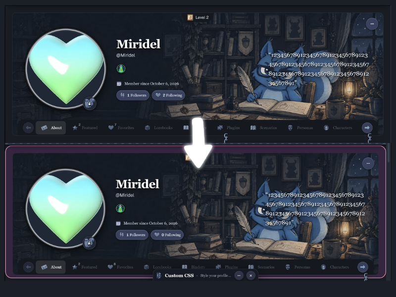

```css
/* Outer wrapper: pink background, border, and rounding. */
[data-profile="scope"] [data-profile="hero-frame"] {
  background: #352440 !important;
  border: 2px solid #ed91b7 !important;
  border-radius: 20px !important;
}
```

**Hero panel**

The background color sits beneath the banner artwork, so the image may cover it.

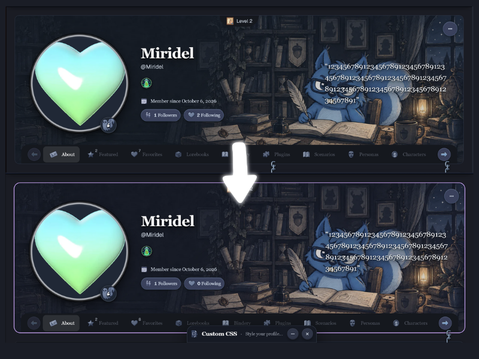

```css
/* Banner panel: purple surface, border, rounding, and shadow. */
[data-profile="scope"] [data-profile="hero"] {
  background-color: #251c35 !important;
  border: 2px solid #bd9bea !important;
  border-radius: 16px !important;
  clip-path: inset(0 round 16px) !important;
  box-shadow: 0 6px 20px #120b2099 !important;
}
```

**Hero content**

A translucent blue background shows the content area while letting some artwork remain visible.

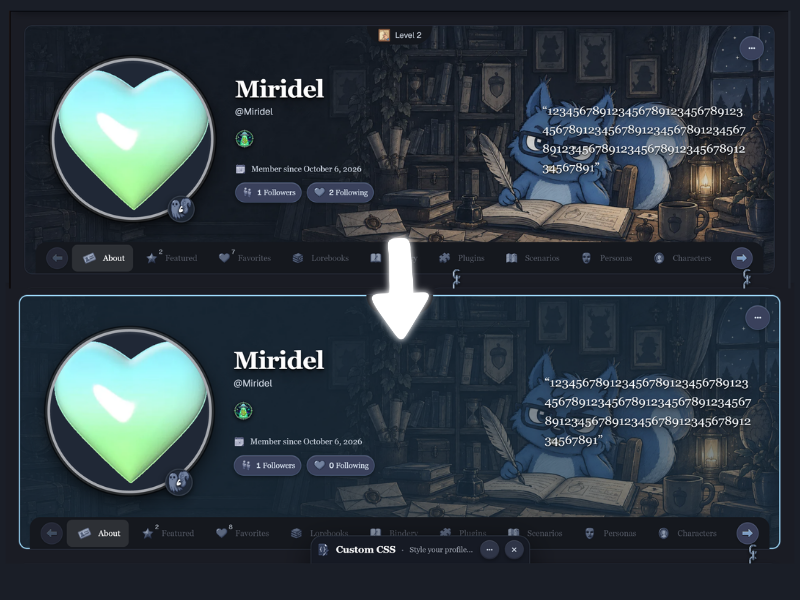

```css
/* Banner content area: blue surface and border. */
[data-profile="scope"] [data-profile="hero-content"] {
  background: rgba(25, 52, 70, 0.45) !important;
  border: 2px solid #91cfed !important;
  border-radius: 12px !important;
}
```

**Hero row**

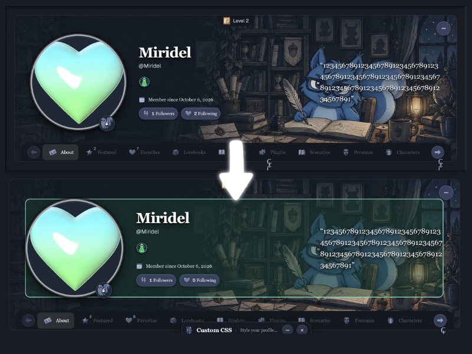

```css
/* Avatar and identity layout row: green surface and border. */
[data-profile="scope"] [data-profile="hero-row"] {
  background: rgba(25, 65, 48, 0.45) !important;
  border: 2px solid #8fd8bb !important;
  border-radius: 12px !important;
}
```

**Customization:** Change each layer independently. `background` changes its surface, `border` marks its edge, `border-radius` rounds its corners, and `box-shadow` adds depth. Keep the hero’s `clip-path` rounding equal to its `border-radius`.

These containers are nested, so translucent backgrounds overlap. Use `background: transparent` on the content or row if you want its border without the colored surface.

**Compact and expanded selector note**

**Layout/state variants; not screen-size selectors.**

| Selector inside the profile | Targets |
| --- | --- |
| `[data-profile="hero"][data-compact="false"]` | Expanded hero |
| `[data-profile="hero"][data-compact="true"]` | Compact hero |

LoreBary controls the state; these selectors let you style each layout separately. Compact/expanded is not a direct mobile/desktop selector.

**Banner Image Layer and Readability Tint**

The **banner artwork** and **readability tint** are separate layers. Style each independently to keep the content at full opacity.

| Target | Selector inside the profile |
| --- | --- |
| Banner artwork | `[data-profile="hero"] > div[style*="background-image"]` |
| Readability tint | `[data-profile="hero-tint"]` |

**Banner artwork**

The captured artwork layer has no dedicated `data-profile` label. This selector finds the direct child of the hero whose inline style contains `background-image`.

```css
/* Banner artwork: sizing, alignment, repetition, and opacity. */
[data-profile="scope"]
[data-profile="hero"] > div[style*="background-image"] {
  background-size: cover !important;
  background-position: center top !important;
  background-repeat: no-repeat !important;
  opacity: 0.8 !important;
}
```

**Customization:** Change `background-position` to move the artwork within its frame. Set `opacity` to `1` for full-strength artwork or lower it to reveal more of the hero’s background color. This fades only the image layer.

**Readability tint**

**Requires a selected banner:** The readability-tint example works when LoreBary renders its tint layer. In the captured default-banner state, that layer is absent, so the rule has no visible effect. The banner-image sizing and positioning example still applies.

This example uses strong pink to make the tint easy to see. The mask rules remove the existing directional fade from this layer.

```css
/* Banner tint: strong pink for a visible test. */
[data-profile="scope"] [data-profile="hero-tint"] {
  background: rgba(255, 0, 120, 0.8) !important;
  opacity: 1 !important;
  mask-image: none !important;
  -webkit-mask-image: none !important;
  pointer-events: none !important;
}
```

- `255, 0, 120` sets the tint color.
- `0.8` sets its strength. Lower it for a softer tint.
- Use `background: transparent` to remove this tint.
- Remove both mask declarations to retain LoreBary’s existing fade.

### Identity Rows and Individual Surface Treatments

Style the identity card and its inner rows, then choose a solid or gradient surface treatment.

**Identity Card, Column, and Row**

These three containers sit inside the hero row. Give each a separate style to see what it surrounds.

| Selector | Targets |
| --- | --- |
| `[data-profile="identity-card"]` | Outer identity area beside the avatar |
| `[data-profile="identity-col"]` | Column containing the name, handle, badges, and metadata |
| `[data-profile="identity"]` | Display-name row |

**Identity card**

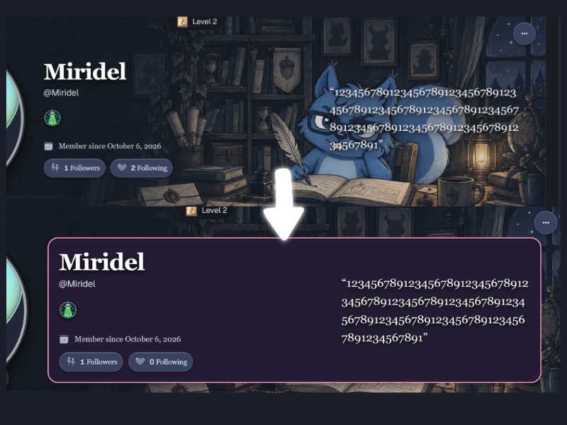

```css
/* Outer identity area: purple panel with a pink border. */
[data-profile="scope"] [data-profile="identity-card"] {
  background: #251c35 !important;
  border: 2px solid #ed91b7 !important;
  border-radius: 16px !important;
  padding: 16px !important;
  box-shadow: 0 4px 14px #120b2080 !important;
}
```

**Identity column**

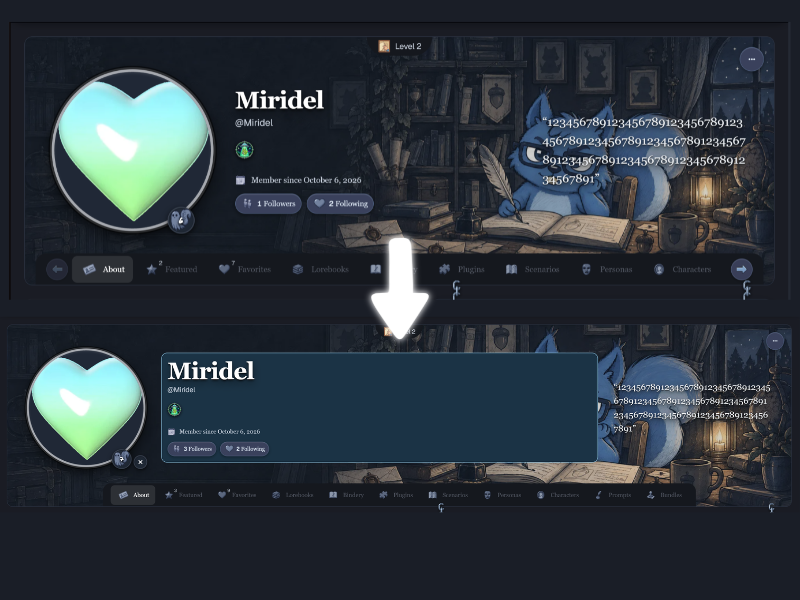

```css
/* Name and metadata column: blue panel. */
[data-profile="scope"] [data-profile="identity-col"] {
  background: #193446 !important;
  border: 1px solid #91cfed !important;
  border-radius: 12px !important;
  padding: 12px !important;
}
```

**Identity row**

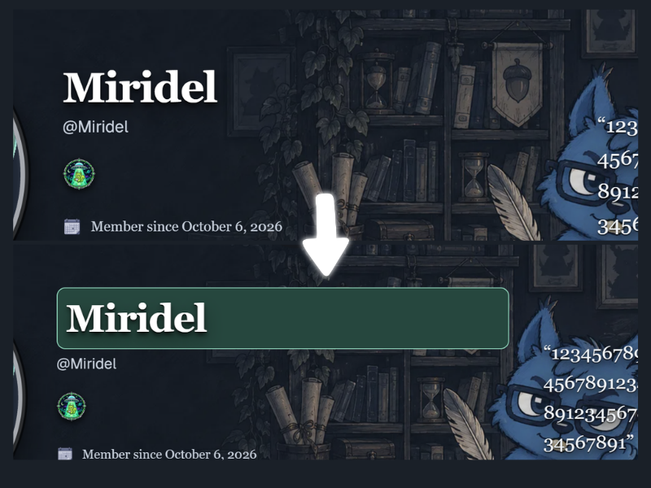

```css
/* Display-name row: green panel. */
[data-profile="scope"] [data-profile="identity"] {
  background: #24483e !important;
  border: 1px solid #8fd8bb !important;
  border-radius: 8px !important;
  padding: 8px !important;
}
```

**Customization:** Change each background, border, rounding, and padding independently. These containers are nested, so their padding adds together.

The examples style the **containers**. Name text, badges, and individual controls keep their existing styles.

**Panel Backgrounds, Borders, Rounding, and Shadows**

Use these four properties to change a panel’s appearance. This example targets only the **outer identity card** beside the avatar.

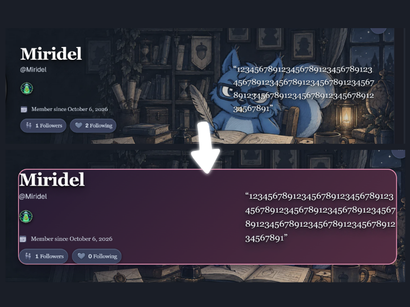

```css
/* Outer identity card: gradient, border, rounded corners, and shadow. */
[data-profile="scope"] [data-profile="identity-card"] {
  /* Surface: purple fading into rose. */
  background: linear-gradient(135deg, #251c35, #562b43) !important;

  /* Outline: thickness, style, and color. */
  border: 2px solid #ed91b7 !important;

  /* Corner rounding. */
  border-radius: 18px !important;

  /* Shadow: horizontal offset, vertical offset, blur, spread, color. */
  box-shadow: 0 8px 20px 0 rgba(18, 11, 32, 0.55) !important;
}
```

If you used the previous identity tutorial, replace its outer-card appearance rules with these. Keep its `padding` if you like that spacing.

**Customize the surface**

| Property | Try | Effect |
| --- | --- | --- |
| `background` | `#251c35` | Solid purple surface |
| `background` | `transparent` | Shows the layers behind the panel |
| `border` | `3px dashed #8fd8bb` | Thicker dashed mint outline |
| `border` | `none` | Removes the outline |
| `border-radius` | `0` | Square corners |
| `border-radius` | `24px` | Rounder corners |
| `box-shadow` | `0 0 16px #ed91b780` | Pink glow around the panel |
| `box-shadow` | `inset 0 0 12px #120b2080` | Shadow inside the panel |
| `box-shadow` | `none` | Removes the shadow |

**Choose a different panel**

Replace `[data-profile="identity-card"]` in the example with one target below.

| Target | Selector |
| --- | --- |
| Identity column | `[data-profile="identity-col"]` |
| Display-name row | `[data-profile="identity"]` |
| Banner content area | `[data-profile="hero-content"]` |

**Preview note:** Colored child panels can cover parts of the outer card’s background. Set the child backgrounds to `transparent` if you want the outer gradient to show through. Shadows extending beyond a clipping ancestor may be cut off.

### Level and Navigation Notches

Style the level notch and navigation notch independently from the banner panels around them.

**Level Notch and Navigation Notch**

The **level notch** sits at the top of the hero. The **navigation notch** holds the profile-section tabs at the bottom.

| Selector | Targets |
| --- | --- |
| `[data-profile="level-notch"]` | Level panel’s outer surface |
| `[data-profile="level-text"]` | Level label |
| `[data-profile="level-icon"]` | Current level’s image icon |
| `[data-profile="tab-notch"]` | Navigation panel’s outer surface |

**Level notch**

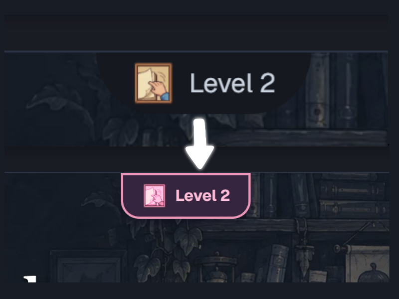

```css
/* Level panel: purple surface with a pink border. */
[data-profile="scope"] [data-profile="level-notch"] {
  background: #352440 !important;
  border: 2px solid #ed91b7 !important;
  border-radius: 0 0 14px 14px !important;
  padding: 6px 14px !important;
  box-shadow: 0 3px 8px #120b2080 !important;
}

/* Level label only. */
[data-profile="scope"] [data-profile="level-text"] {
  color: #ffb8d6 !important;
  font-weight: bold !important;
}

/* Current level icon: tint the artwork. */
[data-profile="scope"] [data-profile="level-icon"] {
  filter: sepia(1) saturate(2) hue-rotate(285deg) !important;
}
```

The icon selector works with whichever level image is displayed; it does not depend on a particular level filename. Its tint depends on the original artwork.

**Navigation notch**

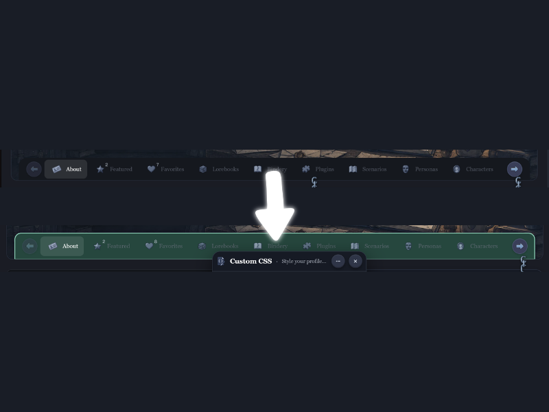

```css
/* Profile navigation panel: green surface with a mint border. */
[data-profile="scope"] [data-profile="tab-notch"] {
  background: #24483e !important;
  border: 2px solid #8fd8bb !important;
  border-radius: 14px 14px 0 0 !important;
  padding: 6px 14px !important;
  box-shadow: 0 -3px 8px #120b2080 !important;
}
```

This styles the navigation panel around the tabs. Individual tab buttons, labels, counts, and icons retain their existing styles.

**Customization:** Change the background, border, padding, and shadow separately. The four `border-radius` values follow top-left, top-right, bottom-right, bottom-left: the level notch rounds its bottom corners, and the navigation notch rounds its top corners.

Shadows may be cut off by the hero’s clipping.

### Member-Since Artwork and Followers/Following Counts

Target the calendar icon, membership text, follower buttons, and count labels separately.

**Member-Since Icon and Text**

Style the calendar icon and membership text independently.

| Selector | Targets |
| --- | --- |
| `[data-profile="member-since-icon"]` | Calendar image |
| `[data-profile="member-since-text"]` | Full “Member since…” line, including the date |

**Calendar icon**

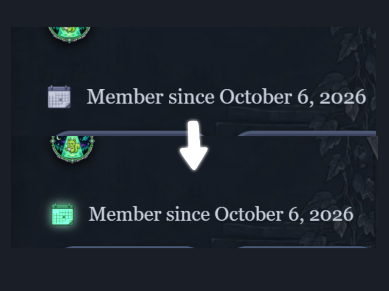

```css
/* Member-since calendar: mint tint and a soft glow. */
[data-profile="scope"] [data-profile="member-since-icon"] {
  filter: sepia(1) saturate(2) hue-rotate(95deg)
    drop-shadow(0 0 3px #8fd8bb) !important;
}
```

The calendar is an image, so `color` does not recolor it. `filter` tints its artwork; `drop-shadow` adds the glow. The tint depends on the original image.

**Membership text**

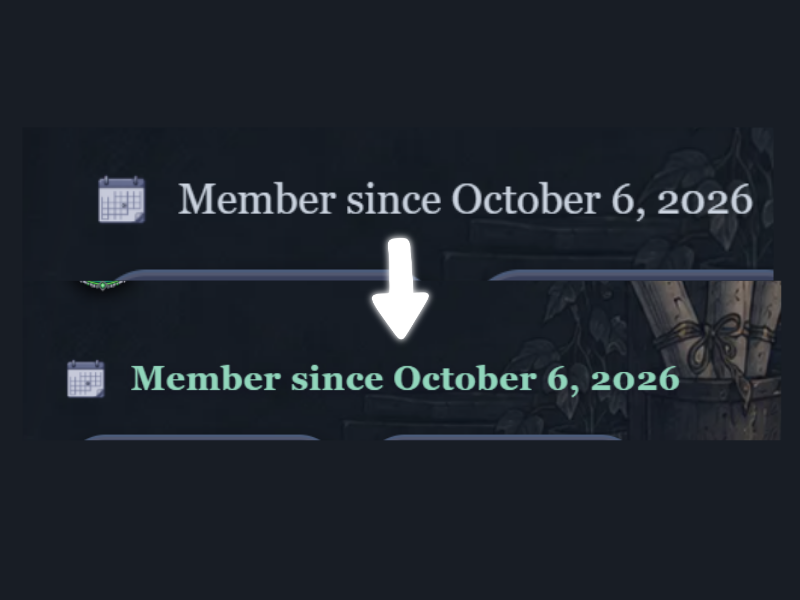

```css
/* Member-since text only: mint with a soft shadow. */
[data-profile="scope"] [data-profile="member-since-text"] {
  color: #8fd8bb !important;
  font-weight: 600 !important;
  letter-spacing: 0.02em !important;
  text-shadow: 0 1px 3px rgba(18, 11, 32, 0.6) !important;
}
```

**Customization:** Change the text’s `color`, `font-weight`, and `letter-spacing` directly. Use `text-shadow: none` to remove its shadow. Remove `drop-shadow(...)` from the icon filter for a tint without glow, or use `filter: none` for the original artwork.

The label and date share one text element in this layout, so this selector styles them together.

**Followers and Following Count Buttons**

These are the two count buttons beneath the profile metadata. Each has its own selector, separate from the Follow action button.

| Selector | Targets |
| --- | --- |
| `[data-profile="count-followers"]` | Followers count button |
| `[data-profile="count-following"]` | Following count button |
| `[data-profile="count-value"]` | Numeric count inside either button |

**Followers button**

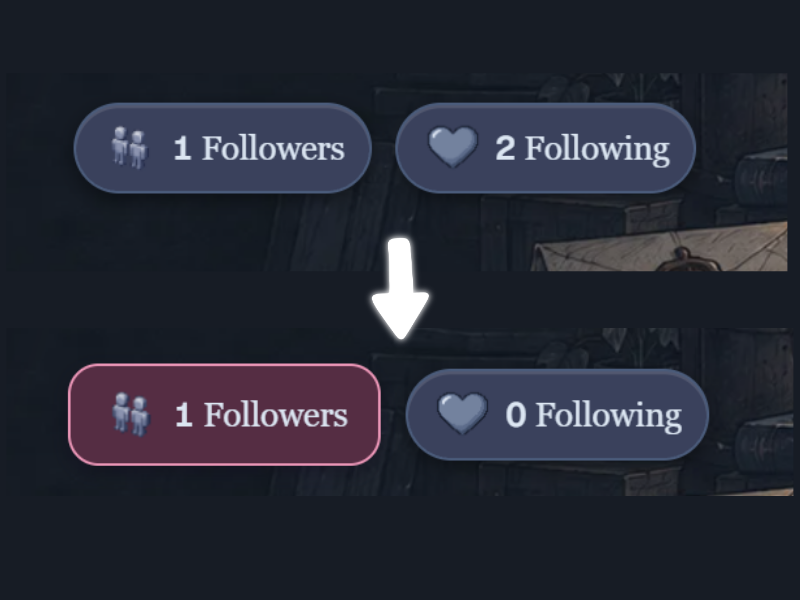

```css
/* Followers button: rose surface and pink border. */
[data-profile="scope"] [data-profile="count-followers"] {
  background: #562b43 !important;
  border: 1px solid #ed91b7 !important;
  border-radius: 10px !important;
  padding: 6px 10px !important;
  box-shadow: 0 2px 6px rgba(18, 11, 32, 0.4) !important;
}

/* Followers button: brighter surface on hover. */
[data-profile="scope"] [data-profile="count-followers"]:hover {
  background: #713953 !important;
}
```

**Following button**

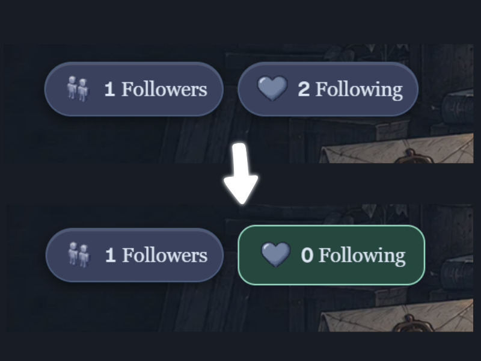

```css
/* Following button: green surface and mint border. */
[data-profile="scope"] [data-profile="count-following"] {
  background: #24483e !important;
  border: 1px solid #8fd8bb !important;
  border-radius: 10px !important;
  padding: 6px 10px !important;
  box-shadow: 0 2px 6px rgba(18, 11, 32, 0.4) !important;
}

/* Following button: brighter surface on hover. */
[data-profile="scope"] [data-profile="count-following"]:hover {
  background: #306052 !important;
}
```

**Customization:** Change each background and border independently. Increase `border-radius` for rounder corners, adjust `padding` for button spacing, or use `box-shadow: none` to remove the shadow.

**Button icons**

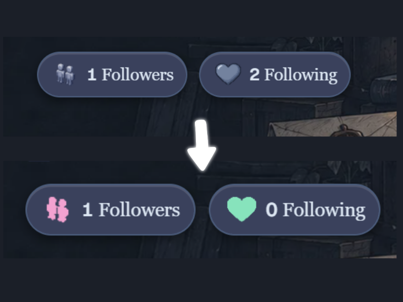

```css
/* Followers icon only: pink recolor. */
[data-profile="scope"] [data-profile="count-followers"]
img[src="/img/pixel/rel_friends.webp"] {
  filter: brightness(0) saturate(100%) invert(75%) sepia(24%)
    saturate(850%) hue-rotate(290deg) brightness(101%) contrast(91%) !important;
}

/* Following heart icon only: mint recolor. */
[data-profile="scope"] [data-profile="count-following"]
img[src="/img/pixel/heart.webp"] {
  filter: brightness(0) saturate(100%) invert(84%) sepia(20%)
    saturate(650%) hue-rotate(100deg) brightness(96%) contrast(90%) !important;
}
```

These filters replace the icons’ original colors with approximately pink and mint silhouettes. Use `filter: none` to restore the artwork’s original colors.

**Numbers and labels**

In “2 Following,” the number has its own `count-value` element. The word is text inside the surrounding span. Style that span for the label, then give the number its own color.

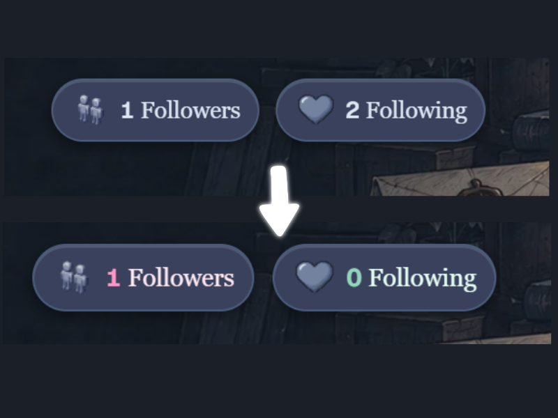

```css
/* Followers label: pale pink. */
[data-profile="scope"] [data-profile="count-followers"]
> span:has(> [data-profile="count-value"]) {
  color: #ffe9f2 !important;
}

/* Followers number only: bright pink and bold. */
[data-profile="scope"] [data-profile="count-followers"]
[data-profile="count-value"] {
  color: #ff91c8 !important;
  font-weight: 700 !important;
}

/* Following label: pale mint. */
[data-profile="scope"] [data-profile="count-following"]
> span:has(> [data-profile="count-value"]) {
  color: #e5fff3 !important;
}

/* Following number only: bright mint and bold. */
[data-profile="scope"] [data-profile="count-following"]
[data-profile="count-value"] {
  color: #8fd8bb !important;
  font-weight: 700 !important;
}
```

**Customization:** Change the label and number colors independently. `font-weight` changes the number’s weight.

The label selector follows the supplied HTML: `> span:has(> [data-profile="count-value"])` selects the button’s direct child span containing the number. The number’s separate rule overrides the color it would otherwise inherit from that span.

The buttons keep their existing click behavior and focus styling.

### Profile View-State Targets

**About and content view states**

The root also carries `data-profile-view`, which LoreBary updates when you navigate.

| Selector | Applies when |
| --- | --- |
| `[data-profile="scope"][data-profile-view="about"]` | The About view is open |
| `[data-profile="scope"][data-profile-view="content"]` | A content view is open |

Keep these attributes together with **no space**: they describe the same root element. A space before another selector targets something inside it.

---

## Profile Background and Layout

### Background Size, Position, and Tint

Adjust the size, position, repetition, and readability tint of artwork selected in the native Profile settings.

**Page Background: Size, Position, and Repetition**

Use `[data-profile="page-background"]` to style the page’s background artwork.

These examples adjust the background selected in LoreBary’s native settings. They do not assign an uploaded image URL. Future background layout examples should likewise omit uploaded-image background declarations.

**Full-image test**

`cover` fills the background area while keeping the image’s proportions. Some artwork may be cropped.

```css
/* Background image: fill the area without repeating. */
[data-profile="scope"] [data-profile="page-background"] {
  background-size: cover !important;
  background-position: center center !important;
  background-repeat: no-repeat !important;
}
```

**Seeing no change is normal:** If the same image is already centered and filling the area, this test can look identical. Try `contain` or `240px auto` to make the sizing change easier to see.

**Change the image size**

Replace the `background-size` value in the test.

| Value | Effect |
| --- | --- |
| `cover` | Fills the area; may crop the image |
| `contain` | Fits the entire image; may leave uncovered space |
| `600px auto` | Sets the image width to 600px and preserves its proportions |
| `50% auto` | Sets the image width to half the background area |

**Change the image position**

Replace the `background-position` value. Position controls where the artwork sits and which part remains visible when cropped.

| Value | Position |
| --- | --- |
| `center center` | Middle |
| `center top` | Top middle |
| `left center` | Left middle |
| `right bottom` | Bottom right |
| `65% 30%` | Custom horizontal and vertical alignment |

A position change may be subtle when the image already fits the area closely.

**Repeating-image test**

Replace the full-image block with this one. A smaller image size makes more copies visible.

```css
/* Background image: repeat a 240px-wide tile. */
[data-profile="scope"] [data-profile="page-background"] {
  background-size: 240px auto !important;
  background-position: left top !important;
  background-repeat: repeat !important;
}
```

| Value | Repetition |
| --- | --- |
| `no-repeat` | One image |
| `repeat` | Across and down |
| `repeat-x` | Across only |
| `repeat-y` | Down only |

The image repeats in this test; whether its edges join seamlessly depends on the artwork.

**Customization:** Use one test block at a time. Change `background-size`, `background-position`, and `background-repeat` directly. Remove the test block to return to your previous styling.

**Page Tint Without Fading Text and Controls**

The **page tint** sits over the background artwork. Target this layer to change the tint while keeping text and controls at full opacity.

```css
/* Page tint: translucent purple over the background. */
[data-profile="scope"] [data-profile="page-tint"] {
  background: rgba(65, 25, 90, 0.45) !important;
  opacity: 1 !important;
  pointer-events: none !important;
}
```

- `65, 25, 90` sets the tint’s RGB color.
- `0.45` sets its strength: `0` is transparent; `1` is solid.
- `pointer-events: none` lets clicks pass through the tint.

Try these backgrounds in the same rule:

| Value | Effect |
| --- | --- |
| `rgba(0, 0, 0, 0.25)` | Light darkening |
| `rgba(0, 0, 0, 0.65)` | Strong darkening |
| `rgba(90, 25, 55, 0.4)` | Rose tint |
| `transparent` | Removes the tint |

**Keep opacity off the profile root:** Applying `opacity` to `[data-profile="scope"]` fades everything inside it, including text and buttons. Adjust the tint’s background transparency instead.

### Body and Grid Spacing

Change outer body padding and the gaps between inner-grid sections without changing spacing inside their cards.

**Body and Inner-Body Spacing**

The **body** wraps the area below the profile header. The **inner body** is the grid holding its main sections.

| Selector | Targets |
| --- | --- |
| `[data-profile="body"]` | Outer body wrapper |
| `[data-profile="body-inner"]` | Inner layout grid |

**Outer body spacing**

Add space between the body’s edges and the layout inside it.

```css
/* Body: space inside the outer wrapper. */
[data-profile="scope"] [data-profile="body"] {
  padding: 12px !important;
}
```

**Inner layout spacing**

Adjust the grid’s inner padding and the space between its direct sections.

```css
/* Inner body: space around and between grid sections. */
[data-profile="scope"] [data-profile="body-inner"] {
  padding: 16px !important;
  column-gap: 24px !important;
  row-gap: 24px !important;
}
```

| Property | Changes |
| --- | --- |
| `padding` | Space inside the selected container |
| `column-gap` | Space between grid columns |
| `row-gap` | Space between grid rows |

The two containers are nested, so their padding **adds together**. Set either container’s padding to `0` if you want only the other to provide that space.

For different vertical and horizontal padding:

```css
/* Inner body: 12px top/bottom, 24px left/right. */
[data-profile="scope"] [data-profile="body-inner"] {
  padding: 12px 24px !important;
}
```

**Gap note:** These rules space the grid’s direct sections. They do not change spacing inside individual cards.

---

## Fonts and Typography

Use a readable body font and reserve decorative fonts for names, headings, and selected labels. Always include fallback fonts because remote fonts can fail to load or may be blocked by the editor.

### Safe system-font setup

This method needs no external font file and works offline.

```css
.profile-theme-scope[data-profile="scope"] {
  --profile-font-body: Georgia, "Times New Roman", serif;
  --profile-font-title: "Trebuchet MS", Arial, sans-serif;
  font-family: var(--profile-font-body) !important;
}

.profile-theme-scope [data-profile="display-name"],
.profile-theme-scope [data-profile="display-name"] *,
.profile-theme-scope [data-profile="composer-header"] h3,
.profile-theme-scope section:has([data-profile="about-card"])
  > header :is(h2, span),
.profile-theme-scope [data-profile="gallery-preview"] h2,
.profile-theme-scope [data-profile="popular-content"] h2 {
  font-family: var(--profile-font-title) !important;
  letter-spacing: .08em;
}

.profile-theme-scope [data-profile="tab"],
.profile-theme-scope [data-profile="about-card"],
.profile-theme-scope [data-profile="composer-editor"] {
  font-family: var(--profile-font-body) !important;
}
```

### Laboratory font variables

Laboratory already exposes useful font variables. Set them on the Laboratory scope instead of repeating `font-family` on every message element.

```css
.lab-theme-scope {
  --lab-font-family: Georgia, "Times New Roman", serif;
  --lab-char-name-font: "Trebuchet MS", Arial, sans-serif;
  --lab-persona-name-font: "Trebuchet MS", Arial, sans-serif;
}
```

### Optional web font

Remote imports work only when the theme editor and the font host permit them. An `@import` rule must sit at the very top of the stylesheet, before normal CSS rules. Keep the fallback stack even when the import works.

```css
@import url("https://fonts.googleapis.com/css2?family=Cinzel:wght@600;700&family=Lexend:wght@400;600&display=swap");

.profile-theme-scope[data-profile="scope"] {
  --profile-font-body: Lexend, Arial, sans-serif;
  --profile-font-title: Cinzel, Georgia, serif;
}
```

If `@import` is rejected by the safety checker, use system fonts or embed a properly licensed WOFF2 file with `@font-face` and a Base64 data URL. Do not remove the fallback fonts.

### Useful typography properties

| Property | Purpose |
| --- | --- |
| `font-family` | Selects the font and fallbacks |
| `font-size` | Changes text size |
| `font-weight` | Controls regular, semibold, or bold text |
| `font-style` | Adds or removes italics |
| `letter-spacing` | Opens or tightens heading letters |
| `line-height` | Improves paragraph readability |
| `text-transform` | Uppercase, lowercase, or normal case |
| `text-shadow` | Separates text from textured backgrounds |

### Display Name, Username, and Quote Treatments

Give the display name, username, and header quote their own text treatments while retaining the existing font setup.

**Display Name: Color, Shadow, and Gradient**

The **display-name** element is the heading; **name-text** is the text inside it.

| Selector | Targets |
| --- | --- |
| `[data-profile="display-name"]` | Display-name heading |
| `[data-profile="name-text"]` | Name text inside the heading |

**Heading weight and shadow**

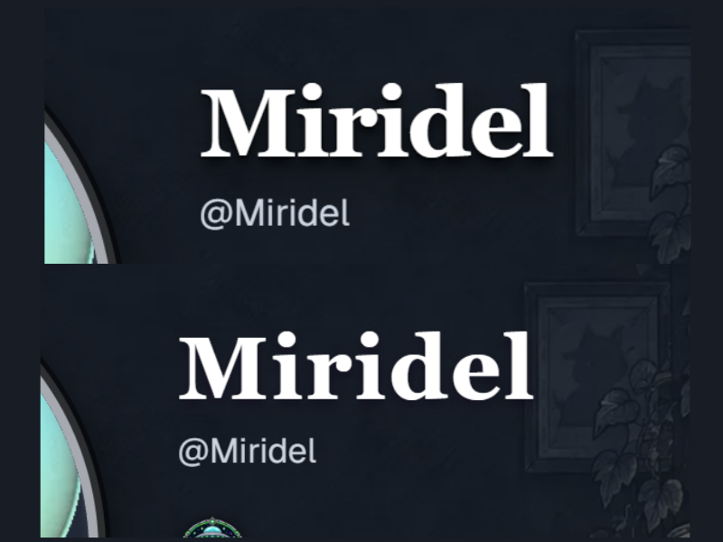

```css
/* Display-name heading: weight, letter spacing, and shadow. */
[data-profile="scope"] [data-profile="display-name"] {
  font-weight: 700 !important;
  letter-spacing: 0.03em !important;
  text-shadow: 0 2px 4px rgba(18, 11, 32, 0.65) !important;
}
```

**Solid name color**

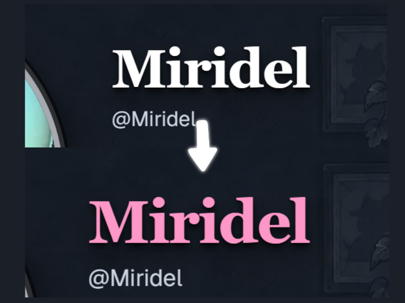

```css
/* Name text only: bright pink. */
[data-profile="scope"] [data-profile="name-text"] {
  color: #ff91c8 !important;
}
```

**Customization:** Change `color` for the name, `letter-spacing` for the distance between letters, and `text-shadow` for its shadow. Use `text-shadow: none` to remove it.

**Optional gradient name**

Replace the solid name-color block with this alternative. It paints the letters with a gradient rather than adding a rectangular background.

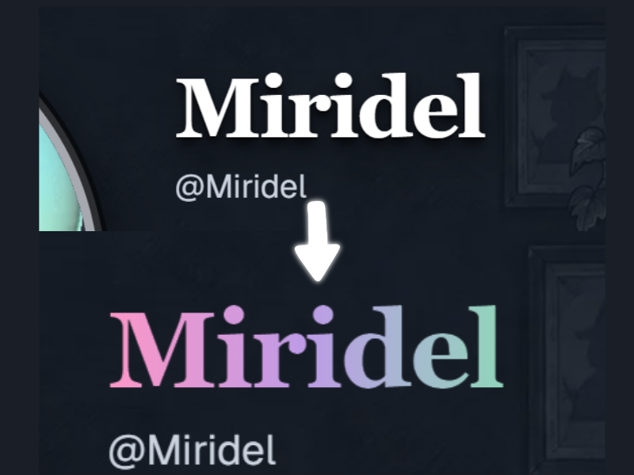

```css
/* Name text only: pink, lavender, and mint gradient. */
[data-profile="scope"] [data-profile="name-text"] {
  background: linear-gradient(90deg, #ff91c8, #bd9bea, #8fd8bb) !important;
  background-clip: text !important;
  -webkit-background-clip: text !important;
  color: transparent !important;
  -webkit-text-fill-color: transparent !important;
  text-shadow: none !important;
}
```

**Customization:** Change the three colors or the gradient angle (`90deg`). Use one name-color treatment at a time. To return to solid text, remove the gradient block and restore the solid-color block.

**Username Text**

The captured username (`@handle`) has no dedicated `data-profile` label. It is a paragraph immediately after the display-name row inside the identity column.

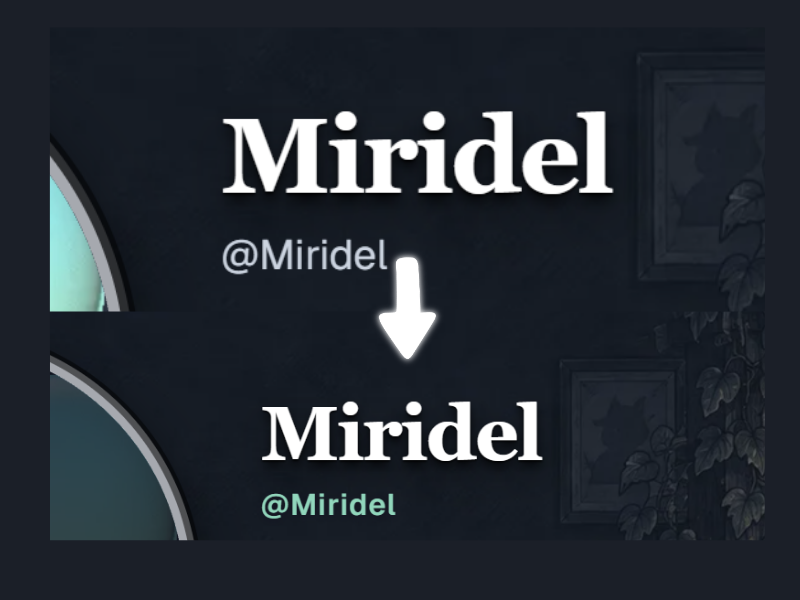

```css
/* Username paragraph directly after the identity row. */
[data-profile="scope"] [data-profile="identity-col"]
> [data-profile="identity"] + p {
  color: #8fd8bb !important;
  font-weight: 600 !important;
  letter-spacing: 0.04em !important;
  text-shadow: 0 1px 3px rgba(18, 11, 32, 0.6) !important;
}
```

**Read the selector**

| Part | Meaning |
| --- | --- |
| `[data-profile="identity-col"]` | Find the identity column |
| `> [data-profile="identity"]` | Find its direct child display-name row |
| `+ p` | Select the paragraph immediately after that row |

**Customization:** Change `color` for the handle, `font-weight` for its weight, and `letter-spacing` for spacing between letters. Use `text-shadow: none` to remove the shadow.

**Quote Container and Quote Text**

Style the quote’s panel and its text separately.

| Selector | Targets |
| --- | --- |
| `[data-profile="quote"]` | Outer quote container |
| `[data-profile="quote-text"]` | Quote text button inside it |

**Quote container**

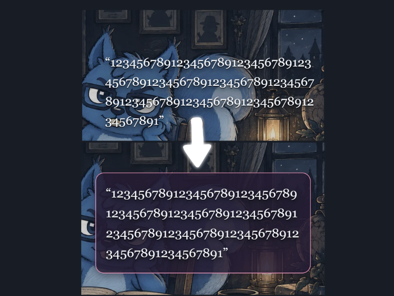

```css
/* Quote panel: purple surface, pink border, and rounded corners. */
[data-profile="scope"] [data-profile="quote"] {
  background: rgba(37, 28, 53, 0.85) !important;
  border: 1px solid #ed91b7 !important;
  border-radius: 12px !important;
  padding: 14px !important;
  box-shadow: 0 4px 12px rgba(18, 11, 32, 0.45) !important;
}
```

**Quote text**

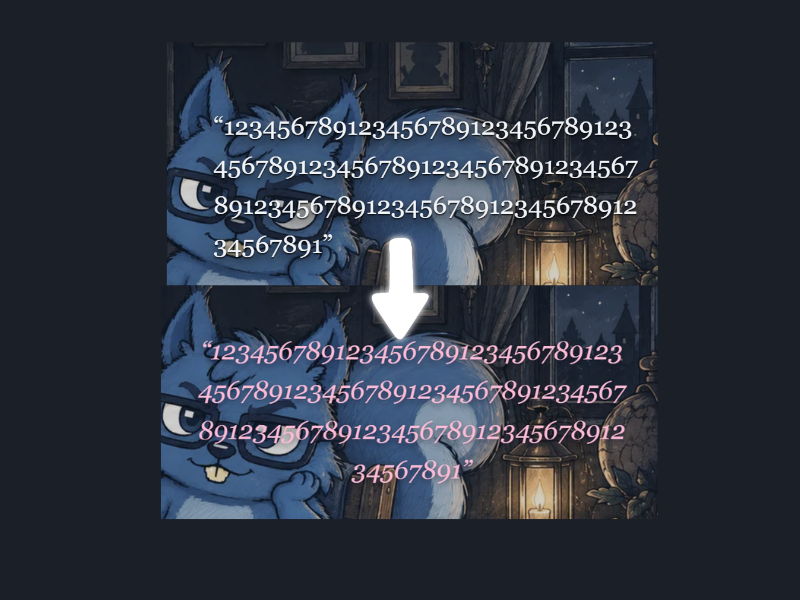

```css
/* Quote text only: pink, italic, and centered. */
[data-profile="scope"] [data-profile="quote-text"] {
  color: #ffb8d6 !important;
  font-style: italic !important;
  text-align: center !important;
  text-shadow: 0 2px 4px rgba(18, 11, 32, 0.6) !important;
}
```

**Customization:** Change `background`, `border`, and `padding` for the panel. Change `color`, `font-style`, `text-align`, and `text-shadow` for the text. Use `font-style: normal` for upright lettering or `text-shadow: none` to remove the shadow.

The captured quote text is a button. Add a quote in LoreBary if the quote area is absent.

### Inherited and Explicit Text Colors

Use the existing font setup for body and title fonts. For component colors, a child span with its own `color` does not inherit the parent’s color—even if the parent declaration is important.

Target nested text only when you intend to replace its author-selected color. Keep optional nested paragraph/span overrides separate from a component’s base surface styling.

---

## Profile Avatar Frame

The most reliable profile frame is a transparent PNG or WebP attached to the outer avatar wrapper. Keep the portrait, the decorative frame, and the action buttons on separate layers.

| Before: portrait without the decorative frame | After: transparent frame aligned to the portrait |
| --- | --- |
|  |  |

### Centered decorative frame

```css
.profile-theme-scope [data-profile="avatar-wrap"] {
  position: relative;
  overflow: visible !important;
  isolation: isolate;
}

.profile-theme-scope [data-profile="avatar"] {
  position: relative;
  z-index: 1;
  overflow: hidden;
  border: 2px solid #d1b781 !important;
  background: #2e261d !important;
}

.profile-theme-scope [data-profile="avatar-wrap"]::after {
  content: "";
  position: absolute;
  inset: -5%;
  z-index: 3;
  pointer-events: none;
  background: url("YOUR-TRANSPARENT-FRAME.png") center / contain no-repeat;
}

.profile-theme-scope [data-profile="avatar-actions"] {
  position: relative;
  z-index: 5;
}
```

`pointer-events: none` is important: the transparent rectangle around the artwork must not block avatar or remove-button clicks.

### Fit the portrait inside the frame opening

Use the same inset for the portrait and its click overlay. Absolute positioning is more reliable than compensating with margins.

```css
.profile-theme-scope [data-profile="avatar"]
  > [data-profile="avatar-img"] {
  position: absolute !important;
  inset: 14% !important;
  width: 72% !important;
  height: 72% !important;
  margin: 0 !important;
  object-fit: cover !important;
  border-radius: 50% !important;
}

.profile-theme-scope [data-profile="avatar"] > div.absolute {
  inset: 14% !important;
}
```

### Asymmetrical frame artwork

Use this pattern when flowers, horns, a lantern, a skull, or another ornament extends farther on one side. Align the visible opening, not the full transparent image bounds.

```css
.profile-theme-scope [data-profile="avatar-wrap"]::after {
  content: "";
  position: absolute;
  width: 150%;
  height: 150%;
  left: -33%;
  top: -39%;
  z-index: 3;
  pointer-events: none;
  background: url("ASYMMETRICAL-FRAME.png") center / 100% 100% no-repeat;
}
```

### Mobile avatar alignment

```css
@media (max-width: 767px) {
  .profile-theme-scope [data-profile="avatar-wrap"]::after {
    inset: -5%;
  }

  .profile-theme-scope [data-profile="avatar"]
    > [data-profile="avatar-img"],
  .profile-theme-scope [data-profile="avatar"] > div.absolute {
    inset: 14% !important;
  }
}
```

If the artwork is asymmetrical, give its mobile rule its own `width`, `height`, `left`, and `top` values instead of reusing `inset`.

### Change-Avatar Overlay and Upload Artwork

Keep the existing frame, portrait-inset, and stacking examples. The upload overlay and its icon can receive their own treatment within those layers.

**Change-Avatar Overlay and Upload Icon**

The upload control appears on your own editable avatar. Its overlay, title, hint, and image icon can be styled separately.

The captured upload label has no dedicated `data-profile` hook. `label:has(> input[aria-label="Change avatar"])` finds the label containing that upload input.

**Overlay surface**

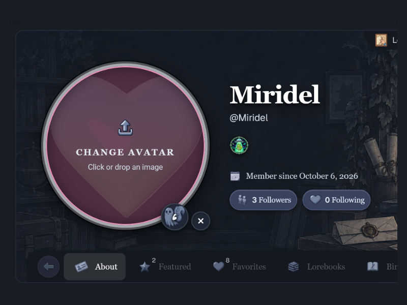

```css
/* Change-avatar overlay: rose tint inside the portrait. */
[data-profile="scope"] [data-profile="avatar"]
label:has(> input[aria-label="Change avatar"]) > span {
  background: rgba(86, 43, 67, 0.88) !important;
  border: 2px solid #ed91b7 !important;
  border-radius: inherit !important;
  box-shadow: inset 0 0 18px rgba(18, 11, 32, 0.55) !important;
}
```

Hover over the avatar or focus its upload input to see the overlay. These rules keep its existing reveal behavior.

**Title and hint**

In the supplied overlay, the second child span contains “Change avatar” and the third contains “Click or drop an image.”

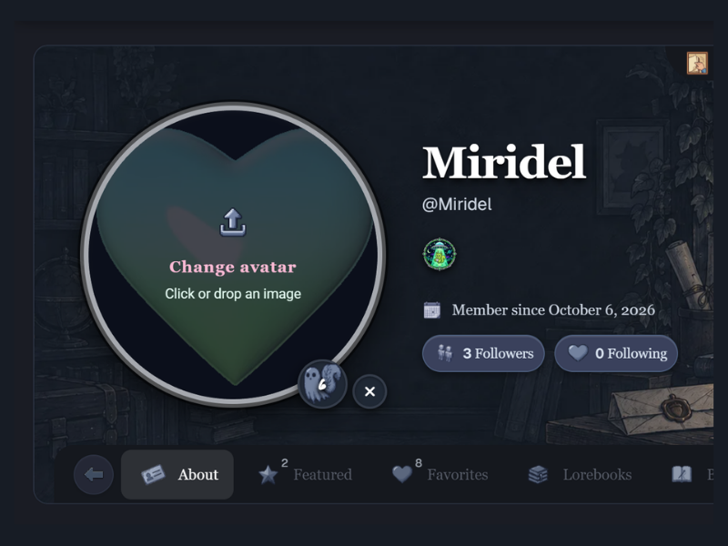

```css
/* Change-avatar title only. */
[data-profile="scope"] [data-profile="avatar"]
label:has(> input[aria-label="Change avatar"])
> span > span:nth-child(2) {
  color: #ffb8d6 !important;
  text-transform: none !important;
  letter-spacing: 0.04em !important;
}

/* Upload hint only. */
[data-profile="scope"] [data-profile="avatar"]
label:has(> input[aria-label="Change avatar"])
> span > span:nth-child(3) {
  color: #e5fff3 !important;
}
```

These text selectors follow the captured child order; they may need updating if LoreBary rearranges the overlay.

**Upload icon**

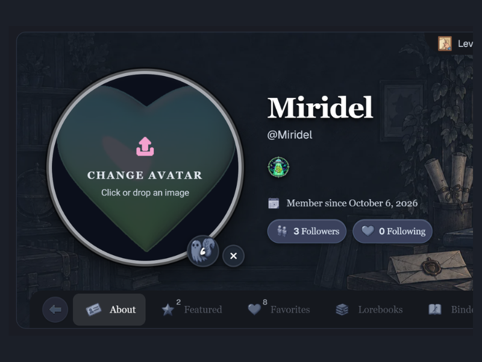

```css
/* Upload image icon only: pink recolor. */
[data-profile="scope"] [data-profile="avatar"]
label:has(> input[aria-label="Change avatar"])
img[src="/img/pixel/expression-upload.webp"] {
  filter: brightness(0) saturate(100%) invert(75%) sepia(24%)
    saturate(850%) hue-rotate(290deg) brightness(101%) contrast(91%) !important;
}
```

**Customization:** Change the overlay’s background transparency, border, and inner shadow independently. Change each text color directly. The filter produces an approximate pink silhouette; use `filter: none` to restore the original icon.

The upload overlay may be absent when viewing another user’s profile.

### Streak and Badge Artwork

Style the streak counter and native badge artwork independently from the portrait and frame.

**Streak Artwork and Count**

The streak beside the avatar has an outer badge, an image, and a number over the image. Give each its own style.

| Selector | Targets |
| --- | --- |
| `[data-profile="streak"]` | Outer streak badge |
| `[data-profile="streak-icon"]` | Streak artwork |
| `[data-profile="streak-count"]` | Number over the artwork |

**Streak badge**

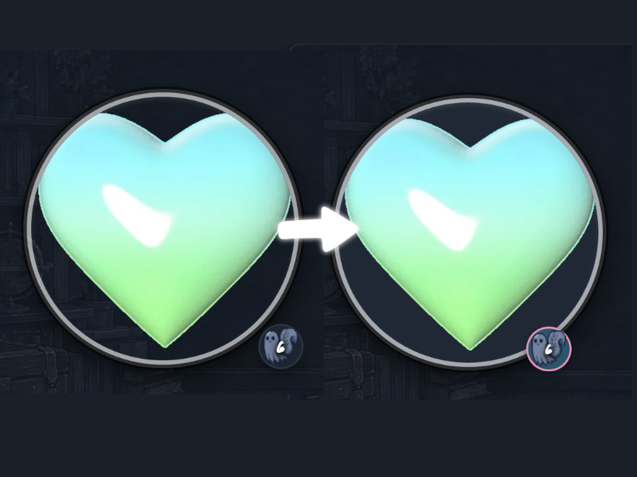

```css
/* Outer streak badge: blue surface and pink border. */
[data-profile="scope"] [data-profile="streak"] {
  background: #27576b !important;
  border: 2px solid #ed91b7 !important;
  border-radius: 50% !important;
  box-shadow: 0 2px 6px rgba(18, 11, 32, 0.5) !important;
}
```

The pink shape inside the badge is the filtered image itself. Changing the badge background changes the surface behind that artwork, not the pink pixels.

**Streak artwork**

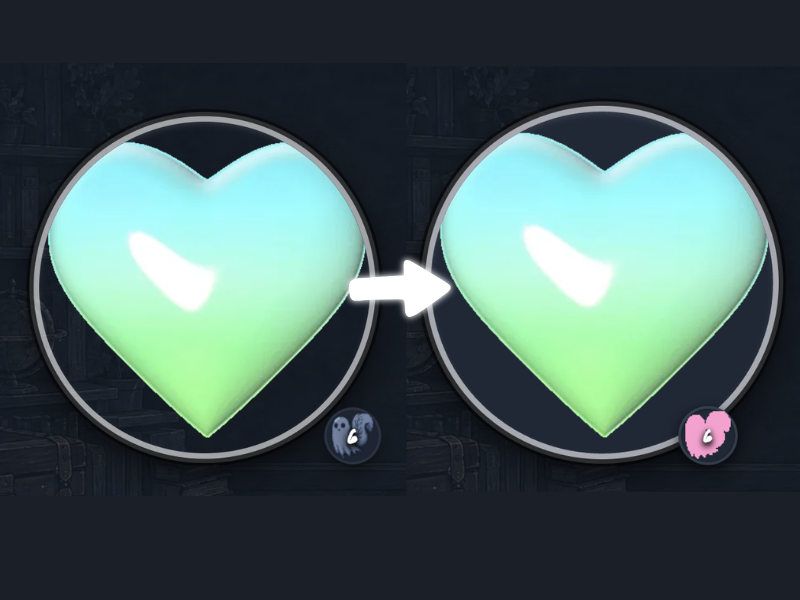

```css
/* Streak artwork only: pink recolor. */
[data-profile="scope"] [data-profile="streak-icon"] {
  filter: brightness(0) saturate(100%) invert(75%) sepia(24%)
    saturate(850%) hue-rotate(290deg) brightness(101%) contrast(91%) !important;
}
```

This recolors whichever streak image LoreBary displays. It produces an approximate pink silhouette; use `filter: none` to retain the original colors and shading.

**Streak count**

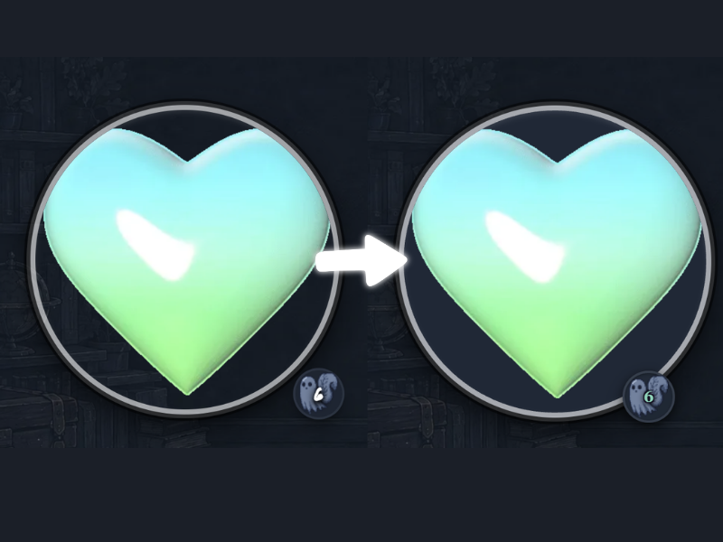

```css
/* Number over the artwork: mint with a dark outline. */
[data-profile="scope"] [data-profile="streak-count"] {
  color: #8fd8bb !important;
  font-family: Georgia, serif !important;
  font-weight: 700 !important;
  text-shadow:
    -1px -1px 0 #120b20,
     1px -1px 0 #120b20,
    -1px  1px 0 #120b20,
     1px  1px 0 #120b20 !important;
}
```

**Customization:** Change the badge’s background and border, the image filter, and the number’s color independently. The four shadows outline the number for contrast; use `text-shadow: none` to remove them.

They change its appearance, not its value.

**Badge List and Individual Badge Targets**

The identity badge list sits beneath the profile name and username. Style its container, badge artwork, or one badge independently.

| Selector | Targets |
| --- | --- |
| `[data-profile="badge-list"]` | Badge-list container |
| `[data-profile="author-badge"]` | Individual badge button |
| `[data-profile="author-badge"][data-badge="glorp"]` | Glorp badge button |

Every example below includes `[data-profile="identity-card"]` so it targets the header’s identity badges.

**Badge-list surface**

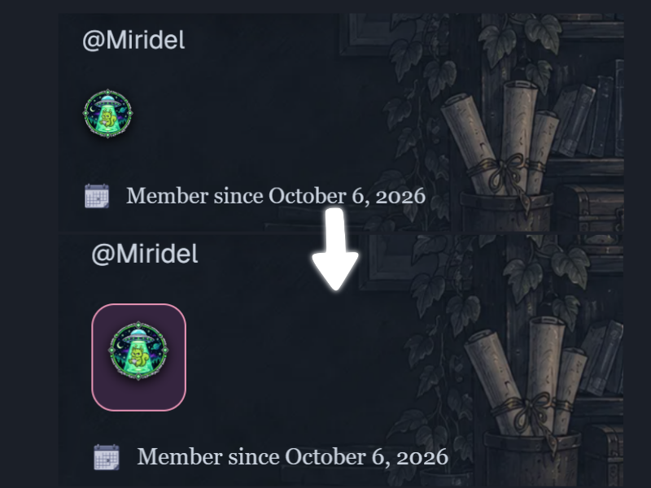

```css
/* Identity badge list: purple surface and pink border. */
[data-profile="scope"] [data-profile="identity-card"]
[data-profile="badge-list"] {
  display: inline-block !important;
  background: #352440 !important;
  border: 1px solid #ed91b7 !important;
  border-radius: 12px !important;
  padding: 8px !important;
}

/* Identity badge artwork: consistent size. */
[data-profile="scope"] [data-profile="identity-card"]
[data-profile="badge-list"] [data-profile="author-badge"] img {
  width: 32px !important;
  height: 32px !important;
  object-fit: contain !important;
}
```

**One badge: Glorp**

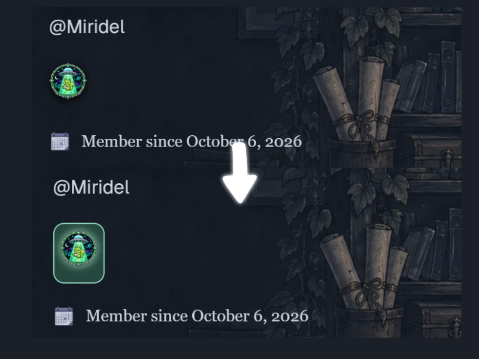

```css
/* Glorp button only: green tile behind the artwork. */
[data-profile="scope"] [data-profile="identity-card"]
[data-profile="author-badge"][data-badge="glorp"] {
  background: #24483e !important;
  border: 1px solid #8fd8bb !important;
  border-radius: 8px !important;
  padding: 4px !important;
}

/* Glorp artwork only: mint glow, preserving original colors. */
[data-profile="scope"] [data-profile="identity-card"]
[data-profile="author-badge"][data-badge="glorp"] img {
  filter: drop-shadow(0 0 3px #8fd8bb) !important;
}
```

**Customization:** Change the list’s surface independently from the individual badge tile. Change `width` and `height` to resize artwork. The Glorp image filter adds a glow; it does not recolor the badge. Use `filter: none` to remove that glow.

**Target another badge**

Replace `glorp` in the individual-badge rules with a captured value below. Keep the spelling and capitalization exactly as shown.

| Badge | `data-badge` value |
| --- | --- |
| Glorp | `glorp` |
| Featured Creator | `featured` |
| Keeper of the Flame | `donatorMonthly` |
| Spark of Kindness | `donatorSingle` |
| Tripartite Trails | `rmq326` |
| Resident Ghost | `residentGhost` |
| The Vanguard | `eraVanguard` |
| The Breaker | `eraBreaker` |
| Academy Graduate | `academyGraduate` |
| The Painter | `title:theme` |
| Guest Emblem in the supplied capture | `event:37185a8d-4528-4de8-968b-b89a4c7b4295` |

These values were found in this layout. The event value identifies that captured emblem; other event badges can have different values.

**The same badge in different places**

Badge artwork can repeat across the page. Select its surrounding area before selecting the image to keep the effect local.

| Location | Selector for the Glorp image |
| --- | --- |
| Profile identity | `[data-profile="scope"] [data-profile="identity-card"] [data-profile="author-badge"][data-badge="glorp"] img` |
| Post author header | `[data-profile="scope"] [data-profile="post"] [data-profile="post-header"] img[src="/img/Badges/badge_glorp.webp"]` |
| Creation cards | `[data-profile="scope"] [data-profile="card"] img[src="/img/Badges/badge_glorp.webp"]` |

The post selector includes `post-header` so it targets the author badge rather than Glorp artwork in the post body. The card selector targets matching artwork inside creation cards.

**Dialog rows:** Followers/Following badges sit inside `[data-profile="modal-list"]` in the captured dialogs. Those dialogs were confirmed outside `[data-profile="scope"]`, so the profile-scoped examples above do not reach them. Keep dialog badge styling for the experimental dialog section.

A filename-only rule such as `img[src="/img/Badges/badge_glorp.webp"]` can affect every matching image within the CSS’s reach. The location selector is what separates these uses.

**Hide badges beside post author names**

```css
/* Hide the entire badge group beside post author names. */
[data-profile="post-author"] + div {
  display: none !important;
}
```

`+ div` selects the badge-group container immediately after the author link. Hiding the group removes all its badge images and any backgrounds, borders, and padding on elements inside it.

Use this exact tested selector, without adding `[data-profile="scope"]`. The scope-prefixed versions did not work in the user’s test; this version did. The supplied post layout places the badge group immediately after the author link.

This leaves profile identity badges and artwork in post bodies visible. Remove the rule to restore the post-header badge group.

---

## Stickers and Decorative Images

The cleanest CSS-only sticker is a transparent PNG or WebP placed in a pseudo-element. Attach it to the nearest stable component, make that component `position: relative`, and keep the sticker click-through.


### Reusable sticker variable

```css
.profile-theme-scope[data-profile="scope"] {
  --profile-sticker: url("YOUR-TRANSPARENT-STICKER.png");
}
```

### Sticker above the About Me panel

```css
.profile-theme-scope section:has([data-profile="about-card"]) {
  position: relative;
  overflow: visible !important;
  isolation: isolate;
}

.profile-theme-scope
  section:has([data-profile="about-card"])::after {
  content: "";
  position: absolute;
  top: -54px;
  right: 18px;
  width: clamp(74px, 8vw, 108px);
  aspect-ratio: 1 / 1;
  z-index: 20;
  pointer-events: none;
  background: var(--profile-sticker) center / contain no-repeat;
  transform: rotate(8deg);
  filter: drop-shadow(0 7px 6px rgba(0, 0, 0, .55));
}
```

### Sticker in the center of the profile body

```css
.profile-theme-scope [data-profile="body-inner"] {
  position: relative;
  overflow: visible !important;
}

.profile-theme-scope [data-profile="body-inner"]::after {
  content: "";
  position: absolute;
  left: 50%;
  top: 330px;
  width: 340px;
  aspect-ratio: 4 / 3;
  z-index: 60;
  pointer-events: none;
  transform: translateX(-50%);
  background: var(--profile-sticker) center / contain no-repeat;
  filter: drop-shadow(0 12px 14px rgba(0, 0, 0, .66));
}
```

### How to move the sticker

| Change | Property |
| --- | --- |
| Move down | Increase `top` |
| Move up | Decrease `top` or use a negative value |
| Move right | Increase `left`, or decrease `right` |
| Move left | Decrease `left`, or increase `right` |
| Resize | Change `width`; keep `height: auto` or an `aspect-ratio` |
| Tilt | Change `rotate(...)` inside `transform` |
| Place above other layers | Increase `z-index` on the sticker and its positioned parent |

Do not set `left` and `right` together unless you intentionally want the browser to stretch the box. When centering with `left: 50%`, keep `translateX(-50%)` in the same `transform` declaration as any rotation.

### Mobile sticker rule

Large desktop stickers often overlap the composer on mobile. Reposition or hide them deliberately.

```css
@media (max-width: 767px) {
  .profile-theme-scope
    section:has([data-profile="about-card"])::after {
    top: -32px;
    right: 8px;
    width: 70px;
    transform: rotate(5deg);
  }

  .profile-theme-scope [data-profile="body-inner"]::after {
    display: none;
  }
}
```

One element provides only one `::before` and one `::after`. If both are already used for borders or particles, anchor the sticker to another stable container instead of overwriting the existing decoration.

### Laboratory sticker equivalent

The same positioning system works in Laboratory. Only the anchor changes.

```css
.lab-theme-scope {
  --lab-sticker: url("YOUR-TRANSPARENT-STICKER.png");
}

.lab-theme-scope [data-lab="header"] {
  position: relative;
  overflow: visible !important;
}

.lab-theme-scope [data-lab="header"]::after {
  content: "";
  position: absolute;
  top: -28px;
  right: 18px;
  width: 84px;
  aspect-ratio: 1 / 1;
  z-index: 20;
  pointer-events: none;
  background: var(--lab-sticker) center / contain no-repeat;
  transform: rotate(6deg);
}
```

### Native Decorations and Layer Choice

The sticker examples already explain anchoring, positioning, and click-through layers. Native Bary images, chain backgrounds, and card vines are separate targets: use their component lessons rather than replacing the sticker’s positioning rules.

A filter on an image does not recolor a separate masked pseudo-element. If the same component already has a decorative replacement, edit that layer or select a different available anchor before adding another decoration. Keep user portraits and gallery images outside native-artwork filters.

---

## Main Profile Tabs and About Tabs

The main profile navigation and the five About Me icon tabs are separate components. Style them independently.


### Main profile tabs, selected state, and counts

```css
.profile-theme-scope [data-profile="tab"] {
  min-height: 36px;
  padding: 7px 12px !important;
  margin: 0 2px;
  color: #eadcc7 !important;
  background: linear-gradient(#3f3328, #2c241d) !important;
  border: 1px solid rgba(205, 164, 95, .45) !important;
  border-radius: 7px !important;
}

@media (hover: hover) {
  .profile-theme-scope [data-profile="tab"]:hover {
    background: #594634 !important;
    border-color: #d9b978 !important;
  }
}

.profile-theme-scope
  [data-profile="tab"][aria-selected="true"] {
  color: #fff4d2 !important;
  background: linear-gradient(#7c8766, #535f4d) !important;
  border-color: #d8c49d !important;
}

.profile-theme-scope [data-profile="tab-count"] {
  color: #fff4d2 !important;
  background: #6d5e4b !important;
}
```

### About Me icon tabs

```css
.profile-theme-scope [data-profile="about"] [role="tab"] {
  margin-left: 0 !important;
  color: #f0e5d0 !important;
  background: linear-gradient(#4b3c2c, #33291f) !important;
  border: 1px solid rgba(213, 168, 93, .55) !important;
  border-radius: 8px 8px 0 0 !important;
}

/* Hide only the paper plate, not the visible tab icons. */
.profile-theme-scope [data-profile="about"]
  [role="tab"] img[src*="paper-tab.webp"] {
  opacity: 0 !important;
}

.profile-theme-scope [data-profile="about"]
  [role="tab"][aria-selected="true"] {
  background: #6c7656 !important;
  border-color: #ebcd8c !important;
}
```

### Individual Main Tabs and Their Artwork

Use the shared tab styling first. Add a data-tab condition when only one tab should differ; use an exact native image path when only its artwork should change.

| Main tab | data-tab | Native heading icon |
| --- | --- | --- |
| About | about | /img/pixel/idcard.webp |
| Featured | featured | /img/pixel/star.webp |
| Favorites | favorites | /img/pixel/heart.webp |
| Lorebooks | lorebooks | /img/pixel/lorebooks.webp |
| Plugins | plugins | /img/pixel/plugins.webp |
| Scenarios | scenarios | /img/pixel/scenarios.webp |
| Personas | personas | /img/pixel/personas.webp |
| Characters | characters | /img/pixel/characters.webp |
| Prompts | prompts | /img/pixel/prompts.webp |
| Bundles | bundles | /img/pixel/templates.webp |
| Bindery | binderies | /img/pixel/bindery.webp |

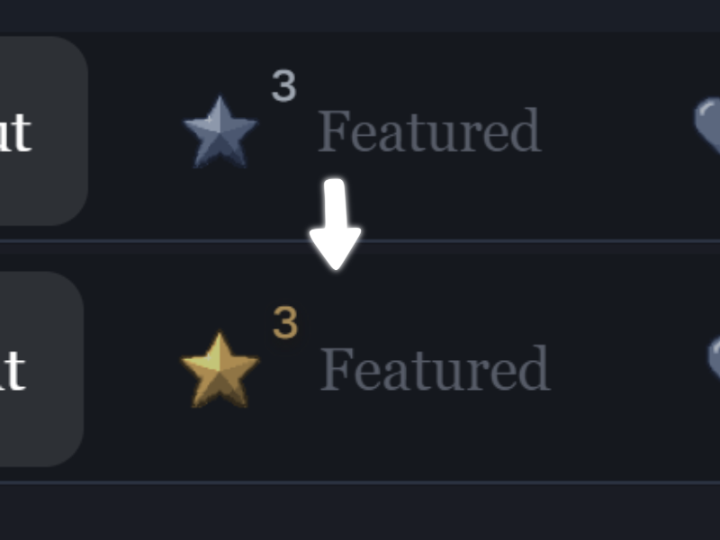

```css
/* Featured artwork and its existing counter. */
[data-profile="scope"] [data-profile="tabs"]
[data-profile="tab"][data-tab="featured"] img[src="/img/pixel/star.webp"] {
  filter: sepia(1) saturate(2) brightness(1.15) !important;
}

[data-profile="scope"] [data-profile="tabs"]
[data-profile="tab"][data-tab="featured"] [data-profile="tab-count"] {
  color: var(--theme-accent, #d7ad63) !important;
  text-shadow: 0 1px 3px #20180e !important;
}
```

The supplied Featured button has both aria-selected=true and data-active=true. Keep its counter’s absolute positioning inside the relative star wrapper. About has no counter; count styling only affects a tab that actually contains tab-count.

### Individual About Subtabs and Paper Artwork

The shared About-tab example provides the overall surface and selected state. To distinguish an individual subtab, add its captured accessible label.

| Subtab aria-label | Native foreground image |
| --- | --- |
| About me | /img/pixel/idcard.webp |
| Personal | /img/pixel/brain.webp |
| Roleplay | /img/pixel/script.webp |
| Relationships | /img/pixel/heart.webp |
| Links & socials | /img/pixel/chain_link.webp |

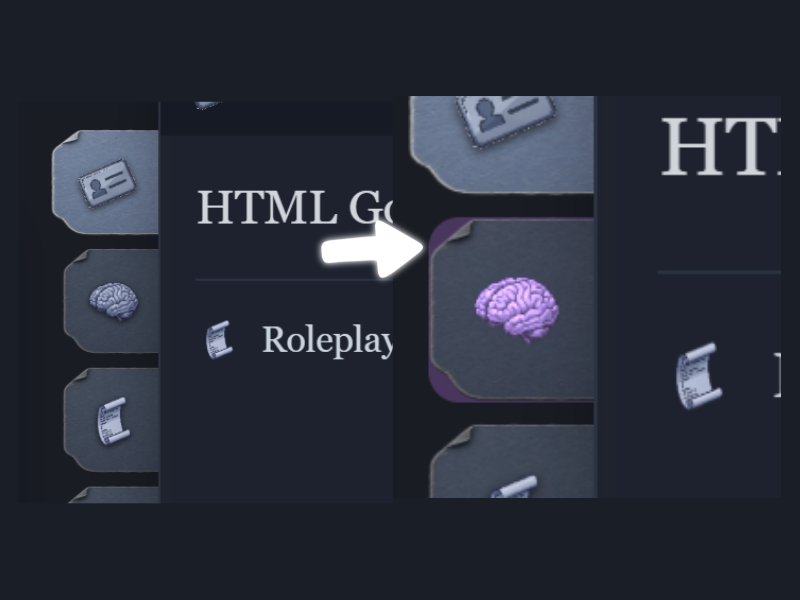

```css
/* Personal subtab only; the shared tab example supplies the other styling. */
[data-profile="scope"] [data-profile="about"]
[role="tab"][aria-label="Personal"] {
  background: #49365e !important;
  border-color: #bd9bea !important;
}

[data-profile="scope"] [data-profile="about"]
[role="tab"][aria-label="Personal"] img[src="/img/pixel/brain.webp"] {
  filter: sepia(1) saturate(2) hue-rotate(220deg) !important;
}
```

The paper-tab.webp backing and foreground icon are separate images. Keep the existing paper-hide treatment when the button surface should show. As an optional paper treatment, remove your paper-hide rule before applying display:block, opacity:1, and a filter to the backing image itself. Opaque backing artwork can cover the button background.

The shared display panel has about-card and role=tabpanel in the captured navigation view. The About editing variant has about-card without that role. Keep hidden biography wrappers hidden when other subtabs are active.

### Main Navigation Scroll Arrows

The arrows scroll the main profile-tab strip. Each direction has its own accessible label.

| Target | Identifier |
| --- | --- |
| Left arrow button | `button[aria-label="Scroll Profile sections left"]` |
| Right arrow button | `button[aria-label="Scroll Profile sections right"]` |
| Native artwork for both | `/img/Icons/pixel_arrow.webp` |
| Enabled / disabled states | `:enabled` / `:disabled` |

**Left arrow**

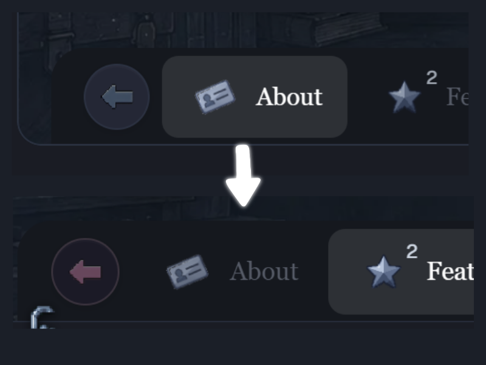

```css
/* Left arrow surface. */
button[aria-label="Scroll Profile sections left"] {
  background: #562b43 !important;
  border: 1px solid #ed91b7 !important;
  border-radius: 50% !important;
  opacity: 1 !important;
}

/* Left arrow artwork: pink tint. */
button[aria-label="Scroll Profile sections left"] img {
  filter: sepia(1) saturate(2) hue-rotate(285deg) !important;
}

/* Enabled left arrow on hover. */
button[aria-label="Scroll Profile sections left"]:enabled:hover {
  background: #713953 !important;
}

/* Disabled left arrow. */
button[aria-label="Scroll Profile sections left"]:disabled {
  background: #251c35 !important;
  border-color: #806477 !important;
  opacity: 0.35 !important;
  cursor: default !important;
}
```

**Right arrow**

```css
/* Right arrow surface. */
button[aria-label="Scroll Profile sections right"] {
  background: #24483e !important;
  border: 1px solid #8fd8bb !important;
  border-radius: 50% !important;
  opacity: 1 !important;
}

/* Right arrow artwork: mint tint. */
button[aria-label="Scroll Profile sections right"] img {
  filter: sepia(1) saturate(2) hue-rotate(95deg) !important;
}

/* Enabled right arrow on hover. */
button[aria-label="Scroll Profile sections right"]:enabled:hover {
  background: #306052 !important;
}

/* Disabled right arrow. */
button[aria-label="Scroll Profile sections right"]:disabled {
  background: #251c35 !important;
  border-color: #647c72 !important;
  opacity: 0.35 !important;
  cursor: default !important;
}
```

**Customization:** Change each surface and icon tint independently. Disabled `opacity` fades the whole arrow button, including its icon. Use `filter: none` to restore the artwork’s original colors.

Both directions use the same image; LoreBary flips the left image. Hover backgrounds apply only while enabled.

LoreBary controls the `disabled` attribute; CSS only changes its appearance. If an arrow is not rendered, its rules have no visible effect.

### About Chain Decorations

The two chains above the About card are separate decorative elements. Both use `/img/nav/break_link.webp` as a background image.

| Selector | Targets |
| --- | --- |
| `[data-profile="about-chain-left"]` | Left chain |
| `[data-profile="about-chain-right"]` | Right chain |

**Left chain**

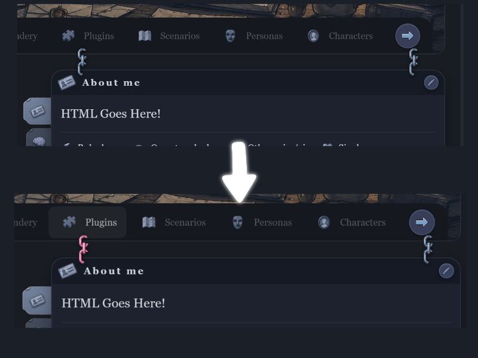

```css
/* Left chain: pink tint and independent placement. */
[data-profile="about-chain-left"] {
  top: -28px !important;
  left: 32px !important;
  width: 18px !important;
  height: 36px !important;
  background-size: 100% 100% !important;
  filter: sepia(1) saturate(2) hue-rotate(285deg)
    drop-shadow(0 1px 2px rgba(0, 0, 0, 0.55)) !important;
}
```

**Right chain**

```css
/* Right chain: mint tint and independent placement. */
[data-profile="about-chain-right"] {
  top: -28px !important;
  right: 32px !important;
  width: 18px !important;
  height: 36px !important;
  background-size: 100% 100% !important;
  filter: sepia(1) saturate(2) hue-rotate(95deg)
    drop-shadow(0 1px 2px rgba(0, 0, 0, 0.55)) !important;
}
```

- `top` moves a chain vertically; negative values extend it above its positioning container.
- `left` or `right` changes its distance from that container’s edge.
- `width` and `height` resize the background artwork. Keep a 1:2 ratio to preserve the captured proportions.
- `filter` tints the artwork; `drop-shadow` adds depth.

The example uses the captured dimensions and offsets, so the tint is the main visible change. For a shadow without tint, use `filter: drop-shadow(0 1px 2px rgba(0, 0, 0, 0.55)) !important;`.

**Hide either chain**

Use these alternatives instead of the styling rules when you want to remove the decorations.

```css
/* Hide the left chain. */
[data-profile="about-chain-left"] {
  display: none !important;
}

/* Hide the right chain. */
[data-profile="about-chain-right"] {
  display: none !important;
}
```

Keep either hiding rule on its own to remove only that chain.

---

## Moving and Framing a Status Block

There are two different cases: moving the complete native About Me card, or styling only a custom status block inside your About content.

### Move and frame the complete native About Me card

Margins keep the card in the normal page flow and are the safest way to move it.

```css
.profile-theme-scope section:has([data-profile="about-card"]) {
  position: relative;
  margin-top: 18px;
  margin-left: 24px;
  width: calc(100% - 24px);
  padding: 8px;
  border: 1px solid var(--theme-edge) !important;
  border-radius: 16px !important;
  background: rgba(23, 21, 18, .72) !important;
  box-shadow: var(--theme-shadow) !important;
}

.profile-theme-scope [data-profile="about-card"] {
  overflow: hidden;
  border: 1px solid rgba(215, 173, 99, .55) !important;
  border-radius: 12px !important;
  background: var(--theme-panel) !important;
}
```

For a small visual adjustment that should not change document flow, use `transform`. Remember that the original layout space remains where it was.

```css
.profile-theme-scope [data-profile="about-card"] {
  transform: translate(18px, -10px);
}
```

### Create a separate custom status box

If the About editor accepts custom HTML, give the status its own class. CSS cannot reliably select an element only because its visible text says “STATUS”.

```html
<section class="lb-profile-status">
  <h3 class="lb-profile-status__title">STATUS</h3>
  <p><strong>Currently working on</strong><br>Updating plugins</p>
  <p><strong>Coming next</strong><br>N/A</p>
  <p><strong>Energy level</strong><br>Tired</p>
</section>
```

```css
.profile-theme-scope .lb-profile-status {
  box-sizing: border-box;
  width: min(100%, 360px);
  margin: 22px auto;
  padding: 18px 20px;
  color: var(--theme-text);
  background:
    linear-gradient(145deg, rgba(59, 46, 33, .97), rgba(31, 25, 20, .97));
  border: 1px solid var(--theme-edge);
  border-left: 4px solid var(--theme-accent);
  border-radius: 14px;
  box-shadow: var(--theme-shadow);
}

.profile-theme-scope .lb-profile-status__title {
  margin: 0 0 12px;
  color: var(--theme-accent);
  font-family: var(--profile-font-title, Georgia, serif);
  letter-spacing: .12em;
}

.profile-theme-scope .lb-profile-status p {
  margin: 10px 0;
  line-height: 1.45;
}
```

### Move only the custom status box

```css
@media (min-width: 1024px) {
  .profile-theme-scope .lb-profile-status {
    position: relative;
    left: 28px;
    top: -14px;
  }
}

@media (max-width: 767px) {
  .profile-theme-scope section:has([data-profile="about-card"]) {
    margin-left: 0;
    width: 100%;
    padding: 5px;
  }

  .profile-theme-scope [data-profile="about-card"],
  .profile-theme-scope .lb-profile-status {
    left: auto;
    top: auto;
    width: 100%;
    transform: none;
  }
}
```

If the status is a single image rather than HTML, apply the frame to its wrapper and use `object-fit: contain` on the image so it remains readable instead of being cropped.

### About Header, Biography, and Overview Details

Use the existing native-card framing example for the panel surface and placement. The following additions address its direct header, biography, overview metadata, and named edit control.

**Direct About header**

The direct-header signature confines these additions to the About card’s own header.

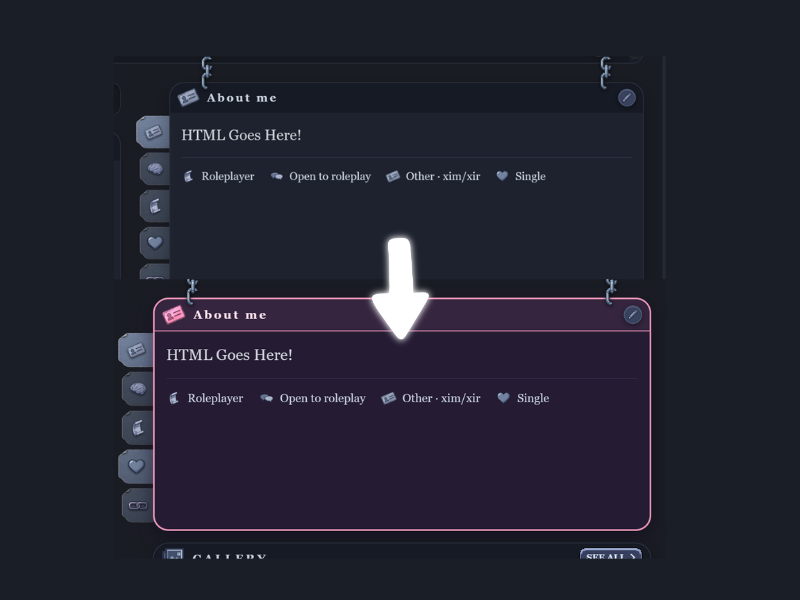

```css
/* Entire About panel, including its header. */
[data-profile="scope"] [data-profile="about"]
section:has([data-profile="about-card"]) {
  background: #251c35 !important;
  border: 2px solid #ed91b7 !important;
  border-radius: 16px !important;
  box-shadow: 0 6px 20px #120b2099 !important;
}

/* Header background and dividing line. */
[data-profile="scope"] [data-profile="about"]
section:has([data-profile="about-card"]) > header.surface-header {
  background: #352440 !important;
  border-bottom: 1px solid #ed91b7 !important;
}

/* “About me” heading. */
[data-profile="scope"] [data-profile="about"]
section:has([data-profile="about-card"]) > header.surface-header h2 {
  color: #ffe4f0 !important;
}

/* ID-card icon in the header only. */
[data-profile="scope"] [data-profile="about"]
section:has([data-profile="about-card"]) > header.surface-header img[src="/img/pixel/idcard.webp"] {
  filter: sepia(1) saturate(2) hue-rotate(285deg) !important;
}
```

**Biography**

The text is bright pink so the change is easy to see. Custom HTML elements with their own colors may need separate selectors.

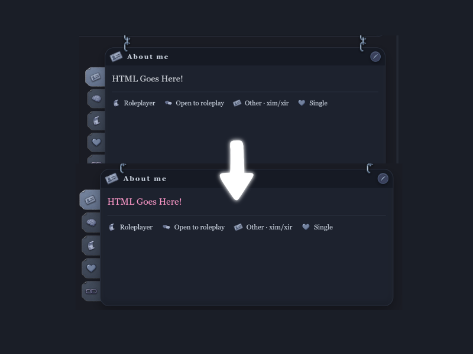

```css
/* Links inside the biography. */
[data-profile="scope"] [data-profile="about-bio"] a {
  color: #ed91b7 !important;
}

/* Biography text. */
[data-profile="scope"] [data-profile="about-bio"] .rich-text-content {
  color: #ff91c8 !important;
}
```

**Overview status row**

These rules target the Role, Availability, Gender/Identity, and Relationship summary shown beneath the biography. The captured Gender/Identity item uses `title="Gender"` and the native idcard artwork.

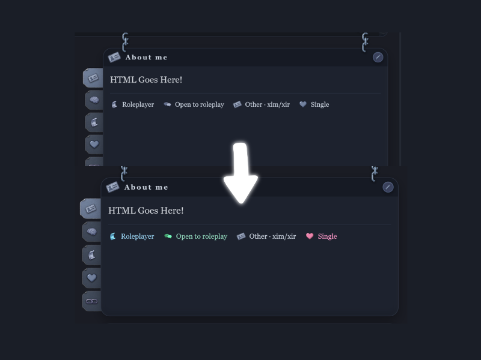

```css
/* Overview: Role text. */
[data-profile="scope"] [data-profile="about-card"]
[data-profile="additional-info"] > span[title="Role"] {
  color: #91cfed !important;
}

/* Overview: Role icon. */
[data-profile="scope"] [data-profile="about-card"]
span[title="Role"] img {
  filter: sepia(1) saturate(2) hue-rotate(155deg) !important;
}

/* Overview: Availability text. */
[data-profile="scope"] [data-profile="about-card"]
[data-profile="additional-info"] > span[title="Availability"] {
  color: #8fd8bb !important;
}

/* Overview: Availability icon. */
[data-profile="scope"] [data-profile="about-card"]
span[title="Availability"] img {
  filter: sepia(1) saturate(2) hue-rotate(95deg) !important;
}

/* Overview: Gender/Identity text. */
[data-profile="scope"] [data-profile="about-card"]
[data-profile="additional-info"] > span[title="Gender"] {
  color: #e0c7ff !important;
}

/* Overview: Gender/Identity icon only. */
[data-profile="scope"] [data-profile="about-card"]
[data-profile="additional-info"] > span[title="Gender"]
img[src="/img/pixel/idcard.webp"] {
  filter: sepia(1) saturate(2) hue-rotate(220deg) !important;
}

/* Overview: Relationship text. */
[data-profile="scope"] [data-profile="about-card"]
[data-profile="additional-info"] > span[title="Relationship"] {
  color: #ff91c8 !important;
}

/* Overview: Relationship icon. */
[data-profile="scope"] [data-profile="about-card"]
span[title="Relationship"] img {
  filter: sepia(1) saturate(2) hue-rotate(285deg) !important;
}
```

**Edit button**

Style the button surface and its pencil icon separately.

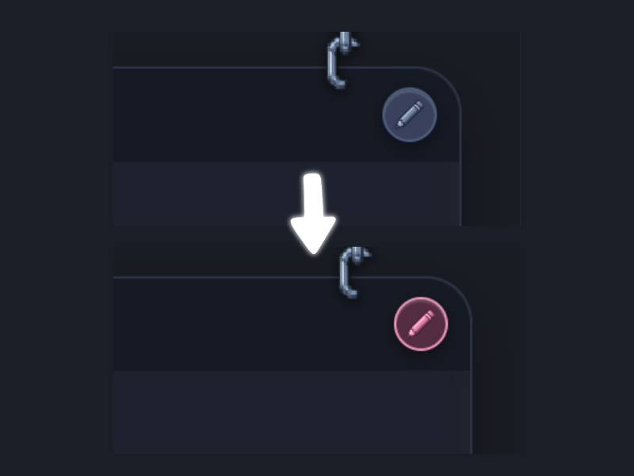

```css
/* Edit button background and border. */
[data-profile="scope"] [data-profile="about-edit"] {
  background: #562b43 !important;
  border: 1px solid #ed91b7 !important;
}

/* Edit button’s pencil icon. */
[data-profile="scope"] [data-profile="about-edit"]
img[src="/img/pixel/pencil.webp"] {
  filter: sepia(1) saturate(2) hue-rotate(285deg) !important;
}
```

About-subtab styling is covered in [About Navigation and Content](#individual-about-subtabs-and-paper-artwork), including each tab’s surface, paper backing, icon, and selected state.

### About Information Cards

Give each About information group its own palette, including its heading, token backing, field labels, and values.

**About You**

The **About you** group uses `data-info="about"`. This is an inner information card, separate from the whole About area.

| Target | Selector |
| --- | --- |
| Group panel | `[data-profile="info-group"][data-info="about"]` |
| Heading | `[data-info="about"] h3` |
| Heading token | `[data-profile="info-group"][data-info="about"] > div > span` |
| Heading icon | `[data-info="about"] img[src="/img/sketch/user.webp"]` |
| Field labels / values | `[data-info="about"] dt` / `[data-info="about"] dd` |

**Group panel and heading**

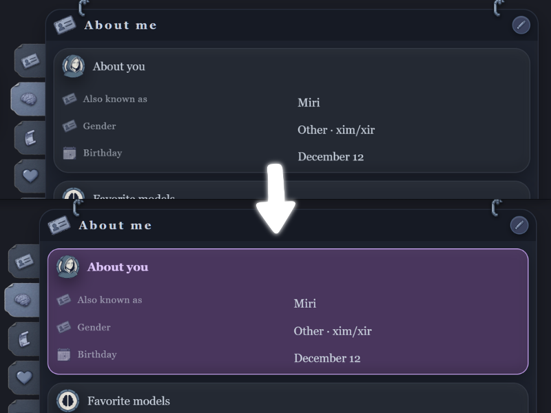

```css
/* About-you panel only. */
[data-profile="info-group"][data-info="about"] {
  background: #49365e !important;
  border: 1px solid #bd9bea !important;
  border-radius: 12px !important;
}

/* About-you heading only. */
[data-info="about"] h3 {
  color: #e0c7ff !important;
  font-weight: 700 !important;
}
```

**Token background and heading icon**

The heading’s circular token is background artwork. The user icon is a separate image inside it. Tint the token with a translucent background layer, then style the icon independently.

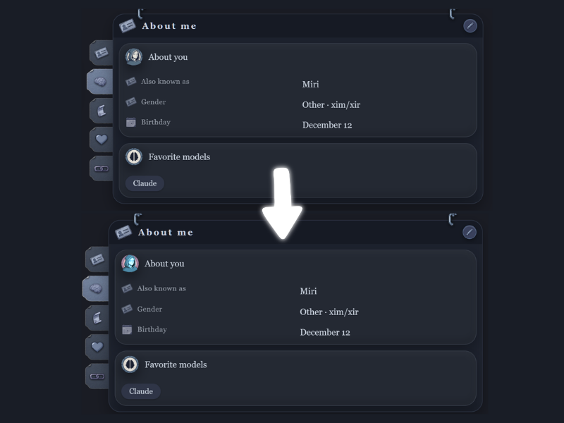

```css
/* Heading token: pink overlay on the native token artwork. */
[data-profile="info-group"][data-info="about"] > div > span {
  background-image:
    linear-gradient(rgba(237, 145, 183, 0.5), rgba(237, 145, 183, 0.5)),
    url("/img/sketch/token.webp") !important;
}

/* User heading icon only: blue tint. */
[data-info="about"] img[src="/img/sketch/user.webp"] {
  filter: sepia(1) saturate(2) hue-rotate(155deg) !important;
}
```

The token rule follows the supplied group header’s structure. Changing its background layers does not tint the foreground icon.

**Field labels and values**

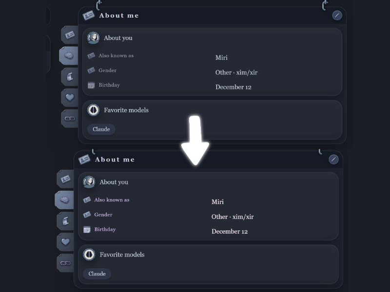

```css
/* About-you field labels: pale lavender. */
[data-info="about"] dt {
  color: #d2b8f0 !important;
  opacity: 1 !important;
}

/* About-you field values: pale pink. */
[data-info="about"] dd {
  color: #ffe9f2 !important;
}
```

`dt` is the label, such as “Birthday”; `dd` is its value, such as “May 20.” These rules only affect fields inside this group.

**Field-label icons**

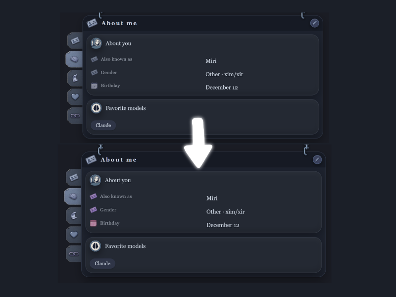

```css
/* Also-known-as and Gender label icons. */
[data-info="about"] dt img[src="/img/pixel/idcard.webp"] {
  filter: sepia(1) saturate(2) hue-rotate(220deg) !important;
}

/* Birthday label icon only. */
[data-info="about"] dt img[src="/img/pixel/calendar.webp"] {
  filter: sepia(1) saturate(2) hue-rotate(285deg) !important;
}
```

**Customization:** Change the panel, heading, token overlay, foreground icon, labels, and values independently. The overlay’s final number (`0.5`) controls its strength. Use `filter: none` to restore an image’s original colors.

These are raster image icons, so their artwork uses `filter`, while text uses `color`. The rules apply when the About-you group is rendered in the Personal subtab.

**Roleplay**

The Roleplay group uses `data-info="roleplay"`. Its heading icon is `/img/sketch/dialogue.webp`.

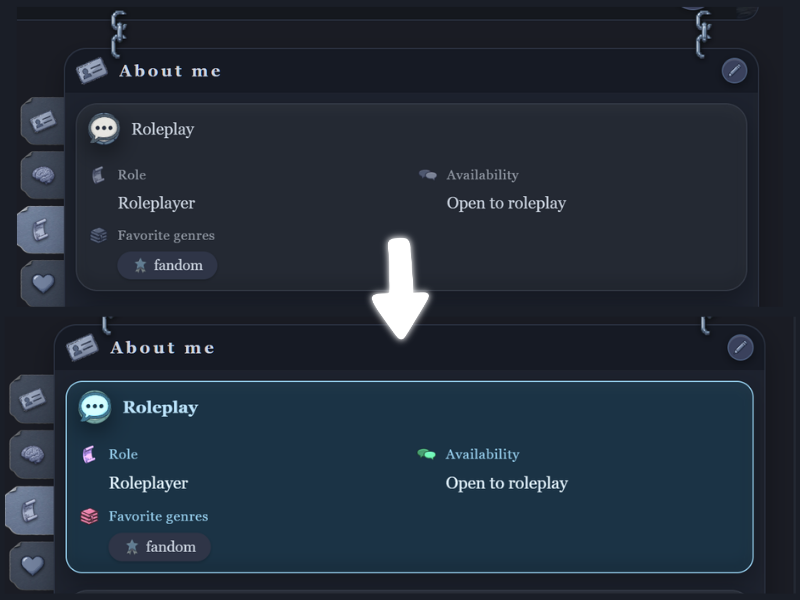

```css
/* Roleplay panel. */
[data-profile="info-group"][data-info="roleplay"] {
  background: #193446 !important;
  border: 1px solid #91cfed !important;
  border-radius: 12px !important;
}

/* Roleplay heading text. */
[data-info="roleplay"] h3 {
  color: #b9e6ff !important;
  font-weight: 700 !important;
}

/* Heading token: mint overlay on native artwork. */
[data-profile="info-group"][data-info="roleplay"] > div > span {
  background-image:
    linear-gradient(rgba(143, 216, 187, 0.5), rgba(143, 216, 187, 0.5)),
    url("/img/sketch/token.webp") !important;
}

/* Dialogue heading image: blue tint. */
[data-info="roleplay"] img[src="/img/sketch/dialogue.webp"] {
  filter: sepia(1) saturate(2) hue-rotate(155deg) !important;
}

/* Field labels: Role, Availability, and Favorite genres. */
[data-info="roleplay"] dt {
  color: #91cfed !important;
  opacity: 1 !important;
}

/* Field values. */
[data-info="roleplay"] dd {
  color: #e2f4ff !important;
}

/* Role label icon. */
[data-info="roleplay"] dt img[src="/img/pixel/script.webp"] {
  filter: sepia(1) saturate(2) hue-rotate(220deg) !important;
}

/* Availability label icon. */
[data-info="roleplay"] dt img[src="/img/pixel/dialogue.webp"] {
  filter: sepia(1) saturate(2) hue-rotate(95deg) !important;
}

/* Favorite-genres label icon. */
[data-info="roleplay"] dt img[src="/img/pixel/lorebooks.webp"] {
  filter: sepia(1) saturate(2) hue-rotate(285deg) !important;
}
```

**Customization:** The panel, heading, token, heading icon, labels, values, and each field icon have separate rules. Genre pills have separate rules below.

**Genre/tag pills**

The tags under Favorite genres are separate pills. Their own colors can override the surrounding field value color.

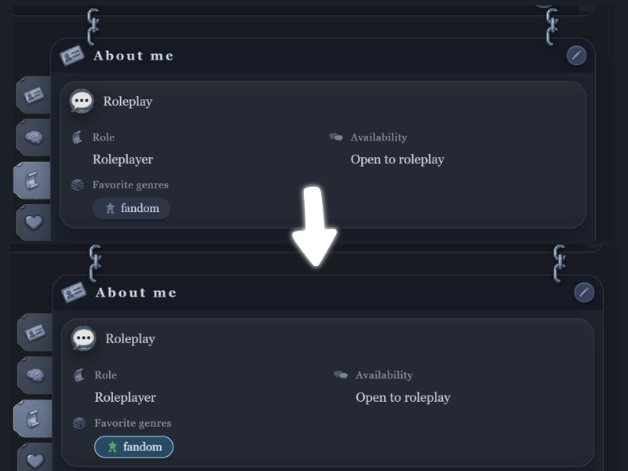

```css
/* Roleplay genre/tag pill surfaces. */
[data-info="roleplay"] .group\/pill {
  background: #254b63 !important;
  border: 1px solid #91cfed !important;
  border-radius: 999px !important;
}

/* Text inside each genre/tag pill. */
[data-info="roleplay"] .group\/pill > span {
  color: #e2f4ff !important;
}

/* Genre/tag pill hover surface. */
[data-info="roleplay"] .group\/pill:hover {
  background: #306078 !important;
}

/* Tag image icons, when present. */
[data-info="roleplay"] .group\/pill img {
  filter: sepia(1) saturate(2) hue-rotate(95deg) !important;
}
```

**Customization:** Change each pill’s surface and text separately. The backslash in `.group\/pill` escapes the slash in LoreBary’s class name; keep it in the selector. Text-only tags such as the captured “IDK” pill do not have an image icon to recolor.

**Preferences**

The Preferences group uses `data-info="preferences"`. Its heading uses a Font Awesome sliders icon, not an image.

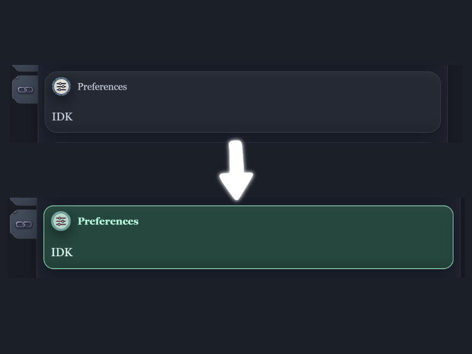

```css
/* Preferences panel. */
[data-profile="info-group"][data-info="preferences"] {
  background: #24483e !important;
  border: 1px solid #8fd8bb !important;
  border-radius: 12px !important;
}

/* Preferences heading text. */
[data-info="preferences"] h3 {
  color: #b8ffe0 !important;
  font-weight: 700 !important;
}

/* Heading token: mint overlay on native artwork. */
[data-profile="info-group"][data-info="preferences"] > div > span {
  background-image:
    linear-gradient(rgba(143, 216, 187, 0.5), rgba(143, 216, 187, 0.5)),
    url("/img/sketch/token.webp") !important;
}

/* Sliders font icon only. */
[data-info="preferences"] .fa-sliders {
  color: #562b43 !important;
}

/* Written preferences only. */
[data-info="preferences"] dd {
  color: #e5fff3 !important;
}
```

**Customization:** Change the panel, heading, token background, sliders color, and written text independently.

Image artwork uses `filter`; Font Awesome icons and text use `color`. The token overlay’s `0.5` controls its strength. Use `filter: none` to restore an image’s original colors.

**Boundaries**

The Boundaries group uses `data-info="boundaries"`. Its heading icon is the Font Awesome lock.

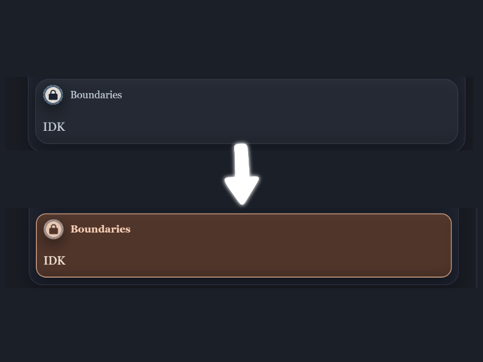

```css
/* Boundaries panel. */
[data-profile="info-group"][data-info="boundaries"] {
  background: #513329 !important;
  border: 1px solid #edb091 !important;
  border-radius: 12px !important;
}

/* Heading text. */
[data-info="boundaries"] h3 {
  color: #ffd0b8 !important;
  font-weight: 700 !important;
}

/* Token background: peach overlay. */
[data-profile="info-group"][data-info="boundaries"] > div > span {
  background-image:
    linear-gradient(rgba(237, 176, 145, 0.5), rgba(237, 176, 145, 0.5)),
    url("/img/sketch/token.webp") !important;
}

/* Lock font icon. */
[data-info="boundaries"] .fa-lock {
  color: #513329 !important;
}

/* Written boundaries. */
[data-info="boundaries"] dd {
  color: #ffeadf !important;
}
```

**Customization:** Change the panel, heading, token overlay, lock color, and written text independently.

**Relationships**

The Relationships group uses `data-info="relationships"`. Its heading uses a Font Awesome heart; field labels use heart images.

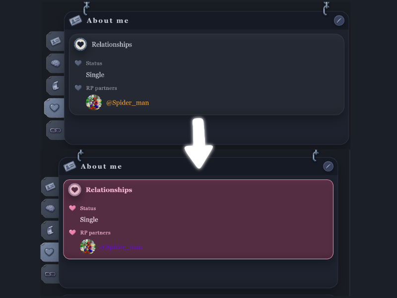

```css
/* Relationships panel. */
[data-profile="info-group"][data-info="relationships"] {
  background: #562b43 !important;
  border: 1px solid #ed91b7 !important;
  border-radius: 12px !important;
}

/* Heading text. */
[data-info="relationships"] h3 {
  color: #ffb8d6 !important;
  font-weight: 700 !important;
}

/* Token background: pink overlay. */
[data-profile="info-group"][data-info="relationships"] > div > span {
  background-image:
    linear-gradient(rgba(237, 145, 183, 0.5), rgba(237, 145, 183, 0.5)),
    url("/img/sketch/token.webp") !important;
}

/* Heading heart: font icon. */
[data-info="relationships"] .fa-heart {
  color: #562b43 !important;
}

/* Status and RP-partners field labels. */
[data-info="relationships"] dt {
  color: #ffb8d6 !important;
  opacity: 1 !important;
}

/* Field values. */
[data-info="relationships"] dd {
  color: #ffe9f2 !important;
}

/* Field-label hearts: image icons. */
[data-info="relationships"] dt img[src="/img/pixel/heart.webp"] {
  filter: sepia(1) saturate(2) hue-rotate(285deg) !important;
}
```

**RP partner links and avatars**

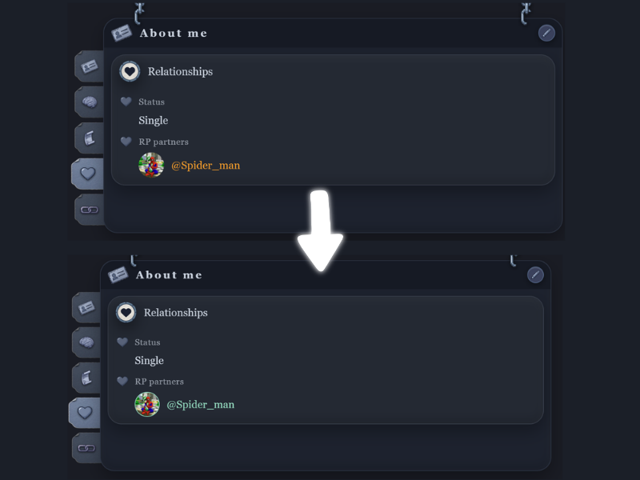

```css
/* RP partner links. */
[data-info="relationships"] dd a {
  color: #8fd8bb !important;
}

/* RP partner links on hover. */
[data-info="relationships"] dd a:hover {
  color: #b8ffe0 !important;
}

/* Partner portrait images only. */
[data-info="relationships"] dd a img {
  border: 1px solid #8fd8bb !important;
  border-radius: 50% !important;
  object-fit: cover !important;
}
```

**Customization:** Change the label and value colors separately from the partner links and portrait borders.

Font Awesome heading icons use `color`; raster field icons use `filter`. The token overlay’s `0.5` controls its strength. These rules style existing partner entries without changing their links or creating missing entries.

**Links & Socials**

The visible heading is **Links & socials**, but the group’s exact `data-info` value is **socials**. Its heading uses a Font Awesome link icon; the captured Website field uses a chain-link image.


```css
/* Links & socials panel. */
[data-profile="info-group"][data-info="socials"] {
  background: #193446 !important;
  border: 1px solid #91cfed !important;
  border-radius: 12px !important;
}

/* Heading text. */
[data-info="socials"] h3 {
  color: #b9e6ff !important;
  font-weight: 700 !important;
}

/* Heading token: blue overlay on native artwork. */
[data-profile="info-group"][data-info="socials"] > div > span {
  background-image:
    linear-gradient(rgba(145, 207, 237, 0.5), rgba(145, 207, 237, 0.5)),
    url("/img/sketch/token.webp") !important;
}

/* Heading link: font icon. */
[data-info="socials"] .fa-link {
  color: #193446 !important;
}

/* Field labels, such as Website. */
[data-info="socials"] dt {
  color: #91cfed !important;
  opacity: 1 !important;
}

/* Field values. */
[data-info="socials"] dd {
  color: #e2f4ff !important;
}

/* Website field’s chain-link image only. */
[data-info="socials"] dt img[src="/img/pixel/chain_link.webp"] {
  filter: sepia(1) saturate(2) hue-rotate(95deg) !important;
}
```

**Website and social links**


```css
/* Links inside field values. */
[data-info="socials"] dd a {
  color: #8fd8bb !important;
  text-decoration: underline !important;
  text-decoration-color: #8fd8bb !important;
  text-underline-offset: 4px !important;
}

/* Link hover color. */
[data-info="socials"] dd a:hover {
  color: #b8ffe0 !important;
  text-decoration-color: #b8ffe0 !important;
}
```

**Customization:** Change the panel, heading, token overlay, heading icon, labels, values, field icon, and links independently. Font icons use `color`; image artwork uses `filter`. Use `filter: none` for the chain-link image’s original colors.

The link rules apply to existing Website and social anchors inside this group. A separate link color overrides the surrounding `dd` value color.

**Favorite models: information-card addition**

**Updated card CSS**

Favorite models uses the captured `data-info="models"` target.


```css
/* Favorite models card. */
[data-profile="scope"] [data-profile="about"]
[data-profile="info-group"][data-info="models"] {
  background: #493f25 !important;
  border: 1px solid #e3ca86 !important;
  border-radius: 12px !important;
  color: #fff3ce !important;
}
```

**Captured component notes**

**Model pills need their own styling.** The card-surface rule above does not recolor the pills. The optional code below styles the pill surface, border, text, and hover, along with the heading and its brain icon.

| Part | Target within the models card | Evidence |
| --- | --- | --- |
| Card | `[data-profile="info-group"][data-info="models"]` | Exact named hook |
| Heading | `> div > h3` | Favorite models; title attribute is explanatory text |
| Token backing | `> div > span` | Inline background-image using `/img/sketch/token.webp` |
| Heading icon | `> div > span > i.fa-brain` | Font Awesome glyph, not an image |
| Model pills | `dd > span > span[translate="no"]` | Nested pill span; captured label Claude |
| Pill label | `dd > span > span[translate="no"] > span` | Nested text span |

Card color is inherited only where descendants have no own color. The captured model pills explicitly set their surface and text colors, so the card rule alone does not recolor them. Optional matching heading/icon/pill styling:


```css
[data-profile="scope"] [data-profile="about"]
[data-profile="info-group"][data-info="models"] > div > h3 {
  color: #fff3ce !important;
}

[data-profile="scope"] [data-profile="about"]
[data-profile="info-group"][data-info="models"] > div > span > i.fa-brain {
  color: #493f25 !important;
}

[data-profile="scope"] [data-profile="about"]
[data-profile="info-group"][data-info="models"] dd > span > span[translate="no"] {
  background: #61522e !important;
  border-color: #e3ca86 !important;
  color: #fff3ce !important;
}

[data-profile="scope"] [data-profile="about"]
[data-profile="info-group"][data-info="models"] dd > span > span[translate="no"]:hover {
  background: #756238 !important;
}
```

**Small-screen behavior — native max-md classes:** The captured model-pill row stops wrapping and scrolls horizontally below the compiled md breakpoint. Keep those classes and the hidden dt label intact. The capture adds no new native image path: token.webp is reused, and the brain is a font icon.

### About Me Editor

Style the About Me editing controls through their captured toolbar class, named textbox, and footer structure.

**What changes**

| Component | Captured difference | Documentation update |
| --- | --- | --- |
| About card | Has `data-profile="about-card"` but no `role="tabpanel"` in this editing view | Keep role-qualified navigation selectors for their captured display view. Add a separate editing-view target. |
| Toolbar | `.rich-text-editor-toolbar`, without `data-profile="composer-toolbar"` | Use the About card plus the class for this variant. |
| Editable content | `contenteditable="true"`, `role="textbox"`, `aria-label="Tell us about yourself..."`; no `composer-editor` | Use the exact textbox signature inside the About card. |
| Formatting controls | Reuses `composer-btn`, `data-btn`, and `icon` hooks | A rule targeting only composer-toolbar misses these. A broad composer-btn rule can affect both editors. |
| Insert Link | `composer-btn`, `data-btn="insert-link"`; glyph `data-icon="link"` | Add the captured button and glyph mapping. |
| Insert Image | Exact `aria-label="Insert Image"`; no composer-btn hook | Target the button by its label. Its glyph is `data-icon="upload"`. |
| Text-color bar | `span[data-btn="text-color-bar"]`, with inline background color | Document separately from the font glyph. Recoloring it can misrepresent the selected author text color. |
| Character counter | Direct `about-card > p`, containing `span.tabular-nums`; captured `15/1000` | Style the counter without changing its content or treating this limit as universal. |
| Footer | Direct About-card div containing Save and Cancel buttons | These are ordinary buttons, not composer-submit or pixel-plate buttons. |

**Narrow editing-view targets**


```css
/* Only the captured About card containing this editable textbox. */
[data-profile="scope"] [data-profile="about-card"]:has(
  [contenteditable="true"][role="textbox"][aria-label="Tell us about yourself..."]
) {
  background: #202332 !important;
  color: #eee7f6 !important;
}

[data-profile="scope"] [data-profile="about-card"]
  > .relative > .rich-text-editor-toolbar {
  background: #30263e !important;
  border-color: #9675ae !important;
}

[data-profile="scope"] [data-profile="about-card"]
  .rich-text-editor-toolbar button {
  background: #40304f !important;
  border-color: #9675ae !important;
  color: #eee7f6 !important;
}

[data-profile="scope"] [data-profile="about-card"]
  .rich-text-editor-toolbar [data-profile="icon"] {
  color: inherit !important;
}

[data-profile="scope"] [data-profile="about-card"]
  .rich-text-editor-toolbar button[aria-pressed="true"] {
  background: #715087 !important;
  border-color: #d8b5ec !important;
}

[data-profile="scope"] [data-profile="about-card"]
  [contenteditable="true"][role="textbox"][aria-label="Tell us about yourself..."] {
  background: #202332 !important;
  border-color: #9675ae !important;
  color: #eee7f6 !important;
  caret-color: #f4c3ec !important;
}

[data-profile="scope"] [data-profile="about-card"]:has(
  [contenteditable="true"][role="textbox"][aria-label="Tell us about yourself..."]
) > p {
  color: #bfa9ce !important;
}

/* Captured footer signature: Save contains a direct check glyph. */
[data-profile="scope"] [data-profile="about-card"]
  > div:has(> button > i[data-profile="icon"][data-icon="check"]) {
  border-color: #9675ae !important;
}

[data-profile="scope"] [data-profile="about-card"]
  > div:has(> button > i[data-profile="icon"][data-icon="check"]) > button {
  background: #40304f !important;
  border-color: #9675ae !important;
  color: #eee7f6 !important;
}
```

These rules assume Profile-scope ancestry. The fragment does not include its ancestors, so it cannot establish whether that ancestor exists. This capture is not evidence of another outside-Profile exception. Keep the agreed Experimental dialog exceptions separate.

**Exact control references**

Within `[data-profile="scope"] [data-profile="about-card"] .rich-text-editor-toolbar`:

| Control | Target | Glyph |
| --- | --- | --- |
| Insert Link | `[data-profile="composer-btn"][data-btn="insert-link"]` | `[data-profile="icon"][data-icon="link"]` |
| Insert Image | `button[aria-label="Insert Image"]` | `[data-profile="icon"][data-icon="upload"]` |
| Insert | `button[aria-label="Insert"]` | `[data-profile="icon"][data-icon="plus"]` |
| Text background | `button[aria-label="Text background"]` | `[data-profile="icon"][data-icon="highlighter"]` |
| Edit as HTML | `button[aria-label="Edit as HTML"]` | `[data-profile="icon"][data-icon="code"]` |
| Text Color | `[data-profile="composer-btn"][data-btn="text-color"]` | `[data-profile="icon"][data-icon="font"]` |
| Text-color indicator | `[data-btn="text-color"] > span[data-btn="text-color-bar"]` | CSS background, not an image |

Save can be selected through the captured check glyph:

```css
[data-profile="scope"] [data-profile="about-card"]
  > div > button:has(> i[data-profile="icon"][data-icon="check"]) {
  background: #715087 !important;
}
```

Cancel has no named hook or aria-label in this capture. Shared footer-button styling is supported. An independent Cancel rule would rely on the captured two-button order and should be documented as structural, not a stable named selector. CSS cannot select a button by visible text alone.

The Edit profile details control also lacks `about-edit` and a dedicated aria-label in this capture. Its observed structural target is:

```css
[data-profile="scope"] [data-profile="about-card"]
  > div:has(> button > span > img[src="/img/pixel/idcard.webp"]) > button {
  background: #30263e !important;
  border-radius: 10px !important;
}
```

This selects the observed About-card action structure. Keep it distinct from the existing named About edit control. The surrounding section header also uses idcard.webp, so a filename-only rule would affect both images.

**Captured states and limits**

- Bold, Italic, Underline, Heading, Bullet List, and Numbered List are explicitly unpressed in this capture. Normal and alignment buttons lack aria-pressed; absence does not mean false.
- Insert has aria-haspopup="menu" and aria-expanded="false". Menu contents are not captured.
- Edit as HTML is unpressed. This capture establishes the rich-text editing view, not the HTML-mode textarea.
- The textbox holds text and has data-placeholder on that same element. Do not copy the composer-editor placeholder pseudo-element rule to this editor unchanged; data-placeholder alone does not specify how its placeholder is rendered.
- The textbox’s inline limits are min-height:100px and max-height:300px, with vertical scrolling and horizontal overflow hidden. Toolbar controls use clamp sizing and --content-ui-scale. Preserve those behaviors unless demonstrating an intentional change.
- Insert Image is followed by a hidden file input accepting JPEG, PNG, WEBP, and GIF. Keep native upload behavior intact.
- No new native image path is introduced. idcard.webp is reused; the toolbar and Save artwork are font icons.
- Keep the generated `_r_ue_-panel` ID out of reusable selectors.
- Editor-rich-text rules currently scoped only to composer-editor do not cover this About textbox. Extend them explicitly when documenting About editing; do not assume every editor shares the published post-decoration hooks.

---

## Profile Actions

### Letter, Wave, Follow, and Alerts

Style the action row, button surfaces, text, and native artwork. Follow/Following uses the captured accessible labels.

**Action-Bar Wrappers**

The action bar contains two groups: Letter and Wave on one side, and Follow/Following with Alerts on the other.

| Selector | Targets |
| --- | --- |
| `[data-profile="action-bar"]` | Whole action bar |
| `[data-profile="actions"]` | Letter and Wave group |
| `[data-profile="actions-right"]` | Follow/Following and available Alerts group |

**Whole action bar**


```css
/* Action bar: purple surface around both groups. */
[data-profile="scope"] [data-profile="action-bar"] {
  background: #251c35 !important;
  border: 1px solid #bd9bea !important;
  border-radius: 12px !important;
  padding: 6px !important;
  gap: 8px !important;
}
```

**Letter and Wave group**

The captured inner wrappers use `display: contents`, which gives them no visible box. Changing them to `inline-flex` lets their backgrounds, borders, and padding appear.


```css
/* Letter and Wave wrapper: rose group surface. */
[data-profile="scope"] [data-profile="action-bar"]
[data-profile="actions"] {
  display: inline-flex !important;
  flex-wrap: wrap !important;
  align-items: center !important;
  gap: 6px !important;
  background: #562b43 !important;
  border: 1px solid #ed91b7 !important;
  border-radius: 8px !important;
  padding: 6px !important;
}
```

**Follow and Alerts group**


```css
/* Follow and Alerts wrapper: green group surface. */
[data-profile="scope"] [data-profile="action-bar"]
[data-profile="actions-right"] {
  display: inline-flex !important;
  flex-wrap: wrap !important;
  align-items: center !important;
  gap: 6px !important;
  margin-left: auto !important;
  background: #24483e !important;
  border: 1px solid #8fd8bb !important;
  border-radius: 8px !important;
  padding: 6px !important;
}
```

**Customization:** The action bar’s `gap` separates the groups; each inner wrapper’s `gap` separates its buttons. `margin-left: auto` pushes the right group toward the available right edge. Grouping the wrappers can change how the buttons wrap when space is limited.

These rules style the wrappers, leaving button surfaces, text, and icons for their individual examples. A wrapper can only show the actions LoreBary currently renders.

**Letter Button and Letterbox Icon**

Style the Letter button’s surface, label, and image icon independently.

**Button surface**


```css
/* Letter button: rose surface and pink border. */
[data-profile="scope"] [data-profile="action-letter"] {
  background: #562b43 !important;
  border: 1px solid #ed91b7 !important;
  border-radius: 10px !important;
  padding: 6px 10px !important;
  box-shadow: 0 2px 6px rgba(18, 11, 32, 0.4) !important;
}

/* Letter button: brighter surface on hover. */
[data-profile="scope"] [data-profile="action-letter"]:hover {
  background: #713953 !important;
}
```

**Letter label**

The captured label is the button’s second direct child span; the first holds its icon.


```css
/* Letter label only. */
[data-profile="scope"] [data-profile="action-letter"]
> span:nth-child(2) {
  color: #ffe9f2 !important;
  font-weight: 600 !important;
}
```

**Letterbox icon**


```css
/* Letterbox image only: pink recolor. */
[data-profile="scope"] [data-profile="action-letter"]
img[src="/img/pixel/letterbox.webp"] {
  filter: brightness(0) saturate(100%) invert(75%) sepia(24%)
    saturate(850%) hue-rotate(290deg) brightness(101%) contrast(91%) !important;
}
```

**Customization:** Change the surface background and border separately from the label color. Adjust `border-radius` for rounding and `padding` for button spacing. The image filter creates an approximate pink silhouette; use `filter: none` to restore the original artwork.

The label selector follows the supplied child order; it may need updating if LoreBary changes that structure. The example applies when the Letter action is present.

**Wave Button and Wave Icon**

Style the Wave button’s surface, label, and image icon independently.

**Button surface**

```css
/* Wave button: green surface and mint border. */
[data-profile="scope"] [data-profile="action-wave"] {
  background: #24483e !important;
  border: 1px solid #8fd8bb !important;
  border-radius: 10px !important;
  padding: 6px 10px !important;
  box-shadow: 0 2px 6px rgba(18, 11, 32, 0.4) !important;
}

/* Wave button: brighter surface on hover. */
[data-profile="scope"] [data-profile="action-wave"]:hover {
  background: #306052 !important;
}
```

**Wave label**

The captured label is the button’s second direct child span; the first holds its icon.

```css
/* Wave label only. */
[data-profile="scope"] [data-profile="action-wave"]
> span:nth-child(2) {
  color: #e5fff3 !important;
  font-weight: 600 !important;
}
```

**Wave icon**

```css
/* Wave image only: mint recolor. */
[data-profile="scope"] [data-profile="action-wave"]
img[src="/img/pixel/wave.webp"] {
  filter: brightness(0) saturate(100%) invert(84%) sepia(20%)
    saturate(650%) hue-rotate(100deg) brightness(96%) contrast(90%) !important;
}
```

**Customization:** Change the surface background and border separately from the label color. Adjust `border-radius` for rounding and `padding` for button spacing. The image filter creates an approximate mint silhouette; use `filter: none` to restore the original artwork.

They style the Wave button, not the window it opens. The label selector follows the supplied child order. The example applies when the Wave action is present.

**Follow and Following Button States**

Both states use the same `action-follow` button. Its `aria-label` changes from `Follow` to `Following`, and its image changes from a heart to a check.

| Selector | Targets |
| --- | --- |
| `[data-profile="action-follow"][aria-label="Follow"]` | Follow state |
| `[data-profile="action-follow"][aria-label="Following"]` | Following state |

**Follow state**


```css
/* Follow surface: rose background and pink border. */
[data-profile="scope"]
[data-profile="action-follow"][aria-label="Follow"] {
  background: #562b43 !important;
  border: 1px solid #ed91b7 !important;
  border-radius: 10px !important;
  padding: 6px 10px !important;
  box-shadow: 0 2px 6px rgba(18, 11, 32, 0.4) !important;
}

/* Follow surface on hover. */
[data-profile="scope"]
[data-profile="action-follow"][aria-label="Follow"]:hover {
  background: #713953 !important;
}

/* Follow label only. */
[data-profile="scope"]
[data-profile="action-follow"][aria-label="Follow"]
> span:nth-child(2) {
  color: #ffe9f2 !important;
  font-weight: 600 !important;
}

/* Follow heart icon only: pink recolor. */
[data-profile="scope"]
[data-profile="action-follow"][aria-label="Follow"]
img[src="/img/pixel/heart.webp"] {
  filter: brightness(0) saturate(100%) invert(75%) sepia(24%)
    saturate(850%) hue-rotate(290deg) brightness(101%) contrast(91%) !important;
}
```

**Following state**


```css
/* Following surface: green background and mint border. */
[data-profile="scope"]
[data-profile="action-follow"][aria-label="Following"] {
  background: #24483e !important;
  border: 1px solid #8fd8bb !important;
  border-radius: 10px !important;
  padding: 6px 10px !important;
  box-shadow: 0 2px 6px rgba(18, 11, 32, 0.4) !important;
}

/* Following surface on hover. */
[data-profile="scope"]
[data-profile="action-follow"][aria-label="Following"]:hover {
  background: #306052 !important;
}

/* Following label only. */
[data-profile="scope"]
[data-profile="action-follow"][aria-label="Following"]
> span:nth-child(2) {
  color: #e5fff3 !important;
  font-weight: 600 !important;
}

/* Following check icon only: mint recolor. */
[data-profile="scope"]
[data-profile="action-follow"][aria-label="Following"]
img[src="/img/pixel/check.webp"] {
  filter: brightness(0) saturate(100%) invert(84%) sepia(20%)
    saturate(650%) hue-rotate(100deg) brightness(96%) contrast(90%) !important;
}
```

**Customization:** Change each state’s background, border, label color, and icon filter independently. Adjust `border-radius` and `padding` for shape and spacing. Use `filter: none` to restore an icon’s original artwork.

Use both blocks together. LoreBary controls the follow state and heart-to-check change; the CSS styles whichever state is present. Keep `data-profile` and `aria-label` together without a space because they describe the same button.

The label is the second direct child span in the supplied buttons.

**Alerts Button and Bell Icon**

The Alerts action uses `action-bell`. In the supplied HTML, its label reads “Alerts too?” and its accessible label is “Get a notification when they post.”

**Button surface**


```css
/* Alerts button: purple surface and lavender border. */
[data-profile="scope"] [data-profile="action-bell"] {
  background: #49365e !important;
  border: 1px solid #bd9bea !important;
  border-radius: 10px !important;
  padding: 6px 10px !important;
  box-shadow: 0 2px 6px rgba(18, 11, 32, 0.4) !important;
}

/* Alerts button: brighter surface on hover. */
[data-profile="scope"] [data-profile="action-bell"]:hover {
  background: #604778 !important;
}
```

**Alerts label**

```css
/* Alerts label only. */
[data-profile="scope"] [data-profile="action-bell"]
> span:nth-child(2) {
  color: #f0e3ff !important;
  font-weight: 600 !important;
}
```

The label is the second direct child span in the supplied button; the first holds its icon.

**Bell icon**

```css
/* Bell image only: pink recolor. */
[data-profile="scope"] [data-profile="action-bell"]
img[src="/img/pixel/bell.webp"] {
  filter: brightness(0) saturate(100%) invert(75%) sepia(24%)
    saturate(850%) hue-rotate(290deg) brightness(101%) contrast(91%) !important;
}
```

**Customization:** Change the surface, label, and icon independently. Adjust `border-radius` for rounding and `padding` for spacing. Use `filter: none` to restore the bell’s original artwork.

**Available state:** The Alerts button disappears after activation in the observed behavior. These rules style it while present; there is no captured visible activated state to style. CSS does not bring back an absent button.

---

## Write a Post

The composer is not one box. It contains a card shell, header, option buttons, body, formatting toolbar, editor, placeholder, footer, switch, and Post button. Style each layer explicitly.


### Component map

| Selector | Component |
| --- | --- |
| `[data-profile="composer-slot"] > .surface-post` | Outer composer card |
| `[data-profile="composer-header"]` | WRITE A POST title row and top controls |
| `[data-profile="composer-header"] button` | Public and Notify followers buttons |
| `[data-profile="composer-body"]` | Avatar and editor area |
| `[data-profile="composer-toolbar"]` | Formatting toolbar |
| `[data-profile="composer-toolbar"] button` | Bold, italic, underline, attachment, emoji, and more |
| `[data-profile="composer-editor"]` | Editable text field |
| `[data-placeholder]::before` | Placeholder text |
| `[data-profile="composer-footer"]` | Terms, switch, and Post button area |

### Card shell and header

```css
.profile-theme-scope [data-profile="composer-slot"]
  > .surface-post {
  overflow: hidden;
  color: var(--theme-text) !important;
  background: var(--theme-panel) !important;
  border: 1px solid var(--theme-edge) !important;
  border-radius: 12px !important;
  box-shadow: var(--theme-shadow) !important;
}

.profile-theme-scope [data-profile="composer-header"] {
  color: #fff1cf !important;
  background: linear-gradient(100deg, #5b3a24, #38251a) !important;
  border-bottom: 1px solid rgba(213, 168, 93, .65) !important;
  border-radius: 11px 11px 0 0 !important;
}

.profile-theme-scope [data-profile="composer-header"] h3 {
  color: inherit !important;
  letter-spacing: .08em;
}

.profile-theme-scope [data-profile="composer-header"] button {
  color: #fff1cf !important;
  background: #30291f !important;
  border: 1px solid rgba(213, 168, 93, .55) !important;
}
```

### Body, toolbar, editor, and placeholder

```css
.profile-theme-scope [data-profile="composer-body"] {
  background: #c7ddeb !important;
  padding: 12px !important;
}

.profile-theme-scope [data-profile="composer-toolbar"] {
  color: #f6ead2 !important;
  background: #3b3026 !important;
  border-color: rgba(213, 168, 93, .55) !important;
}

.profile-theme-scope [data-profile="composer-toolbar"] button {
  color: #f6ead2 !important;
  background: #564331 !important;
  border: 1px solid rgba(235, 205, 140, .55) !important;
}

.profile-theme-scope [data-profile="composer-toolbar"]
  button[aria-pressed="true"] {
  color: #ffffff !important;
  background: #7c8766 !important;
  border-color: #f0d99f !important;
}

.profile-theme-scope [data-profile="composer-editor"] {
  min-height: 150px;
  color: #2b231d !important;
  background: #fff8e9 !important;
  border-color: rgba(137, 101, 48, .55) !important;
  caret-color: #6f3138;
}

.profile-theme-scope [data-profile="composer-editor"]
  [data-placeholder]::before {
  color: #7e746c !important;
  opacity: 1 !important;
}
```

### Additional Composer Placement, Artwork, and Placeholder Targets

The existing composer example supplies the shared surfaces and text colors. These additions distinguish its captured placement, native header artwork, avatar, and same-element placeholder.

**Outer Card Through the Observed Structure**

The captured composer sits directly inside `feed-list`. Its `.surface-post` shell contains an inner div, which holds `composer-header`.


```css
/* Outer composer card in the captured feed layout. */
[data-profile="feed-list"]
> .surface-post:has(> div > [data-profile="composer-header"]) {
  background: #193446 !important;
  border: 1px solid #91cfed !important;
  border-radius: 14px !important;
  box-shadow: 0 4px 12px rgba(0, 0, 0, 0.35) !important;
}
```

**Customization:** Change the shell’s background, border, rounding, and shadow independently. Header, body, toolbar, editor, and footer have their own surfaces, so their backgrounds can cover parts of this shell.

`:has(> div > [data-profile="composer-header"])` identifies the composer by its inner structure. This keeps the rule separate from ordinary posts that also use `.surface-post`.

**Captured placement:** The existing composer-slot example uses `[data-profile="composer-slot"] > .surface-post`. That targets a composer inside its dedicated slot. This placement variant covers the supplied feed layout, where the shell appears directly beneath `feed-list`.

Use the placement signature matching your composer. If you are also styling Poke Bary, keep enough overflow space for its artwork above the shell.

**Header Artwork and Status Text**

The header surface, title, native writing icon, and captured status text have separate targets.

```css
/* Write a Post title. */
[data-profile="composer-header"] > h3 {
  color: #e0c7ff !important;
  text-shadow: 0 1px 3px #24182f !important;
}

/* Native writing artwork. */
[data-profile="composer-header"]
> img[src="/img/pixel/lab-write.webp"] {
  filter: sepia(1) saturate(2) hue-rotate(220deg) !important;
}

/* Captured Followers only status text. */
[data-profile="composer-header"] > span {
  color: #ffb8d6 !important;
}
```

**Customization:** Adjust the native header icon and status text separately from the existing header treatment. Direct-child selectors follow the captured layout.

The writing icon is inside the header. The Poke Bary decoration sits outside it and remains a separate target.

The supplied header contains a Followers only status span. Another supplied layout places privacy and notification buttons here instead; the span rule applies only where that direct status element exists. Individual controls receive their own examples later.

**Composer Avatar**

The body wraps a row containing the avatar image and editor column. The avatar has no dedicated composer-avatar hook in the captured markup.


```css
/* Avatar border and shadow. */
[data-profile="composer-body"] > div > img {
  border: 2px solid #8fd8bb !important;
  border-radius: 50% !important;
  box-shadow: 0 0 6px rgba(143, 216, 187, 0.35) !important;
  box-sizing: border-box !important;
}

/* Avatar image crop. */
[data-profile="composer-body"] > div > img {
  object-fit: cover !important;
  object-position: center !important;
}
```

**Customization:** Adjust the avatar border, shadow, and crop.

`> div > img` follows body → row → avatar image. It avoids images nested deeper inside the editor or formatting controls, and works without matching a username or uploaded image ID. The captured default avatar uses `/img/bary/default-avatar.webp`; the structural selector also accommodates an uploaded portrait.

The toolbar and editor have their own backgrounds, so changing the body surface does not necessarily recolor those inner areas.

**Same-Element Placeholder**

The captured editable div carries both `composer-editor` and `data-placeholder`. Target the placeholder pseudo-element on that same element.

```css
/* Placeholder on the editor itself. */
[data-profile="composer-editor"][data-placeholder]::before {
  color: #91cfed !important;
  opacity: 1 !important;
  text-shadow: none !important;
}
```

**Customization:** Adjust the placeholder color and shadow independently from typed text. Explicit colors applied to rich-text spans can override inherited base text color.

There is no space between `[data-profile="composer-editor"]` and `[data-placeholder]`: both attributes belong to the same captured div. This same-element form applies when the attribute is on the editable div itself.

The contributor’s existing descendant-placeholder example remains useful where the placeholder belongs to an inner element. Keep the placement explanation beside this additional same-element example.

### Individual Formatting Buttons and Font Icons

The shared toolbar example supplies its general button treatment. Use the additional hooks below to distinguish individual buttons and font glyphs, including controls without composer-btn.

Some buttons sit inside small wrappers. Toolbar gap controls spacing between its direct children, including those wrappers. Keep the native overflow so popovers can extend beyond the strip.

**Individual Formatting Buttons**

Captured formatting buttons use `data-profile="composer-btn"` and a separate `data-btn` value.

```css
/* Bold only. */
[data-profile="composer-toolbar"]
[data-profile="composer-btn"][data-btn="bold"] {
  background: #49365e !important;
  border-color: #bd9bea !important;
  color: #e0c7ff !important;
}

/* Attach only: surface. */
[data-profile="composer-toolbar"]
[data-profile="composer-btn"][data-btn="attach"] {
  background: #193446 !important;
  border-color: #91cfed !important;
}
```

**Customization:** Use the shared rule for a consistent base, then change `bold` or `attach` to a captured value below to style one control. Individual examples follow the shared rules and take priority where specificity is equal.

| Control | Exact data-btn value |
| --- | --- |
| Bold | `bold` |
| Italic | `italic` |
| Underline | `underline` |
| Heading | `heading` |
| Normal | `normal` |
| Bullet List | `bullet-list` |
| Numbered List | `numbered-list` |
| Left Align | `left-align` |
| Center | `center` |
| Right Align | `right-align` |
| Justify | `justify` |
| Text Color | `text-color` |
| Attach | `attach` |
| GIFs & Stickers | `gifs-stickers` |

Button color recolors font icons through inheritance unless an icon has its own explicit color. Raster images need their own artwork rule; changing color does not tint them.

`text-color-bar` belongs to the color indicator inside Text Color, not a separate formatting button. Its appearance represents the selected text color, so leave it separate from the button theme.

Insert, Text background, and Edit as HTML lack composer-btn and data-btn in this layout. The shared base and hover rules include their exact aria-label values so all captured controls receive the same treatment. The examples below style the color controls and their palettes. Insert and Edit as HTML are covered here as toolbar buttons only.

**Font-Icon Targets**

Toolbar icons are font glyphs on `[data-profile="icon"]` elements. Use color rather than an image filter.


```css
/* All captured toolbar font icons. */
[data-profile="composer-toolbar"] [data-profile="icon"] {
  color: #b8ffe0 !important;
  text-shadow: 0 0 4px rgba(143, 216, 187, 0.35) !important;
}

/* Bold glyph only. */
[data-profile="composer-toolbar"] [data-profile="icon"][data-icon="bold"] {
  color: #e0c7ff !important;
}

/* Attach glyph only. */
[data-profile="composer-toolbar"] [data-profile="icon"][data-icon="paperclip"] {
  color: #91cfed !important;
}
```

**Customization:** Change glyph color and glow independently from the button surface. Explicit icon colors override inherited button colors, including hover and pressed colors. For icons to follow the button instead, use `color: inherit !important` in the shared icon rule and remove individual icon-color rules.

| Control | Exact data-icon value |
| --- | --- |
| Bold | `bold` |
| Italic | `italic` |
| Underline | `underline` |
| Heading | `heading` |
| Normal | `paragraph` |
| Bullet List | `list-ul` |
| Numbered List | `list-ol` |
| Left Align | `align-left` |
| Center | `align-center` |
| Right Align | `align-right` |
| Justify | `align-justify` |
| Insert | `plus` |
| Text Color | `font` |
| Text background | `highlighter` |
| Attach | `paperclip` |
| GIFs & Stickers | `smile` |
| Edit as HTML | `code` |

**Pressed and Unpressed Controls**

Some captured toolbar buttons expose `aria-pressed="false"`. These rules distinguish that state from true when LoreBary updates the attribute.

```css
/* Controls explicitly marked unpressed. */
[data-profile="composer-toolbar"] button[aria-pressed="false"] {
  background: #24483e !important;
  border-color: #8fd8bb !important;
  color: #b8ffe0 !important;
}

/* Font glyph inside a pressed control. */
[data-profile="composer-toolbar"] button[aria-pressed="true"]
[data-profile="icon"] {
  color: #ffd580 !important;
  text-shadow: 0 0 4px rgba(255, 213, 128, 0.35) !important;
}
```

**Customization:** Change pressed and unpressed colors independently. Place these after shared button, individual-button, hover, and icon rules. Earlier rules with greater specificity can still win; edit conflicting theme rules if needed.

The supplied toolbar exposes aria-pressed on Bold, Italic, Underline, Heading, Bullet List, Numbered List, Insert, GIFs & Stickers, and Edit as HTML. Other captured buttons lack it and match neither state rule.

An absent attribute does not equal false. These selectors style attributes; they do not set a formatting state. `aria-expanded` describes a popup’s open state and is separate from aria-pressed. The supplied toolbar capture shows false values, so true-state rules are conditional examples.


**Text Color and Text Background**

Style the two toolbar buttons and their shared palette surface separately. Text Color has a named composer hook; Text background uses its exact aria-label. The popup is a direct child of the wrapper containing both controls.

```css
/* Color-control button surfaces. */
[data-profile="composer-toolbar"]
:is(button[data-profile="composer-btn"][data-btn="text-color"],
    button[aria-label="Text background"]) {
  background: #49365e !important;
  border-color: #bd9bea !important;
  color: #f0e3ff !important;
}

/* Font and highlighter glyphs, including themes with explicit icon colors. */
[data-profile="composer-toolbar"]
:is(button[data-profile="composer-btn"][data-btn="text-color"],
    button[aria-label="Text background"]) > [data-profile="icon"] {
  color: #f0e3ff !important;
}

/* Popup surface: anchored to the wrapper containing both color controls. */
[data-profile="composer-toolbar"]
div:has(> div > button[data-btn="text-color"]):has(
  > div > button[aria-label="Text background"]
) > div:has(> label > input[type="color"][aria-label="Pick a custom color"]) {
  background: #241c30 !important;
  border-color: #bd9bea !important;
  border-radius: 12px !important;
  box-shadow: 0 8px 24px #100b1dcc !important;
}

/* Popup title and Remove background action. */
[data-profile="composer-toolbar"]
div:has(> div > button[data-btn="text-color"]):has(
  > div > button[aria-label="Text background"]
) > div:has(> label > input[type="color"][aria-label="Pick a custom color"])
> :is(p, button) {
  color: #f0e3ff !important;
}

/* Custom-color row and label. */
[data-profile="composer-toolbar"]
div:has(> div > button[data-btn="text-color"]):has(
  > div > button[aria-label="Text background"]
) > div > label:has(> input[type="color"][aria-label="Pick a custom color"]) {
  background: #382a47 !important;
  border-color: #bd9bea !important;
}

[data-profile="composer-toolbar"]
div:has(> div > button[data-btn="text-color"]):has(
  > div > button[aria-label="Text background"]
) > div > label:has(> input[type="color"][aria-label="Pick a custom color"]) > span {
  color: #f0e3ff !important;
}

/* Swatch borders: preserve each swatch's actual color and selection ring. */
[data-profile="composer-toolbar"]
div:has(> div > button[data-btn="text-color"]):has(
  > div > button[aria-label="Text background"]
) > div:has(> label > input[type="color"][aria-label="Pick a custom color"])
> div > button[title] {
  border-color: #bd9bea !important;
}
```

**Customization:** Change the button, popup, text, and custom-color row independently. Place these rules after the shared toolbar and font-icon rules. Keep the color indicator, swatch backgrounds, selected-swatch ring, and custom input's color wheel intact: they communicate the chosen colors. The direct popup button is Remove background in the background palette; the text-color palette has no equivalent action.

These selectors style the page's palette and custom-color input. The browser's native color-picker window keeps its own appearance. Popup positioning and native color-selection behavior remain unchanged.

### Privacy Labels and Both Notify Followers Layouts

**Footer switch: base treatment**
```css
.profile-theme-scope [data-profile="composer-footer"] {
  color: var(--theme-muted) !important;
}

.profile-theme-scope [data-profile="composer-footer"]
  input[type="checkbox"] + div {
  background: #665744 !important;
  border-color: #a78f6a !important;
}

.profile-theme-scope [data-profile="composer-footer"]
  input[type="checkbox"] + div::after {
  background: #fff3d3 !important;
}

.profile-theme-scope [data-profile="composer-footer"]
  input[type="checkbox"]:checked + div {
  background: #71805c !important;
}
```

Keep editor text and placeholder contrast high. Decorative textures should never make typed text difficult to read.


Style privacy separately from notification state. Notify supports both its header button and footer checkbox representation.

**Privacy Controls**

The supplied layouts place privacy in the header or footer. Scope the exact button labels to both locations.


```css
/* Privacy button: shared surface. */
:is([data-profile="composer-header"], [data-profile="composer-footer"])
button:is([aria-label="Private post, followers only"], [aria-label="Visible to followers only"]) {
  background: #24483e !important;
  border: 1px solid #8fd8bb !important;
  border-radius: 999px !important;
  color: #b8ffe0 !important;
}

/* Privacy marked pressed: captured Private state. */
:is([data-profile="composer-header"], [data-profile="composer-footer"])
button:is([aria-label="Private post, followers only"], [aria-label="Visible to followers only"])[aria-pressed="true"] {
  background: #49365e !important;
  border-color: #bd9bea !important;
  color: #e0c7ff !important;
}

/* Public-state artwork. */
:is([data-profile="composer-header"], [data-profile="composer-footer"])
button:is([aria-label="Private post, followers only"], [aria-label="Visible to followers only"]) img[src="/img/pixel/universes.webp"] {
  filter: sepia(1) saturate(2) hue-rotate(95deg) !important;
}

/* Private-state artwork. */
:is([data-profile="composer-header"], [data-profile="composer-footer"])
button:is([aria-label="Private post, followers only"], [aria-label="Visible to followers only"]) img[src="/img/pixel/lock.webp"] {
  filter: sepia(1) saturate(2) hue-rotate(220deg) !important;
}

```

**Customization:** Change button surfaces, text, and privacy artwork independently. Captured privacy buttons use either Private post, followers only or Visible to followers only as their aria-label. Both variants are included. The label can remain the same while the visible state changes: false accompanies Public and true accompanies Private in these layouts.

Notify followers is covered in the combined tutorial immediately below, including both its header-button and footer-switch layouts.

**Notify Followers: Header Button and Footer Switch**

**Layout variants; screen-width trigger unconfirmed.**

Notify followers has two captured representations. The existing footer-switch example provides its base track and thumb. Here, the header uses a pill-shaped button whose state is `aria-pressed`; the footer uses a checkbox switch whose state is `:checked`. Each rule applies only to its matching layout.

| Representation | Off state | On state |
| --- | --- | --- |
| Header button | `button[aria-pressed="false"]` | `button[aria-pressed="true"]` |
| Footer switch | `input:not(:checked) + div` | `input:checked + div` |

The footer label contains a visually hidden checkbox followed immediately by a div. That div draws the track; its ::after pseudo-element draws the thumb. The button rule cannot style this switch, even though both controls are named Notify followers.

| Part | Captured target |
| --- | --- |
| State and accessible control | `input[type="checkbox"][aria-label="Notify followers"]` |
| Visual track | That input followed by `+ div` |
| Thumb | The track’s `::after` |


```css
/* Notify followers when rendered as a header button. */
[data-profile="composer-header"] button[aria-label="Notify followers"] {
  background: #193446 !important;
  border: 1px solid #91cfed !important;
  border-radius: 999px !important;
  color: #b9e6ff !important;
}

/* Header button: notifications enabled (pressed). */
[data-profile="composer-header"]
button[aria-label="Notify followers"][aria-pressed="true"] {
  background: #24483e !important;
  border-color: #8fd8bb !important;
  color: #b8ffe0 !important;
}

/* Checked thumb. */
[data-profile="composer-footer"]
input[type="checkbox"][aria-label="Notify followers"]:checked + div::after {
  background: #b8ffe0 !important;
}

/* Keyboard-focus outline on the visible track. */
[data-profile="composer-footer"]
input[type="checkbox"][aria-label="Notify followers"]:focus-visible + div {
  outline: 2px solid #ffd580 !important;
  outline-offset: 2px !important;
}

/* Text row containing the captured switch label. */
[data-profile="composer-footer"]
> div:has(> label > input[type="checkbox"][aria-label="Notify followers"]) {
  color: #b9e6ff !important;
}
```

**Customization:** The header button and footer track share blue off-state and green on-state palettes. Change the button text separately from the switch thumb. The final rule recolors the Notify followers text in its captured footer row.

`+ div` means the immediately following sibling, not a child of the input. `:checked` reads the live checkbox state; it does not require a checked attribute in copied HTML.

Keep the native input, label, track dimensions, and thumb movement.

### Footer Text, Submit Artwork, and Disabled State

Style the footer row and Post button, including the backing plate and native disabled appearance.

**Footer and Submit Button**

The footer contains the terms paragraph, privacy/notification controls, and Submit button.

```css
/* Terms paragraph. */
[data-profile="composer-footer"] > p {
  color: #91cfed !important;
}

/* Terms and Community Guidelines links. */
[data-profile="composer-footer"] > p > a {
  color: #b8ffe0 !important;
  text-decoration-color: #8fd8bb !important;
}

/* Terms-link hover. */
[data-profile="composer-footer"] > p > a:hover {
  color: #ffd580 !important;
}

/* Submit-button shell. */
[data-profile="composer-footer"] [data-profile="composer-submit"] {
  background: #193446 !important;
  border: 1px solid #8fd8bb !important;
  border-radius: 10px !important;
}

/* Foreground Post label. */
[data-profile="composer-submit"] > span {
  color: #b8ffe0 !important;
  text-shadow: 0 1px 3px #10251e !important;
}

/* Enabled Submit hover: label. */
[data-profile="composer-submit"]:enabled:hover > span {
  color: #ffd580 !important;
}
```

**Customization:** Change the footer surface, spacing, terms text, links, button shell, and label separately.

The image plate covers most of the button background. Change that image’s filter in the next example to alter the visible plate. The border-radius rule affects the shell; it does not reshape the native plate artwork.

**Submit Artwork and Disabled State**

The captured Submit button uses one background plate and a foreground text span. There is no separate foreground Submit icon in this supplied example.


```css
/* Submit background plate. */
[data-profile="composer-submit"]
> img[src="/img/Icons/btn_pixel_plate_24.webp"] {
  filter: sepia(1) saturate(2) hue-rotate(95deg) !important;
}

/* Enabled plate hover. */
[data-profile="composer-submit"]:enabled:hover
> img[src="/img/Icons/btn_pixel_plate_24.webp"] {
  filter: sepia(1) saturate(2) hue-rotate(95deg) brightness(1.15) !important;
}

/* Disabled button: keep visibly subdued. */
[data-profile="composer-submit"]:disabled {
  opacity: 0.5 !important;
  filter: grayscale(1) !important;
  cursor: not-allowed !important;
}

/* Disabled label. */
[data-profile="composer-submit"]:disabled > span {
  color: #a8b3bd !important;
  text-shadow: none !important;
}
```

**Customization:** Change the plate tint, enabled hover brightness, disabled opacity, and disabled label independently.

The supplied button has a native disabled attribute and pointer-events-none class. CSS does not enable publishing; LoreBary controls when the button becomes available.

The disabled grayscale filter applies to the entire button, including the tinted plate and label. When enabled, the native disabled styling stops applying and the colored plate can show again. Keep disabled selectors after the base Submit rules.

Because the captured disabled button ignores pointer events, its not-allowed cursor may not appear on hover. This example does not change pointer-events merely to expose the cursor.

### Composer Bary Artwork: Recolor or Hide

Recolor or hide the native Bary decorations above the composer using their separate image and control targets.

**Cheeky Bary and Peeking Ears Above the Composer**

The captured decoration is button[aria-label="Poke Bary"] inside the composer’s inner relative wrapper, alongside composer-header. Its supplied image is /img/Icons/feed_bary_peeking_ears.webp. No dedicated recolor/hide tutorial was previously included.

Target the Poke Bary image rather than one source filename so the same treatment continues if the image inside that button changes to another Bary expression. This covers expression variants rendered within that control; a separately placed Cheeky Bary element would need its own captured target.

**Recolor while retaining the Poke action**


```css
/* Image inside the captured composer Bary control. */
.surface-post > .relative:has(> [data-profile="composer-header"])
> button[aria-label="Poke Bary"] > img {
  filter: sepia(1) saturate(2) hue-rotate(220deg)
    drop-shadow(0 0 4px #bd9bea) !important;
}
```

**Customization:** Change the filter hue and glow. This tints rather than exactly replaces every source color.

The selector follows composer shell → inner wrapper containing the header → Poke Bary button → image. It avoids Wave animation frames, dialog sketches, and unrelated Bary artwork.

Pseudo-element replacements are separate targets.

**Hide the decoration and its clickable control**

```css
/* Hide the whole Poke Bary button, including its hit area. */
.surface-post > .relative:has(> [data-profile="composer-header"])
> button[aria-label="Poke Bary"] {
  display: none !important;
}
```

**Customization:** Use this instead of the recolor rule when you want no Bary above the editor. Hiding only the image can leave an invisible clickable button; hiding the button removes both the artwork and Poke action.

The captured button is absolutely positioned, so hiding it does not itself close the composer’s existing top spacing. This example does not change composer margins or hide adjacent effect containers whose purpose/state is not established.

The native peeking-ears path and control structure are confirmed by supplied HTML. A later supplied stylesheet identifies the Cheeky paw path; the next entry provides its exact-path rules separately.

**Cheeky Paw: Supplied Native Path**

The additional stylesheet reference identifies /img/Icons/feed_bary_cheeky_paw.webp. Unlike the captured ears image, its placement inside Poke Bary is not established by this source rule, so target the supplied exact path within Profile scope.

**Recolor the Cheeky paw**

```css
[data-profile="scope"]
img[src="/img/Icons/feed_bary_cheeky_paw.webp"] {
  filter: grayscale(1) sepia(1) saturate(8) hue-rotate(105deg)
    brightness(1.3) drop-shadow(0 0 3px #65ffc788) !important;
}
```

**Customization:** This is the supplied green recolor. Change hue-rotate and the shadow color for another tint. It targets every occurrence of that exact image inside Profile scope; the reference does not establish a composer-only parent.

**Hide the Cheeky paw image**

```css
[data-profile="scope"]
img[src="/img/Icons/feed_bary_cheeky_paw.webp"] {
  display: none !important;
}
```

Hiding the image leaves its parent intact. If that parent is interactive, this rule does not remove its hit area. Keep the existing whole-button hide example for the separately captured Poke Bary ears control; do not assume the Cheeky paw has the same parent.

**Separate Profile actions button**

The other supplied selector targets [data-profile="customize"] > button[aria-label="Profile actions"]. It styles the customization action button, not Bary artwork. No parent relationship between that button and the Cheeky paw is established by two adjacent CSS rules.

The path is confirmed by the supplied stylesheet reference; its exact HTML placement and visual outcome remain to be checked.

### Poll Composer, Answers, End Date, and Submission

Style the nested poll card, its fields, answer controls, end-date switch, and date caption. Keep submission targeting on the outer composer.

**Poll Composer: Card, Header, Fields, and Controls**

**Evidence:** The subsequent composer HTML confirms the fields and header structure. The root now requires the direct poll-card structure so it does not also match the surrounding post composer. Exact captured controls and their artwork are documented in Section 18.2. HTML matching does not establish a visual demonstration.

**Outer card and header**


```css
/* Composer card identified by its question input. */
.surface-post:has(> .relative > div > fieldset > input[aria-label="Poll question"]) {
  background: #193446 !important;
  border: 1px solid #91cfed !important;
  box-shadow: 0 4px 12px rgba(0, 0, 0, 0.35) !important;
}

/* Header through the supplied structural selector. */
.surface-post:has(> .relative > div > fieldset > input[aria-label="Poll question"])
> .relative > .surface-header {
  background: #49365e !important;
  border-bottom: 1px solid #bd9bea !important;
}

/* Header title. */
.surface-post:has(> .relative > div > fieldset > input[aria-label="Poll question"])
> .relative > .surface-header h3 {
  color: #e0c7ff !important;
}
```

**Customization:** Change card surface, border, shadow, header, and title independently. :has() selects a surface-post containing the question input. The direct-child header sequence follows the supplied stylesheet; a different nesting structure would need its own selector.

This identifies a composer rather than a published poll. Because it uses a descendant question-field signature, any nested surface-post ancestors containing that field could also match; verify which shell receives the rule when the composer markup is accessible.

**Question and answer fields**


```css
/* Question field. */
.surface-post:has(> .relative > div > fieldset > input[aria-label="Poll question"]) input[aria-label="Poll question"] {
  background: #122b39 !important;
  border: 1px solid #91cfed !important;
  color: #e2f4ff !important;
  caret-color: #ffd580 !important;
}

/* Answer fields. */
.surface-post:has(> .relative > div > fieldset > input[aria-label="Poll question"]) input[aria-label^="Answer "] {
  background: #173a30 !important;
  border: 1px solid #8fd8bb !important;
  color: #b8ffe0 !important;
  caret-color: #ffd580 !important;
}

/* Placeholders in those fields. */
.surface-post:has(> .relative > div > fieldset > input[aria-label="Poll question"])
input:is([aria-label="Poll question"], [aria-label^="Answer "])::placeholder {
  color: #91cfed !important;
  opacity: 1 !important;
}

/* Field focus. */
.surface-post:has(> .relative > div > fieldset > input[aria-label="Poll question"])
input:is([aria-label="Poll question"], [aria-label^="Answer "]):focus {
  border-color: #ffd580 !important;
  outline: 1px solid #ffd580 !important;
  outline-offset: 1px !important;
}
```

**Customization:** Give the question and answers different surfaces or use the same palette for both. The Answer prefix includes a trailing space and accommodates numbered answer labels without assuming the count.

These examples change appearance without changing field values, limits, answer order, or input behavior. No global font sizes are set.

**Answer controls**

The captured answer-row buttons have numbered accessible labels: Remove answer 1, Remove answer 2, and Remove answer 3. Match their shared label prefix inside the fieldset containing Poll question. This separates them from the header’s Remove poll control and covers existing and newly added answer rows with the same label pattern.

```css
/* Remove-answer buttons only. */
[data-profile="scope"] fieldset:has(> input[aria-label="Poll question"])
button[aria-label^="Remove answer "] {
  background: #562b43 !important;
  border: 1px solid #ed91b7 !important;
  color: #ffe9f2 !important;
}

[data-profile="scope"] fieldset:has(> input[aria-label="Poll question"])
button[aria-label^="Remove answer "]:enabled:hover {
  background: #713955 !important;
}

[data-profile="scope"] fieldset:has(> input[aria-label="Poll question"])
button[aria-label^="Remove answer "]:focus-visible {
  outline: 2px solid #ffd580 !important;
  outline-offset: 2px !important;
}

/* Trash artwork inside each remove-answer button. */
[data-profile="scope"] fieldset:has(> input[aria-label="Poll question"])
button[aria-label^="Remove answer "] img[src="/img/pixel/trash.webp"] {
  filter: sepia(1) saturate(2) hue-rotate(285deg) !important;
}
```

**Customization:** Change button surface, border, enabled hover, focus outline, and trash-image tint independently. Keep native dimensions and disabled behavior. The selector uses the captured fieldset relationship rather than generated IDs or a fixed answer number.

See **Captured answer controls and artwork** below for the separate Add answer and Remove poll targets. Remove poll deletes the entire poll; the numbered controls above remove individual answers.

**Poll Composer: Labels, End-Date Switch, Date Controls, and Submission**

The supplied composer HTML includes the question and numbered answer fields, the nested poll card, End date/No time limit spans, the helper paragraph, Add answer and Remove poll controls, the unchecked end-date switch, and the disabled main Post button.

The poll card sits inside the outer post composer. Keep the question-field signature on the inner card; the main Post button belongs to the outer composer.

**Labels and helper text**


```css
/* End date label and adjacent No time limit text. */
.surface-post:has(> .relative > div > fieldset > input[aria-label="Poll question"])
fieldset > div:has(> label > input[aria-label="Set end date"]) > span {
  color: #91cfed !important;
}

/* Helper below the answer fieldset. */
.surface-post:has(> .relative > div > fieldset > input[aria-label="Poll question"])
fieldset + div > p {
  color: #b8ffe0 !important;
}
```

**Customization:** Change the date-row text and voting helper independently. The helper says One answer each. Votes can be changed. The question and answer names are accessible input labels, not separate visible label elements.

**Captured answer controls and artwork**


```css
/* Remove poll: explicit label. */
.surface-post:has(> .relative > div > fieldset > input[aria-label="Poll question"])
button[aria-label="Remove poll"] {
  background: #49365e !important;
  color: #e0c7ff !important;
}

/* Add answer: identified by its native artwork. */
.surface-post:has(> .relative > div > fieldset > input[aria-label="Poll question"])
fieldset + div > button:has(img[src="/img/pixel/plus_squirrel.webp"]) {
  background: #24483e !important;
  color: #b8ffe0 !important;
}

/* Remove poll artwork. */
.surface-post:has(> .relative > div > fieldset > input[aria-label="Poll question"])
button[aria-label="Remove poll"] img[src="/img/pixel/trash.webp"] {
  filter: sepia(1) saturate(2) hue-rotate(285deg) !important;
}

/* Add answer artwork. */
.surface-post:has(> .relative > div > fieldset > input[aria-label="Poll question"])
fieldset + div > button img[src="/img/pixel/plus_squirrel.webp"] {
  filter: sepia(1) saturate(2) hue-rotate(95deg) !important;
}
```

**Customization:** These exact captured targets replace the earlier broad shared-button example. Remove poll deletes the whole poll; it is not a remove-answer button.

**End-date checkbox, track, and thumb**


```css
/* Unchecked track. */
.surface-post:has(> .relative > div > fieldset > input[aria-label="Poll question"])
input[type="checkbox"][aria-label="Set end date"] + div {
  background: #122b39 !important;
  border-color: #416b80 !important;
}

/* Unchecked thumb. */
.surface-post:has(> .relative > div > fieldset > input[aria-label="Poll question"])
input[type="checkbox"][aria-label="Set end date"] + div::after {
  background: #91cfed !important;
}

/* Checked track. */
.surface-post:has(> .relative > div > fieldset > input[aria-label="Poll question"])
input[type="checkbox"][aria-label="Set end date"]:checked + div {
  background: #24483e !important;
  border-color: #8fd8bb !important;
}

/* Checked thumb. */
.surface-post:has(> .relative > div > fieldset > input[aria-label="Poll question"])
input[type="checkbox"][aria-label="Set end date"]:checked + div::after {
  background: #b8ffe0 !important;
}

/* Focus on the visible track. */
.surface-post:has(> .relative > div > fieldset > input[aria-label="Poll question"])
input[type="checkbox"][aria-label="Set end date"]:focus-visible + div {
  outline: 2px solid #ffd580 !important;
  outline-offset: 2px !important;
}
```

**Customization:** The checkbox owns the state, the immediately following div draws the track, and ::after draws the thumb. Keep native dimensions, input hiding, label interaction, and thumb movement. The checked rules apply when the live input becomes checked; only the unchecked layout is supplied.

**Date controls where captured**

The original composer capture displays No time limit with the switch unchecked. A subsequent snippet confirms input[type="datetime-local"][aria-label="Poll end date"] and its following timezone paragraph; see the next tutorial. Native picker-popup markup remains uncaptured.

**Poll submission and enabled/disabled states**

The poll is submitted with the outer composer’s ordinary Post button. No separate poll-submit button appears. Scope it to the outer composer containing a poll:


```css
/* Main Post label when this composer contains a poll. */
.surface-post:has(> .relative > [data-profile="composer-header"]):has(input[aria-label="Poll question"])
[data-profile="composer-submit"] > span {
  color: #b8ffe0 !important;
}

/* Enabled hover. */
.surface-post:has(> .relative > [data-profile="composer-header"]):has(input[aria-label="Poll question"])
[data-profile="composer-submit"]:enabled:hover > span {
  color: #ffd580 !important;
}

/* Disabled appearance. */
.surface-post:has(> .relative > [data-profile="composer-header"]):has(input[aria-label="Poll question"])
[data-profile="composer-submit"]:disabled {
  opacity: 0.5 !important;
  filter: grayscale(1) !important;
}

/* Disabled label. */
.surface-post:has(> .relative > [data-profile="composer-header"]):has(input[aria-label="Poll question"])
[data-profile="composer-submit"]:disabled > span {
  color: #a8b3bd !important;
}
```

**Customization:** Keep the existing Submit plate tutorial for artwork styling. The capture has disabled on the Post button; enabled hover is conditional when LoreBary enables it.

**Poll Composer: End-Date Field and Timezone Caption**

The supplied additional markup confirms a datetime-local input labelled Poll end date, followed by a paragraph displaying America/Los_Angeles.


```css
/* End-date field surface, text, and caret. */
.surface-post:has(> .relative > div > fieldset > input[aria-label="Poll question"])
input[type="datetime-local"][aria-label="Poll end date"] {
  background: #122b39 !important;
  border: 1px solid #91cfed !important;
  border-radius: 8px !important;
  color: #e2f4ff !important;
  caret-color: #ffd580 !important;
  color-scheme: dark;
}

/* End-date field focus. */
.surface-post:has(> .relative > div > fieldset > input[aria-label="Poll question"])
input[type="datetime-local"][aria-label="Poll end date"]:focus {
  border-color: #ffd580 !important;
  outline: 1px solid #ffd580 !important;
  outline-offset: 1px !important;
}

/* Timezone caption immediately following the field. */
.surface-post:has(> .relative > div > fieldset > input[aria-label="Poll question"])
input[type="datetime-local"][aria-label="Poll end date"] + p {
  color: #91cfed !important;
}
```

**Customization:** Change the field surface, border, rounding, text, caret, focus outline, and timezone caption independently. Keep this block after earlier field rules.

The input’s exact type and label distinguish it from the question and numbered answers. + p selects the immediately following timezone paragraph without matching its text or hard-coding a timezone.

color-scheme: dark requests a dark native control appearance where supported. The browser controls the date/time segments, picker icon, and picker popup; this captured HTML does not provide a separate popup root or native icon element. Browser-specific picker customization remains outside this example.

The added snippet does not include the checkbox or its ancestors. It confirms the date field itself; the surrounding poll-card scope follows the earlier composer structure and should be checked with the full enabled-date layout.

They do not convert timezones or set a deadline. The state and visual outcome still need checking; markup alone is not a styling demonstration.

---

## SEE ALL and Popular Creations Buttons

These controls contain raster image plates and icons. Style the button image and the label separately.

| SEE ALL button | Popular Creations carousel arrow |
| --- | --- |
|  |  |

### SEE ALL plate and label

```css
.profile-theme-scope [data-profile="gallery-preview"]
  .dashboard-action-button img[src*="btn_pixel_plate"],
.profile-theme-scope [data-profile="popular-content"]
  .dashboard-action-button img[src*="btn_pixel_plate"] {
  filter: sepia(.92) saturate(1.75) hue-rotate(346deg)
          brightness(.86) contrast(1.28)
          drop-shadow(0 2px 2px rgba(0, 0, 0, .5)) !important;
}

.profile-theme-scope [data-profile="gallery-preview"]
  .dashboard-action-button span,
.profile-theme-scope [data-profile="popular-content"]
  .dashboard-action-button span {
  color: #fff1cf !important;
  text-shadow: 0 1px 2px rgba(0, 0, 0, .88) !important;
}
```

### Popular Creations scroll arrows

```css
.profile-theme-scope
  button[aria-label^="Scroll popular creations"] {
  background: #5b3a24 !important;
  border: 1px solid #d5a85d !important;
  box-shadow: inset 0 1px rgba(255, 241, 200, .35),
              0 2px 5px rgba(0, 0, 0, .5) !important;
}

.profile-theme-scope
  button[aria-label^="Scroll popular creations"] img {
  filter: sepia(1) saturate(1.8) hue-rotate(345deg)
          brightness(1.35) contrast(1.1) !important;
}

@media (hover: hover) {
  .profile-theme-scope
    button[aria-label^="Scroll popular creations"]:hover {
    background: #765034 !important;
    border-color: #f0cc83 !important;
  }
}
```

The `^=` operator matches both arrow labels because both begin with the same phrase.

---

## Gallery Preview and Full Gallery

Style the preview and full Gallery separately, including their grids and image wrappers.

**Gallery Preview**

The captured `gallery-preview` hook belongs to an outer div. Its direct section child draws the preview card.


```css
/* Preview wrapper: space above the card. */
[data-profile="gallery-preview"] {
  margin-top: 16px !important;
}

/* Preview card surface. */
[data-profile="gallery-preview"] > section {
  background: #193446 !important;
  border: 1px solid #91cfed !important;
  border-radius: 14px !important;
  box-shadow: 0 4px 12px rgba(0, 0, 0, 0.35) !important;
}

/* Preview header. */
[data-profile="gallery-preview"] > section > header {
  background: #49365e !important;
  border-bottom: 1px solid #bd9bea !important;
  border-radius: 13px 13px 0 0 !important;
}

/* Gallery heading. */
[data-profile="gallery-preview"] > section > header h2 {
  color: #e0c7ff !important;
  text-shadow: 0 1px 3px #24182f !important;
}

/* Native header artwork. */
[data-profile="gallery-preview"] > section > header
img[src="/img/pixel/lab-gallery.webp"] {
  filter: sepia(1) saturate(2) hue-rotate(220deg) !important;
}
```

**Customization:** Change wrapper spacing, card surface, header, heading, and native icon independently.

The card background belongs on `> section`, rather than only on the outer preview wrapper. The header is a separate surface and can cover the card background.

Every example begins with `gallery-preview`, limiting it to descendants of the preview wrapper. An image dialog rendered outside that wrapper is not selected. Full Gallery coverage follows separately.

The exact header-artwork path avoids recoloring uploaded gallery images.

**Gallery Grid and Image Wrappers**

Scope the grid to gallery-preview to style the preview thumbnails separately from the full Gallery section.


```css
/* Preview grid spacing. */
[data-profile="gallery-preview"] [data-profile="gallery-grid"] {
  column-gap: 10px !important;
  row-gap: 12px !important;
}

/* Square thumbnail frame. */
[data-profile="gallery-preview"] [data-profile="gallery-grid"] > div > div {
  background: #122b39 !important;
  border: 1px solid #91cfed !important;
  border-radius: 14px !important;
  box-shadow: 0 3px 8px rgba(0, 0, 0, 0.35) !important;
}

/* Image-opening wrapper inside the frame. */
[data-profile="gallery-preview"] [data-profile="gallery-grid"]
> div > div > [role="button"][aria-label="View image"] {
  border-radius: 10px !important;
}

/* Keyboard focus on the image-opening wrapper. */
[data-profile="gallery-preview"] [data-profile="gallery-grid"]
> div > div > [role="button"][aria-label="View image"]:focus-visible {
  outline: 2px solid #ffd580 !important;
  outline-offset: -2px !important;
}
```

**Customization:** Change grid gaps, frame background, border, rounding, shadow, and inner wrapper rounding independently. The uploaded image may cover most of the frame background.

The structure is grid → outer div → square frame div → image-opening div → media-reveal wrapper → image. The opener uses role=button and tabindex=0 rather than a native button element.

These rules keep the captured four-column preview, square proportions, image crop, reveal behavior, and opening interaction. They do not recolor uploaded images.

**Gallery**

Gallery uses `data-section="gallery"` and the heading image `/img/pixel/lab-gallery.webp`.


```css
/* Gallery panel. */
[data-profile="content-panel"][data-section="gallery"] {
  background: #193446 !important;
  border: 1px solid #91cfed !important;
  border-radius: 16px !important;
}

/* Header surface. */
[data-section="gallery"] [data-profile="content-header"] {
  background: #254b63 !important;
  border-bottom: 1px solid #91cfed !important;
}

/* Heading text. */
[data-section="gallery"] [data-profile="content-title"] {
  color: #b9e6ff !important;
}

/* Heading image only. */
[data-section="gallery"] [data-profile="content-header"]
img[src="/img/pixel/lab-gallery.webp"] {
  filter: sepia(1) saturate(2) hue-rotate(155deg) !important;
}

/* Heading count, when present. */
[data-section="gallery"] [data-profile="content-count"] {
  color: #ffd580 !important;
}

/* Gallery grid spacing. */
[data-section="gallery"] [data-profile="gallery-grid"] {
  column-gap: 12px !important;
  row-gap: 20px !important;
}

/* Square tile surfaces in the captured gallery structure. */
[data-section="gallery"] [data-profile="gallery-grid"] > div > div {
  background: #122b39 !important;
  border: 1px solid #91cfed !important;
  border-radius: 16px !important;
  box-shadow: 0 3px 8px rgba(0, 0, 0, 0.35) !important;
}
```

**Customization:** Change the panel, header, title, heading-icon tint, count, grid gaps, and tile frame independently. The tile selector follows the supplied grid’s two wrapper levels.

Gallery uses `data-profile="gallery-grid"`, not the ordinary `grid` hook. Its captured tiles are image-view controls and have no `data-card="gallery"` attribute.

Use `gallery` with the shared content-section examples’s shared search, body, scroll, fades, and footer examples. The captured header has search but no filter or sort trigger.

**Preview versus full-section scope**

The full Gallery panel uses content-panel with data-section=gallery. It is distinct from gallery-preview.

| Area | Scope |
| --- | --- |
| Gallery preview | `[data-profile="gallery-preview"]` |
| Full Gallery panel | `[data-profile="content-panel"][data-section="gallery"]` |
| Grid shared by both layouts | `[data-profile="gallery-grid"]` |

An unscoped gallery-grid rule can affect both layouts. Add the appropriate scope when they need different styling. Gallery images are not standard content cards; no data-card=gallery hook was captured.

The full-section rules above include the heading artwork, count, grid gaps, and tile frames. Use the shared section controls for the remaining panel elements.

### Gallery Folder Toolbar

Style the strip and folder controls without changing horizontal scrolling.

```css
[data-profile="content-panel"][data-section="gallery"][role="dialog"] [role="group"][aria-label="Folders"] {
  background: #193446 !important;
  border: 1px solid #91cfed !important;
}

[data-profile="content-panel"][data-section="gallery"][role="dialog"] [role="group"][aria-label="Folders"] {
  --scroll-shade-rgb: 25, 52, 70;
}

[data-profile="content-panel"][data-section="gallery"][role="dialog"] [role="group"][aria-label="Folders"] > button:has(> img[src="/img/pixel/folder_all.webp"]) {
  background: #49365e !important;
  border: 1px solid #bd9bea !important;
  color: #e0c7ff !important;
}

[data-profile="content-panel"][data-section="gallery"][role="dialog"] [role="group"][aria-label="Folders"] [data-folder-chip="true"] > button {
  border-color: #91cfed !important;
  color: #b9e6ff !important;
}

[data-profile="content-panel"][data-section="gallery"][role="dialog"] [role="group"][aria-label="Folders"] button[aria-label="Create new folder"] {
  background: #49365e !important;
  border: 1px solid #bd9bea !important;
  color: #e0c7ff !important;
}

[data-profile="content-panel"][data-section="gallery"][role="dialog"] [role="group"][aria-label="Folders"] [aria-label="Folder options"] {
  color: #ffd580 !important;
}

[data-profile="content-panel"][data-section="gallery"][role="dialog"] [role="group"][aria-label="Folders"] [data-folder-chip="true"] > button > span.truncate {
  color: #b9e6ff !important;
}

[data-profile="content-panel"][data-section="gallery"][role="dialog"] [role="group"][aria-label="Folders"] button:focus-visible {
  outline: 2px solid #ffd580 !important;
  outline-offset: 2px !important;
}

[data-profile="content-panel"][data-section="gallery"][role="dialog"] [role="group"][aria-label="Folders"] img:is([src="/img/pixel/folder_all.webp"],[src="/img/pixel/folder.webp"],[src="/img/pixel/folder_open.webp"],[src="/img/pixel/lock.webp"],[src="/img/pixel/rel_friends.webp"]) {
  filter: grayscale(1) sepia(1) saturate(2.5) hue-rotate(155deg) brightness(1.15) !important;
}

[data-profile="content-panel"][data-section="gallery"][role="dialog"] [role="group"][aria-label="Folders"] :is(.fa-plus,.fa-ellipsis-h) {
  color: #b9e6ff !important;
}
```

**Customization:** The All treatment here is a fixed demo style, not a selected-state selector.

### Selected Gallery Folder

Identify the selected named folder through its recorded open-folder artwork.

```css
[data-profile="content-panel"][data-section="gallery"][role="dialog"] [role="group"][aria-label="Folders"] [data-folder-chip="true"] > button:has(> img[src="/img/pixel/folder_open.webp"]) {
  background: #49365e !important;
  border: 1px solid #bd9bea !important;
  color: #e0c7ff !important;
}

[data-profile="content-panel"][data-section="gallery"][role="dialog"] [role="group"][aria-label="Folders"] [data-folder-chip="true"] > button:has(> img[src="/img/pixel/folder_open.webp"]) > span.truncate {
  color: #ffe2a6 !important;
}

[data-profile="content-panel"][data-section="gallery"][role="dialog"] [role="group"][aria-label="Folders"] [data-folder-chip="true"] > button img:is([src="/img/pixel/folder_open.webp"]) {
  filter: grayscale(1) sepia(1) saturate(2.5) hue-rotate(155deg) brightness(1.15) !important;
}
```

**Customization:** Artwork-based structural signature, confirmed in the supplied selected capture. All does not have an equivalent semantic selected attribute established here. Place selected-folder rules after the general folder-button rules when combining these examples.

### Empty Gallery Folder

Style the empty-state wrapper, illustration, and its two messages.

```css
[data-profile="content-panel"][data-section="gallery"][role="dialog"] [data-profile="content-scroll"] div:has(> img[src="/img/sketch/photo_frame.webp"]) {
  background: #193446 !important;
  border: 1px solid #91cfed !important;
}

[data-profile="content-panel"][data-section="gallery"][role="dialog"] [data-profile="content-scroll"] div:has(> img[src="/img/sketch/photo_frame.webp"]) {
  border-radius: 14px !important;
}

[data-profile="content-panel"][data-section="gallery"][role="dialog"] [data-profile="content-scroll"] div:has(> img[src="/img/sketch/photo_frame.webp"]) > img[src="/img/sketch/photo_frame.webp"] {
  filter: sepia(1) saturate(2) hue-rotate(155deg) !important;
}

[data-profile="content-panel"][data-section="gallery"][role="dialog"] [data-profile="content-scroll"] div:has(> img[src="/img/sketch/photo_frame.webp"]) > p:first-of-type {
  color: #e0c7ff !important;
}

[data-profile="content-panel"][data-section="gallery"][role="dialog"] [data-profile="content-scroll"] div:has(> img[src="/img/sketch/photo_frame.webp"]) > p:nth-of-type(2) {
  color: #b9e6ff !important;
}
```

**Customization:** The signature uses the direct native illustration child, not message text or a folder name. The Upload trigger receives its own example in lesson 5.

### Gallery Action Controls

Cover the two Upload trigger placements, Select, and thumbnail options.

```css
[data-profile="content-panel"][data-section="gallery"][role="dialog"] :is(button[aria-label="Upload images"], button[aria-label="Select multiple images to move or delete"], button[aria-label="Image options"]) {
  background: #49365e !important;
  border: 1px solid #bd9bea !important;
  color: #e0c7ff !important;
}

[data-profile="content-panel"][data-section="gallery"][role="dialog"] :is(button[aria-label="Upload images"], button[aria-label="Select multiple images to move or delete"], button[aria-label="Image options"]):focus-visible {
  outline: 2px solid #ffd580 !important;
  outline-offset: 2px !important;
}

[data-profile="content-panel"][data-section="gallery"][role="dialog"] [data-profile="gallery-actions"] button[aria-label="Upload images"] img[src="/img/pixel/expression-upload.webp"] {
  filter: sepia(1) saturate(2) hue-rotate(220deg) !important;
}

[data-profile="content-panel"][data-section="gallery"][role="dialog"] [data-profile="gallery-grid"] :is(i[data-profile="icon"],button[aria-label="Close"] > i) {
  color: #b9e6ff !important;
}
```

**Customization:** Gallery Upload itself is excluded: only its existing trigger buttons are styled.  Opened menus and multi-select mode require separate captures.

---

## Content Sections

### Content Panels, Headers, and Counts

Style a content section’s outer panel, header, count, artwork, and chains as separate layers.

**Section Container and data-section**

Each content panel uses `data-profile="content-panel"`. Its `data-section` value identifies which section it belongs to.

| Section | Exact panel selector |
| --- | --- |
| Featured | `[data-profile="content-panel"][data-section="featured"]` |
| Favorites | `[data-profile="content-panel"][data-section="favorites"]` |
| Lorebooks | `[data-profile="content-panel"][data-section="lorebooks"]` |
| Plugins | `[data-profile="content-panel"][data-section="plugins"]` |
| Scenarios | `[data-profile="content-panel"][data-section="scenarios"]` |
| Personas | `[data-profile="content-panel"][data-section="personas"]` |
| Characters | `[data-profile="content-panel"][data-section="characters"]` |
| Prompts | `[data-profile="content-panel"][data-section="prompts"]` |
| Bundles | `[data-profile="content-panel"][data-section="bundles"]` |

The table includes Favorites alongside the section-container values used by the other captured panels. Main navigation buttons use `data-tab`; content panels use `data-section`.

**Style one section container**


```css
/* Favorites panel: outer surface only. */
[data-profile="content-panel"][data-section="favorites"] {
  background: #193446 !important;
  border: 1px solid #91cfed !important;
  border-radius: 16px !important;
  box-shadow: 0 6px 18px rgba(0, 0, 0, 0.35) !important;
}
```

**Customization:** Change `favorites` to another value from the table to style that section. Copy the rule with another value to give different sections their own surfaces.

The header and footer have their own backgrounds. This rule styles the outer panel; their separate rules come next in this chapter.

**Shared parts inside the panel**

| Part | Hook |
| --- | --- |
| Header | `[data-profile="content-header"]` |
| Title | `[data-profile="content-title"]` |
| Actions | `[data-profile="content-actions"]` |
| Search wrapper | `[data-profile="search"]` |
| Sort wrapper | `[data-profile="content-sort"]` |
| Body | `[data-profile="content-body"]` |
| Scroll region | `[data-profile="content-scroll"]` |
| Footer | `[data-profile="content-footer"]` |

Place the section-container selector before a part’s selector to limit a later rule to that section. The captured Bundles panel has a search field but no sort trigger.

**Heading, Title, and Count**

This example styles the Favorites header, title, heading image, and little number beside that image separately.


```css
/* Header surface. */
[data-section="favorites"] [data-profile="content-header"] {
  background: #24483e !important;
  border-bottom: 1px solid #8fd8bb !important;
  border-radius: 16px 16px 0 0 !important;
}

/* Title text. */
[data-section="favorites"] [data-profile="content-title"] {
  color: #b8ffe0 !important;
  text-shadow: 0 1px 3px #10251e !important;
}

/* Favorites heading image only. */
[data-section="favorites"] [data-profile="content-header"]
img[src="/img/pixel/heart.webp"] {
  filter: sepia(1) saturate(2) hue-rotate(95deg) !important;
}

/* Number beside the heading image, when present. */
[data-section="favorites"] [data-profile="content-count"] {
  color: #ffd580 !important;
  font-weight: 700 !important;
  text-shadow: 0 1px 3px #10251e !important;
}
```

**Customization:** Change the section value and heading image path to target another section. `content-count` styles an existing number; it does not add one. It is separate from the navigation’s `tab-count`.

| Section value | Heading image |
| --- | --- |
| `favorites` | `/img/pixel/heart.webp` |
| `plugins` | `/img/pixel/plugins.webp` |
| `scenarios` | `/img/pixel/scenarios.webp` |
| `personas` | `/img/pixel/personas.webp` |
| `characters` | `/img/pixel/characters.webp` |
| `prompts` | `/img/pixel/prompts.webp` |
| `bundles` | `/img/pixel/templates.webp` |

The exact image selector recolors the heading artwork without recoloring the sort artwork. Set `filter: none` to restore its original colors.

**Chains and Background Artwork**

Content chains use background artwork, not `` elements. Both use `/img/nav/break_link.webp`.

| Target | Hook |
| --- | --- |
| Wrapper around chains and panel | `[data-profile="content-chain-frame"]` |
| Left chain | `[data-profile="content-chain-left"]` |
| Right chain | `[data-profile="content-chain-right"]` |


```css
/* Left content chain: artwork, size, and position. */
[data-profile="content-chain-left"] {
  background-image: url("/img/nav/break_link.webp") !important;
  background-size: 100% auto !important;
  background-repeat: no-repeat !important;
  background-position: center top !important;
  width: 18px !important;
  height: 37px !important;
  top: -8px !important;
  left: 24px !important;
  filter: sepia(1) saturate(2) hue-rotate(95deg)
    drop-shadow(0 1px 2px rgba(0, 0, 0, 0.55)) !important;
}

/* Right content chain: independent tint and position. */
[data-profile="content-chain-right"] {
  background-image: url("/img/nav/break_link.webp") !important;
  background-size: 100% auto !important;
  background-repeat: no-repeat !important;
  background-position: center top !important;
  width: 18px !important;
  height: 37px !important;
  top: -8px !important;
  right: 24px !important;
  filter: sepia(1) saturate(2) hue-rotate(285deg)
    drop-shadow(0 1px 2px rgba(0, 0, 0, 0.55)) !important;
}
```

**Customization:** Change `left` or `right` to move a chain inward; change `top` to move it vertically. Change `width` and `height` together to resize it. Replace the background URL with your own uploaded artwork if desired.

These rules target content chains across sections. The chains sit beside the panel inside `content-chain-frame`, so a `data-section` selector followed by a chain selector will not reach them. About chains have separate hooks and remain separate targets.

To restore the original artwork colors while keeping its shadow, replace the filter with `drop-shadow(0 1px 2px rgba(0, 0, 0, 0.55))`.

### Section Search, Filter, and Sort

Style the search field and the captured Filter and Sort triggers without changing their native actions.

**Search Field and Icon**

The search box uses `[data-profile="search"]`. Inside it, `.header-search` is the surface, `.header-search-input` is the input, and `.fa-search` is the magnifying-glass font icon.


```css
/* Favorites search box: surface and border. */
[data-section="favorites"] [data-profile="search"] .header-search {
  background: #193446 !important;
  border: 1px solid #91cfed !important;
  border-radius: 12px !important;
}

/* Typed text and typing cursor. */
[data-section="favorites"] [data-profile="search"] .header-search-input {
  background: transparent !important;
  color: #e2f4ff !important;
  caret-color: #8fd8bb !important;
}

/* Placeholder text shown before typing. */
[data-section="favorites"] [data-profile="search"]
.header-search-input::placeholder {
  color: #91cfed !important;
  opacity: 1 !important;
}

/* Magnifying-glass font icon only. */
[data-section="favorites"] [data-profile="search"] .fa-search {
  color: #8fd8bb !important;
}

/* Search box border while its input has focus. */
[data-section="favorites"] [data-profile="search"] .header-search:focus-within {
  border-color: #8fd8bb !important;
}
```

**Customization:** Change `favorites` to another section value to target its search box. Change the surface, border, typed text, placeholder, cursor, and icon independently.

The magnifying glass is a Font Awesome icon, so it uses `color`, not an image filter.

**Filter Trigger Button**

The captured Favorites filter uses `data-profile="content-type-filter"`. Its button is labeled “Filter favorites by type.”


```css
/* Filter button surface. */
[data-profile="content-type-filter"] button {
  background: #24483e !important;
  border: 1px solid #8fd8bb !important;
  border-radius: 12px !important;
}

/* Selected filter label, such as All Types. */
[data-profile="content-type-filter"] button > span {
  color: #b8ffe0 !important;
}

/* Filter artwork inside the button. */
[data-profile="content-type-filter"] button > img {
  filter: sepia(1) saturate(2) hue-rotate(95deg) !important;
}

/* Dropdown chevron: font icon. */
[data-profile="content-type-filter"] button > .fa-chevron-down {
  color: #8fd8bb !important;
}

/* Filter button hover surface. */
[data-profile="content-type-filter"] button:hover {
  background: #306052 !important;
}
```

**Customization:** Change the surface, label, artwork, and chevron independently. The captured All Types image is `/img/pixel/folder_all.webp`. The image rule follows whichever artwork the button displays.

This entry styles the trigger button only. Dropdown menu contents remain outside this guide’s scope.

**Sort Trigger Button**

The sort control uses `data-profile="content-sort"`. Its button is labeled “Sort items.”


```css
/* Sort button surface. */
[data-profile="content-sort"] button {
  background: #49365e !important;
  border: 1px solid #bd9bea !important;
  border-radius: 12px !important;
}

/* Selected sort label. */
[data-profile="content-sort"] button > span {
  color: #e0c7ff !important;
}

/* Sort artwork inside the button. */
[data-profile="content-sort"] button > img {
  filter: sepia(1) saturate(2) hue-rotate(220deg) !important;
}

/* Dropdown chevron: font icon. */
[data-profile="content-sort"] button > .fa-chevron-down {
  color: #bd9bea !important;
}

/* Sort button hover surface. */
[data-profile="content-sort"] button:hover {
  background: #604778 !important;
}
```

**Customization:** These rules style existing sort triggers across sections. Add `[data-section="favorites"]` before a selector to limit that rule to Favorites.

| Captured button label | Native image |
| --- | --- |
| All Types — filter | `/img/pixel/folder_all.webp` |
| Newest — sort | `/img/pixel/calendar.webp` |
| Recently updated — sort | `/img/pixel/clock.webp` |

The image rule follows either captured sort artwork; the chevron uses `color` because it is a font icon. Use `filter: none` to restore image colors. The captured Bundles panel has no sort trigger.

These rules style the button without changing its selection or native chevron movement. Dropdown menu contents remain excluded.

### Search Results: Card, Header, Empty State, and Result Groups

Style the separate Search results card in the captured main-page and Favorites content-page placements. The same card structure is used for empty and populated results; its placement inside the page is a separate distinction.

This example gives the card a blue edge, its header a purple surface, the empty message a purple background, and populated group headings mint text with gold counts. Existing post and content-card tutorials continue to style the returned items.


```css
/* Search-results card: blue surface and edge. */
[data-profile="scope"] .surface-post:has(> div > .surface-header + div > [aria-live="polite"][aria-busy]) {
  background: #193446 !important;
  border: 1px solid #91cfed !important;
  border-radius: 14px !important;
  box-shadow: 0 4px 12px #09182380 !important;
}

/* Results header: purple surface. */
[data-profile="scope"] .surface-header:has(+ div > [aria-live="polite"][aria-busy]) {
  background: #49365e !important;
  border-bottom: 1px solid #bd9bea !important;
}

/* Search results title. */
[data-profile="scope"] .surface-header:has(+ div > [aria-live="polite"][aria-busy]) > h3 {
  color: #e0c7ff !important;
  text-shadow: none !important;
}

/* Matches for… caption; query text stays native. */
[data-profile="scope"] .surface-header:has(+ div > [aria-live="polite"][aria-busy]) > span {
  color: #e2f4ff !important;
}

/* Live results body: shared by empty and populated results. */
[data-profile="scope"] .surface-header + div > [aria-live="polite"][aria-busy] {
  background: #122b39 !important;
}

/* Empty state: direct message only. */
[data-profile="scope"] .surface-header + div > [aria-live="polite"][aria-busy] > p {
  background: #352440 !important;
  color: #f0e3ff !important;
  padding: 14px !important;
  margin: 0 !important;
}

/* Populated state: result-group surface and spacing. */
[data-profile="scope"] .surface-header + div > [aria-live="polite"][aria-busy] > section {
  background: #193446 !important;
  padding: 10px !important;
}

/* Group heading, such as Posts. */
[data-profile="scope"] .surface-header + div > [aria-live="polite"][aria-busy] > section > h4 {
  color: #8fd8bb !important;
  padding-bottom: 8px !important;
}

/* Existing result count, not post metadata. */
[data-profile="scope"] .surface-header + div > [aria-live="polite"][aria-busy] > section > h4 > span.tabular-nums {
  color: #ffd580 !important;
}
```

**Customization:** Change the card surface and border, header surface, title, query caption, empty-message palette, group surface, and heading/count colors independently. These rules leave native search behavior, query wording, result counts, and scrolling intact.

**How the targets work:** The results card has no dedicated search-results data-profile hook in this layout. The structural signature follows card → inner div → header → next div → live results body. The live body carries both aria-live="polite" and aria-busy. Requiring this relationship separates it from the nested poll’s header and live-feedback area. Generated IDs and search-query text are not used as selectors.

The empty message is a direct paragraph under the live results body. Populated results are grouped in direct section elements, with an h4 heading and count. Direct-child selectors avoid recoloring headings, paragraphs, or counts inside returned posts and polls. No filter is applied to results, uploaded artwork, or avatars.

The shared structural targets cover the captured main-page and Favorites content-page placements. Clearing the query returns to the normal content view; these rules leave that view and its existing search-field styling intact.

### Section Grids, Scrolling, Empty States, and Footer

Style the grid, scroll region, fades, empty message, and footer while retaining native scrolling behavior.

**Body, Scroll Region, and Grid**

These are three separate layers: the body holds the content, the scroll region moves it, and the grid arranges the cards.

| Layer | Favorites selector |
| --- | --- |
| Body | `[data-section="favorites"] [data-profile="content-body"]` |
| Scroll region | `[data-section="favorites"] [data-profile="content-scroll"]` |
| Card grid | `[data-profile="grid"][data-section="favorites"]` |


```css
/* Body: background and space around the scrolling area. */
[data-section="favorites"] [data-profile="content-body"] {
  background: #193446 !important;
  padding: 12px !important;
}

/* Scroll region: inner surface and space around its content. */
[data-section="favorites"] [data-profile="content-scroll"] {
  background: #122b39 !important;
  border: 1px solid #416b80 !important;
  border-radius: 12px !important;
  padding: 16px !important;
}

/* Card grid: spacing between columns and rows. */
[data-profile="grid"][data-section="favorites"] {
  column-gap: 16px !important;
  row-gap: 24px !important;
}
```

**Customization:** Change `favorites` to another section value. Body padding adds space outside the scroll region; scroll padding adds space inside it. Grid gaps change the space between cards.

The grid hook is `data-profile="grid"`, not `content-grid`. It also carries its own `data-section` value. The gap example keeps LoreBary’s existing column layout and scrolling behavior. An empty section may have no card grid to style.

**Optional: change the number of columns**

Add this rule if you also want to change card sizing and how many fit in each row.

```css
/* Fit as many columns as the available width allows. */
[data-profile="grid"][data-section="favorites"] {
  grid-template-columns: repeat(auto-fill, minmax(min(100%, 140px), 1fr)) !important;
}
```

**Customization:** Increase `140px` for wider cards and fewer columns, or decrease it for narrower cards and more columns. Remove this optional rule to restore the native column layout.

**Empty-State Text**

Empty sections show messages such as “No lorebooks found.” In the supplied HTML, this paragraph sits inside a centered wrapper directly within the scroll region.


```css
/* Favorites empty-state message only. */
[data-section="favorites"] [data-profile="content-scroll"]
> div.text-center > p {
  color: #b8ffe0 !important;
  font-weight: 700 !important;
  text-shadow: 0 1px 3px #10251e !important;
}
```

**Customization:** Change `favorites` to another captured section value, such as `plugins` or `bundles`. Change the message’s color, weight, and shadow independently.

This targets the captured empty-message structure rather than every paragraph in the scroll region. The message appears when the section has no matching items; the rule styles its existing wording without replacing it.

**Top and Bottom Fades**

These overlays soften the top and bottom edges of the scrolling content. They have separate hooks and opposite gradient directions.

```css
/* Top edge: mint fading downward. */
[data-section="favorites"] [data-profile="content-fade-top"] {
  background: linear-gradient(180deg, rgba(143, 216, 187, 0.85), rgba(143, 216, 187, 0)) !important;
  height: 24px !important;
  pointer-events: none !important;
}

/* Bottom edge: pink fading upward. */
[data-section="favorites"] [data-profile="content-fade-bottom"] {
  background: linear-gradient(0deg, rgba(237, 145, 183, 0.85), rgba(237, 145, 183, 0)) !important;
  height: 24px !important;
  pointer-events: none !important;
}
```

**Customization:** Change the RGB colors, the starting opacity (`0.85`), and the fade height. For a subtle blend, match the RGB color to your scroll-region background. Replace `favorites` to target another section.

The rules style existing fade elements. They may only be rendered at applicable scroll positions.

**Footer**

The footer uses `data-profile="content-footer"`. Its surface and text have separate rules.


```css
/* Favorites footer surface. */
[data-section="favorites"] [data-profile="content-footer"] {
  background: #24483e !important;
  border-top: 1px solid #8fd8bb !important;
  box-shadow: 0 -3px 8px rgba(0, 0, 0, 0.25) !important;
}

/* Standard footer text: section name and username. */
[data-section="favorites"] [data-profile="content-footer"] > span {
  color: #b8ffe0 !important;
}

/* Footer-tip text in the captured alternate layout. */
[data-section="favorites"] [data-profile="content-footer"]
[data-modal-footer-tip] {
  color: #b8ffe0 !important;
}
```

**Customization:** Replace `favorites` to target another section. Change the surface, upper border, shadow, and text colors independently. Each text rule applies to its matching captured layout.

**Back to Top**

The captured button appears in two places: floating at the lower-right of the content body, or within the content footer. Both use `.back-to-top-button` and the image `/img/sketch/arrow_up.webp`.


```css
/* Button surface in either content-panel placement. */
[data-profile="content-panel"] .back-to-top-button button {
  background: #24483e !important;
  border: 1px solid #8fd8bb !important;
  border-radius: 50% !important;
  box-shadow: 0 3px 8px rgba(0, 0, 0, 0.35) !important;
}

/* Up-arrow artwork in either placement. */
[data-profile="content-panel"] .back-to-top-button
img[src="/img/sketch/arrow_up.webp"] {
  filter: sepia(1) saturate(2) hue-rotate(95deg) !important;
}

/* Enabled button hover. */
[data-profile="content-panel"] .back-to-top-button button:enabled:hover {
  background: #306052 !important;
}

/* Floating placement: distance from the body’s lower-right corner. */
[data-profile="content-body"] .back-to-top-button {
  bottom: 20px !important;
  right: 20px !important;
}

/* Floating placement: button size. */
[data-profile="content-body"] .back-to-top-button button {
  width: 40px !important;
  height: 40px !important;
}

/* Footer placement: independently sized button. */
[data-profile="content-footer"] .back-to-top-button button {
  width: 32px !important;
  height: 32px !important;
}
```

**Customization:** Change the button surface and arrow tint separately. Floating offsets apply to the body placement; the footer button stays in its native row. Adjust each placement’s button size independently.

LoreBary controls when the button appears and becomes available. Scroll down to see it when applicable.

### Individual Sections and Card-Type Targets

Use section targets for panel styling and card-type targets for items inside mixed collections.

**Favorites**

Favorites is one section containing several card types. Use `data-section="favorites"` for the section and `data-card` for a card’s type.

Use the shared content-panel example above with `data-section="favorites"` for its shell, heading, icon, and count.

**Customization:** Change the panel, header, heading, heart tint, and count independently. For the shared search, filter, sort, body, scroll, grid, and footer examples in the shared content-section examples, use `favorites` as the section value.

**Mixed card types**

All seven of these card types appeared in the captured Favorites grid.

| Card type | Target inside Favorites |
| --- | --- |
| Characters | `[data-section="favorites"] [data-profile="card"][data-card="characters"]` |
| Lorebooks | `[data-section="favorites"] [data-profile="card"][data-card="lorebooks"]` |
| Plugins | `[data-section="favorites"] [data-profile="card"][data-card="plugins"]` |
| Scenarios | `[data-section="favorites"] [data-profile="card"][data-card="scenarios"]` |
| Personas | `[data-section="favorites"] [data-profile="card"][data-card="personas"]` |
| Prompts | `[data-section="favorites"] [data-profile="card"][data-card="prompts"]` |
| Bundles | `[data-section="favorites"] [data-profile="card"][data-card="bundles"]` |

Try these two rules to see the difference between card types:


```css
/* Character cards inside Favorites: pink outline. */
[data-section="favorites"] [data-profile="card"][data-card="characters"] {
  outline: 2px solid #ed91b7 !important;
  outline-offset: 3px !important;
}

/* Lorebook cards inside Favorites: mint outline. */
[data-section="favorites"] [data-profile="card"][data-card="lorebooks"] {
  outline: 2px solid #8fd8bb !important;
  outline-offset: 3px !important;
}
```

**Customization:** Change `data-card` to another value from the table to outline that type. These are card-wrapper examples; the artwork and inner card parts have their own targets.

`[data-section="lorebooks"]` selects a Lorebooks section or grid. `[data-card="lorebooks"]` selects lorebook-type cards. Combining the Favorites section with that card type reaches lorebooks saved in Favorites, without styling the separate Lorebooks section.

The filter’s selected type determines which cards are currently visible; CSS styles the cards that are rendered.

**Use the shared panel tutorial for other sections**

The panel/header/title/count structure is the same in these captured sections. In the shared examples, replace the section value and use the heading-image path from the icon table below. Change the palette values independently rather than copying another full panel lesson.

| Section | data-section / data-card value | Panel | Header | Border | Heading text |
| --- | --- | --- | --- | --- | --- |
| Lorebooks | `lorebooks` | `#193446` | `#254b63` | `#91cfed` | `#b9e6ff` |
| Plugins | `plugins` | `#24483e` | `#306052` | `#8fd8bb` | `#b8ffe0` |
| Scenarios | `scenarios` | `#513329` | `#694234` | `#edb091` | `#ffd0b8` |
| Personas | `personas` | `#49365e` | `#604778` | `#bd9bea` | `#e0c7ff` |
| Characters | `characters` | `#562b43` | `#703b57` | `#ed91b7` | `#ffb8d6` |
| Prompts | `prompts` | `#193446` | `#254b63` | `#91cfed` | `#b9e6ff` |

Keep the heading count color separate. Standard card hooks still depend on card type; the table below and Bundle lesson describe the structural exceptions.

**Bundles**

The exact section value is `bundles`. Its heading uses `/img/pixel/templates.webp`.

```css
/* Bundles panel. */
[data-profile="content-panel"][data-section="bundles"] {
  background: #513329 !important;
  border: 1px solid #edb091 !important;
  border-radius: 16px !important;
}

/* Header surface. */
[data-section="bundles"] [data-profile="content-header"] {
  background: #694234 !important;
  border-bottom: 1px solid #edb091 !important;
}

/* Heading text. */
[data-section="bundles"] [data-profile="content-title"] {
  color: #ffd0b8 !important;
}

/* Heading image. */
[data-section="bundles"] [data-profile="content-header"]
img[src="/img/pixel/templates.webp"] {
  filter: sepia(1) saturate(2) hue-rotate(335deg) !important;
}

/* Heading count, when present. */
[data-section="bundles"] [data-profile="content-count"] {
  color: #ffd580 !important;
}

/* Card wrappers inside this section. */
[data-section="bundles"] [data-profile="card"][data-card="bundles"] {
  outline: 2px solid #edb091 !important;
  outline-offset: 3px !important;
}
```

**Customization:** Change each surface, heading, icon tint, count, and card outline independently. Remove the outline rule if you do not want it.

**Distinct bundle-card layout**

The captured Bundles section still uses `[data-profile="grid"][data-section="bundles"]`. Its cards have a separate title strip, a preview window, and a description/tag area, using `/img/content/frame_library_bundles_v2.webp` as their frame.

```css
/* Bundle-card title strip only. */
[data-section="bundles"] [data-card="bundles"] [data-profile="card-header"] {
  background: #694234 !important;
}

/* Bundle-card title text only. */
[data-section="bundles"] [data-card="bundles"]
[data-profile="card-header"] [data-profile="card-tip"] > span {
  color: #ffd0b8 !important;
}

/* Bundle-card description text only. */
[data-section="bundles"] [data-card="bundles"] [data-profile="card-tip"] > p {
  color: #ffeadf !important;
}
```

**Customization:** Style the card title strip and description separately from the section heading.

The captured header includes search but no sort trigger. Use `bundles` with the shared body, scroll, grid, empty-state, and footer examples in the shared content-section examples. The heading image is `templates.webp`, despite the section being named Bundles.

**Bindery**

The exact section value is `binderies`. Its heading uses `/img/pixel/bindery.webp`.

```css
/* Bindery panel. */
[data-profile="content-panel"][data-section="binderies"] {
  background: #49365e !important;
  border: 1px solid #bd9bea !important;
  border-radius: 16px !important;
}

/* Header surface. */
[data-section="binderies"] [data-profile="content-header"] {
  background: #604778 !important;
  border-bottom: 1px solid #bd9bea !important;
}

/* Heading text. */
[data-section="binderies"] [data-profile="content-title"] {
  color: #e0c7ff !important;
}

/* Heading image. */
[data-section="binderies"] [data-profile="content-header"]
img[src="/img/pixel/bindery.webp"] {
  filter: sepia(1) saturate(2) hue-rotate(220deg) !important;
}

/* Heading count, when present. */
[data-section="binderies"] [data-profile="content-count"] {
  color: #ffd580 !important;
}

/* Card wrappers inside this section. */
[data-section="binderies"] [data-profile="card"][data-card="binderies"] {
  outline: 2px solid #bd9bea !important;
  outline-offset: 3px !important;
}
```

**Customization:** Change each surface, heading, icon tint, count, and card outline independently. Remove the outline rule if you do not want it.

**Observed contents**

The visible heading is **Bindery**, but both the section and card type use **`binderies`**.

| Captured part | Value or artwork |
| --- | --- |
| Section | `data-section="binderies"` |
| Grid | `[data-profile="grid"][data-section="binderies"]` |
| Card type | `data-card="binderies"` |
| Heading icon | `/img/pixel/bindery.webp` |
| Card frame | `/img/content/frame_library_lorebooks.webp` |
| Cover images | `/api/bindery/cover/...` |
| Card destinations | `/bindery/...` |

The captured grid contains bindery cards with cover artwork, titles, author details, and lower card metadata. It shares the lorebook frame artwork, but its cards are still `binderies` cards. Select them by `data-card`, rather than using that shared frame image to identify their type.

The captured header includes search and sort. Use `binderies` with the shared content-section examples’s shared content examples. For the sort trigger, place `[data-section="binderies"]` before its selector if you want to style this section alone.

**Section-to-Heading-Icon Reference**

These are the exact section values and native heading images captured in this layout.

| Visible section | `data-section` | Heading image |
| --- | --- | --- |
| Featured | `featured` | `/img/pixel/star.webp` |
| Favorites | `favorites` | `/img/pixel/heart.webp` |
| Lorebooks | `lorebooks` | `/img/pixel/lorebooks.webp` |
| Plugins | `plugins` | `/img/pixel/plugins.webp` |
| Scenarios | `scenarios` | `/img/pixel/scenarios.webp` |
| Personas | `personas` | `/img/pixel/personas.webp` |
| Characters | `characters` | `/img/pixel/characters.webp` |
| Prompts | `prompts` | `/img/pixel/prompts.webp` |
| Bundles | `bundles` | `/img/pixel/templates.webp` |
| Bindery | `binderies` | `/img/pixel/bindery.webp` |
| Gallery | `gallery` | `/img/pixel/lab-gallery.webp` |

Use the section value with `[data-profile="content-panel"]` for the panel. For a heading-image rule, target the image inside that section’s `[data-profile="content-header"]` so other images stay separate.

**Section Versus Card Type**

A section identifies **where content appears**. A card type identifies **what kind of content it is**.

| Selection | Exact example |
| --- | --- |
| Entire Lorebooks panel | `[data-profile="content-panel"][data-section="lorebooks"]` |
| Lorebooks grid | `[data-profile="grid"][data-section="lorebooks"]` |
| Lorebook cards wherever rendered | `[data-profile="card"][data-card="lorebooks"]` |
| Lorebook cards inside Favorites | `[data-section="favorites"] [data-profile="card"][data-card="lorebooks"]` |
| Lorebook cards inside Lorebooks | `[data-section="lorebooks"] [data-profile="card"][data-card="lorebooks"]` |
| Profile-style preview cards | `[data-profile="card"][data-card="profileStyles"]` |

Favorites contains multiple card types, so its section and card-type values often differ. Bindery uses `binderies` for both. Gallery uses `gallery-grid` and image-view tiles; no gallery card-type selector was captured.

**Remember:** `data-tab` selects a navigation button, `data-section` identifies a content section or grid, and `data-card` identifies a card type.

### Featured Content and Favorite Creators

Style the Featured content panel, its Favorite Creators shelf, and the creator cards inside the rail. These are separate from the Featured navigation button.

| Layer | Captured selector / structure |
| --- | --- |
| Outer Featured panel | `[data-profile="content-panel"][data-section="featured"]` |
| Active pane | `[data-profile="tab-pane"][data-pane="featured"]` |
| Featured wrapper | `[data-profile="featured"]` |
| Favorite Creators shelf | `[data-profile="featured-section"][data-section="creators"]` |
| Shelf heading | `[data-profile="featured-title"]` |
| Creator count | Shelf direct header → direct span; no dedicated count hook captured |
| Creator rail | `[data-profile="featured-rail"]` |
| Clickable creator card | `a[data-profile="creator-card"]` |
| Native frame | Direct frame image inside the card’s outer span |
| Frame tint | Separate `span[aria-hidden="true"]` with an inline mask |
| Avatar and text row | Last child span inside that outer span |


**Featured panel, header, and search**

Use both content-panel and data-section="featured" on the outer root. The nested Favorite Creators shelf has its own data-section="creators" value.

```css
/* FEATURED CONTENT AND FAVORITE CREATORS */

/* Featured content panel; separate from its navigation tab. */
[data-profile="scope"] [data-profile="content-panel"][data-section="featured"] {
  background: #193446 !important;
  border: 1px solid #91cfed !important;
  border-radius: 16px !important;
}

/* Outer Featured header only. */
[data-profile="scope"] [data-profile="content-panel"][data-section="featured"] > [data-profile="content-header"] {
  background: #49365e !important;
  border-bottom: 1px solid #bd9bea !important;
}

/* Featured title. */
[data-profile="scope"] [data-profile="content-panel"][data-section="featured"] > [data-profile="content-header"] [data-profile="content-title"] {
  color: #f0e3ff !important;
}

/* Native star in the outer header. */
[data-profile="scope"] [data-profile="content-panel"][data-section="featured"] > [data-profile="content-header"] img[src="/img/pixel/star.webp"] {
  filter: sepia(1) saturate(2) hue-rotate(220deg) !important;
}

/* Section search surface. */
[data-profile="scope"] [data-profile="content-panel"][data-section="featured"] [data-profile="search"] .header-search {
  background: #122b39 !important;
  border: 1px solid #91cfed !important;
}

/* Search text and caret. */
[data-profile="scope"] [data-profile="content-panel"][data-section="featured"] [data-profile="search"] .header-search-input {
  background: transparent !important;
  color: #e2f4ff !important;
  caret-color: #8fd8bb !important;
}

/* Search placeholder. */
[data-profile="scope"] [data-profile="content-panel"][data-section="featured"] [data-profile="search"] .header-search-input::placeholder {
  color: #91cfed !important;
  opacity: 1 !important;
}

/* Search font icon. */
[data-profile="scope"] [data-profile="content-panel"][data-section="featured"] [data-profile="search"] .fa-search {
  color: #8fd8bb !important;
}

/* Search focus edge. */
[data-profile="scope"] [data-profile="content-panel"][data-section="featured"] [data-profile="search"] .header-search:focus-within {
  border-color: #8fd8bb !important;
}

/* Outer body and existing scroll area. */
[data-profile="scope"] [data-profile="content-panel"][data-section="featured"] > [data-profile="content-body"],
[data-profile="scope"] [data-profile="content-panel"][data-section="featured"] [data-profile="content-scroll"] {
  background: #122b39 !important;
}
```

**Customization:** Change the panel, header, title, star artwork, search field, and scroll surfaces independently. The example uses a blue panel with a purple header.

**Favorite Creators shelf and count**

The shelf uses featured-section, its heading uses featured-title, and the count is the header’s direct span.

```css
/* Favorite Creators shelf surface. */
[data-profile="scope"] [data-profile="content-panel"][data-section="featured"] [data-profile="featured-section"][data-section="creators"] {
  background: #193446 !important;
  border-color: #91cfed !important;
}

/* Shelf header only. */
[data-profile="scope"] [data-profile="content-panel"][data-section="featured"] [data-profile="featured-section"][data-section="creators"] > header.surface-header {
  background: #24483e !important;
  border-bottom: 1px solid #8fd8bb !important;
}

/* Favorite Creators heading. */
[data-profile="scope"] [data-profile="content-panel"][data-section="featured"] [data-profile="featured-section"][data-section="creators"] > header > [data-profile="featured-title"] {
  color: #b8ffe0 !important;
}

/* Existing creator count; no dedicated count hook was supplied. */
[data-profile="scope"] [data-profile="content-panel"][data-section="featured"] [data-profile="featured-section"][data-section="creators"] > header > span {
  background: #122b39 !important;
  border-color: #8fd8bb !important;
  color: #ffd580 !important;
}
```

**Customization:** Change the shelf surface, green header, heading text, and gold count independently.

**Creator rail, frames, and avatar borders**

The frame image and its masked tint are separate layers. Style each directly; the avatar rule changes only its border.

```css
[data-profile="scope"] [data-profile="featured-rail"] {
  --scroll-shade-rgb: 25, 52, 70;
  --carousel-fade-width: 3rem;
}

[data-profile="scope"] [data-profile="featured-rail"] [data-profile="creator-card"] > span > span:first-child {
  background: #193446 !important;
}

[data-profile="scope"] [data-profile="featured-rail"] [data-profile="creator-card"] > span > img[src="/img/marketplace/frame-rising-creator.webp"] {
  filter: sepia(1) saturate(2) hue-rotate(155deg) !important;
}

[data-profile="scope"] [data-profile="featured-rail"] [data-profile="creator-card"] > span > span[aria-hidden="true"] {
  background-color: #91cfed !important;
}

[data-profile="scope"] [data-profile="featured-rail"] [data-profile="creator-card"] > span > span:last-child > img {
  border-color: #bd9bea !important;
}

[data-profile="scope"] [data-profile="featured-rail"] button:is([aria-label="Scroll featured work left"],[aria-label="Scroll featured work right"]) {
  background: #49365e !important;
  border: 1px solid #bd9bea !important;
  color: #e0c7ff !important;
}

[data-profile="scope"] [data-profile="featured-rail"] [data-profile="creator-card"]:focus-visible {
  outline: 2px solid #ffd580 !important;
  outline-offset: 2px !important;
}

[data-profile="scope"] [data-profile="featured-rail"] button:is([aria-label="Scroll featured work left"],[aria-label="Scroll featured work right"]) img:is([src="/img/Icons/pixel_arrow.webp"]) {
  filter: grayscale(1) sepia(1) saturate(2.5) hue-rotate(155deg) brightness(1.15) !important;
}
```

**Customization:** Change the inset card surface, frame-image filter, mask color, avatar border, arrow surfaces/artwork, and edge-fade variables. The direct-child selectors follow the captured card layers. The native frame path is `/img/marketplace/frame-rising-creator.webp`; it is used by both the image and mask.

**Creator names and status text**

Name and status spans have explicit text colors. Target those spans separately from the clickable card’s inherited color.

```css
/* Creator name; explicitly colored nested text. */
[data-profile="scope"] [data-profile="content-panel"][data-section="featured"] [data-profile="featured-section"][data-section="creators"] [data-profile="creator-card"] > span > span:last-child > span > span[translate="no"] {
  color: #b8ffe0 !important;
}

/* Creator status text. */
[data-profile="scope"] [data-profile="content-panel"][data-section="featured"] [data-profile="featured-section"][data-section="creators"] [data-profile="creator-card"] > span > span:last-child > span > span:last-child {
  color: #b9e6ff !important;
}

/* Hovered creator name; navigation behavior is native. */
[data-profile="scope"] [data-profile="content-panel"][data-section="featured"] [data-profile="featured-section"][data-section="creators"] [data-profile="creator-card"]:hover > span > span:last-child > span > span[translate="no"] {
  color: #ffffff !important;
}
```

**Customization:** Change the mint name, blue-white status text, and hovered name independently. These rules apply across creators without matching usernames or avatar URLs.

**Featured footer**

The footer belongs to the outer Featured panel, below its content area.

```css
/* Outer section footer. */
[data-profile="scope"] [data-profile="content-panel"][data-section="featured"] > [data-profile="content-footer"] {
  background: #24483e !important;
  border-top: 1px solid #8fd8bb !important;
}

/* Footer text has its own native color. */
[data-profile="scope"] [data-profile="content-panel"][data-section="featured"] > [data-profile="content-footer"] > span {
  color: #b8ffe0 !important;
}
```

**Customization:** Change the footer surface, top edge, and caption separately.

---

## Content Cards

### Card Layers, Frames, Covers, and Overlays

Work through the card from shell to cover. The frame and cover are different images, and overlay filters can change their final appearance.

**Card Type Reference**

Use `[data-profile="card"][data-card="TYPE"]` to select a card type. These values were captured:

| Type | `data-card` |
| --- | --- |
| Lorebooks | `lorebooks` |
| Plugins | `plugins` |
| Scenarios | `scenarios` |
| Personas | `personas` |
| Characters | `characters` |
| Prompts | `prompts` |
| Bundles | `bundles` |
| Bindery | `binderies` |

Card-type rules can reach that type in its own section and in Favorites. Add a section selector first if you only want one location. Gallery has its own `gallery-grid` and image-view tiles, with no captured `data-card="gallery"` hook.

**Shell and Lift Layer**

The **shell** is the clickable wrapper that sets the card’s size. The **lift layer** sits inside it and carries the frame and inner artwork; LoreBary moves this layer for its native hover lift.

| Layer | Lorebook-card selector |
| --- | --- |
| Shell | `[data-card="lorebooks"] [data-profile="card-shell"]` |
| Lift layer | `[data-card="lorebooks"] [data-profile="card-lift"]` |


```css
/* Shell: pink outline around the clickable card area. */
[data-card="lorebooks"] [data-profile="card-shell"] {
  outline: 2px solid #ed91b7 !important;
  outline-offset: 4px !important;
  border-radius: 16px !important;
}

/* Lift layer: mint glow following its rendered artwork. */
[data-card="lorebooks"] [data-profile="card-lift"] {
  filter: drop-shadow(0 0 5px #8fd8bb)
    drop-shadow(0 4px 10px rgba(0, 0, 0, 0.4)) !important;
}

/* Stronger lift-layer glow while hovering the shell. */
[data-card="lorebooks"] [data-profile="card-shell"]:hover
[data-profile="card-lift"] {
  filter: drop-shadow(0 0 8px #b8ffe0)
    drop-shadow(0 6px 14px rgba(0, 0, 0, 0.45)) !important;
}
```

**Customization:** Change `lorebooks` to another captured card type. The pink outline marks the shell; the mint glow applies to the lift layer. Adjust outline spacing and shadow strength independently.

Rounding the shell’s outline does not reshape the frame artwork inside it. The lift rule replaces that layer’s existing filter, so its normal shadow is included alongside the new glow.

To limit a rule to lorebook cards in Favorites, put `[data-section="favorites"]` before its selector. Remove the outline rule when you no longer want the shell marked.

**Frame Artwork**

The frame is a separate image directly inside `card-lift`. Target that image to recolor the frame without filtering the cover or card text.


```css
/* Lorebook frame artwork only. */
[data-card="lorebooks"] [data-profile="card-lift"]
> img[src="/img/content/frame_library_lorebooks.webp"] {
  filter: sepia(1) saturate(2) hue-rotate(285deg)
    drop-shadow(0 0 3px #ed91b7) !important;
}
```

**Customization:** Change the hue and glow color. Set `filter: none` to restore the frame image’s original colors. This rule changes the image, while the separate `card-tint` overlay can still influence its final appearance.

| Captured card type | Frame artwork in these examples |
| --- | --- |
| Lorebooks | `/img/content/frame_library_lorebooks.webp` |
| Bindery (`binderies`) | `/img/content/frame_library_lorebooks.webp` |
| Characters | `/img/content/frame_library.webp` |
| Bundles | `/img/content/frame_library_bundles_v2.webp` |

Change both the `data-card` value and image path to target another frame. The direct-child `> img` keeps the selector away from nested cover images. Bindery shares the lorebook frame image, so retain the card-type selector to distinguish them.

These are captured frame examples; normal/featured frame differences have their own later entry.

**Cover Container and Image**

The **cover container** holds and clips the cover area. The **cover image** is the artwork inside it. Their hooks are `card-cover` and `card-cover-img`.


```css
/* Lorebook cover container: surface, border, and clipping shape. */
[data-card="lorebooks"] [data-profile="card-cover"] {
  background: #352440 !important;
  border: 2px solid #ed91b7 !important;
  border-radius: 10px !important;
  box-sizing: border-box !important;
}

/* Lorebook cover image: crop position and artwork treatment. */
[data-card="lorebooks"] [data-profile="card-cover-img"] {
  object-fit: cover !important;
  object-position: 50% 35% !important;
  filter: brightness(1.1) saturate(1.3) !important;
}
```

**Customization:** Change the container’s background, border, and rounding separately from the image’s crop and color treatment. The background is visible where the image is transparent or leaves space. `object-position` moves the artwork within its existing crop; it does not move the card.

The container keeps its captured position and dimensions. Its existing overflow clipping makes the rounded corners crop the content. Other overlays inside the cover can still affect the finished appearance.

**Optional: show the entire cover image**

Use this in place of the crop rule if you want the whole image visible.


```css
/* Full cover image, with empty space where its proportions differ. */
[data-card="lorebooks"] [data-profile="card-cover-img"] {
  object-fit: contain !important;
  object-position: center !important;
}
```

**Customization:** `cover` fills the area and may crop the artwork; `contain` shows the full image and may reveal the container background. Set `filter: none` to remove the image’s color treatment.

Change `lorebooks` to another card type only when that card has these hooks. The captured Bundle cards use a different preview-window structure and lack both standard cover hooks; those elements are covered separately in the Bundle card lesson.

**Tint, Wash, and Fade Overlays**

These are separate overlay elements. The captured character card has all three, making it a useful example.

| Hook | Captured purpose |
| --- | --- |
| `card-tint` | Color layer masked to the frame, using color blending |
| `card-wash` | Gradient layer masked to the frame, using multiply blending |
| `card-fade` | Gradient over the cover that improves lower-text readability |


```css
/* Frame tint: mint color layer. */
[data-card="characters"] [data-profile="card-tint"] {
  background: #8fd8bb !important;
  opacity: 0.65 !important;
  pointer-events: none !important;
}

/* Frame wash: pink-to-purple gradient. */
[data-card="characters"] [data-profile="card-wash"] {
  background: linear-gradient(160deg, #ed91b7, #49365e) !important;
  opacity: 0.55 !important;
  pointer-events: none !important;
}

/* Cover fade: clear at the top, dark toward the bottom. */
[data-card="characters"] [data-profile="card-fade"] {
  background: linear-gradient(
    180deg,
    rgba(25, 52, 70, 0) 30%,
    rgba(25, 52, 70, 0.7) 60%,
    rgba(25, 52, 70, 0.95) 100%
  ) !important;
  pointer-events: none !important;
}
```

**Customization:** Change each overlay independently. Tint and wash opacity affect those layers, not the whole card. Adjust the fade’s RGB color, opacity, and percentage stops to control where it darkens the cover.

Try one rule at a time to see each layer’s effect. Remove earlier rules that hide these hooks before testing.

Not every card has every overlay. The supplied Lorebook and Bindery cards have tint and fade; Bundle, Plugin, Scenario, and Prompt cards have tint but no captured `card-wash` or `card-fade` hooks. These rules style existing elements rather than creating missing layers.

### Card Text, Tags, Statistics, and Ratings

Style card regions and their contents without changing the native values, truncation, or rating state.

**Header, Body, and Footer**

Some card types expose separate structural regions. Plugins has all three captured hooks, so this example styles their surfaces independently.


```css
/* Plugin card header surface. */
[data-card="plugins"] [data-profile="card-header"] {
  background: #49365e !important;
  border-radius: 5px !important;
}

/* Plugin card body surface. */
[data-card="plugins"] [data-profile="card-body"] {
  background: #193446 !important;
  border-radius: 5px !important;
}

/* Plugin card footer surface and divider. */
[data-card="plugins"] [data-profile="card-footer"] {
  background: #24483e !important;
  border-top: 1px solid #8fd8bb !important;
}
```

**Customization:** Change each region’s background separately. These examples keep the captured positions, sizes, spacing, and clipping. Title, description, and statistics text have their own targets in the following entries.

| Captured card type | Header hook | Body hook | Footer hook |
| --- | --- | --- | --- |
| Plugins | Yes | Yes | Yes |
| Scenarios | Yes | Yes | Yes |
| Prompts | Yes | Yes | Yes |
| Profile-style previews (`profileStyles`) | Yes | Yes | Yes |
| Bundles | Yes | Not captured | Not captured |
| Characters | Not captured | Not captured | Yes |
| Personas | Not captured | Not captured | Yes |
| Lorebooks | Not captured | Not captured | Not captured |
| Bindery (`binderies`) | Not captured | Not captured | Not captured |

“Not captured” means no matching hook was present in the supplied examples, even when a card had similar visible content. Bundle description and statistics areas use other elements; their selectors are covered separately.

Change `plugins` to another type only where the matching hook exists. These are card regions, separate from the section-level `content-header`, `content-body`, and `content-footer`.

**Title and Description Wrappers**

`card-tip` is reused for titles, descriptions, and tags. Give it surrounding context so a rule reaches only the intended wrapper. This example uses captured Plugin cards.


```css
/* Title wrapper inside the card header. */
[data-card="plugins"] [data-profile="card-header"] [data-profile="card-tip"] {
  background: #49365e !important;
  border-radius: 4px !important;
}

/* Title text only. */
[data-card="plugins"] [data-profile="card-header"] [data-profile="card-tip"] > span {
  color: #e0c7ff !important;
  text-shadow: 0 1px 3px #24182f !important;
}

/* Wrapper containing the captured description span. */
[data-card="plugins"] [data-profile="card-body"]
[data-profile="card-tip"]:has(> span[translate="yes"]) {
  background: #193446 !important;
  border-radius: 4px !important;
}

/* Description text only. */
[data-card="plugins"] [data-profile="card-body"]
[data-profile="card-tip"] > span[translate="yes"] {
  color: #e2f4ff !important;
  text-shadow: none !important;
}
```

**Customization:** Change wrapper backgrounds separately from text colors and shadows. The title stays in its native truncated area, and the description keeps its existing line clamp.

The description selector uses the captured `translate="yes"` attribute to distinguish it from the tag row. `:has(...)` selects the wrapper containing that description span. Other card layouts can use different elements, such as the Bundle description’s `<p>`; use their captured structure rather than changing the type value blindly.

**Tags and Additional-Tag Count**

Captured Plugin cards have bordered tag pills inside a `card-tip` row. The additional-tag count has its own hook: `card-tags-more`.


```css
/* Tag pill surfaces only. */
[data-card="plugins"] [data-profile="card-tip"] > span > span.border {
  background: #24483e !important;
  border: 1px solid #8fd8bb !important;
  border-radius: 6px !important;
}

/* Text inside each tag pill. */
[data-card="plugins"] [data-profile="card-tip"] > span > span.border > span {
  color: #b8ffe0 !important;
}

/* Tag images, when present. */
[data-card="plugins"] [data-profile="card-tip"] > span > span.border > img {
  filter: sepia(1) saturate(2) hue-rotate(95deg) !important;
}

/* Tag pill hover surface. */
[data-card="plugins"] [data-profile="card-tip"] > span > span.border:hover {
  background: #306052 !important;
}

/* Additional-tag count, such as +4. */
[data-card="plugins"] [data-profile="card-tags-more"] {
  color: #ffd580 !important;
  font-weight: 700 !important;
  text-shadow: 0 1px 3px #24182f !important;
}
```

**Customization:** Change pill surfaces, text, image tint, and the additional-tag number independently. Text-only tags have no image to recolor. The count rule styles LoreBary’s existing number; it does not add a count or reveal hidden tags.

The supplied pills lack a dedicated tag hook, so the selector follows their wrapper structure and `.border` class. These selectors stay inside `card-tip` and the chosen card type.

Use another card type only when its captured tag structure matches. These are content-card tags, separate from Roleplay information-group genre pills.

**Views, Downloads, and Pieces**

Each captured statistic has a `data-stat` value. The number is a child `<span>`; its artwork is a separate `card-stat-icon` image.

| Statistic | Hook | Native image |
| --- | --- | --- |
| Views | `data-stat="views"` | `/img/pixel/eye.webp` |
| Downloads | `data-stat="downloads"` | `/img/pixel/download.webp` |
| Bundle pieces | `data-stat="pieces"` | `/img/pixel/templates.webp` |


```css
/* Views number only. */
[data-profile="card"] [data-stat="views"] > span {
  color: #91cfed !important;
  font-weight: 700 !important;
}

/* Views image only. */
[data-profile="card"] [data-stat="views"] [data-profile="card-stat-icon"] {
  filter: sepia(1) saturate(2) hue-rotate(155deg) !important;
  opacity: 1 !important;
}

/* Downloads number only. */
[data-profile="card"] [data-stat="downloads"] > span {
  color: #ffb8d6 !important;
  font-weight: 700 !important;
}

/* Downloads image only. */
[data-profile="card"] [data-stat="downloads"] [data-profile="card-stat-icon"] {
  filter: sepia(1) saturate(2) hue-rotate(285deg) !important;
  opacity: 1 !important;
}

/* Bundle pieces number only. */
[data-profile="card"] [data-stat="pieces"] > span {
  color: #ffd580 !important;
  font-weight: 700 !important;
}

/* Bundle pieces image only. */
[data-profile="card"] [data-stat="pieces"] [data-profile="card-stat-icon"] {
  filter: sepia(1) saturate(2) hue-rotate(335deg) !important;
  opacity: 1 !important;
}
```

**Customization:** Change each number and image tint independently. These rules reach existing matching statistics across card types, including Bundle pieces even though their container lacks a standard `card-footer` hook.

To limit a rule to one type, replace `[data-profile="card"]` with `[data-profile="card"][data-card="plugins"]`, or the corresponding type. To limit it to one location, add a section selector first.

CSS styles the existing values without changing their numbers or adding missing statistics. Set an image’s `filter` to `none` for its original colors.

**Rating Artwork**

Ratings use the `card-rating` wrapper. The captured markers are acorn images with separate filled and empty filenames.

| Marker | Native artwork |
| --- | --- |
| Filled | `/img/Icons/icon_acon.png` |
| Empty | `/img/Icons/icon_acon_emtpy.webp` |


```css
/* Filled rating artwork: mint tint. */
[data-profile="card-rating"] img[src="/img/Icons/icon_acon.png"] {
  filter: sepia(1) saturate(2) hue-rotate(95deg) !important;
}

/* Empty rating artwork: softer pink tint. */
[data-profile="card-rating"] img[src="/img/Icons/icon_acon_emtpy.webp"] {
  filter: brightness(0) invert(0.7) sepia(1) saturate(2) hue-rotate(285deg) !important;
  opacity: 0.6 !important;
}
```

**Customization:** Change filled and empty artwork independently. Keep the exact filename spelling, including `acon` and `emtpy`. These are image icons, so their artwork uses `filter`.

They recolor the markers without changing their filled/empty state or rating value. A rule has no visible effect when that marker is not rendered.

Add `[data-card="plugins"]` before either selector to limit rating styling to Plugin cards. The captured Bundle statistics do not include a `card-rating` hook.

### Vines, Featured Artwork, and Fallbacks

Style the card’s native decorative artwork separately from its cover, title, and other content.

**Vine Decorations**

Vines use `data-profile="card-vine"`. The two captured images have separate filenames, so each can be styled independently.


```css
/* Vine A wrapper: size only. */
[data-card="characters"] [data-profile="card-vine"]:has(> img[src="/img/content/vine_corner_a.webp"]) {
  width: 32% !important;
}

/* Vine A artwork: mint tint. */
[data-card="characters"] [data-profile="card-vine"]
> img[src="/img/content/vine_corner_a.webp"] {
  filter: sepia(1) saturate(2) hue-rotate(95deg) !important;
}

/* Vine B wrapper: independent size. */
[data-card="characters"] [data-profile="card-vine"]:has(> img[src="/img/content/vine_corner_b.webp"]) {
  width: 28% !important;
}

/* Vine B artwork: pink tint. */
[data-card="characters"] [data-profile="card-vine"]
> img[src="/img/content/vine_corner_b.webp"] {
  filter: sepia(1) saturate(2) hue-rotate(285deg) !important;
}

/* Keep the decorations click-through. */
[data-card="characters"] [data-profile="card-vine"] {
  pointer-events: none !important;
}
```

**Customization:** Change each vine’s width and image tint separately. `:has(...)` selects the wrapper containing that particular image. These examples keep native corner positions, flips, and stacking.

A captured vine can include a masked color overlay beside its image; that overlay still mixes with the image’s tint. Vines only change where the decoration exists. Change the card type only when the target card has these elements.

**Featured Stickers and Ribbons**

The Featured sticker is an image. The corner ribbon is a rotated text element; the captured ribbons include labels such as Featured, Updated, and Shared.


```css
/* Featured sticker artwork only. */
[data-profile="card"] img[src="/img/content/featured_sticker.webp"] {
  filter: sepia(1) saturate(2) hue-rotate(285deg)
    drop-shadow(0 2px 4px rgba(0, 0, 0, 0.6)) !important;
}

/* Corner ribbon surface in the captured cover structure. */
[data-profile="card"] [data-profile="card-cover"] .rotate-45 {
  background: #24483e !important;
  box-shadow: inset 0 1px 0 rgba(255, 255, 255, 0.15) !important;
}

/* Corner ribbon text separately. */
[data-profile="card"] [data-profile="card-cover"] .rotate-45 {
  color: #b8ffe0 !important;
  text-shadow: none !important;
}

/* Distinct ribbon surface on cards with a Featured sticker. */
[data-profile="card"]:has(img[src="/img/content/featured_sticker.webp"])
[data-profile="card-cover"] .rotate-45 {
  background: #49365e !important;
}
```

**Customization:** Change the sticker image tint separately from the ribbon’s background and text. The last rule gives sticker-bearing cards a different ribbon surface; remove it to use the shared surface everywhere.

The ribbon has no dedicated hook in the supplied markup, so the selector uses its captured `.rotate-45` class inside `card-cover`. The Featured-specific rule detects the captured sticker, rather than assuming that every ribbon says Featured.

These rules style existing decorations without adding stickers or changing featured status. Add a card-type selector if you want one type only. Featured frame artwork has a separate entry next.

**Normal and Featured Frames**

Normal and featured cards can use different frame images. Match the exact filename to style one without changing the other.


```css
/* Normal Character frame: mint tint. */
[data-card="characters"] [data-profile="card-lift"]
> img[src="/img/content/frame_library.webp"] {
  filter: sepia(1) saturate(2) hue-rotate(95deg) !important;
}

/* Featured Character frame: pink tint and glow. */
[data-card="characters"] [data-profile="card-lift"]
> img[src="/img/content/frame_library_featured.webp"] {
  filter: sepia(1) saturate(2) hue-rotate(285deg)
    drop-shadow(0 0 4px #ed91b7) !important;
}
```

**Customization:** Change each frame treatment separately.  Existing tint/wash overlays may still influence the final color.

All filenames below are under `/img/content/`.

| Card type | Normal/captured frame | Featured frame captured |
| --- | --- | --- |
| Characters / Personas | `frame_library.webp` | `frame_library_featured.webp` |
| Plugins | `frame_library_plugins.webp` | `frame_library_plugins_featured.webp` |
| Scenarios | `frame_library_scenarios.webp` | `frame_library_scenarios_featured.webp` |
| Prompts | `frame_library_prompts.webp` | `frame_library_prompts_featured.webp` |
| Lorebooks / Bindery | `frame_library_lorebooks.webp` | Not captured |
| Bundles | `frame_library_bundles_v2.webp` | Not captured |
| Profile-style previews | `frame_library_themes_portrait.webp` | Not captured |

Change both the card type and frame path to use the examples for another type. “Not captured” means no separate featured filename was present in the supplied examples.

**Native Fallback Covers**

A fallback cover is native artwork displayed in place of an uploaded cover. The supplied cards confirm one exact fallback path: `/img/content/fallback_plugins.webp`.

```css
/* Native Plugin fallback artwork only. */
[data-card="plugins"]
[data-profile="card-cover-img"][src="/img/content/fallback_plugins.webp"] {
  filter: sepia(1) saturate(2) hue-rotate(95deg) !important;
  object-fit: contain !important;
  object-position: center !important;
}
```

**Customization:** Change its tint and fit separately. `contain` shows the full fallback artwork; use `cover` to fill the cover area. Set `filter: none` for original colors.

The exact path leaves uploaded Plugin covers separate. This rule only applies while the native fallback is being displayed; it does not select or replace the cover. Other fallback filenames were not captured, so they are not guessed here.

### Profile-Style Preview Cards

These preview cards use the exact, case-sensitive value `data-card="profileStyles"`. The captured examples appear in Favorites and have their own portrait frame and preview image.


```css
/* Profile-style card wrapper. */
[data-profile="card"][data-card="profileStyles"] {
  outline: 2px solid #bd9bea !important;
  outline-offset: 3px !important;
}

/* Portrait frame artwork only. */
[data-card="profileStyles"] [data-profile="card-lift"]
> img[src="/img/content/frame_library_themes_portrait.webp"] {
  filter: sepia(1) saturate(2) hue-rotate(220deg) !important;
}

/* Card title strip. */
[data-card="profileStyles"] [data-profile="card-header"] {
  background: #49365e !important;
}

/* Card title text. */
[data-card="profileStyles"] [data-profile="card-header"]
[data-profile="card-tip"] > span {
  color: #e0c7ff !important;
}

/* Preview-image container. */
[data-card="profileStyles"] [data-profile="card-cover"] {
  background: #24182f !important;
  border: 1px solid #bd9bea !important;
  box-sizing: border-box !important;
}

/* Preview image: keep the whole screenshot visible. */
[data-card="profileStyles"] [data-profile="card-cover-img"] {
  object-fit: contain !important;
  object-position: center !important;
}

/* Downloads number. */
[data-card="profileStyles"] [data-stat="downloads"] > span {
  color: #ffd580 !important;
}

/* Preview caption and its arrow. */
[data-card="profileStyles"] [data-profile="card-footer"] > span:not([data-stat]) {
  color: #b8ffe0 !important;
}
```

**Customization:** Change the wrapper, frame tint, title strip/text, preview surface, download number, and Preview caption independently. Remove the outline rule if you do not want it.

The captured cover images use `/api/favorites/profile-style-cover/...`. `profileStyles` is a card type, not a captured section value.

Add `[data-section="favorites"]` before a selector if you want to limit it to Favorites. The shared card-body and card-footer surface examples can also use this type where their hooks exist.

### Bundle Cards Without Standard Hooks

Captured Bundle cards have no `card-cover`, `card-cover-img`, `card-body`, or `card-footer` hooks. Their preview window has `data-card-window`, and nearby elements can be selected through the supplied structure.

| Bundle part | Captured target |
| --- | --- |
| Preview container | `[data-card="bundles"] [data-card-window]` |
| Preview image | `[data-card="bundles"] [data-card-window] > img` |
| Creator caption | `[data-card="bundles"] [data-card-window] > span` |
| Description/tag area | `[data-card="bundles"] [data-card-window] + div` |
| Statistics row | `[data-card="bundles"] [data-profile="card-lift"] > div:has(> [data-stat="pieces"])` |


```css
/* Preview window: surface and border. */
[data-card="bundles"] [data-card-window] {
  background: #352440 !important;
  border: 1px solid #ed91b7 !important;
  box-sizing: border-box !important;
}

/* Preview image: show the entire assembled cover. */
[data-card="bundles"] [data-card-window] > img {
  object-fit: contain !important;
  object-position: center !important;
}

/* Creator caption over the preview. */
[data-card="bundles"] [data-card-window] > span {
  color: #ffb8d6 !important;
  text-shadow: 0 1px 3px #24182f !important;
}

/* Description and tag area: the next sibling after the preview. */
[data-card="bundles"] [data-card-window] + div {
  background: #193446 !important;
  border-radius: 4px !important;
}

/* Description text only. */
[data-card="bundles"] [data-profile="card-tip"] > p {
  color: #e2f4ff !important;
}

/* Statistics-row surface: identified by its pieces statistic. */
[data-card="bundles"] [data-profile="card-lift"]
> div:has(> [data-stat="pieces"]) {
  background: #24483e !important;
}

/* Pieces number only. */
[data-card="bundles"] [data-stat="pieces"] > span {
  color: #ffd580 !important;
}

/* Date text beside the pieces statistic. */
[data-card="bundles"] [data-profile="card-lift"]
> div:has(> [data-stat="pieces"]) > span:not([data-stat]) {
  color: #b8ffe0 !important;
}
```

**Customization:** Change the preview surface, image fit, creator caption, description surface/text, statistics surface, pieces number, and date independently. The captured preview image uses `object-fit: fill`; remove the image-fit rule to restore that native treatment. `contain` may leave space showing the preview background.

`+ div` means the next sibling after the preview window. `:has(> [data-stat="pieces"])` selects the row containing the pieces statistic. These selectors follow the captured Bundle structure without changing its positions, dimensions, or opening behavior.

Bundle cards still have `card-header`, `card-tip`, `card-tags-more`, and `card-stat-icon`. The earlier title, tag-pill, additional-tag-count, and pieces-icon examples can use `bundles` where their captured selectors match. The creator caption here is plain text rather than a user link.

These rules apply to Bundle cards wherever they appear. Add `[data-section="bundles"]` or `[data-section="favorites"]` first to limit them to one section.

---

## Published Posts, Polls, and Media

### Post Structure, Author, Body, and Privacy

Style the feed and published post from its outer container through the author row, body, and followers-only indicator.

**Feed and Continuation Wrapper**

The feed, its item list, and its continuation control have separate hooks.

| Target | Hook |
| --- | --- |
| Feed container | `[data-profile="feed"]` |
| Feed item list | `[data-profile="feed-list"]` |
| Continuation wrapper | `[data-profile="feed-more"]` |


```css
/* Feed container: surrounding surface and spacing. */
[data-profile="feed"] {
  background: #193446 !important;
  border: 1px solid #91cfed !important;
  border-radius: 16px !important;
  padding: 8px !important;
}

/* Item list: inner spacing. */
[data-profile="feed-list"] {
  padding: 4px !important;
}

/* Continuation wrapper: space above Load more posts. */
[data-profile="feed-more"] {
  padding-top: 16px !important;
}

/* Load more posts button surface. */
[data-profile="feed-more"] button {
  background: #24483e !important;
  border: 1px solid #8fd8bb !important;
  border-radius: 999px !important;
}

/* Load more posts label. */
[data-profile="feed-more"] button > span:last-child {
  color: #b8ffe0 !important;
}

/* Dialogue image inside Load more posts. */
[data-profile="feed-more"] img[src="/img/pixel/dialogue.webp"] {
  filter: sepia(1) saturate(2) hue-rotate(95deg) !important;
}

/* Enabled continuation button hover. */
[data-profile="feed-more"] button:enabled:hover {
  background: #306052 !important;
}
```

**Customization:** Change the surrounding feed surface, list padding, continuation spacing, button surface, label, and icon independently. The feed background appears around its items; individual posts keep their own surfaces.

The supplied continuation button says “Load more posts” and uses `/img/pixel/dialogue.webp`. It only changes where that control is rendered.

**Post Container**

`data-profile="post"` selects the outer post surface.


```css
/* Post surface, border, rounding, spacing, and shadow. */
[data-profile="post"] {
  background: #193446 !important;
  border: 1px solid #91cfed !important;
  border-radius: 16px !important;
  padding: 16px !important;
  box-shadow: 0 5px 14px rgba(0, 0, 0, 0.35) !important;
}

/* Post hover border. */
[data-profile="post"]:hover {
  border-color: #b9e6ff !important;
}
```

**Customization:** Change each surface property independently. These rules target post containers wherever that hook is rendered, including event posts that share it. Author information, body text, and action controls have separate targets.

**Author Row, Avatar, Name, and Metadata Pill**

The post header holds the avatar, author information, and options trigger. The author-name row is the element containing `post-author` as a direct child.


```css
/* Author-name row: its own surface and spacing. */
[data-profile="post-header"] div:has(> [data-profile="post-author"]) {
  background: #24483e !important;
  border-radius: 8px !important;
  padding: 4px 6px !important;
}

/* Avatar wrapper: surface and border. */
[data-profile="post-avatar"] {
  background: #24483e !important;
  border: 2px solid #8fd8bb !important;
  border-radius: 50% !important;
  box-sizing: border-box !important;
}

/* Avatar image: crop and position. */
[data-profile="post-avatar"] > img {
  object-fit: cover !important;
  object-position: center !important;
}

/* Author display name. */
[data-profile="post-author"] {
  color: #b8ffe0 !important;
  text-shadow: 0 1px 3px #10251e !important;
}

/* Author display name on hover. */
[data-profile="post-author"]:hover {
  color: #ffd580 !important;
}

/* Username beneath the name row in the captured header. */
[data-profile="post-header"] p[translate="no"] {
  color: #91cfed !important;
}

/* Metadata pill surface, such as Posted · 6d. */
[data-profile="post-pill"] {
  background: #49365e !important;
  border: 1px solid #bd9bea !important;
  border-radius: 999px !important;
}

/* Metadata pill text. */
[data-profile="post-pill"] {
  color: #e0c7ff !important;
}

/* Metadata pill hover surface. */
[data-profile="post-pill"]:hover {
  background: #604778 !important;
}
```

**Customization:** Change the name-row surface, avatar frame, portrait crop, display name, username, and metadata pill independently. These selectors do not depend on a particular username or post ID.

`:has(> [data-profile="post-author"])` selects the row containing the author link. The username rule follows the supplied header’s non-translated paragraph.

The portrait rule keeps native dimensions and original image colors. Name and metadata links keep their existing behavior, and the row rule leaves the separate Post options trigger untouched.

**Post Body and Rich Text**

`post-body` is the content container. `.rich-text-content` holds the written post inside it.


```css
/* Post-body surface and spacing. */
[data-profile="post-body"] {
  background: #122b39 !important;
  border: 1px solid #416b80 !important;
  border-radius: 12px !important;
  padding: 12px !important;
}

/* Base rich-text color and line spacing. */
[data-profile="post-body"] .rich-text-content {
  color: #e2f4ff !important;
  line-height: 1.6 !important;
}

/* Paragraph text. */
[data-profile="post-body"] .rich-text-content p {
  color: #e2f4ff !important;
}

/* List-item text. */
[data-profile="post-body"] .rich-text-content li {
  color: #b8ffe0 !important;
}

/* Links inside the written post. */
[data-profile="post-body"] .rich-text-content a {
  color: #ffd580 !important;
  text-decoration: underline !important;
}

/* Link hover color. */
[data-profile="post-body"] .rich-text-content a:hover {
  color: #ffb8d6 !important;
}
```

**Customization:** Change the body surface separately from base text, paragraphs, list items, and links. The selectors stay inside post content, leaving author names and action labels separate.

Nested text with its own explicit color can retain that color; this example does not blanket-recolor every element inside authored HTML.

**Private-Post Indicator**

The published indicator is a span with a lock image and visible Followers only text in the latest capture. Two aria-label variants are recorded: `Private post, followers only` and `Visible to followers only`. Use the label matching the rendered indicator; both captured variants are included below. Its title describes the audience; avoid selectors tied to a particular profile name.


```css
/* Published private-post indicator: both captured labels. */
[data-profile="scope"] [data-profile="post-header"]
span:is(
  [aria-label="Private post, followers only"],
  [aria-label="Visible to followers only"]
) {
  background: #49365e !important;
  border: 1px solid #bd9bea !important;
  border-radius: 999px !important;
  color: #e0c7ff !important;
  text-shadow: none !important;
}

/* Direct-child lock artwork. */
[data-profile="scope"] [data-profile="post-header"]
span:is(
  [aria-label="Private post, followers only"],
  [aria-label="Visible to followers only"]
) > img[src="/img/pixel/lock.webp"] {
  filter: sepia(1) saturate(2) hue-rotate(220deg) !important;
}
```

**Customization:** Change surface, border, visible text, and image tint independently. The captured span has an inline text-shadow, which the important text-shadow rule overrides. This targets an already-published followers-only post; it does not change its audience or style the composer privacy button.

### Pinned Tape and Post Options

Style pinned-post tape independently from the post’s action trigger.

**Pinned Decoration**

The captured pinned post has `/img/sketch/tape_plain.webp` as a direct child of its post container. Its hidden “Pinned post” label is a separate element.


```css
/* Pinned-post tape artwork only. */
[data-profile="post"] > img[src="/img/sketch/tape_plain.webp"] {
  width: 64px !important;
  height: auto !important;
  rotate: -8deg !important;
  filter: sepia(1) saturate(2) hue-rotate(285deg)
    drop-shadow(0 2px 3px rgba(0, 0, 0, 0.35)) !important;
  pointer-events: none !important;
}
```

**Customization:** Change the tape width, angle, tint, and shadow. The native top-center placement and translation stay intact.

The direct-child `>` matters: the supplied page also uses this tape image deeper inside post content. This rule only reaches the captured pin decoration. It keeps the hidden accessibility label and styles existing pinned artwork without pinning another post.

**Post Options Trigger**

The options wrapper is `post-actions`. Its button is labeled “Post options” and contains the `ellipsis-h` font icon.


```css
/* Post options button surface. */
[data-profile="post-actions"] button[aria-label="Post options"] {
  background: #49365e !important;
  border: 1px solid #bd9bea !important;
  border-radius: 50% !important;
  box-shadow: 0 2px 6px rgba(0, 0, 0, 0.35) !important;
}

/* Ellipsis font icon. */
[data-profile="post-actions"] [data-icon="ellipsis-h"] {
  color: #e0c7ff !important;
}

/* Enabled trigger hover surface. */
[data-profile="post-actions"] button[aria-label="Post options"]:enabled:hover {
  background: #604778 !important;
}
```

**Customization:** Change the button surface and ellipsis color independently. The ellipsis is a font icon and uses `color`. Only the trigger is covered; menu contents remain excluded.

### Featured Creator Links

Captured featured-author links have `data-featured-link="true"`. Use that marker alongside `post-author`, rather than targeting a username or profile URL.

```css
/* Featured post-author name: solid gold instead of native gradient text. */
[data-profile="post-author"][data-featured-link="true"] {
  background: none !important;
  color: #ffd580 !important;
  -webkit-text-fill-color: #ffd580 !important;
  text-shadow: 0 1px 3px #352440 !important;
}

/* Featured post-author hover. */
[data-profile="post-author"][data-featured-link="true"]:hover {
  color: #b8ffe0 !important;
  -webkit-text-fill-color: #b8ffe0 !important;
}
```

**Customization:** Change the solid name and hover colors independently. Clearing the native text background and setting text fill lets the solid color show through an existing gradient treatment.

These rules follow the featured marker across authors. Place them after general `post-author` rules. The `post-author` hook limits the treatment to post names, leaving featured links in content cards separate. Styling does not grant featured status or change the link destination.

### Level Up, Relationship, and Glorp Events

Distinguish event posts through their captured artwork signatures, then style the outer post and inner event panel separately.

**Level Up**

The captured Level Up event contains a native Level image with the `.aspect-square` class. Together, the image path and class distinguish this event artwork from smaller Level icons elsewhere.


```css
/* Whole post containing the captured Level Up signature. */
[data-profile="post"]:has(img[src^="/img/Level/"].aspect-square) {
  background: #352440 !important;
  border: 1px solid #ffd580 !important;
  border-radius: 16px !important;
}

/* Inner event panel: the element containing the image row. */
[data-profile="post"] div:has(> div > img[src^="/img/Level/"].aspect-square) {
  background: #193446 !important;
  border: 1px solid #91cfed !important;
  border-radius: 12px !important;
}

/* Level artwork tile: surface, border, and glow. */
[data-profile="post"] img[src^="/img/Level/"].aspect-square {
  background: #49365e !important;
  border: 1px solid #bd9bea !important;
  border-radius: 12px !important;
  filter: drop-shadow(0 0 4px #bd9bea) !important;
}

/* Reached Level title beside the artwork. */
[data-profile="post"] img[src^="/img/Level/"].aspect-square + div > p {
  color: #ffd580 !important;
  text-shadow: 0 1px 3px #24182f !important;
}

/* Event subtitle beneath the title. */
[data-profile="post"] img[src^="/img/Level/"].aspect-square + div > div {
  color: #b9e6ff !important;
}
```

**Customization:** Change the whole post, inner panel, artwork tile, title, and subtitle independently. The artwork’s drop shadow adds glow while preserving its original colors.

`src^="/img/Level/"` matches the native Level folder, without hard-coding the captured `lvl17.webp` filename. `.aspect-square` narrows it to the captured event image. `:has(...)` selects the post or panel containing that image; it does not select the image itself.

The inner-panel rule follows the supplied layout: panel → image row → Level image. Author information and engagement controls remain separate targets, and no username or post ID is needed.

**Relationship and Marriage Events**

The captured RP-partner, relationship, and marriage events share `/img/pixel/heart.webp` with `.aspect-square`. This signature styles all three layouts together.


```css
/* Whole relationship-family post. */
[data-profile="post"]:has(img[src="/img/pixel/heart.webp"].aspect-square) {
  background: #352440 !important;
  border: 1px solid #ed91b7 !important;
  border-radius: 16px !important;
}

/* Inner event panel. */
[data-profile="post"] div:has(> div > img[src="/img/pixel/heart.webp"].aspect-square) {
  background: #562b43 !important;
  border: 1px solid #ed91b7 !important;
  border-radius: 12px !important;
}

/* Heart artwork tile. */
[data-profile="post"] img[src="/img/pixel/heart.webp"].aspect-square {
  background: #49365e !important;
  border: 1px solid #bd9bea !important;
  border-radius: 12px !important;
  filter: drop-shadow(0 0 4px #ed91b7) !important;
}

/* Event title: RP partners, In a relationship, or Married. */
[data-profile="post"] img[src="/img/pixel/heart.webp"].aspect-square + div > p {
  color: #ffb8d6 !important;
  text-shadow: 0 1px 3px #24182f !important;
}

/* Description paragraph beneath the event title. */
[data-profile="post"] img[src="/img/pixel/heart.webp"].aspect-square + div
.rich-text-content p {
  color: #ffe9f2 !important;
}

/* Participant links inside the event description. */
[data-profile="post"] img[src="/img/pixel/heart.webp"].aspect-square + div
.rich-text-content a {
  color: #8fd8bb !important;
}

/* Participant-link hover. */
[data-profile="post"] img[src="/img/pixel/heart.webp"].aspect-square + div
.rich-text-content a:hover {
  color: #b8ffe0 !important;
}
```

**Customization:** Change the outer post, inner panel, heart tile, title, description, and participant links independently. The glow preserves the heart’s original colors.

The supplied events share the same image signature, so this example does not distinguish marriage from other relationship events.

The `.aspect-square` qualifier keeps the event image separate from smaller heart icons used elsewhere. The inner-panel rule follows the captured panel → image-row → heart structure.

**Glorp Event**

The captured Glorp event uses `/img/Badges/badge_glorp.webp` with `.aspect-square`. The same file also appears as a small author badge, so the class qualifier is essential.


```css
/* Whole Glorp event post. */
[data-profile="post"]:has(img[src="/img/Badges/badge_glorp.webp"].aspect-square) {
  background: #193446 !important;
  border: 1px solid #8fd8bb !important;
  border-radius: 16px !important;
}

/* Inner event panel. */
[data-profile="post"] div:has(> div > img[src="/img/Badges/badge_glorp.webp"].aspect-square) {
  background: #24483e !important;
  border: 1px solid #8fd8bb !important;
  border-radius: 12px !important;
}

/* Glorp artwork tile. */
[data-profile="post"] img[src="/img/Badges/badge_glorp.webp"].aspect-square {
  background: #193446 !important;
  border: 1px solid #91cfed !important;
  border-radius: 12px !important;
  filter: drop-shadow(0 0 4px #8fd8bb) !important;
}

/* Glorp event title. */
[data-profile="post"] img[src="/img/Badges/badge_glorp.webp"].aspect-square + div > p {
  color: #b8ffe0 !important;
  text-shadow: 0 1px 3px #10251e !important;
}

/* Event subtitle. */
[data-profile="post"] img[src="/img/Badges/badge_glorp.webp"].aspect-square + div > div {
  color: #b9e6ff !important;
}
```

**Customization:** Change each surface and text area independently. The artwork tile’s glow leaves its original colors intact.

A selector matching every post containing `badge_glorp.webp` would also match ordinary posts by authors wearing Glorp. Adding `.aspect-square` narrows it to the captured event artwork. The author-row badge lacks that class, so it remains separate.

These selectors distinguish the whole event post from its inner panel and image.

**Event Image Versus Author Icon**

An image filename identifies the artwork, not its role. LoreBary can use the same Glorp image in an event and beside an author’s name.

| Captured use | Structure |
| --- | --- |
| Glorp event artwork | `img[src="/img/Badges/badge_glorp.webp"].aspect-square` inside the event panel |
| Glorp author badge | Small image in the author row, without `.aspect-square` |

A post selector that checks only for `badge_glorp.webp` would also match ordinary posts whose authors wear the badge. The captured event signature adds `.aspect-square`:

```css
/* Select a post containing the captured Glorp event artwork. */
[data-profile="post"]:has(img[src="/img/Badges/badge_glorp.webp"].aspect-square) {
  border-color: #8fd8bb !important;
}
```

**Remember:** Here `.aspect-square` is a captured class on the event image. The selector checks that class, not the image’s measured size or shape. It is absent from the supplied author-row badge.

**Inner Panel Versus Whole Post**

The whole post includes its author header, event content, and engagement controls. The inner event panel is the bordered box around the event artwork and text.

```css
/* Whole Glorp event post: surrounding surface. */
[data-profile="post"]:has(img[src="/img/Badges/badge_glorp.webp"].aspect-square) {
  background: #352440 !important;
  border: 1px solid #ed91b7 !important;
}

/* Inner Glorp event panel: its own surface. */
[data-profile="post"] div:has(> div > img[src="/img/Badges/badge_glorp.webp"].aspect-square) {
  background: #24483e !important;
  border: 1px solid #8fd8bb !important;
}
```

**Customization:** Change either surface independently. The outer rule styles the post container. The inner rule styles the captured panel containing the image row, leaving the author header and engagement controls outside that target.

In the inner selector, `> div > img` follows panel → image row → event image. In both rules, `:has(...)` identifies a container by what it contains. Artwork, titles, and subtitles retain their separate rules from the event tutorials.

### Published and Updated Content Embeds

Style the two embed variants and their shared card/title structure, using each native corner image only in its intended component.

**Published-Content Embeds**

The exact wrapper is `[data-profile="post-embed"][data-embed="published"]`. This identifies the embed type without matching a title, username, or cover image.

```css
/* Published embed-card surface. */
[data-profile="post-embed"][data-embed="published"] [data-profile="embed-card"] {
  background: #24483e !important;
  border: 1px solid #8fd8bb !important;
  border-radius: 12px !important;
  box-shadow: 0 4px 12px rgba(0, 0, 0, 0.35) !important;
}

/* Embedded content title. */
[data-profile="post-embed"][data-embed="published"] [data-profile="embed-title"] {
  color: #b8ffe0 !important;
  text-shadow: 0 1px 3px #10251e !important;
}

/* Native corner artwork, separate from the content cover. */
[data-profile="post-embed"][data-embed="published"] [data-profile="embed-card"]
> img[src="/img/Icons/icon_action_create_clean.svg"] {
  filter: sepia(1) saturate(2) hue-rotate(95deg) !important;
  opacity: 0.65 !important;
}

/* Published corner-ribbon surface and text. */
[data-profile="post-embed"][data-embed="published"] [data-profile="embed-card"] .rotate-45 {
  background: #24483e !important;
  color: #b8ffe0 !important;
  text-shadow: none !important;
}

/* Description paragraph in the captured text column. */
[data-profile="post-embed"][data-embed="published"] [data-profile="embed-card"]
> div > p {
  color: #e2f4ff !important;
}
```

**Customization:** Change the embed surface, title, corner artwork, ribbon, and description independently. The native corner image is `/img/Icons/icon_action_create_clean.svg`. Its filter does not touch the nested content-cover image.

These rules style the embedded card, leaving the outer post, author header, and engagement controls separate.

Published embeds use `data-embed="published"`; Updated embeds use `data-embed="updated"`. They share `embed-card` and `embed-title` hooks, so the type wrapper keeps their styling independent.

**Updated-Content Embeds**

The exact wrapper is `[data-profile="post-embed"][data-embed="updated"]`. This identifies the embed type without matching a title, username, or cover image.

```css
/* Updated embed-card surface. */
[data-profile="post-embed"][data-embed="updated"] [data-profile="embed-card"] {
  background: #193446 !important;
  border: 1px solid #91cfed !important;
  border-radius: 12px !important;
  box-shadow: 0 4px 12px rgba(0, 0, 0, 0.35) !important;
}

/* Embedded content title. */
[data-profile="post-embed"][data-embed="updated"] [data-profile="embed-title"] {
  color: #b9e6ff !important;
  text-shadow: 0 1px 3px #10251e !important;
}

/* Native corner artwork, separate from the content cover. */
[data-profile="post-embed"][data-embed="updated"] [data-profile="embed-card"]
> img[src="/img/Icons/feed_filter_updates.webp"] {
  filter: sepia(1) saturate(2) hue-rotate(155deg) !important;
  opacity: 0.65 !important;
}

/* Updated corner-ribbon surface and text. */
[data-profile="post-embed"][data-embed="updated"] [data-profile="embed-card"] .rotate-45 {
  background: #193446 !important;
  color: #b9e6ff !important;
  text-shadow: none !important;
}

/* Description paragraph in the captured text column. */
[data-profile="post-embed"][data-embed="updated"] [data-profile="embed-card"]
> div > p {
  color: #e2f4ff !important;
}
```

**Customization:** Change the embed surface, title, corner artwork, ribbon, and description independently. The native corner image is `/img/Icons/feed_filter_updates.webp`. Its filter does not touch the nested content-cover image.

These rules style the embedded card, leaving the outer post, author header, and engagement controls separate.

**Embed Card and Title**

These shared hooks style both Published and Updated embeds.

```css
/* Shared embed-card surface. */
[data-profile="post-embed"] [data-profile="embed-card"] {
  background: #193446 !important;
  border: 1px solid #91cfed !important;
  border-radius: 12px !important;
  box-shadow: 0 4px 12px rgba(0, 0, 0, 0.35) !important;
}

/* Embedded title text. */
[data-profile="post-embed"] [data-profile="embed-title"] {
  color: #b9e6ff !important;
  text-shadow: 0 1px 3px #10251e !important;
}

/* Title when its button is hovered. */
[data-profile="post-embed"] button:hover > [data-profile="embed-title"] {
  color: #ffd580 !important;
}
```

**Customization:** Change the card surface and title independently.

Use these as a shared base. Earlier selectors containing `[data-embed="published"]` or `[data-embed="updated"]` are more specific and take priority for overlapping properties.

### Post Media, Reveal Wrappers, and Native Artwork

**Post-Media Container and Grid**

`post-media` wraps the attachment area. `post-media-grid` controls the arrangement inside it.


```css
/* Outer media container. */
[data-profile="post-media"] {
  background: #122b39 !important;
  border: 1px solid #416b80 !important;
  border-radius: 14px !important;
  padding: 8px !important;
  margin-bottom: 16px !important;
  box-sizing: border-box !important;
}

/* Grid surface and spacing between attachments. */
[data-profile="post-media"] [data-profile="post-media-grid"] {
  background: #193446 !important;
  border-radius: 10px !important;
  gap: 10px !important;
}
```

**Customization:** Change the outer background, border, padding, bottom spacing, and grid gap independently. The captured single-image grid has one column; gap becomes visible when multiple items occupy separate grid cells.

They target the containers without applying filters to uploaded media or changing reveal controls.

**Media-Reveal Wrapper**

The captured media area has two reveal layers: an outer wrapper around the grid, and individual wrappers inside it.


```css
/* Outer reveal wrapper. */
[data-profile="post-media"] > [data-profile="media-reveal"] {
  border: 1px solid #91cfed !important;
  border-radius: 14px !important;
}

/* Individual attachment wrappers. */
[data-profile="post-media-grid"] > [data-profile="media-reveal"] {
  background: #24483e !important;
  border: 1px solid #8fd8bb !important;
  border-radius: 12px !important;
  box-shadow: 0 3px 10px rgba(0, 0, 0, 0.3) !important;
}
```

**Customization:** Change the outer border and each attachment’s surface independently. The direct-child `>` distinguishes the two layers.

**Keep User Media Distinct from Native Interface Artwork**

Scope artwork rules to its interface location and exact native filename.

```css
/* Native Share icon only. */
[data-profile="post-engagement"] button[aria-label="Share"]
img[src="/img/Icons/feed_action_share.webp"] {
  filter: sepia(1) saturate(2) hue-rotate(285deg) !important;
}

/* Uploaded attachment button surface. */
[data-profile="post-media-grid"]
button[aria-label^="Open image "] {
  background: #122b39 !important;
  border-radius: 10px !important;
}

/* Visible attachment image: rounded corners. */
[data-profile="post-media-grid"]
button[aria-label^="Open image "] > img {
  border-radius: 10px !important;
}
```

**Customization:** Tint native icons through their exact paths. Style attachment frames through media hooks without recoloring the uploaded image.

The captured attachment uses the same uploaded image twice: once as a blurred background fill, and once inside the opening button. Targeting the button’s direct image selects the visible attachment without changing that background copy.

Avoid broad rules such as `[data-profile="post"] img { filter: ... }`: they also reach avatars, covers, badges, event artwork, and user uploads.

### Published Polls, Results, and Tape

The supplied open and ended poll HTML both contain a header and nested answer buttons with aria-pressed. The open capture has End poll and vote-saved feedback. The ended capture has a time badge, disabled answer buttons, and final-results feedback.

**Captured card signature**

`.surface-post:has(> .relative > .surface-header):has(> .relative > div > div > button[aria-pressed])`

The shared signature requires a direct header structure and the captured nested answer-row structure. It identifies the inner poll card in both supplied layouts without requiring End poll. The earlier End poll signature remains useful only for the open capture where that control exists.

This structural selector follows the open and ended poll layouts shown here. It depends on their header and answer-row structure.

**Card, header, voting rows, results, feedback, and End poll**


```css
/* Captured inner poll card. */
.surface-post:has(> .relative > .surface-header):has(> .relative > div > div > button[aria-pressed]) {
  background: #193446 !important;
  border: 1px solid #91cfed !important;
  box-shadow: 0 4px 12px rgba(0, 0, 0, 0.35) !important;
}

/* Header surface. */
.surface-post:has(> .relative > .surface-header):has(> .relative > div > div > button[aria-pressed]) > .relative > .surface-header {
  background: #49365e !important;
  border-bottom: 1px solid #bd9bea !important;
}

/* Question: title wrapper and nested text. */
.surface-post:has(> .relative > .surface-header):has(> .relative > div > div > button[aria-pressed]) > .relative > .surface-header h3,
.surface-post:has(> .relative > .surface-header):has(> .relative > div > div > button[aria-pressed]) > .relative > .surface-header h3 > span {
  color: #e0c7ff !important;
}

/* Header vote count in the captured metadata row. */
.surface-post:has(> .relative > .surface-header):has(> .relative > div > div > button[aria-pressed]) > .relative > .surface-header > div > span.tabular-nums {
  color: #ffd580 !important;
}

/* Voting rows: shared text and separators. */
.surface-post:has(> .relative > .surface-header):has(> .relative > div > div > button[aria-pressed]) button[aria-pressed] {
  color: #e2f4ff !important;
  border-bottom: 1px solid #416b80 !important;
}

/* Unselected rows. */
.surface-post:has(> .relative > .surface-header):has(> .relative > div > div > button[aria-pressed]) button[aria-pressed="false"] {
  background: #122b39 !important;
}

/* Enabled unselected hover. */
.surface-post:has(> .relative > .surface-header):has(> .relative > div > div > button[aria-pressed]) button[aria-pressed="false"]:enabled:hover {
  background: #254b63 !important;
}

/* Selected rows. */
.surface-post:has(> .relative > .surface-header):has(> .relative > div > div > button[aria-pressed]) button[aria-pressed="true"] {
  background: #24483e !important;
  box-shadow: inset 3px 0 0 #8fd8bb !important;
}

/* Answer text, including its inner span. */
.surface-post:has(> .relative > .surface-header):has(> .relative > div > div > button[aria-pressed]) button[aria-pressed] > span:first-child,
.surface-post:has(> .relative > .surface-header):has(> .relative > div > div > button[aria-pressed]) button[aria-pressed] > span:first-child > span {
  color: #e2f4ff !important;
}

/* Selected answer text. */
.surface-post:has(> .relative > .surface-header):has(> .relative > div > div > button[aria-pressed]) button[aria-pressed="true"] > span:first-child,
.surface-post:has(> .relative > .surface-header):has(> .relative > div > div > button[aria-pressed]) button[aria-pressed="true"] > span:first-child > span {
  color: #b8ffe0 !important;
}

/* Combined result count and percentage. */
.surface-post:has(> .relative > .surface-header):has(> .relative > div > div > button[aria-pressed]) button[aria-pressed] > span.tabular-nums {
  color: #ffd580 !important;
}

/* Live feedback surface and text. */
.surface-post:has(> .relative > .surface-header):has(> .relative > div > div > button[aria-pressed]) [aria-live="polite"] {
  background: #122b39 !important;
  border-top: 1px solid #416b80 !important;
  color: #91cfed !important;
}
.surface-post:has(> .relative > .surface-header):has(> .relative > div > div > button[aria-pressed]) [aria-live="polite"] > span {
  color: #91cfed !important;
}

/* End poll button. */
.surface-post:has(> .relative > .surface-header):has(> .relative > div > div > button[aria-pressed]) button[aria-label="End poll"] {
  background: #49365e !important;
  border: 1px solid #bd9bea !important;
  color: #e0c7ff !important;
}

/* Native lock artwork. */
.surface-post:has(> .relative > .surface-header):has(> .relative > div > div > button[aria-pressed]) button[aria-label="End poll"]
img[src="/img/pixel/lock.webp"] {
  filter: sepia(1) saturate(2) hue-rotate(220deg) !important;
}

/* End poll enabled hover. */
.surface-post:has(> .relative > .surface-header):has(> .relative > div > div > button[aria-pressed]) button[aria-label="End poll"]:enabled:hover {
  background: #604778 !important;
}

/* Retain subdued disabled controls when LoreBary sets disabled. */
.surface-post:has(> .relative > .surface-header):has(> .relative > div > div > button[aria-pressed]) button:disabled {
  opacity: 0.5 !important;
}

```

**Customization:** Change each surface, answer color, result color, and artwork tint independently. Put these component rules after earlier broad surface-post or button treatments. Existing theme rules with greater specificity may still need editing.

**Question, vote count, and metadata**

The question is inside header h3 > span. The total vote count is a direct span in the adjacent header metadata div. The selector targets its tabular-nums class without depending on the current vote value.

The ended capture adds a time[datetime] badge in the header metadata row. Its value and caption stay native. A scheduled future-deadline layout remains uncaptured. Keep this metadata separate from the outer post author/date pill.

**Selected and unselected answers**

The captured voting buttons use aria-pressed=true and false. The nested first span contains answer text; a separate direct span.tabular-nums contains results. These rules distinguish their colors rather than recoloring every span indiscriminately.

Hover applies to enabled unselected answers; selected answers retain their selected appearance. CSS reads state but does not cast a vote or change selection.

**Results, counts, percentages, and progress artwork**

Each result is a combined text node, such as 1 · 100%, inside span.tabular-nums. Count and percentage therefore recolor together.

Do not use nth-child as a proxy for vote count, percentage, or selection.

**Live feedback area**

The open capture reports Vote saved. Choose another answer to change it. The ended capture reports Poll ended. Results are final. Both messages use the same aria-live=polite div and child span, so the shared rules style either without matching message text.

Keep native message updates and live announcements. Styling does not replace the feedback text.

**Poll Tape and Ended-Time Badge**


```css
/* Tape immediately before a card with the captured poll structure. */
div:has(> .surface-post > .relative > .surface-header):has(
  > .surface-post > .relative > div > div > button[aria-pressed]
) > img[src="/img/sketch/tape_plain.webp"] {
  width: 56px !important;
  height: auto !important;
  rotate: -5deg !important;
  filter: sepia(1) saturate(2) hue-rotate(285deg)
    drop-shadow(0 2px 3px rgba(0, 0, 0, 0.35)) !important;
  pointer-events: none !important;
}

/* Time badge in the poll header metadata. */
.surface-post:has(> .relative > .surface-header):has(> .relative > div > div > button[aria-pressed])
> .relative > .surface-header > div > time[datetime] {
  background: #49365e !important;
  border: 1px solid #bd9bea !important;
  border-radius: 999px !important;
  color: #e0c7ff !important;
}
```

**Customization:** Change tape width, angle, tint, and shadow independently from the ended-time badge. Tape retains its native placement and translation. It stays click-through.

The outer wrapper is selected through sibling :has() conditions following its direct poll card structure. Its direct tape image is then selected. No :has() is nested inside another. This distinguishes the poll tape from pinned-post tape and covers both supplied layouts.

The ended capture replaces End poll with time[datetime]. Its two answer buttons retain true/false aria-pressed values and both have disabled. The same result and feedback rules therefore still apply. Enabled-only hover does not activate on those disabled rows.

Do not infer the poll ended from one selected answer or a particular timestamp. The supplied ended layout establishes the combination of its time badge, disabled answers, absent End poll, and final-results feedback. No CSS rule changes those states.

HTML matching is confirmed for these supplied structures; visual styling still requires checking.

---

## Comment, Share, and Like Buttons

```css
.profile-theme-scope [data-profile="post-like"],
.profile-theme-scope [data-profile="post-likes"],
.profile-theme-scope [data-profile="post-engagement"]
  button[aria-label="Comments"],
.profile-theme-scope [data-profile="post-engagement"]
  button[aria-label="Share"] {
  color: #fff1cf !important;
  background: linear-gradient(#5a432f, #3a2b20) !important;
  border: 1px solid #bd9457 !important;
  border-radius: 8px !important;
}

.profile-theme-scope [data-profile="post-engagement"]
  img[src*="feed_action_"],
.profile-theme-scope [data-profile="post-engagement"]
  img[src*="feed_filter_"] {
  filter: sepia(1) saturate(1.4) hue-rotate(345deg)
          brightness(1.35) !important;
}

.profile-theme-scope [data-profile="post-like"][aria-pressed="true"] {
  color: #ffffff !important;
  background: #71805c !important;
  border-color: #f0d99f !important;
}
```

### Reaction Counts and Share Artwork

The existing engagement example supplies button surfaces, raster recolors, and the pressed Like state. Add these targets when the number, Share backing, or foreground icon should differ from that shared treatment.

```css
/* Existing reaction number only. */
[data-profile="scope"] [data-profile="post-likes"] > span.tabular-nums {
  color: var(--theme-accent, #d7ad63) !important;
  font-weight: 700 !important;
}

```


```css
/* Existing comment count. */
[data-profile="scope"] [data-profile="post-comment-count"] {
  color: var(--theme-accent, #d7ad63) !important;
}

```


```css
/* Share foreground artwork, separately from its backing plate. */
[data-profile="scope"] [data-profile="post-engagement"]
button[aria-label="Share"] img[src="/img/Icons/feed_action_share.webp"] {
  filter: sepia(1) saturate(2) hue-rotate(95deg) !important;
}

[data-profile="scope"] [data-profile="post-engagement"]
button[aria-label="Share"] img[src="/img/Icons/btn_pixel_plate_24.webp"] {
  filter: sepia(1) saturate(2) hue-rotate(220deg) !important;
}
```

Use the exact backing filename present in the button. btn_pixel_plate.webp and btn_pixel_plate_24.webp are distinct paths. Keep the foreground image and label above the backing. The rules style existing numbers; they do not change reaction totals.

An expanded control uses aria-expanded; a pressed toggle uses aria-pressed. Match only the state actually present on the control. Missing aria-pressed is not false.

### Recoloring raster UI icons

CSS `color` does not recolor the pixels of a PNG or WebP. Use a scoped `filter` on known UI assets instead.

```css
/* Good: only pixel icons inside the main profile tabs. */
.profile-theme-scope [data-profile="tab"]
  img[src*="/img/pixel/"] {
  filter: grayscale(1) sepia(.5) saturate(.6)
          brightness(1.9) contrast(.8) !important;
}

/* Avoid: this would also recolor portraits and gallery covers. */
/* .profile-theme-scope img { filter: sepia(1); } */
```

Useful starting points:

| Target | Filter |
| --- | --- |
| Warm gold | `sepia(1) saturate(1.8) hue-rotate(345deg) brightness(1.35) contrast(1.1)` |
| Cream | `grayscale(1) sepia(.5) saturate(.6) brightness(1.9) contrast(.8)` |
| Muted moss | `sepia(.8) saturate(.8) hue-rotate(55deg) brightness(.85) contrast(1.15)` |
| Burgundy | `sepia(1) saturate(2.2) hue-rotate(305deg) brightness(.72) contrast(1.25)` |
| Moon blue | `grayscale(.3) sepia(.4) saturate(1.7) hue-rotate(165deg) brightness(1.05)` |

Filter functions run from left to right. The same filter can look different on a blue plate and a gray icon.

---

## Rich Text and Dividers

### Rich-Text Scope and Text Colors

The composer and published posts use different roots. Pair them only when the same treatment should apply in both places.

| Context | Scope |
| --- | --- |
| Editable composer content | `[data-profile="composer-editor"]` |
| Published post text | `[data-profile="post-body"] .rich-text-content` |
| Profile header quote | `[data-profile="quote"]` and `[data-profile="quote-text"]` |

**Composer versus published content**

```css
/* Shared base text and line spacing. */
:is(
  [data-profile="composer-editor"],
  [data-profile="post-body"] .rich-text-content
) {
  color: #e2f4ff !important;
  line-height: 1.6 !important;
}

/* Editable paragraph treatment. */
[data-profile="composer-editor"] p {
  color: #e2f4ff !important;
}

/* Published paragraph treatment. */
[data-profile="post-body"] .rich-text-content p {
  color: #e2f4ff !important;
}
```

**Customization:** Use :is() for a shared treatment, or separate the scopes when editing and reading need different appearances. No Profile-scope prefix is required by these examples.

The composer root carries the editable content directly; do not assume it contains .rich-text-content. Published content is inside that rich-text wrapper beneath post-body.

These scopes do not include poll cards outside post-body, interface labels, or the profile header quote.

**Supplied post-decoration hooks**

The supplied published HTML confirms these targets:

| Block | Captured published selector inside the rich-text scope |
| --- | --- |
| Quote | `blockquote[data-profile="post-decoration"][data-decoration="quote"]` |
| Collapsible section | `details.editor-details[data-profile="post-decoration"][data-decoration="collapsible"]` |
| Spoiler | `.spoiler-text[data-profile="post-decoration"][data-decoration="spoiler"]` |
| Table | `table` — no post-decoration hook supplied |

Do not assume these published hooks appear in the editor. Use captured editor elements/classes for editing examples and the dedicated hooks for published examples where available.

```css
/* Published quote: scoped hook, not every site blockquote. */
[data-profile="post-body"] .rich-text-content
blockquote[data-profile="post-decoration"][data-decoration="quote"] {
  border-left: 4px solid #8fd8bb !important;
}

/* Published collapsible: outer border only. */
[data-profile="post-body"] .rich-text-content
details[data-profile="post-decoration"][data-decoration="collapsible"] {
  border: 1px solid #91cfed !important;
}

/* Published spoiler: decoration without revealing text. */
[data-profile="post-body"] .rich-text-content
[data-profile="post-decoration"][data-decoration="spoiler"] {
  border: 1px dashed #bd9bea !important;
}
```

**Customization:** These are targeting examples. Dedicated block tutorials follow for full surfaces and states. Avoid one blanket rule for every post-decoration: that hook covers blocks with different behavior. Published spoilers deliberately receive no forced text color, background, opacity, or visibility here.

**Keep post quotes separate from the header quote**

```css
/* Quotes while editing. */
[data-profile="composer-editor"] blockquote {
  border-left: 4px solid #8fd8bb !important;
}

/* Quotes in published post content. */
[data-profile="post-body"] .rich-text-content
blockquote[data-decoration="quote"] {
  border-left: 4px solid #8fd8bb !important;
}
```

**Customization:** These examples never select the profile header’s blockquote. A global blockquote rule would reach both the profile quote and post quotes, so keep the content scopes.

**Inherited text color versus explicit nested colors**

Color on a parent supplies an inherited value only where a descendant has no color declaration of its own. A parent’s !important does not make its inherited color override a child’s explicit color.

```css
/* Optional: make paragraphs and spans inside published quotes inherit. */
[data-profile="post-body"] .rich-text-content
blockquote[data-decoration="quote"] :is(p, span) {
  color: inherit !important;
}
```

**Customization:** Use this optional rule only when you want a uniform quote color. It replaces explicit colors on those paragraphs/spans, including author-selected inline colors unless a stronger important rule wins. Omit it to preserve individual formatting.

Avoid blanket descendant rules such as .rich-text-content * { color: ... !important; }: they can flatten link colors and alter spoiler concealment or other state-based styling.

Do not filter the whole editor or rich-text wrapper to recolor it; filters also affect embedded user artwork.

The published hooks are confirmed in this layout. Composer-specific rich-text block markup and visual outcomes should be checked as those examples become available.

### Blockquotes

The previous entry established the scopes. These examples supply the full quote appearance, pairing the stylesheet’s editor blockquote target with the dedicated published hook.


```css
/* Quote surface, border, accent, spacing, and shadow. */
:is([data-profile="composer-editor"] blockquote, [data-profile="post-body"] .rich-text-content blockquote[data-profile="post-decoration"][data-decoration="quote"]) {
  margin: 12px 0 !important;
  padding: 12px 16px !important;
  background: #122b39 !important;
  border: 1px solid #416b80 !important;
  border-left: 4px solid #8fd8bb !important;
  border-radius: 4px 10px 10px 4px !important;
  color: #e2f4ff !important;
  box-shadow: inset 0 1px 0 rgba(255,255,255,0.06),
    0 3px 9px rgba(0,0,0,0.2) !important;
}

/* Optional uniform nested quote text. */
:is([data-profile="composer-editor"] blockquote, [data-profile="post-body"] .rich-text-content blockquote[data-profile="post-decoration"][data-decoration="quote"]) :is(p, span) {
  color: inherit !important;
}
```

**Customization:** Change the surface, border, accent edge, spacing, shadow, and base text independently. The optional nested-text rule forces paragraphs/spans to inherit and can override author-selected colors; omit it when preserving those colors is preferred.

The published selector is confirmed by supplied HTML. The editor element target comes from the supplied stylesheet and needs checking with quote content in the editor. Neither scope selects the profile header quote.

### Collapsible Sections

Published HTML confirms details.editor-details with data-profile=post-decoration and data-decoration=collapsible. Its summary is the native disclosure control. The paired editor class target comes from the supplied CSS reference.


```css
/* Details container. */
:is([data-profile="composer-editor"] details.editor-details, [data-profile="post-body"] .rich-text-content details[data-profile="post-decoration"][data-decoration="collapsible"]) {
  background: #122b39 !important;
  border: 1px solid #91cfed !important;
  border-radius: 12px !important;
  color: #e2f4ff !important;
}

/* Summary surface and title. */
:is([data-profile="composer-editor"] details.editor-details, [data-profile="post-body"] .rich-text-content details[data-profile="post-decoration"][data-decoration="collapsible"]) > summary {
  background: #49365e !important;
  color: #e0c7ff !important;
  padding: 10px 14px !important;
  border-radius: 11px !important;
}

/* Native disclosure marker color. */
:is([data-profile="composer-editor"] details.editor-details, [data-profile="post-body"] .rich-text-content details[data-profile="post-decoration"][data-decoration="collapsible"]) > summary::marker {
  color: #ffd580 !important;
}

/* Open summary: separate it from the content. */
:is([data-profile="composer-editor"] details.editor-details, [data-profile="post-body"] .rich-text-content details[data-profile="post-decoration"][data-decoration="collapsible"])[open] > summary {
  border-bottom: 1px solid #91cfed !important;
  border-radius: 11px 11px 0 0 !important;
}

/* Direct content blocks, excluding summary and editor delete control. */
:is([data-profile="composer-editor"] details.editor-details, [data-profile="post-body"] .rich-text-content details[data-profile="post-decoration"][data-decoration="collapsible"]) > :not(summary):not(.block-delete-btn) {
  color: #e2f4ff !important;
  margin: 10px 14px !important;
}
```

**Customization:** Change container, summary, marker, and content treatment independently. The direct content rule styles paragraphs in the supplied example; nested content with its own colors or margins can retain them. It does not establish a separate inner-body hook.

::marker styles the native marker if one is displayed. It does not invent a marker or replace an existing custom indicator. Do not force hidden content to display.

The supplied published examples are open. The base summary rule also supplies the closed appearance when open is absent, but a closed-layout screenshot is not established here.

**Editor-only delete control**

```css
/* Reference-based editor delete-control appearance, where present. */
[data-profile="composer-editor"] details.editor-details .block-delete-btn {
  background: #49365e !important;
  border: 1px solid #bd9bea !important;
  border-radius: 6px !important;
  color: #e0c7ff !important;
}
```

The supplied CSS references block-delete-btn, but the editor details block’s exact markup has not been captured. Keep this example conditional and scoped to the editor. Do not add or expose delete controls in published posts.

### Spoilers

Published HTML confirms an inline span with spoiler-text, post-decoration, and data-decoration=spoiler. Treat composer appearance separately from published click-to-reveal behavior.

**Composer concealment and editing interaction**

```css
/* Editor spoiler: reference-based concealment. */
[data-profile="composer-editor"] .spoiler-text {
  background: #49365e !important;
  color: transparent !important;
  border: 1px dashed #bd9bea !important;
  border-radius: 5px !important;
  padding: 1px 5px !important;
}

/* Editor-only text visibility while interacting. */
[data-profile="composer-editor"] .spoiler-text:is(:hover, :focus, :focus-within) {
  background: #193446 !important;
  color: #e2f4ff !important;
}
```

**Customization:** These editing-only interactions follow the supplied CSS reference; they are not confirmed published reveal-state selectors. A span is not necessarily focusable, so focus only applies if its actual markup permits it. Explicit child colors can also override inherited concealment; test nested colored text before claiming the editor treatment conceals every case.

**Published spoiler decoration**

```css
/* Border and multi-line decoration only. */
[data-profile="post-body"] .rich-text-content
.spoiler-text[data-profile="post-decoration"][data-decoration="spoiler"] {
  border: 1px dashed #bd9bea !important;
  border-radius: 5px !important;
  padding: 1px 5px !important;
  box-decoration-break: clone;
  -webkit-box-decoration-break: clone;
}
```

**Customization:** Change the border, rounding, and inset spacing without assigning text color, background, opacity, visibility, or pointer-events. clone requests decoration around each wrapped fragment.

No explicit hidden/revealed attribute or state class is supplied for the published spoiler. Do not invent one, use hover as a replacement for click-to-reveal, or copy the editor color overrides into published content.

Keep native concealment and reveal handling. Earlier blanket paragraph/span color rules may still interfere and should be checked separately.

These tutorials supplement the shared targeting reference. Markup evidence and reference-based editor selectors are distinguished from visual demonstration.

### Tables

The supplied published HTML contains table, thead, th, tbody, tr, and td. No dedicated table-decoration hook or table-only overflow wrapper is captured. Editor table selectors come from the supplied CSS reference.


```css
/* Table surface and border model. */
:is([data-profile="composer-editor"], [data-profile="post-body"] .rich-text-content) table {
  width: 100% !important;
  background: #122b39 !important;
  border-collapse: separate !important;
  border-spacing: 0 !important;
  border: 1px solid #91cfed !important;
  border-radius: 12px !important;
  color: #e2f4ff !important;
}

/* Header cells and text. */
:is([data-profile="composer-editor"], [data-profile="post-body"] .rich-text-content) table th {
  background: #49365e !important;
  color: #e0c7ff !important;
  border: 0 !important;
  padding: 10px 12px !important;
}

/* Body cells and text. */
:is([data-profile="composer-editor"], [data-profile="post-body"] .rich-text-content) table td {
  background: #193446 !important;
  color: #e2f4ff !important;
  border: 0 !important;
  border-top: 1px solid #416b80 !important;
  padding: 9px 12px !important;
}

/* Separators between cells. */
:is([data-profile="composer-editor"], [data-profile="post-body"] .rich-text-content) table :is(th, td) + :is(th, td) {
  border-left: 1px solid #416b80 !important;
}

/* Alternating body rows. */
:is([data-profile="composer-editor"], [data-profile="post-body"] .rich-text-content) table tbody > tr:nth-child(even) > td {
  background: #122b39 !important;
}

/* Rounded header corners for the captured thead structure. */
:is([data-profile="composer-editor"], [data-profile="post-body"] .rich-text-content) table > thead > tr:first-child > th:first-child {
  border-top-left-radius: 11px !important;
}
:is([data-profile="composer-editor"], [data-profile="post-body"] .rich-text-content) table > thead > tr:first-child > th:last-child {
  border-top-right-radius: 11px !important;
}

/* Rounded lower body corners for the captured tbody structure. */
:is([data-profile="composer-editor"], [data-profile="post-body"] .rich-text-content) table > tbody > tr:last-child > td:first-child {
  border-bottom-left-radius: 11px !important;
}
:is([data-profile="composer-editor"], [data-profile="post-body"] .rich-text-content) table > tbody > tr:last-child > td:last-child {
  border-bottom-right-radius: 11px !important;
}
```

**Customization:** Change table background, outer border, header/body colors, separators, alternating rows, and cell padding independently. Separate borders with zero spacing keep the outer frame and cell separators distinct.

Cell backgrounds can cover the table background. The explicit corner-cell rules give the captured table visible rounded corners without relying on overflow hidden to clip a native table. Tables lacking thead/tbody or using different corner-cell types need matching corner rules.

**Nested content and explicit colors**

Cell color inherits into text without its own declaration. Nested paragraphs, spans, and links with explicit colors can keep them.

```css
/* Optional: uniform paragraph/span colors inside cells. */
:is([data-profile="composer-editor"], [data-profile="post-body"] .rich-text-content) table :is(th, td) :is(p, span) {
  color: inherit !important;
}
```

**Customization:** Omit this optional rule to preserve individually colored content. It can override author-selected paragraph/span colors and may affect spoilers nested inside cells; exclude or remove it where those native states must remain intact. Links retain their separate declarations unless affected by nested span overrides.

Place table-specific styles after earlier shared paragraph styles when uniform table text is intended. Do not set every table descendant to one color indiscriminately.

**Wide-table overflow**

The captured published table is directly inside rich-text-content; no table-only scroll wrapper is supplied. Its enclosing post preview has its own clipping/height behavior, which is not evidence of a dedicated horizontal table scroller.

Do not invent a wrapper hook or change the entire post’s overflow to create table scrolling. The width example alone does not guarantee every long word or wide table will fit.

**Composer versus published targets**

The shared :is() scope applies to editor tables and published post tables. Split it into [data-profile="composer-editor"] table or [data-profile="post-body"] .rich-text-content table when their appearance should differ.

Published table markup is confirmed; composer table markup and visual outcomes remain to be checked.

### Solid, Dotted, and Paw Dividers

The supplied HTML includes hr.editor-divider, its editor-divider-dotted variant, and the published post-decoration values divider, divider-dotted, and paws.


```css
/* Solid line in composer and published content. */
:is([data-profile="composer-editor"], [data-profile="post-body"] .rich-text-content)
hr.editor-divider:not(.editor-divider-dotted) {
  border: 0 !important;
  border-top: 1px solid #91cfed !important;
  margin: 14px 0 !important;
}

/* Dotted line. */
:is([data-profile="composer-editor"], [data-profile="post-body"] .rich-text-content)
hr.editor-divider.editor-divider-dotted {
  border: 0 !important;
  border-top: 2px dotted #bd9bea !important;
  margin: 14px 0 !important;
}

/* Published paw divider: pink artwork, retaining native centering. */
[data-profile="scope"] [data-profile="post-body"] .rich-text-content
.editor-divider-paws[data-profile="post-decoration"][data-decoration="paws"] {
  margin: 14px auto !important;
  filter: brightness(0) saturate(100%)
    invert(79%) sepia(24%) saturate(800%)
    hue-rotate(290deg) brightness(100%) contrast(95%) !important;
  opacity: 1 !important;
}
```

**Customization:** Change line color, thickness, style, and vertical spacing independently. The solid and dotted rules are mutually exclusive.

The supplied native CSS now establishes that div.editor-divider-paws draws `/img/pixel/paw.webp` as a repeated background. It is not an img or a mask. Native dimensions are height:16px and width:112px, with background-size:16px 16px, background-repeat:space, margin:14px auto, image-rendering:pixelated, and opacity:.75.

The example filters only this dedicated divider, preserving paw size, repetition, and native pixel rendering. It does not filter its post parent or user artwork. Set opacity back to .75 for native softness; filter:none restores original artwork colors. The filter changes the rendered divider artwork; adjust its hue and opacity to suit your palette.

For an About-editor variant or another editor, confirm that its own captured ancestor and divider markup match before adapting the published-post scope.

The capture also contains inline-timestamp elements. Their detailed styling is not covered by this divider tutorial.

**Table overflow: additional evidence**

The supplied long-table example still has no dedicated table-only scroll wrapper. A long unbroken number appears in a td. The preview’s ancestor clips content and sets max-height:240px; post-more links to View all.

Opening a full post does not by itself establish horizontal table scrolling. Keep table layout changes separate from the overall post clipping.

---

## Experimental Profile Dialogs

Current mobile captures include a separate `[data-profile="scope"][data-profile-portal="true"]` wrapper. This allows Profile-scoped rules to reach those dialogs. Earlier captures below placed dialogs outside Profile scope; those placement-specific examples remain available. A rule depending on the main page’s ancestry or variables should not be assumed to cover every portal.

The current Gallery, post/comments, New folder, and About Me examples use the captured component roots. Gallery Upload’s interface is excluded from this guide’s styling coverage; its trigger controls are included.

### Mobile Gallery Panel

Distinguish the Gallery dialog’s main surfaces.

```css
[data-profile="content-panel"][data-section="gallery"][role="dialog"] {
  background: #193446 !important;
  border: 1px solid #91cfed !important;
}

[data-profile="content-panel"][data-section="gallery"][role="dialog"] > [data-profile="content-header"] {
  background: #49365e !important;
  border: 1px solid #bd9bea !important;
  color: #e0c7ff !important;
}

[data-profile="content-panel"][data-section="gallery"][role="dialog"] [data-profile="content-title"] {
  color: #e0c7ff !important;
}

[data-profile="content-panel"][data-section="gallery"][role="dialog"] > [data-profile="content-body"] {
  background: #193446 !important;
}

[data-profile="content-panel"][data-section="gallery"][role="dialog"] [data-profile="content-scroll"] {
  background: #122b39 !important;
}

[data-profile="content-panel"][data-section="gallery"][role="dialog"] > [data-profile="content-footer"] {
  background: #49365e !important;
  border-top: 1px solid #bd9bea !important;
}

[data-profile="content-panel"][data-section="gallery"][role="dialog"] button[aria-label="Close"] {
  background: #49365e !important;
  border: 1px solid #bd9bea !important;
  color: #e0c7ff !important;
}

[data-profile="content-panel"][data-section="gallery"][role="dialog"] > [data-profile="content-header"] img:is([src="/img/pixel/lab-gallery.webp"]) {
  filter: grayscale(1) sepia(1) saturate(2.5) hue-rotate(155deg) brightness(1.15) !important;
}

[data-profile="content-panel"][data-section="gallery"][role="dialog"] button:is([aria-label^="Previous section:"],[aria-label^="Next section:"]) img:is([src="/img/pixel/arrow-left-v2.webp"],[src="/img/pixel/arrow-right-v2.webp"]) {
  filter: grayscale(1) sepia(1) saturate(2.5) hue-rotate(155deg) brightness(1.15) !important;
}

[data-profile="content-panel"][data-section="gallery"][role="dialog"] > [data-profile="content-footer"] img:is([src="/img/Icons/btn_pixel_plate_24.webp"],[src="/img/pixel/check.webp"],[src="/img/sketch/arrow_up.webp"]) {
  filter: grayscale(1) sepia(1) saturate(2.5) hue-rotate(155deg) brightness(1.15) !important;
}

[data-profile="content-panel"][data-section="gallery"][role="dialog"] :is(i[data-profile="icon"],button[aria-label="Close"] > i) {
  color: #b9e6ff !important;
}
```

**Customization:** Uses content-panel, not modal-panel.  Direct targeting also accommodates the earlier outside-scope placement.

### New Folder Dialog

Style the form shell, its three cards, name field, and footer.

```css
[data-profile="modal-panel"][role="dialog"][aria-label="New folder"] {
  background: #193446 !important;
  border: 1px solid #91cfed !important;
}

[data-profile="modal-panel"][role="dialog"][aria-label="New folder"] > [data-profile="modal-header"] {
  background: #49365e !important;
  border: 1px solid #bd9bea !important;
  color: #e0c7ff !important;
}

[data-profile="modal-panel"][role="dialog"][aria-label="New folder"] [data-profile="modal-title"] {
  color: #e0c7ff !important;
}

[data-profile="modal-panel"][role="dialog"][aria-label="New folder"] > [data-profile="modal-body"] {
  background: #122b39 !important;
}

[data-profile="modal-panel"][role="dialog"][aria-label="New folder"] [data-profile="modal-body"] > form > .surface-post {
  background: #193446 !important;
  border: 1px solid #91cfed !important;
}

[data-profile="modal-panel"][role="dialog"][aria-label="New folder"] [data-profile="modal-body"] > form > .surface-post > div > .surface-header {
  background: #49365e !important;
  border: 1px solid #bd9bea !important;
  color: #e0c7ff !important;
}

[data-profile="modal-panel"][role="dialog"][aria-label="New folder"] input[aria-label="Folder name"] {
  background: #122b39 !important;
  border-color: #91cfed !important;
  color: #e2f4ff !important;
  caret-color: #ffd580 !important;
}

[data-profile="modal-panel"][role="dialog"][aria-label="New folder"] input[aria-label="Folder name"]::placeholder {
  color: #91cfed !important;
  opacity: 1 !important;
}

[data-profile="modal-panel"][role="dialog"][aria-label="New folder"] > [data-profile="modal-footer"] {
  background: #49365e !important;
  border: 1px solid #bd9bea !important;
  color: #e0c7ff !important;
}

[data-profile="modal-panel"][role="dialog"][aria-label="New folder"] [data-profile="modal-footer"] button[type="submit"] {
  background: #49365e !important;
  border: 1px solid #bd9bea !important;
  color: #e0c7ff !important;
}

[data-profile="modal-panel"][role="dialog"][aria-label="New folder"] button[aria-label="Close"] {
  background: #49365e !important;
  border: 1px solid #bd9bea !important;
  color: #e0c7ff !important;
}

[data-profile="modal-panel"][role="dialog"][aria-label="New folder"] > [data-profile="modal-header"] img:is([src="/img/pixel/folder.webp"]) {
  filter: grayscale(1) sepia(1) saturate(2.5) hue-rotate(155deg) brightness(1.15) !important;
}

[data-profile="modal-panel"][role="dialog"][aria-label="New folder"] form .surface-header img:is([src="/img/pixel/pencil.webp"],[src="/img/pixel/highlighter.webp"],[src="/img/pixel/eye.webp"]) {
  filter: grayscale(1) sepia(1) saturate(2.5) hue-rotate(155deg) brightness(1.15) !important;
}

[data-profile="modal-panel"][role="dialog"][aria-label="New folder"] > [data-profile="modal-footer"] img:is([src="/img/Icons/btn_pixel_plate_24.webp"],[src="/img/pixel/check.webp"]) {
  filter: grayscale(1) sepia(1) saturate(2.5) hue-rotate(155deg) brightness(1.15) !important;
}

[data-profile="modal-panel"][role="dialog"][aria-label="New folder"] :is(i[data-profile="icon"],button[aria-label="Close"] > i) {
  color: #b9e6ff !important;
}
```

**Customization:** The submit button is outside the form and linked through its form attribute. Do not target generated IDs. This capture does not establish an outer Profile wrapper, so the named root is used directly.

### Folder Color and Privacy Choices

Show selected states separately while preserving the actual color choices.

```css
[data-profile="modal-panel"][role="dialog"][aria-label="New folder"] button:is([aria-label="Blue"],[aria-label="Purple"],[aria-label="Pink"],[aria-label="Rose"],[aria-label="Amber"],[aria-label="Emerald"],[aria-label="Teal"],[aria-label="Cyan"],[aria-label="Indigo"],[aria-label="Slate"])[aria-pressed="true"] {
  outline: 2px solid #ffd580 !important;
  outline-offset: 2px !important;
}

[data-profile="modal-panel"][role="dialog"][aria-label="New folder"] button:is([aria-label="Blue"],[aria-label="Purple"],[aria-label="Pink"],[aria-label="Rose"],[aria-label="Amber"],[aria-label="Emerald"],[aria-label="Teal"],[aria-label="Cyan"],[aria-label="Indigo"],[aria-label="Slate"]):focus-visible {
  outline: 2px solid #ffd580 !important;
  outline-offset: 2px !important;
}

[data-profile="modal-panel"][role="dialog"][aria-label="New folder"] [data-profile="modal-body"] button:has(> span > img:is([src="/img/pixel/lock.webp"],[src="/img/pixel/rel_friends.webp"],[src="/img/pixel/globe.webp"])) {
  border-bottom: 1px solid #416b80 !important;
}

[data-profile="modal-panel"][role="dialog"][aria-label="New folder"] [data-profile="modal-body"] button:has(> span > img:is([src="/img/pixel/lock.webp"],[src="/img/pixel/rel_friends.webp"],[src="/img/pixel/globe.webp"]))[aria-pressed="true"] {
  background: #49365e !important;
  border: 1px solid #bd9bea !important;
  color: #e0c7ff !important;
}

[data-profile="modal-panel"][role="dialog"][aria-label="New folder"] [data-profile="modal-body"] button:has(> span > img:is([src="/img/pixel/lock.webp"],[src="/img/pixel/rel_friends.webp"],[src="/img/pixel/globe.webp"]))[aria-pressed="true"] > span.flex > span {
  color: #e0c7ff !important;
}

[data-profile="modal-panel"][role="dialog"][aria-label="New folder"] [data-profile="modal-body"] button:has(> span > img:is([src="/img/pixel/lock.webp"],[src="/img/pixel/rel_friends.webp"],[src="/img/pixel/globe.webp"])):focus-visible {
  outline: 2px solid #ffd580 !important;
  outline-offset: 2px !important;
}

[data-profile="modal-panel"][role="dialog"][aria-label="New folder"] [data-profile="modal-body"] button img:is([src="/img/pixel/lock.webp"],[src="/img/pixel/rel_friends.webp"],[src="/img/pixel/globe.webp"]) {
  filter: grayscale(1) sepia(1) saturate(2.5) hue-rotate(155deg) brightness(1.15) !important;
}
```

**Customization:** Both groups use aria-pressed. A generic selected-button background would repaint swatches. Color names identify swatches; native image paths identify privacy controls. These are native button states, not invented radio attributes.

### Mobile Post and Comments Sheet

Separate the post/comments sheet shell from the post and comment-row surfaces.

```css
[data-profile="modal-panel"][role="dialog"]:has(> [data-profile="modal-body"] > [data-profile="post"]) {
  background: #193446 !important;
  border: 1px solid #91cfed !important;
}

[data-profile="modal-panel"][role="dialog"]:has(> [data-profile="modal-body"] > [data-profile="post"]) > [data-profile="modal-header"] {
  background: #49365e !important;
  border: 1px solid #bd9bea !important;
  color: #e0c7ff !important;
}

[data-profile="modal-panel"][role="dialog"]:has(> [data-profile="modal-body"] > [data-profile="post"]) [data-profile="modal-title"] {
  color: #e0c7ff !important;
}

[data-profile="modal-panel"][role="dialog"]:has(> [data-profile="modal-body"] > [data-profile="post"]) > [data-profile="modal-body"] {
  background: #122b39 !important;
}

[data-profile="modal-panel"][role="dialog"]:has(> [data-profile="modal-body"] > [data-profile="post"]) > [data-profile="modal-body"] > [data-profile="post"] {
  background: #193446 !important;
}

[data-profile="modal-panel"][role="dialog"]:has(> [data-profile="modal-body"] > [data-profile="post"]) [data-profile="comment"] {
  background: #193446 !important;
  border: 1px solid #91cfed !important;
}

[data-profile="modal-panel"][role="dialog"]:has(> [data-profile="modal-body"] > [data-profile="post"]) [data-profile="comment-avatar"] {
  border-color: #91cfed !important;
  --tw-ring-color: #bd9bea !important;
}

[data-profile="modal-panel"][role="dialog"]:has(> [data-profile="modal-body"] > [data-profile="post"]) [data-profile="comment-time"] {
  color: #91cfed !important;
}

[data-profile="modal-panel"][role="dialog"]:has(> [data-profile="modal-body"] > [data-profile="post"]) > [data-profile="modal-footer"] {
  background: #49365e !important;
  border: 1px solid #bd9bea !important;
  color: #e0c7ff !important;
}

[data-profile="modal-panel"][role="dialog"]:has(> [data-profile="modal-body"] > [data-profile="post"]) button[aria-label="Close"] {
  background: #49365e !important;
  border: 1px solid #bd9bea !important;
  color: #e0c7ff !important;
}

[data-profile="modal-panel"][role="dialog"]:has(> [data-profile="modal-body"] > [data-profile="post"]) > [data-profile="modal-header"] img:is([src="/img/Icons/feed_filter_posts.webp"]) {
  filter: grayscale(1) sepia(1) saturate(2.5) hue-rotate(155deg) brightness(1.15) !important;
}

[data-profile="modal-panel"][role="dialog"]:has(> [data-profile="modal-body"] > [data-profile="post"]) :is(i[data-profile="icon"],button[aria-label="Close"] > i) {
  color: #b9e6ff !important;
}
```

**Customization:** Comments are siblings of the post within modal-body, not descendants of post. The supplied capture has a portal Profile wrapper. Structural root matching avoids hard-coded usernames.

### Comment Reactions and Reply Controls

Reach the reused post-like/post-likes hooks within comments.

```css
[data-profile="modal-panel"][role="dialog"]:has(> [data-profile="modal-body"] > [data-profile="post"]) [data-profile="comment"] [data-profile="post-like"] {
  background: #49365e !important;
  border: 1px solid #bd9bea !important;
  color: #e0c7ff !important;
}

[data-profile="modal-panel"][role="dialog"]:has(> [data-profile="modal-body"] > [data-profile="post"]) [data-profile="comment"] [data-profile="post-like"][aria-pressed="true"] {
  background: #24483e !important;
  border-color: #8fd8bb !important;
}

[data-profile="modal-panel"][role="dialog"]:has(> [data-profile="modal-body"] > [data-profile="post"]) [data-profile="comment"] [data-profile="post-likes"] {
  background: #49365e !important;
  border: 1px solid #bd9bea !important;
  color: #e0c7ff !important;
}

[data-profile="modal-panel"][role="dialog"]:has(> [data-profile="modal-body"] > [data-profile="post"]) [data-profile="comment"] [data-profile="post-likes"] > span[aria-hidden="true"] > span[title] {
  background: #49365e !important;
  --tw-ring-color: #193446 !important;
}

[data-profile="modal-panel"][role="dialog"]:has(> [data-profile="modal-body"] > [data-profile="post"]) [data-profile="comment"] [data-profile="comment-reply-btn"] {
  background: #49365e !important;
  border: 1px solid #bd9bea !important;
  color: #e0c7ff !important;
}

[data-profile="modal-panel"][role="dialog"]:has(> [data-profile="modal-body"] > [data-profile="post"]) [data-profile="comment"] button[aria-label="Comment options"] {
  background: #49365e !important;
  border: 1px solid #bd9bea !important;
  color: #e0c7ff !important;
}

[data-profile="modal-panel"][role="dialog"]:has(> [data-profile="modal-body"] > [data-profile="post"]) [data-profile="comment"] :is([data-profile="post-like"],[data-profile="post-likes"],[data-profile="comment-reply-btn"]):focus-visible {
  outline: 2px solid #ffd580 !important;
  outline-offset: 2px !important;
}

[data-profile="modal-panel"][role="dialog"]:has(> [data-profile="modal-body"] > [data-profile="post"]) [data-profile="comment"] :is(i[data-profile="icon"],button[aria-label="Close"] > i) {
  color: #b9e6ff !important;
}
```

**Customization:** Keep emoji fonts and native --rx sizing. No filter is applied to emoji or entire buttons. Reaction-picker and reaction-list dialogs are outside this lesson.

### Mobile Comment Composer Preview

Style the footer preview without interfering with its opening overlay.

```css
[data-profile="modal-panel"][role="dialog"]:has(> [data-profile="modal-body"] > [data-profile="post"]) [data-post-comment-composer="true"] [data-profile="comment-editor"] {
  background: #122b39 !important;
  border-color: #91cfed !important;
  color: #e2f4ff !important;
}

[data-profile="modal-panel"][role="dialog"]:has(> [data-profile="modal-body"] > [data-profile="post"]) [data-post-comment-composer="true"] [data-profile="comment-editor"][data-placeholder]::before {
  color: #91cfed !important;
}

[data-profile="modal-panel"][role="dialog"]:has(> [data-profile="modal-body"] > [data-profile="post"]) [data-post-comment-composer="true"] [data-profile="comment-toolbar"] {
  background: #49365e !important;
  border: 1px solid #bd9bea !important;
  color: #e0c7ff !important;
}

[data-profile="modal-panel"][role="dialog"]:has(> [data-profile="modal-body"] > [data-profile="post"]) [data-post-comment-composer="true"] [data-profile="comment-toolbar"] button {
  background: #49365e !important;
  border: 1px solid #bd9bea !important;
  color: #e0c7ff !important;
}

[data-profile="modal-panel"][role="dialog"]:has(> [data-profile="modal-body"] > [data-profile="post"]) [data-post-comment-composer="true"] [data-profile="comment-toolbar"] [data-profile="icon"] {
  color: #e0c7ff !important;
}

[data-profile="modal-panel"][role="dialog"]:has(> [data-profile="modal-body"] > [data-profile="post"]) [data-post-comment-composer="true"] button[aria-haspopup="dialog"]:focus-visible {
  outline: 2px solid #ffd580 !important;
  outline-offset: 2px !important;
}

[data-profile="modal-panel"][role="dialog"]:has(> [data-profile="modal-body"] > [data-profile="post"]) [data-post-comment-composer="true"] .back-to-top-button img:is([src="/img/sketch/arrow_up.webp"]) {
  filter: grayscale(1) sepia(1) saturate(2.5) hue-rotate(155deg) brightness(1.15) !important;
}
```

**Customization:** The captured preview is inert and aria-hidden, with an overlaid button that opens another dialog. Do not remove inert, aria-hidden, the overlay, or its hit area. Styling this preview does not establish coverage of the active editor.

### Mobile About Me Editor

Style the editor shell and tools while preserving the authored biography.

```css
[data-profile="scope"] [data-profile="modal"][data-modal="about"] [data-profile="modal-panel"] {
  background: #193446 !important;
  border: 1px solid #91cfed !important;
}

[data-profile="scope"] [data-profile="modal"][data-modal="about"] [data-profile="modal-header"] {
  background: #49365e !important;
  border: 1px solid #bd9bea !important;
  color: #e0c7ff !important;
}

[data-profile="scope"] [data-profile="modal"][data-modal="about"] [data-profile="modal-title"] {
  color: #e0c7ff !important;
}

[data-profile="scope"] [data-profile="modal"][data-modal="about"] [data-profile="modal-body"] {
  background: #122b39 !important;
}

[data-profile="scope"] [data-profile="modal"][data-modal="about"] .rich-text-editor-toolbar {
  background: #49365e !important;
  border: 1px solid #bd9bea !important;
  color: #e0c7ff !important;
}

[data-profile="scope"] [data-profile="modal"][data-modal="about"] .rich-text-editor-toolbar button {
  background: #49365e !important;
  border: 1px solid #bd9bea !important;
  color: #e0c7ff !important;
}

[data-profile="scope"] [data-profile="modal"][data-modal="about"] .rich-text-editor-toolbar button[aria-pressed="true"] {
  background: #24483e !important;
  border-color: #8fd8bb !important;
}

[data-profile="scope"] [data-profile="modal"][data-modal="about"] [data-profile="modal-body"] [contenteditable="true"][role="textbox"][aria-label="Tell us about yourself..."] {
  background: #193446 !important;
  border-color: #91cfed !important;
}

[data-profile="scope"] [data-profile="modal"][data-modal="about"] [data-profile="modal-body"] [contenteditable="true"][role="textbox"][aria-label="Tell us about yourself..."][data-placeholder]::before {
  color: #91cfed !important;
}

[data-profile="scope"] [data-profile="modal"][data-modal="about"] [data-profile="modal-body"] [contenteditable="true"][role="textbox"][aria-label="Tell us about yourself..."] .image-delete-btn {
  background: #49365e !important;
  border: 1px solid #bd9bea !important;
  color: #e0c7ff !important;
}

[data-profile="scope"] [data-profile="modal"][data-modal="about"] [data-profile="modal-body"] [contenteditable="true"][role="textbox"][aria-label="Tell us about yourself..."] .image-frame-btn {
  background: #49365e !important;
  border: 1px solid #bd9bea !important;
  color: #e0c7ff !important;
}

[data-profile="scope"] [data-profile="modal"][data-modal="about"] [data-profile="modal-body"] [contenteditable="true"][role="textbox"][aria-label="Tell us about yourself..."] .image-frame-btn.active {
  outline: 2px solid #ffd580 !important;
}

[data-profile="scope"] [data-profile="modal"][data-modal="about"] [data-profile="modal-footer"] {
  background: #49365e !important;
  border: 1px solid #bd9bea !important;
  color: #e0c7ff !important;
}

[data-profile="scope"] [data-profile="modal"][data-modal="about"] [data-profile="modal-footer"] button {
  background: #49365e !important;
  border: 1px solid #bd9bea !important;
  color: #e0c7ff !important;
}

[data-profile="scope"] [data-profile="modal"][data-modal="about"] button[aria-label="Close"]:focus-visible {
  outline: 2px solid #ffd580 !important;
  outline-offset: 2px !important;
}

[data-profile="scope"] [data-profile="modal"][data-modal="about"] [data-profile="modal-header"] img:is([src="/img/pixel/idcard.webp"]) {
  filter: grayscale(1) sepia(1) saturate(2.5) hue-rotate(155deg) brightness(1.15) !important;
}

[data-profile="scope"] [data-profile="modal"][data-modal="about"] :is(i[data-profile="icon"],button[aria-label="Close"] > i) {
  color: #b9e6ff !important;
}

[data-profile="scope"] [data-profile="modal"][data-modal="about"] .rich-text-editor-toolbar i {
  color: #b9e6ff !important;
}

[data-profile="scope"] [data-profile="modal"][data-modal="about"] :is(.image-delete-btn,.image-frame-btn) i {
  color: #e0c7ff !important;
}
```

**Customization:** There is no composer-editor or comment-editor hook here. The editor and outer body each scroll. Footer buttons are styled together because Cancel lacks a dedicated semantic hook; Save can be distinguished by :has([data-icon="check"]). Keep the native 100–300px editor height range. This lesson intentionally avoids overriding authored descendant text and artwork.

### Experimental: Followers and Following Dialogs

**Experimental — Profile-scope exception:** Target the named dialog root directly and define its variables there; this layout sits outside Profile scope.

**Followers and Following: Headers, Titles, Bodies, Search, Lists, and Footers**

The examples share a palette defined on the two named roots. Keep this root block with the component rules.


```css
/* Named roots and self-contained palette. */
[data-profile="modal-panel"]:is([aria-label="Followers"], [aria-label="Following"]) {
  --fd-bg: #193446;
  --fd-head: #49365e;
  --fd-edge: #91cfed;
  --fd-text: #e2f4ff;
  --fd-title: #e0c7ff;
  background: var(--fd-bg) !important;
  border: 1px solid var(--fd-edge) !important;
  color: var(--fd-text) !important;
}

/* Header variants. */
[data-profile="modal-panel"]:is([aria-label="Followers"], [aria-label="Following"])
:is([data-profile="modal-header"], .surface-header) {
  background: var(--fd-head) !important;
  border-bottom: 1px solid var(--fd-edge) !important;
}

/* Title hook or captured header h3. */
[data-profile="modal-panel"]:is([aria-label="Followers"], [aria-label="Following"])
:is([data-profile="modal-title"], .surface-header h3) {
  background: none !important;
  color: var(--fd-title) !important;
  -webkit-text-fill-color: var(--fd-title) !important;
  text-shadow: none !important;
}

/* Body hook where present. */
[data-profile="modal-panel"]:is([aria-label="Followers"], [aria-label="Following"])
[data-profile="modal-body"] {
  background: var(--fd-bg) !important;
}

/* Captured body variant containing the decorative sketch. */
[data-profile="modal-panel"]:is([aria-label="Followers"], [aria-label="Following"])
> div:has(> img[src="/img/sketch/bary_pencil.webp"]) {
  background: var(--fd-bg) !important;
}

/* Search area. */
[data-profile="modal-panel"]:is([aria-label="Followers"], [aria-label="Following"])
[data-profile="modal-search"] {
  background: #122b39 !important;
  border-bottom: 1px solid var(--fd-edge) !important;
}

/* Visible search-field wrapper. */
[data-profile="modal-panel"]:is([aria-label="Followers"], [aria-label="Following"])
[data-profile="modal-search"] .header-search {
  background: #122b39 !important;
  border: 1px solid var(--fd-edge) !important;
  border-radius: 10px !important;
}

/* Search input text. */
[data-profile="modal-panel"]:is([aria-label="Followers"], [aria-label="Following"])
[data-profile="modal-search"] input {
  background: transparent !important;
  color: var(--fd-text) !important;
  caret-color: #ffd580 !important;
}

/* Search placeholder. */
[data-profile="modal-panel"]:is([aria-label="Followers"], [aria-label="Following"])
[data-profile="modal-search"] input::placeholder {
  color: var(--fd-edge) !important;
  opacity: 1 !important;
}

/* List surface. */
[data-profile="modal-panel"]:is([aria-label="Followers"], [aria-label="Following"])
[data-profile="modal-list"] {
  background: transparent !important;
}

/* List rows. */
[data-profile="modal-panel"]:is([aria-label="Followers"], [aria-label="Following"])
[data-profile="modal-list"] > div {
  border-bottom: 1px solid #416b80 !important;
}

/* Row hover. */
[data-profile="modal-panel"]:is([aria-label="Followers"], [aria-label="Following"])
[data-profile="modal-list"] > div:hover {
  background: #24483e !important;
}

/* Footer variants. */
[data-profile="modal-panel"]:is([aria-label="Followers"], [aria-label="Following"])
:is([data-profile="modal-footer"], .surface-footer, [data-modal-footer="true"]) {
  background: #122b39 !important;
  border-top: 1px solid var(--fd-edge) !important;
  color: var(--fd-text) !important;
}
```

**Customization:** Change the five root variables for the shared palette, then adjust search, row-hover, and footer surfaces separately. For different palettes, define overrides on the individual Followers or Following root.

Alternative hooks/classes accommodate the recorded markup variants; a missing hook simply does not match. The structural body rule identifies the container by its direct decorative image without recoloring that image.

The title rule clears an existing gradient-text treatment so the solid title color can show. Existing theme rules with greater specificity may need editing.

These examples keep native dialog positioning, sizing, scrolling, search behavior, and controls. Heading artwork, Bary sketch appearance, Close, avatars, badges, Follow buttons, and footer-button artwork receive separate examples.

**Followers and Following: Heading Icon and Decorative Bary Sketch**

These Experimental examples use exact native paths inside the named Followers and Following roots. They do not require the palette variables from the preceding tutorial.


```css
/* Heading icon inside the header. */
[data-profile="modal-panel"]:is([aria-label="Followers"], [aria-label="Following"])
:is([data-profile="modal-header"], .surface-header)
img[src="/img/pixel/characters.webp"] {
  filter: sepia(1) saturate(2) hue-rotate(220deg) !important;
}

/* Decorative Bary sketch. */
[data-profile="modal-panel"]:is([aria-label="Followers"], [aria-label="Following"])
img[src="/img/sketch/bary_pencil.webp"] {
  filter: sepia(1) saturate(2) hue-rotate(155deg) !important;
  opacity: 0.2 !important;
  pointer-events: none !important;
}
```

**Customization:** Change the heading-icon tint and sketch tint/opacity independently. The exact sketch path keeps row avatars and badges separate. Pointer-events none makes the decorative image click-through; it does not alter the dialog’s controls.

**Followers and Following: List-Row Avatars and Badges**

These Experimental examples style the captured direct row-avatar images separately from nested native badge artwork.


```css
/* Row avatars: border and shadow. */
[data-profile="modal-panel"]:is([aria-label="Followers"], [aria-label="Following"])
[data-profile="modal-list"] > div > img {
  border: 2px solid #8fd8bb !important;
  border-radius: 50% !important;
  box-shadow: 0 0 6px rgba(143, 216, 187, 0.3) !important;
  box-sizing: border-box !important;
}

/* Row-avatar crop. */
[data-profile="modal-panel"]:is([aria-label="Followers"], [aria-label="Following"])
[data-profile="modal-list"] > div > img {
  object-fit: cover !important;
  object-position: center !important;
}

/* Native badge artwork within list rows. */
[data-profile="modal-panel"]:is([aria-label="Followers"], [aria-label="Following"])
[data-profile="modal-list"] img[src^="/img/Badges/"] {
  filter: drop-shadow(0 0 3px rgba(189, 155, 234, 0.5)) !important;
}
```

**Customization:** Change avatar borders, rounding, shadow, and crop independently from badge glow. Avatar dimensions remain native; no color filter is applied to portraits.

The avatar selector follows modal-list → row div → direct image. The badge selector is restricted to the native /img/Badges/ directory within the list. Its drop shadow preserves badge colors but replaces any earlier filter on those matching images.

The native-path badge rule does not cover uploaded custom badges. Do not broaden it to every row image, because that would also affect avatars. To treat one native badge differently, replace the path prefix with its exact captured filename.

**Followers and Following: Shared Follow Button Styling**

Both visible Follow and Following row buttons use modal-row-follow in these layouts.


```css
/* Shared row-button surface and text. */
[data-profile="modal-panel"]:is([aria-label="Followers"], [aria-label="Following"])
[data-profile="modal-row-follow"] {
  background: #24483e !important;
  border: 1px solid #8fd8bb !important;
  border-radius: 999px !important;
  color: #b8ffe0 !important;
  box-shadow: inset 0 1px 0 rgba(255, 255, 255, 0.08),
    0 2px 6px rgba(0, 0, 0, 0.3) !important;
}

/* Enabled hover. */
[data-profile="modal-panel"]:is([aria-label="Followers"], [aria-label="Following"])
[data-profile="modal-row-follow"]:enabled:hover {
  background: #306052 !important;
  border-color: #b8ffe0 !important;
  color: #ffd580 !important;
}

/* Keyboard focus. */
[data-profile="modal-panel"]:is([aria-label="Followers"], [aria-label="Following"])
[data-profile="modal-row-follow"]:focus-visible {
  outline: 2px solid #ffd580 !important;
  outline-offset: 2px !important;
}
```

**Customization:** Change the shared surface, border, text, shadow, hover, and focus outline independently.

**Follow Versus Following: Captured Selector Limitation**

The captured Follow and Following row buttons have identical attributes and classes and differ only in visible text. No captured attribute or class establishes a CSS selector that distinguishes those two states.

The shared modal-row-follow rule therefore applies to both labels. Standard CSS cannot select an element by its text content; :has() does not supply a text-content selector.

Do not invent aria-pressed, data-following, or state-class selectors for these buttons. :hover, :focus-visible, and :disabled describe interaction states, not whether a person is currently followed.

Also distinguish the dialog name from a row-button state: aria-label=Following on the dialog root identifies the Following list, not the follow status of each button inside it.

### Experimental: Followers and Following Close Button

**Experimental — Profile-scope exception:** Target the named dialog root directly and define its variables there; this layout sits outside Profile scope.

Use the exact Close label under the named dialog roots.


```css
/* Close-button surface and inherited font-icon color. */
[data-profile="modal-panel"]:is([aria-label="Followers"], [aria-label="Following"])
button[aria-label="Close"] {
  background: #49365e !important;
  border: 1px solid #bd9bea !important;
  border-radius: 50% !important;
  color: #e0c7ff !important;
  box-shadow: 0 2px 6px rgba(0, 0, 0, 0.35) !important;
}

/* Enabled hover. */
[data-profile="modal-panel"]:is([aria-label="Followers"], [aria-label="Following"])
button[aria-label="Close"]:enabled:hover {
  background: #604778 !important;
  color: #ffd580 !important;
}

/* Keyboard focus. */
[data-profile="modal-panel"]:is([aria-label="Followers"], [aria-label="Following"])
button[aria-label="Close"]:focus-visible {
  outline: 2px solid #ffd580 !important;
  outline-offset: 2px !important;
}
```

**Customization:** Change the button surface, border, rounding, color, shadow, hover, and focus outline independently. Color is intended to reach the Close font glyph through inheritance; an existing explicit icon color can override it.

They target Close only in Followers and Following, leaving unrelated dialogs separate.

Keep the Experimental status until the specific example is visually verified. No variables or animations are required by this block.

### Experimental: Send a Wave

**Experimental — Profile-scope exception:** Target the named dialog root directly and define its variables there; this layout sits outside Profile scope.

**Header and sketch artwork**


```css
[data-profile="modal-panel"][aria-label="Send a wave"] :is([data-profile="modal-header"], .surface-header) {
  background: #49365e !important;
  border-bottom: 1px solid #bd9bea !important;
}
[data-profile="modal-panel"][aria-label="Send a wave"] .surface-header h3 {
  background: none !important;
  color: #e0c7ff !important;
  -webkit-text-fill-color: #e0c7ff !important;
}
[data-profile="modal-panel"][aria-label="Send a wave"] .surface-header img[src="/img/pixel/wave.webp"] {
  filter: sepia(1) saturate(2) hue-rotate(220deg) !important;
}

```

**Customization:** Change the header and sketch separately. The wave-image rule applies only to that exact artwork inside the header.

**Two Bary animation frames**

The static screenshot shows the frame artwork and glow; LoreBary controls the animation.


```css
[data-profile="modal-panel"][aria-label="Send a wave"] img:is(
  [src="/img/Animation/animation_bary_wink1.webp"],
  [src="/img/Animation/animation_bary_wink2.webp"]
) {
  filter: drop-shadow(0 0 4px #bd9bea) !important;
}
```

**Customization:** Both exact frame paths receive the same glow. Do not set opacity, display, animation, or frame positioning: LoreBary controls the frame changes. Avoid style-string matching such as [style*="opacity: 1"]; it depends on inline formatting and does not reliably describe intermediate animation states.

**Dialog Background, Sketch Replacement, Close, and Unclipped Note**

Replace earlier sketch styling with this block. It supplies the background and Close treatment, replaces the sketch with a click-through mask, and moves tape inside a rectangular note. Keep the Bary animation, wish, footer, and Send rules below.


```css
/* Wave root: background and local replacement variables. */
[data-profile="modal-panel"][aria-label="Send a wave"] {
  --wv-bg: #193446;
  --wv-sketch: url("/img/sketch/bary_pencil.webp");
  --wv-sketch-color: #91cfed;
  background: var(--wv-bg) !important;
  border: 1px solid #91cfed !important;
  color: #e2f4ff !important;
}

/* Inner body surface. */
[data-profile="modal-panel"][aria-label="Send a wave"] .surface-post {
  background: var(--wv-bg) !important;
  border-color: #416b80 !important;
}

/* Container holding the captured decorative sketch. */
[data-profile="modal-panel"][aria-label="Send a wave"]
div:has(> img[src="/img/sketch/bary_pencil.webp"]) {
  position: relative !important;
  isolation: isolate;
  background: var(--wv-bg) !important;
}

/* Keep native sketch geometry while using a masked replacement. */
[data-profile="modal-panel"][aria-label="Send a wave"]
img[src="/img/sketch/bary_pencil.webp"] {
  display: block !important;
  opacity: 0 !important;
  pointer-events: none !important;
}

/* Decorative replacement, drawn within its container. */
[data-profile="modal-panel"][aria-label="Send a wave"]
div:has(> img[src="/img/sketch/bary_pencil.webp"])::before {
  content: "" !important;
  position: absolute;
  right: 8px;
  bottom: 8px;
  width: min(176px, 70%);
  height: 176px;
  background: var(--wv-sketch-color);
  -webkit-mask: var(--wv-sketch) center / contain no-repeat;
  mask: var(--wv-sketch) center / contain no-repeat;
  opacity: 0.2;
  pointer-events: none;
  z-index: -1;
}

/* Close button. */
[data-profile="modal-panel"][aria-label="Send a wave"] button[aria-label="Close"] {
  background: #49365e !important;
  border: 1px solid #bd9bea !important;
  border-radius: 50% !important;
  color: #e0c7ff !important;
}
[data-profile="modal-panel"][aria-label="Send a wave"] button[aria-label="Close"]:enabled:hover {
  background: #604778 !important;
  color: #ffd580 !important;
}
[data-profile="modal-panel"][aria-label="Send a wave"] button[aria-label="Close"]:focus-visible {
  outline: 2px solid #ffd580 !important;
  outline-offset: 2px !important;
}

/* Rectangular note with room for an inset tape fastener. */
[data-profile="modal-panel"][aria-label="Send a wave"] section.sketch-note {
  position: relative !important;
  box-sizing: border-box !important;
  height: auto !important;
  min-height: 100px !important;
  padding: 44px 20px 18px !important;
  background: #122b39 !important;
  border: 1px solid #91cfed !important;
  border-radius: 14px !important;
  clip-path: none !important;
  -webkit-mask: none !important;
  mask: none !important;
  overflow: visible !important;
  color: #e2f4ff !important;
}

/* Remove former note/replacement decoration layers. */
[data-profile="modal-panel"][aria-label="Send a wave"] section.sketch-note::before,
[data-profile="modal-panel"][aria-label="Send a wave"] section.sketch-note::after {
  content: none !important;
}

/* Let the captured text column fit the new note surface. */
[data-profile="modal-panel"][aria-label="Send a wave"] section.sketch-note > div {
  position: relative !important;
  width: 100% !important;
  min-width: 0 !important;
  box-sizing: border-box !important;
  padding: 0 !important;
}
[data-profile="modal-panel"][aria-label="Send a wave"] section.sketch-note p {
  color: #e2f4ff !important;
}

/* Tape stays inside the note instead of crossing its top edge. */
[data-profile="modal-panel"][aria-label="Send a wave"] section.sketch-note
> img[src="/img/sketch/tape.webp"] {
  position: absolute !important;
  top: 6px !important;
  left: 50% !important;
  right: auto !important;
  bottom: auto !important;
  transform: translateX(-50%) !important;
  translate: none !important;
  rotate: 0deg !important;
  width: min(140px, 60%) !important;
  height: 28px !important;
  object-fit: contain !important;
  filter: sepia(1) saturate(2) hue-rotate(285deg) !important;
  pointer-events: none !important;
  z-index: 2 !important;
}
```

**Customization:** Change --wv-bg, --wv-sketch-color, and --wv-sketch on the Wave root. The sketch variable supplies a silhouette mask. The note clears native clipping and decoration layers, and inset tape stays within the note bounds. Verify the longest wish after applying this Experimental layout change.

**Changing wish text**

```css
[data-profile="modal-panel"][aria-label="Send a wave"] section.sketch-note [aria-live="polite"] {
  color: #ffd580 !important;
  text-shadow: 0 1px 3px #10251e !important;
}
```

**Customization:** The aria-live element carries the changing wish. This selector follows the recorded note structure rather than matching a particular wish sentence.

**Checked/unchecked wish pills**


```css
[data-profile="modal-panel"][aria-label="Send a wave"] [role="radiogroup"][aria-label="Wish"]
button[role="radio"][aria-checked="false"] > span {
  background: #193446 !important;
  border: 1px solid #91cfed !important;
  border-radius: 10px !important;
  color: #e2f4ff !important;
}
[data-profile="modal-panel"][aria-label="Send a wave"] [role="radiogroup"][aria-label="Wish"]
button[role="radio"][aria-checked="true"] > span {
  background: #24483e !important;
  border: 1px solid #8fd8bb !important;
  border-radius: 10px !important;
  color: #b8ffe0 !important;
}
[data-profile="modal-panel"][aria-label="Send a wave"] [role="radiogroup"][aria-label="Wish"]
button[role="radio"]:focus-visible > span {
  outline: 2px solid #ffd580 !important;
  outline-offset: 2px !important;
}
```

**Customization:** The visible pill surface is the radio button’s child span. aria-checked is the captured radio state; :checked is for native checkbox/radio inputs and would miss these buttons.

**Footer, Send button, plate, and wave icon**


```css
[data-profile="modal-panel"][aria-label="Send a wave"] :is(.surface-footer, [data-modal-footer="true"]) {
  background: #122b39 !important;
  border-top: 1px solid #416b80 !important;
  color: #e2f4ff !important;
}
[data-profile="modal-panel"][aria-label="Send a wave"] [data-modal-footer-tip="true"] {
  color: #91cfed !important;
}
[data-profile="modal-panel"][aria-label="Send a wave"] button[aria-label="Send wave"] {
  background: #24483e !important;
  border: 1px solid #8fd8bb !important;
  border-radius: 10px !important;
}
[data-profile="modal-panel"][aria-label="Send a wave"] button[aria-label="Send wave"] > span {
  color: #b8ffe0 !important;
}
[data-profile="modal-panel"][aria-label="Send a wave"] button[aria-label="Send wave"]
> img[src="/img/Icons/btn_pixel_plate_24.webp"] {
  filter: sepia(1) saturate(2) hue-rotate(95deg) !important;
}
[data-profile="modal-panel"][aria-label="Send a wave"] button[aria-label="Send wave"]
img[src="/img/pixel/wave.webp"] {
  filter: sepia(1) saturate(2) hue-rotate(285deg) !important;
}
[data-profile="modal-panel"][aria-label="Send a wave"] button[aria-label="Send wave"]:enabled:hover {
  border-color: #ffd580 !important;
}
```

**Customization:** The plate and nested wave icon receive separate filters. The plate covers much of the button background. Header and Send artwork are separated by their component scopes.

### Experimental: Section Dialogs

**Experimental — Profile-scope exception:** Target the named dialog root directly and define its variables there; this layout sits outside Profile scope.

Use `[data-profile="content-panel"][role="dialog"]` directly, without requiring a Profile-scope ancestor. The role distinguishes the dialog form from regular full-section panels.

**Dialog root and surfaces — mobile**

**Mobile layout:** These rules target the captured mobile section dialog. They remain Experimental because that dialog sits outside Profile scope.


```css
[data-profile="content-panel"][role="dialog"] {
  --sd-bg: #193446;
  --sd-edge: #91cfed;
  --sd-text: #e2f4ff;
  background: var(--sd-bg) !important;
  border: 1px solid var(--sd-edge) !important;
  color: var(--sd-text) !important;
}
[data-profile="content-panel"][role="dialog"] [data-profile="content-header"] {
  background: #49365e !important;
  border-bottom: 1px solid #bd9bea !important;
}
[data-profile="content-panel"][role="dialog"] [data-profile="content-title"] {
  color: #e0c7ff !important;
}
[data-profile="content-panel"][role="dialog"] [data-profile="content-body"] {
  background: var(--sd-bg) !important;
}
```

**Customization:** The root retains content-panel, not modal-panel. Add [data-section="gallery"] or another captured section value directly to this root to limit a rule to one section. Keep the root-variable block with its dependent examples.

**Previous/Next section arrows and Close**


```css
[data-profile="content-panel"][role="dialog"] button:is(
  [aria-label^="Previous section:"],
  [aria-label^="Next section:"],
  [aria-label="Close"]
) {
  background: #24483e !important;
  border: 1px solid #8fd8bb !important;
  color: #b8ffe0 !important;
}
[data-profile="content-panel"][role="dialog"] button[aria-label^="Previous section:"]
img[src$="/arrow-left-v2.webp"] {
  filter: sepia(1) saturate(2) hue-rotate(95deg) !important;
}
[data-profile="content-panel"][role="dialog"] button[aria-label^="Next section:"]
img[src$="/arrow-right-v2.webp"] {
  filter: sepia(1) saturate(2) hue-rotate(155deg) !important;
}
[data-profile="content-panel"][role="dialog"] button:is(
  [aria-label^="Previous section:"],
  [aria-label^="Next section:"],
  [aria-label="Close"]
):enabled:hover {
  background: #306052 !important;
  color: #ffd580 !important;
}
```

**Customization:** Label-prefix matching accommodates changing destination names. The artwork selectors use recorded filename suffixes within the precise arrow buttons. Close font icons inherit button color unless explicitly colored elsewhere.

**Header versus body action placement**

```css
[data-profile="content-panel"][role="dialog"] [data-profile="content-actions"] {
  gap: 8px !important;
}
[data-profile="content-panel"][role="dialog"] [data-profile="content-header"]
[data-profile="content-actions"] {
  background: #49365e !important;
}
[data-profile="content-panel"][role="dialog"] [data-profile="content-body"]
[data-profile="content-actions"] {
  background: #122b39 !important;
}
```

**Customization:** The recorded dialog layout can place actions in the body, whereas other content panels place them in the header. Target content-actions under the dialog root when both placements should match. The two placement-specific rules apply only where those relationships exist. Do not move controls to make the selectors match.

**Search and Filter/Sort triggers**


```css
[data-profile="content-panel"][role="dialog"] [data-profile="search"] .header-search {
  background: #122b39 !important;
  border: 1px solid var(--sd-edge) !important;
  border-radius: 10px !important;
}
[data-profile="content-panel"][role="dialog"] [data-profile="search"] .header-search-input {
  background: transparent !important;
  color: var(--sd-text) !important;
  caret-color: #ffd580 !important;
}
[data-profile="content-panel"][role="dialog"] [data-profile="search"] .header-search-input::placeholder {
  color: var(--sd-edge) !important;
  opacity: 1 !important;
}
[data-profile="content-panel"][role="dialog"] [data-profile="search"] .fa-search {
  color: #ffd580 !important;
}
[data-profile="content-panel"][role="dialog"] [data-profile="content-type-filter"]
button[aria-label="Filter favorites by type"],
[data-profile="content-panel"][role="dialog"] [data-profile="content-sort"]
button[aria-label="Sort items"] {
  background: #24483e !important;
  border: 1px solid #8fd8bb !important;
  color: #b8ffe0 !important;
}
[data-profile="content-panel"][role="dialog"] :is(
  button[aria-label="Filter favorites by type"],
  button[aria-label="Sort items"]
) > span {
  color: #b8ffe0 !important;
}
[data-profile="content-panel"][role="dialog"] :is(
  button[aria-label="Filter favorites by type"],
  button[aria-label="Sort items"]
) > img {
  filter: sepia(1) saturate(2) hue-rotate(95deg) !important;
}
```

**Customization:** Root-based targeting reaches either action placement. The Filter label is specific to Favorites. Only existing matching controls are styled; not every section has Filter or Sort. This covers triggers, not menu contents. Image filtering stays inside named trigger buttons.

**Scroll area**

```css
[data-profile="content-panel"][role="dialog"] [data-profile="content-scroll"] {
  background: #122b39 !important;
  scrollbar-color: #91cfed #122b39;
}
```

**Customization:** Change the scroll surface and supported scrollbar colors. Keep native height, min-height, overflow, and scroll-container structure; these determine which area actually scrolls. This example does not force hidden scrollbars to appear or replace the dialog with page scrolling.

**Footer, Back to top, and Okay**


```css
[data-profile="content-panel"][role="dialog"] [data-profile="content-footer"] {
  background: #122b39 !important;
  border-top: 1px solid #416b80 !important;
  color: var(--sd-text) !important;
}
[data-profile="content-panel"][role="dialog"] [data-profile="content-footer"]
[data-modal-footer-tip] {
  color: #91cfed !important;
}
[data-profile="content-panel"][role="dialog"] .back-to-top-button button {
  background: #24483e !important;
  border: 1px solid #8fd8bb !important;
  border-radius: 50% !important;
}
[data-profile="content-panel"][role="dialog"] .back-to-top-button
img[src="/img/sketch/arrow_up.webp"] {
  filter: sepia(1) saturate(2) hue-rotate(95deg) !important;
}
[data-profile="content-panel"][role="dialog"] [data-profile="content-footer"]
button.dashboard-action-button:has(img[src="/img/pixel/check.webp"]) {
  border: 1px solid #8fd8bb !important;
  border-radius: 10px !important;
}
[data-profile="content-panel"][role="dialog"] [data-profile="content-footer"]
button.dashboard-action-button:has(img[src="/img/pixel/check.webp"])
> img[src="/img/Icons/btn_pixel_plate_24.webp"] {
  filter: sepia(1) saturate(2) hue-rotate(95deg) !important;
}
[data-profile="content-panel"][role="dialog"] [data-profile="content-footer"]
button.dashboard-action-button:has(img[src="/img/pixel/check.webp"]) > span {
  color: #b8ffe0 !important;
}
[data-profile="content-panel"][role="dialog"] [data-profile="content-footer"]
button.dashboard-action-button img[src="/img/pixel/check.webp"] {
  filter: drop-shadow(0 0 3px #8fd8bb) !important;
}
```

**Customization:** Back to top can appear floating in the body or in the footer; the dialog-root selector accommodates both without moving it or forcing it visible. Okay is identified by the footer action button containing its native checkmark, not by invented aria-label text. Its plate, label, and checkmark stay separate.

---

## Mobile Profile Repairs

Start with the desktop component and override only what becomes too wide, clipped, or misaligned below the breakpoint.

### Responsive result example

**Desktop**


**Mobile**


```css
@media (max-width: 767px) {
  .profile-theme-scope [data-profile="tabs"] {
    display: flex !important;
    overflow-x: auto;
    gap: 4px;
    scrollbar-width: none;
  }

  .profile-theme-scope [data-profile="tab"] {
    flex: 0 0 auto;
    min-width: 52px;
    padding: 6px 8px !important;
    font-size: 10px !important;
  }

  .profile-theme-scope [data-profile="composer-header"] {
    display: flex !important;
    flex-wrap: wrap;
    gap: 8px;
    padding: 9px !important;
  }

  .profile-theme-scope [data-profile="composer-body"] {
    padding: 9px !important;
  }

  .profile-theme-scope [data-profile="composer-editor"] {
    min-height: 140px;
  }

  .profile-theme-scope [data-profile="about"] [role="tablist"] {
    display: grid !important;
    grid-template-columns: repeat(5, minmax(0, 1fr));
    gap: 3px;
  }

  .profile-theme-scope [data-profile="about"] [role="tab"] {
    width: 100% !important;
    min-width: 0 !important;
    margin: 0 !important;
  }
}
```

Mobile failure checklist:

- A fixed pixel width is wider than the viewport.
- A flex row cannot wrap.
- A decorative pseudo-element creates horizontal overflow.
- The frame was scaled but the portrait inset was not.
- A desktop margin still pushes the avatar or composer sideways.
- Text is present but has insufficient contrast on the mobile background.
- The browser window looks narrow, but the real viewport is still wider than `767px`.

---

## Profile Selector Quick Reference

### Identity and navigation

| Selector | Use |
| --- | --- |
| `[data-profile="hero"]` | Banner and identity block |
| `[data-profile="avatar-wrap"]` | Decorative avatar-frame anchor |
| `[data-profile="avatar"]` | Avatar crop, border, and shadow |
| `[data-profile="avatar-img"]` | Portrait size and `object-fit` |
| `[data-profile="avatar-actions"]` | Avatar action controls and stacking layer |
| `[data-profile="avatar-remove"]` | Remove-avatar control |
| `[data-profile="level"]` / `[data-profile="level-icon"]` | Level label and icon |
| `[data-profile="streak"]` / `[data-profile="streak-icon"]` | Streak counter and icon |
| `[data-profile="member-since-icon"]` | Calendar icon |
| `[data-profile="count-followers"]` | Followers button |
| `[data-profile="count-following"]` | Following button |
| `[data-profile="tabs"]` / `[data-profile="tab"]` | Main navigation |
| `[data-profile="tab-notch"]` | Decorative tab notch |
| `[data-profile="tab-count"]` | Number shown on a tab |

### Content, composer, and actions

| Selector | Use |
| --- | --- |
| `[data-profile="about"]` | About Me section root |
| `[data-profile="about-card"]` | Native About Me content card |
| `[data-profile="body-inner"]` | Main body positioning anchor for large stickers |
| `[data-profile="about-edit"]` | Edit About Me button |
| `[data-profile="about-more"]` | Show more button |
| `[data-profile="additional-info"]` | Role, availability, gender, and relationship information |
| `[data-profile="gallery-preview"]` | Gallery preview shell |
| `[data-profile="gallery-grid"]` | Gallery image grid |
| `[data-profile="popular-content"]` | Popular Creations shell and carousel |
| `[data-profile="feed-list"]` | Post feed container |
| `[data-profile="post"]` | One post card |
| `[data-profile="post-header"]` | Post author and metadata row |
| `[data-profile="post-body"]` | Main post content |
| `[data-profile="post-engagement"]` | Like, comment, and share row |
| `[data-profile="post-like"]` / `[data-profile="post-likes"]` | Like controls and reactions |
| `[data-profile="post-comment-count"]` | Comment count text |
| `[data-profile="composer-slot"]` | Write a Post placement area |
| `[data-profile="composer-header"]` | Composer title and options row |
| `[data-profile="composer-body"]` | Composer avatar and editor body |
| `[data-profile="composer-toolbar"]` | Formatting controls |
| `[data-profile="composer-editor"]` | Editable text field |
| `[data-profile="composer-footer"]` | Terms, switch, and Post action area |

### Useful attribute patterns

| Pattern | Use |
| --- | --- |
| `[aria-selected="true"]` | Currently selected tab |
| `[aria-pressed="true"]` | Pressed toolbar or like button |
| `button[aria-label="Comments"]` | Comment action |
| `button[aria-label="Share"]` | Share action |
| `button[aria-label^="Scroll popular creations"]` | Both Popular Creations arrows |
| `img[src*="btn_pixel_plate"]` | Pixel plate behind dashboard buttons |
| `img[src*="pixel_arrow.webp"]` | Pixel arrow image |
| `img[src*="paper-tab.webp"]` | Paper plate behind About icons |
| `input[type="checkbox"] + div` | Visual track after a custom checkbox |
| `[data-placeholder]::before` | Editor placeholder pseudo-element |

Attribute matching operators:

```css
[attr="exact value"]   /* exact match */
[attr^="starts with"]  /* begins with */
[attr$="ends with"]    /* ends with */
[attr*="contains"]     /* contains text */
```

### Additional Component and State Selectors

These entries extend the existing quick reference with compound, named-control, and structural targets. The component tutorials provide the complete rules.

| UI area | Individual target | CSS selector / target |
| --- | --- | --- |
| About & information | About Bio | `[data-profile="scope"] [data-profile="about-bio"]` |
| About & information | About Chain Left | `[data-profile="scope"] [data-profile="about-chain-left"]` |
| About & information | About Chain Right | `[data-profile="scope"] [data-profile="about-chain-right"]` |
| Profile shell & header | Action Bar | `[data-profile="scope"] [data-profile="action-bar"]` |
| Profile shell & header | Action Follow | `[data-profile="scope"] [data-profile="action-follow"]` |
| Profile shell & header | Action Letter | `[data-profile="scope"] [data-profile="action-letter"]` |
| Profile shell & header | Action Wave | `[data-profile="scope"] [data-profile="action-wave"]` |
| Profile shell & header | Author Badge | `[data-profile="scope"] [data-profile="author-badge"]` |
| Profile shell & header | Badge List | `[data-profile="scope"] [data-profile="badge-list"]` |
| Profile shell & header | Badges | `[data-profile="scope"] [data-profile="badges"]` |
| Profile shell & header | Body | `[data-profile="scope"] [data-profile="body"]` |
| Profile shell & header | Card Fade | `[data-profile="scope"] [data-profile="card-fade"]` |
| Profile shell & header | Card Rating | `[data-profile="scope"] [data-profile="card-rating"]` |
| Profile shell & header | Card Stat Icon | `[data-profile="scope"] [data-profile="card-stat-icon"]` |
| Profile shell & header | Card Tint | `[data-profile="scope"] [data-profile="card-tint"]` |
| Profile shell & header | Card Wash | `[data-profile="scope"] [data-profile="card-wash"]` |
| Feed & composer | Composer Btn | `[data-profile="scope"] [data-profile="composer-btn"]` |
| Feed & composer | Composer Submit | `[data-profile="scope"] [data-profile="composer-submit"]` |
| Content & navigation | Content Body | `[data-profile="scope"] [data-profile="content-body"]` |
| Content & navigation | Content Chain Left | `[data-profile="scope"] [data-profile="content-chain-left"]` |
| Content & navigation | Content Chain Right | `[data-profile="scope"] [data-profile="content-chain-right"]` |
| Content & navigation | Content Fade Bottom | `[data-profile="scope"] [data-profile="content-fade-bottom"]` |
| Content & navigation | Content Fade Top | `[data-profile="scope"] [data-profile="content-fade-top"]` |
| Content & navigation | Content Footer | `[data-profile="scope"] [data-profile="content-footer"]` |
| Content & navigation | Content Header | `[data-profile="scope"] [data-profile="content-header"]` |
| Content & navigation | Content Panel | `[data-profile="scope"] [data-profile="content-panel"]` |
| Content & navigation | Content Scroll | `[data-profile="scope"] [data-profile="content-scroll"]` |
| Content & navigation | Content Sort | `[data-profile="scope"] [data-profile="content-sort"]` |
| Content & navigation | Content Type Filter | `[data-profile="scope"] [data-profile="content-type-filter"]` |
| Profile shell & header | Hero Content | `[data-profile="scope"] [data-profile="hero-content"]` |
| Profile shell & header | Hero Frame | `[data-profile="scope"] [data-profile="hero-frame"]` |
| Profile shell & header | Hero Row | `[data-profile="scope"] [data-profile="hero-row"]` |
| Profile shell & header | Hero Tint | `[data-profile="scope"] [data-profile="hero-tint"]` |
| Profile shell & header | Identity | `[data-profile="scope"] [data-profile="identity"]` |
| Profile shell & header | Identity Card | `[data-profile="scope"] [data-profile="identity-card"]` |
| Profile shell & header | Identity Col | `[data-profile="scope"] [data-profile="identity-col"]` |
| About & information | Info Group | `[data-profile="scope"] [data-profile="info-group"]` |
| Profile shell & header | Level Notch | `[data-profile="scope"] [data-profile="level-notch"]` |
| Profile shell & header | Level Text | `[data-profile="scope"] [data-profile="level-text"]` |
| Modals | Modal List | `[data-profile="modal-panel"] [data-profile="modal-list"]` |
| Modals | Modal Panel | `[data-profile="modal-panel"]` |
| Modals | Modal Row Follow | `[data-profile="modal-panel"] [data-profile="modal-row-follow"]` |
| Modals | Modal Search | `[data-profile="modal-panel"] [data-profile="modal-search"]` |
| Profile shell & header | Name Text | `[data-profile="scope"] [data-profile="name-text"]` |
| Profile shell & header | Page Tint | `[data-profile="scope"] [data-profile="page-tint"]` |
| Feed & composer | Post Actions | `[data-profile="scope"] [data-profile="post-actions"]` |
| Feed & composer | Post Author | `[data-profile="scope"] [data-profile="post-author"]` |
| Feed & composer | Post Avatar | `[data-profile="scope"] [data-profile="post-avatar"]` |
| Feed & composer | Post Comment Button | `[data-profile="scope"] [data-profile="post-comment-button"]` |
| Feed & composer | Post Embed | `[data-profile="scope"] [data-profile="post-embed"]` |
| Feed & composer | Post Pill | `[data-profile="scope"] [data-profile="post-pill"]` |
| Profile shell & header | Quote | `[data-profile="scope"] [data-profile="quote"]` |
| Profile shell & header | Quote Text | `[data-profile="scope"] [data-profile="quote-text"]` |
| Content & navigation | Search | `[data-profile="scope"] [data-profile="search"]` |
| Content & navigation | Tab Pane | `[data-profile="scope"] [data-profile="tab-pane"]` |
| Named targets | data-tab / about | `[data-profile="scope"] [data-tab="about"]` |
| Named targets | data-tab / bundles | `[data-profile="scope"] [data-tab="bundles"]` |
| Named targets | data-tab / characters | `[data-profile="scope"] [data-tab="characters"]` |
| Named targets | data-tab / favorites | `[data-profile="scope"] [data-tab="favorites"]` |
| Named targets | data-tab / lorebooks | `[data-profile="scope"] [data-tab="lorebooks"]` |
| Named targets | data-tab / personas | `[data-profile="scope"] [data-tab="personas"]` |
| Named targets | data-tab / plugins | `[data-profile="scope"] [data-tab="plugins"]` |
| Named targets | data-tab / prompts | `[data-profile="scope"] [data-tab="prompts"]` |
| Named targets | data-tab / scenarios | `[data-profile="scope"] [data-tab="scenarios"]` |
| Named targets | data-btn / attach | `[data-profile="scope"] [data-btn="attach"]` |
| Named targets | data-btn / bold | `[data-profile="scope"] [data-btn="bold"]` |
| Named targets | data-btn / bullet-list | `[data-profile="scope"] [data-btn="bullet-list"]` |
| Named targets | data-btn / center | `[data-profile="scope"] [data-btn="center"]` |
| Named targets | data-btn / gifs-stickers | `[data-profile="scope"] [data-btn="gifs-stickers"]` |
| Named targets | data-btn / heading | `[data-profile="scope"] [data-btn="heading"]` |
| Named targets | data-btn / italic | `[data-profile="scope"] [data-btn="italic"]` |
| Named targets | data-btn / justify | `[data-profile="scope"] [data-btn="justify"]` |
| Named targets | data-btn / left-align | `[data-profile="scope"] [data-btn="left-align"]` |
| Named targets | data-btn / normal | `[data-profile="scope"] [data-btn="normal"]` |
| Named targets | data-btn / numbered-list | `[data-profile="scope"] [data-btn="numbered-list"]` |
| Named targets | data-btn / right-align | `[data-profile="scope"] [data-btn="right-align"]` |
| Named targets | data-btn / text-color | `[data-profile="scope"] [data-btn="text-color"]` |
| Named targets | data-btn / underline | `[data-profile="scope"] [data-btn="underline"]` |
| Named targets | data-info / boundaries | `[data-profile="scope"] [data-info="boundaries"]` |
| Named targets | data-info / preferences | `[data-profile="scope"] [data-info="preferences"]` |
| Named targets | data-info / relationships | `[data-profile="scope"] [data-info="relationships"]` |
| Named targets | data-info / roleplay | `[data-profile="scope"] [data-info="roleplay"]` |
| Named targets | data-info / socials | `[data-profile="scope"] [data-info="socials"]` |
| Named targets | data-profile-view / about | `[data-profile="scope"][data-profile-view="about"]` |
| Modals | Followers | `[data-profile="modal-panel"][aria-label="Followers"]` |
| Modals | Following | `[data-profile="modal-panel"][aria-label="Following"]` |
| Modals | Send a wave | `[data-profile="modal-panel"][aria-label="Send a wave"]` |
| Event posts | Level Up | `[data-profile="scope"] [data-profile="post"]:has(img[src^="/img/Level/"].aspect-square)` |
| Event posts | Relationship / marriage | `[data-profile="scope"] [data-profile="post"]:has(img[src="/img/pixel/heart.webp"].aspect-square)` |
| Event posts | Glorp badge | `[data-profile="scope"] [data-profile="post"]:has(img[src="/img/Badges/badge_glorp.webp"].aspect-square)` |
| About & information | About me tab | `[data-profile="scope"] [data-profile="about"] [role="tab"][aria-label="About me"]` |
| About & information | Roleplay tab | `[data-profile="scope"] [data-profile="about"] [role="tab"][aria-label="Roleplay"]` |
| About & information | Relationships tab | `[data-profile="scope"] [data-profile="about"] [role="tab"][aria-label="Relationships"]` |
| About & information | Links & socials tab | `[data-profile="scope"] [data-profile="about"] [role="tab"][aria-label="Links & socials"]` |
| Feed & composer | Insert | `[data-profile="scope"] [data-profile="composer-toolbar"] button[aria-label="Insert"]` |
| Feed & composer | Text background | `[data-profile="scope"] [data-profile="composer-toolbar"] button[aria-label="Text background"]` |
| Feed & composer | Edit as HTML | `[data-profile="scope"] [data-profile="composer-toolbar"] button[aria-label="Edit as HTML"]` |
| Controls | Post options | `[data-profile="scope"] [data-profile="post-actions"] > button[aria-label="Post options"]` |
| Controls | Share | `[data-profile="scope"] [data-profile="post"] button[aria-label="Share"]` |
| Controls | Send wave | `[data-profile="modal-panel"][aria-label="Send a wave"] button[aria-label="Send wave"]` |
| Controls | Back to top | `[data-profile="content-panel"] button[aria-label="Back to top"]` |
| HTML additions | About Row | `[data-profile="scope"] [data-profile="about-row"]` |
| HTML additions | Actions | `[data-profile="scope"] [data-profile="actions"]` |
| HTML additions | Actions Right | `[data-profile="scope"] [data-profile="actions-right"]` |
| HTML additions | Card | `[data-profile="scope"] [data-profile="card"]` |
| HTML additions | Card Body | `[data-profile="scope"] [data-profile="card-body"]` |
| HTML additions | Card Cover | `[data-profile="scope"] [data-profile="card-cover"]` |
| HTML additions | Card Cover Img | `[data-profile="scope"] [data-profile="card-cover-img"]` |
| HTML additions | Card Footer | `[data-profile="scope"] [data-profile="card-footer"]` |
| HTML additions | Card Header | `[data-profile="scope"] [data-profile="card-header"]` |
| HTML additions | Card Lift | `[data-profile="scope"] [data-profile="card-lift"]` |
| HTML additions | Card Shell | `[data-profile="scope"] [data-profile="card-shell"]` |
| HTML additions | Card Tags More | `[data-profile="scope"] [data-profile="card-tags-more"]` |
| HTML additions | Card Tip | `[data-profile="scope"] [data-profile="card-tip"]` |
| HTML additions | Card Vine | `[data-profile="scope"] [data-profile="card-vine"]` |
| HTML additions | Content Actions | `[data-profile="scope"] [data-profile="content-actions"]` |
| HTML additions | Content Chain Frame | `[data-profile="scope"] [data-profile="content-chain-frame"]` |
| HTML additions | Content Count | `[data-profile="scope"] [data-profile="content-count"]` |
| HTML additions | Content Title | `[data-profile="scope"] [data-profile="content-title"]` |
| HTML additions | Count Value | `[data-profile="scope"] [data-profile="count-value"]` |
| HTML additions | Counts | `[data-profile="scope"] [data-profile="counts"]` |
| HTML additions | Feed | `[data-profile="scope"] [data-profile="feed"]` |
| HTML additions | Grid | `[data-profile="scope"] [data-profile="grid"]` |
| HTML additions | Icon | `[data-profile="scope"] [data-profile="icon"]` |
| HTML additions | Member Since | `[data-profile="scope"] [data-profile="member-since"]` |
| HTML additions | Member Since Inner | `[data-profile="scope"] [data-profile="member-since-inner"]` |
| HTML additions | Member Since Text | `[data-profile="scope"] [data-profile="member-since-text"]` |
| HTML additions | Meta | `[data-profile="scope"] [data-profile="meta"]` |
| HTML additions | Page Background | `[data-profile="scope"] [data-profile="page-background"]` |
| HTML additions | Post Decoration | `[data-profile="scope"] [data-profile="post-decoration"]` |
| HTML additions | Streak Count | `[data-profile="scope"] [data-profile="streak-count"]` |
| Named HTML targets | data-btn / text-color-bar | `[data-profile="scope"] [data-btn="text-color-bar"]` |
| Named HTML targets | data-card / bundles | `[data-profile="scope"] [data-card="bundles"]` |
| Named HTML targets | data-card / characters | `[data-profile="scope"] [data-card="characters"]` |
| Named HTML targets | data-card / lorebooks | `[data-profile="scope"] [data-card="lorebooks"]` |
| Named HTML targets | data-card / personas | `[data-profile="scope"] [data-card="personas"]` |
| Named HTML targets | data-card / plugins | `[data-profile="scope"] [data-card="plugins"]` |
| Named HTML targets | data-card / prompts | `[data-profile="scope"] [data-card="prompts"]` |
| Named HTML targets | data-card / scenarios | `[data-profile="scope"] [data-card="scenarios"]` |
| Named HTML targets | data-profile-view / content | `[data-profile="scope"][data-profile-view="content"]` |
| Named HTML targets | data-stat / downloads | `[data-profile="scope"] [data-stat="downloads"]` |
| Named HTML targets | data-stat / pieces | `[data-profile="scope"] [data-stat="pieces"]` |
| Named HTML targets | data-stat / views | `[data-profile="scope"] [data-stat="views"]` |
| Wave & modals | Wish options | `[data-profile="modal-panel"][aria-label="Send a wave"] [role="radiogroup"][aria-label="Wish"]` |
| Wave & modals | Wish selected | `[data-profile="modal-panel"][aria-label="Send a wave"] button[role="radio"][aria-checked="true"] > span` |
| Wave & modals | Wish unselected | `[data-profile="modal-panel"][aria-label="Send a wave"] button[role="radio"][aria-checked="false"] > span` |
| Wave & modals | Wave note | `[data-profile="modal-panel"][aria-label="Send a wave"] section.sketch-note` |
| Wave & modals | Wave tape | `[data-profile="modal-panel"][aria-label="Send a wave"] img.sketch-note__fastener--tape` |
| Wave & modals | Wave changing wish | `[data-profile="modal-panel"][aria-label="Send a wave"] [aria-live="polite"]` |
| Wave & modals | Modal footer | `[data-profile="modal-panel"] [data-modal-footer="true"]` |
| Wave & modals | Modal footer tip | `[data-profile="modal-panel"] [data-modal-footer-tip="true"]` |
| Wave & modals | Wave close | `[data-profile="modal-panel"][aria-label="Send a wave"] button[aria-label="Close"]` |
| Content sections | Lorebooks panel | `[data-profile="scope"] [data-profile="content-panel"][data-section="lorebooks"]` |
| Content sections | Plugins panel | `[data-profile="scope"] [data-profile="content-panel"][data-section="plugins"]` |
| Content sections | Scenarios panel | `[data-profile="scope"] [data-profile="content-panel"][data-section="scenarios"]` |
| Content sections | Personas panel | `[data-profile="scope"] [data-profile="content-panel"][data-section="personas"]` |
| Content sections | Characters panel | `[data-profile="scope"] [data-profile="content-panel"][data-section="characters"]` |
| Content sections | Prompts panel | `[data-profile="scope"] [data-profile="content-panel"][data-section="prompts"]` |
| Content sections | Bundles panel | `[data-profile="scope"] [data-profile="content-panel"][data-section="bundles"]` |
| About & information | About you group | `[data-profile="scope"] [data-profile="info-group"][data-info="about"]` |
| Additional HTML hooks | Embed Card | `[data-profile="scope"] [data-profile="embed-card"]` |
| Additional HTML hooks | Embed Title | `[data-profile="scope"] [data-profile="embed-title"]` |
| Additional HTML hooks | Feed More | `[data-profile="scope"] [data-profile="feed-more"]` |
| Additional HTML hooks | Media Reveal | `[data-profile="scope"] [data-profile="media-reveal"]` |
| Additional HTML hooks | Modal Body | `[data-profile="modal-panel"] [data-profile="modal-body"]` |
| Additional HTML hooks | Modal Footer | `[data-profile="modal-panel"] [data-profile="modal-footer"]` |
| Additional HTML hooks | Modal Header | `[data-profile="modal-panel"] [data-profile="modal-header"]` |
| Additional HTML hooks | Modal Title | `[data-profile="modal-panel"] [data-profile="modal-title"]` |
| Additional HTML hooks | Post Media | `[data-profile="scope"] [data-profile="post-media"]` |
| Additional HTML hooks | Post Media Grid | `[data-profile="scope"] [data-profile="post-media-grid"]` |
| Additional components | Bindery tab | `[data-profile="tabs"] [data-profile="tab"][data-tab="binderies"]` |
| Additional components | Personal subtab | `[data-profile="about"] [role="tab"][aria-label="Personal"]` |
| Additional components | Main sections left | `[data-profile="tabs"] button[aria-label="Scroll Profile sections left"]` |
| Additional components | Main sections right | `[data-profile="tabs"] button[aria-label="Scroll Profile sections right"]` |
| Additional components | Gallery panel | `[data-profile="content-panel"][data-section="gallery"]` |
| Additional components | Content dialog | `[data-profile="content-panel"][role="dialog"]` |
| Additional components | Previous section | `[data-profile="content-panel"] button[aria-label^="Previous section:"]` |
| Additional components | Next section | `[data-profile="content-panel"] button[aria-label^="Next section:"]` |
| Additional components | Content dialog Close | `[data-profile="content-panel"][role="dialog"] button[aria-label="Close"]` |
| Additional components | Popular creations dialog | `[role="dialog"][aria-label="Popular creations"]` |
| Additional components | Popular creations Close | `[role="dialog"][aria-label="Popular creations"] button[aria-label="Close"]` |
| Additional components | Popular carousel left | `[data-profile="popular-content"] button[aria-label="Scroll popular creations left"]` |
| Additional components | Popular carousel right | `[data-profile="popular-content"] button[aria-label="Scroll popular creations right"]` |
| Additional components | Published embed | `[data-profile="post-embed"][data-embed="published"]` |
| Additional components | Updated embed | `[data-profile="post-embed"][data-embed="updated"]` |
| Additional components | Featured creator link | `[data-profile="scope"] [data-featured-link="true"]` |
| Additional components | Profile style card | `[data-profile="card"][data-card="profileStyles"]` |
| Additional components | About expansion button | `button[data-profile="about-more"]` |
| Additional components | Feed continuation wrapper | `[data-profile="feed-more"]` |
| Profile actions / Bindery | Bindery panel | `[data-profile="content-panel"][data-section="binderies"]` |
| Profile actions / Bindery | Profile Follow state | `[data-profile="action-follow"][aria-label="Follow"]` |
| Profile actions / Bindery | Profile Following state | `[data-profile="action-follow"][aria-label="Following"]` |
| Profile actions / Bindery | Profile Alerts action | `[data-profile="action-bell"]` |
| Composer additions | Composer card in feed | `[data-profile="feed-list"] > .surface-post:has(> div > [data-profile="composer-header"])` |
| Composer additions | Composer placeholder | `[data-profile="composer-editor"][data-placeholder]::before` |
| Composer additions | Poke Bary control | `.surface-post > .relative:has(> [data-profile="composer-header"]) > button[aria-label="Poke Bary"]` |
| Composer additions | Cheeky paw image | `[data-profile="scope"] img[src="/img/Icons/feed_bary_cheeky_paw.webp"]` |
| Composer additions | Privacy label variants | `:is([data-profile="composer-header"], [data-profile="composer-footer"]) button:is([aria-label="Private post, followers only"], [aria-label="Visible to followers only"])` |
| Composer additions | Notify checkbox track | `[data-profile="composer-footer"] input[type="checkbox"][aria-label="Notify followers"] + div` |
| Composer additions | Notify checkbox thumb | `[data-profile="composer-footer"] input[type="checkbox"][aria-label="Notify followers"] + div::after` |
| Toolbar buttons | bold | `[data-profile="composer-toolbar"] [data-profile="composer-btn"][data-btn="bold"]` |
| Toolbar buttons | italic | `[data-profile="composer-toolbar"] [data-profile="composer-btn"][data-btn="italic"]` |
| Toolbar buttons | underline | `[data-profile="composer-toolbar"] [data-profile="composer-btn"][data-btn="underline"]` |
| Toolbar buttons | heading | `[data-profile="composer-toolbar"] [data-profile="composer-btn"][data-btn="heading"]` |
| Toolbar buttons | normal | `[data-profile="composer-toolbar"] [data-profile="composer-btn"][data-btn="normal"]` |
| Toolbar buttons | bullet-list | `[data-profile="composer-toolbar"] [data-profile="composer-btn"][data-btn="bullet-list"]` |
| Toolbar buttons | numbered-list | `[data-profile="composer-toolbar"] [data-profile="composer-btn"][data-btn="numbered-list"]` |
| Toolbar buttons | left-align | `[data-profile="composer-toolbar"] [data-profile="composer-btn"][data-btn="left-align"]` |
| Toolbar buttons | center | `[data-profile="composer-toolbar"] [data-profile="composer-btn"][data-btn="center"]` |
| Toolbar buttons | right-align | `[data-profile="composer-toolbar"] [data-profile="composer-btn"][data-btn="right-align"]` |
| Toolbar buttons | justify | `[data-profile="composer-toolbar"] [data-profile="composer-btn"][data-btn="justify"]` |
| Toolbar buttons | text-color | `[data-profile="composer-toolbar"] [data-profile="composer-btn"][data-btn="text-color"]` |
| Toolbar buttons | attach | `[data-profile="composer-toolbar"] [data-profile="composer-btn"][data-btn="attach"]` |
| Toolbar buttons | gifs-stickers | `[data-profile="composer-toolbar"] [data-profile="composer-btn"][data-btn="gifs-stickers"]` |
| Toolbar buttons | Insert | `[data-profile="composer-toolbar"] button[aria-label="Insert"]` |
| Toolbar buttons | Text background | `[data-profile="composer-toolbar"] button[aria-label="Text background"]` |
| Toolbar buttons | Edit as HTML | `[data-profile="composer-toolbar"] button[aria-label="Edit as HTML"]` |
| Toolbar buttons | Font glyph by captured icon value | `[data-profile="composer-toolbar"] [data-profile="icon"][data-icon="bold"]` |
| Toolbar buttons | Explicitly pressed control | `[data-profile="composer-toolbar"] button[aria-pressed="true"]` |
| Post additions | Level Up post | `[data-profile="post"]:has(img[src^="/img/Level/"].aspect-square)` |
| Post additions | Relationship event post | `[data-profile="post"]:has(img[src="/img/pixel/heart.webp"].aspect-square)` |
| Post additions | Glorp event post | `[data-profile="post"]:has(img[src="/img/Badges/badge_glorp.webp"].aspect-square)` |
| Post additions | Share button | `[data-profile="post-engagement"] button[aria-label="Share"]` |
| Post additions | Reaction number | `[data-profile="post-likes"] > span.tabular-nums` |
| Post additions | Post options trigger | `[data-profile="post-actions"] button[aria-label="Post options"]` |
| Post additions | Pinned tape | `[data-profile="post"] > img[src="/img/sketch/tape_plain.webp"]` |
| Post additions | Outer media reveal | `[data-profile="post-media"] > [data-profile="media-reveal"]` |
| Post additions | Attachment reveal | `[data-profile="post-media-grid"] > [data-profile="media-reveal"]` |
| Preview additions | Preview shell | `[data-profile="gallery-preview"] > section` |
| Preview additions | Preview tile frame | `[data-profile="gallery-preview"] [data-profile="gallery-grid"] > div > div` |
| Preview additions | Preview image opener | `[data-profile="gallery-preview"] [data-profile="gallery-grid"] > div > div > [role="button"][aria-label="View image"]` |
| Preview additions | Popular shelf card | `[data-profile="popular-content"] > section` |
| Preview additions | Popular carousel row | `[data-profile="popular-content"] .marketplace-shelf` |
| Preview additions | See all preview header action | `:is([data-profile="gallery-preview"], [data-profile="popular-content"]) > section > header button.dashboard-action-button` |
| Experimental dialog additions | Named list-dialog roots | `[data-profile="modal-panel"]:is([aria-label="Followers"], [aria-label="Following"])` |
| Experimental dialog additions | List-dialog header variants | `[data-profile="modal-panel"]:is([aria-label="Followers"], [aria-label="Following"]) :is([data-profile="modal-header"], .surface-header)` |
| Experimental dialog additions | List-dialog body | `[data-profile="modal-panel"]:is([aria-label="Followers"], [aria-label="Following"]) [data-profile="modal-body"]` |
| Experimental dialog additions | List-dialog footer variants | `[data-profile="modal-panel"]:is([aria-label="Followers"], [aria-label="Following"]) :is([data-profile="modal-footer"], .surface-footer, [data-modal-footer="true"])` |
| Experimental dialog additions | List-row avatar | `[data-profile="modal-panel"]:is([aria-label="Followers"], [aria-label="Following"]) [data-profile="modal-list"] > div > img` |
| Experimental dialog additions | List-row shared Follow button | `[data-profile="modal-panel"]:is([aria-label="Followers"], [aria-label="Following"]) [data-profile="modal-row-follow"]` |
| Experimental dialog additions | Wave changing wish | `[data-profile="modal-panel"][aria-label="Send a wave"] section.sketch-note [aria-live="polite"]` |
| Experimental dialog additions | Selected wish pill | `[data-profile="modal-panel"][aria-label="Send a wave"] [role="radiogroup"][aria-label="Wish"] button[role="radio"][aria-checked="true"] > span` |
| Experimental dialog additions | Unselected wish pill | `[data-profile="modal-panel"][aria-label="Send a wave"] [role="radiogroup"][aria-label="Wish"] button[role="radio"][aria-checked="false"] > span` |
| Experimental dialog additions | Dialog-only scroll | `[data-profile="content-panel"][role="dialog"] [data-profile="content-scroll"]` |
| Experimental dialog additions | Dialog Back to top | `[data-profile="content-panel"][role="dialog"] .back-to-top-button button` |
| Experimental dialog additions | Dialog Okay signature | `[data-profile="content-panel"][role="dialog"] [data-profile="content-footer"] button.dashboard-action-button:has(img[src="/img/pixel/check.webp"])` |
| Poll additions | Poll composer inner card | `.surface-post:has(> .relative > div > fieldset > input[aria-label="Poll question"])` |
| Poll additions | Poll question | `.surface-post:has(> .relative > div > fieldset > input[aria-label="Poll question"]) input[aria-label="Poll question"]` |
| Poll additions | Numbered answer field | `.surface-post:has(> .relative > div > fieldset > input[aria-label="Poll question"]) input[aria-label^="Answer "]` |
| Poll additions | End-date track | `.surface-post:has(> .relative > div > fieldset > input[aria-label="Poll question"]) input[type="checkbox"][aria-label="Set end date"] + div` |
| Poll additions | End-date thumb | `.surface-post:has(> .relative > div > fieldset > input[aria-label="Poll question"]) input[type="checkbox"][aria-label="Set end date"] + div::after` |
| Poll additions | End-date field | `.surface-post:has(> .relative > div > fieldset > input[aria-label="Poll question"]) input[type="datetime-local"][aria-label="Poll end date"]` |
| Poll additions | Timezone caption | `.surface-post:has(> .relative > div > fieldset > input[aria-label="Poll question"]) input[type="datetime-local"][aria-label="Poll end date"] + p` |
| Poll additions | Remove whole poll | `.surface-post:has(> .relative > div > fieldset > input[aria-label="Poll question"]) button[aria-label="Remove poll"]` |
| Poll additions | Add answer | `.surface-post:has(> .relative > div > fieldset > input[aria-label="Poll question"]) fieldset + div > button:has(img[src="/img/pixel/plus_squirrel.webp"])` |
| Poll additions | Published open/ended poll card | `.surface-post:has(> .relative > .surface-header):has(> .relative > div > div > button[aria-pressed])` |
| Poll additions | Selected answer | `.surface-post:has(> .relative > .surface-header):has(> .relative > div > div > button[aria-pressed]) button[aria-pressed="true"]` |
| Poll additions | Unselected answer | `.surface-post:has(> .relative > .surface-header):has(> .relative > div > div > button[aria-pressed]) button[aria-pressed="false"]` |
| Poll additions | Combined count and percent | `.surface-post:has(> .relative > .surface-header):has(> .relative > div > div > button[aria-pressed]) button[aria-pressed] > span.tabular-nums` |
| Poll additions | Poll feedback | `.surface-post:has(> .relative > .surface-header):has(> .relative > div > div > button[aria-pressed]) [aria-live="polite"]` |
| Poll additions | Poll time badge | `.surface-post:has(> .relative > .surface-header):has(> .relative > div > div > button[aria-pressed]) > .relative > .surface-header > div > time[datetime]` |
| Poll additions | Poll tape wrapper target | `div:has(> .surface-post > .relative > .surface-header):has(> .surface-post > .relative > div > div > button[aria-pressed]) > img[src="/img/sketch/tape_plain.webp"]` |
| Rich-text additions | Published rich-text root | `[data-profile="post-body"] .rich-text-content` |
| Rich-text additions | Published quote | `[data-profile="post-body"] .rich-text-content blockquote[data-profile="post-decoration"][data-decoration="quote"]` |
| Rich-text additions | Published collapsible | `[data-profile="post-body"] .rich-text-content details[data-profile="post-decoration"][data-decoration="collapsible"]` |
| Rich-text additions | Open collapsible summary | `[data-profile="post-body"] .rich-text-content details[data-decoration="collapsible"][open] > summary` |
| Rich-text additions | Published spoiler | `[data-profile="post-body"] .rich-text-content .spoiler-text[data-profile="post-decoration"][data-decoration="spoiler"]` |
| Rich-text additions | Published table | `[data-profile="post-body"] .rich-text-content table` |
| Rich-text additions | Solid divider | `[data-profile="post-body"] .rich-text-content hr[data-decoration="divider"]` |
| Rich-text additions | Dotted divider | `[data-profile="post-body"] .rich-text-content hr[data-decoration="divider-dotted"]` |
| Rich-text additions | Paw divider wrapper | `[data-profile="post-body"] .rich-text-content [data-decoration="paws"]` |
| Post additions | Published private indicator, both labels | `[data-profile="post-header"] span:is([aria-label="Private post, followers only"], [aria-label="Visible to followers only"])` |
| Rich-text additions | Published paw artwork wrapper | `[data-profile="post-body"] .rich-text-content .editor-divider-paws[data-profile="post-decoration"][data-decoration="paws"]` |
| Main navigation | Featured tab | `[data-profile="scope"] [data-profile="tabs"] [data-profile="tab"][data-tab="featured"]` |
| Main navigation | Featured selected | `[data-profile="scope"] [data-profile="tabs"] [data-profile="tab"][data-tab="featured"][aria-selected="true"]` |
| Main navigation | Featured star | `[data-profile="scope"] [data-profile="tabs"] [data-profile="tab"][data-tab="featured"] img[src="/img/pixel/star.webp"]` |
| Main navigation | Featured counter | `[data-profile="scope"] [data-profile="tabs"] [data-profile="tab"][data-tab="featured"] [data-profile="tab-count"]` |

### Current Mobile and Rail Selectors

| Component | Selector | Notes |
| --- | --- | --- |
| Profile portal scope | `[data-profile="scope"][data-profile-portal="true"]` | Separate scope wrapper in current complete captures. |
| Gallery folders | `[data-section="gallery"] [role="group"][aria-label="Folders"]` | Horizontal scrolling strip. |
| Named folder | `[data-folder-chip="true"] > button` | Scope to Gallery. |
| Selected named folder | `[data-folder-chip="true"] > button:has(> img[src="/img/pixel/folder_open.webp"])` | Captured artwork signature; not an All selection hook. |
| New folder | `[data-profile="modal-panel"][role="dialog"][aria-label="New folder"]` | Color swatches and privacy both use aria-pressed. |
| Post/comments sheet | `[data-profile="modal-panel"]:has(> [data-profile="modal-body"] > [data-profile="post"])` | Comments are siblings of the post. |
| Comment preview | `[data-post-comment-composer="true"]` | Inert preview opens a separate editor. |
| Featured rail | `[data-profile="featured-rail"]` | Creator cards, scroll viewport, and arrow controls. |
| Featured panel | `[data-profile="content-panel"][data-section="featured"]` | Separate from the navigation tab and nested shelf. |
| Favorite Creators shelf | `[data-profile="featured-section"][data-section="creators"]` | Scope to the Featured panel. |
| Favorite Creators heading | `[data-profile="featured-section"][data-section="creators"] > header > [data-profile="featured-title"]` | Shelf heading, not outer content-title. |
| Favorite Creators count | `[data-profile="featured-section"][data-section="creators"] > header > span` | Header’s direct count span. |
| Creator name | `[data-profile="creator-card"] > span > span:last-child > span > span[translate="no"]` | Explicitly colored name span; scope to the intended shelf. |
| Creator status | `[data-profile="creator-card"] > span > span:last-child > span > span:last-child` | Status text span; scope to the intended shelf. |
| Remove poll answer | `fieldset:has(> input[aria-label="Poll question"]) button[aria-label^="Remove answer "]` | Numbered labels; preserve the trailing prefix space. |
| Remove-answer artwork | `fieldset:has(> input[aria-label="Poll question"]) button[aria-label^="Remove answer "] img[src="/img/pixel/trash.webp"]` | Separate from the header’s Remove poll control. |
| About editor modal | `[data-profile="modal"][data-modal="about"]` | Toolbar class and named textbox; no composer-editor hook. |

### Native Artwork Paths and Reuse

This reference combines paths recorded in the existing companion catalogue with native paths used in the current tutorials. No native image files were fetched. Paths identify artwork, not a universal component or state.

**How to use this reference**

For an image row, place its component scope before `img[src="EXACT_PATH"]`, unless the row already describes an image target. Scope descriptions are lookup guidance, not every row being a complete paste-ready selector. Use the corresponding component tutorial for precise captured structure. Background and mask rows require CSS background/mask properties rather than an img filter.

**Profile identity and actions**

| Native path | Visible role | Component scope | Representation |
| --- | --- | --- | --- |
| `/img/pixel/expression-upload.webp` | Avatar-change control | `[data-profile="avatar"] label:has(> input[aria-label="Change avatar"])` | Image |
| `/img/pixel/haunting.webp` | Captured streak artwork | `[data-profile="streak-icon"]` | Image |
| `/img/pixel/heart.webp` | Favorites, Follow, and relationship-event artwork | `[data-profile="tab"][data-tab="favorites"], [data-profile="action-follow"], or event img.aspect-square` | Image |
| `/img/pixel/idcard.webp` | About tab icon | `[data-profile="tab"][data-tab="about"]` | Image |
| `/img/pixel/letterbox.webp` | Letter action artwork | `[data-profile="action-letter"]` | Image |
| `/img/pixel/rel_friends.webp` | Followers/Following count artwork | `[data-profile="counts"]` | Image |
| `/img/pixel/wave.webp` | Wave action/Send wave foreground icon | `[data-profile="action-wave"] or named Wave button[aria-label="Send wave"]` | Image |

**About information and subtabs**

| Native path | Visible role | Component scope | Representation |
| --- | --- | --- | --- |
| `/img/pixel/brain.webp` | Personal subtab icon | `[data-profile="about"] [role="tab"][aria-label="Personal"]` | Image |
| `/img/pixel/chain_link.webp` | Links subtab/Website artwork | `[data-profile="about"] [role="tab"][aria-label="Links & socials"] or [data-info="socials"] dt` | Image |
| `/img/pixel/pencil.webp` | About edit button artwork | `[data-profile="about-edit"]` | Image |
| `/img/pixel/script.webp` | Roleplay subtab/field artwork | `[data-profile="about"] [role="tab"][aria-label="Roleplay"] or [data-info="roleplay"] dt` | Image |
| `/img/sketch/user.webp` | About-information heading artwork | `[data-info="about"]` | Image |

**Section headings and controls**

| Native path | Visible role | Component scope | Representation |
| --- | --- | --- | --- |
| `/img/Icons/pixel_arrow.webp` | Profile-tab scrolling and Popular carousel arrows | `Named Scroll Profile sections / Scroll popular creations buttons` | Image |
| `/img/pixel/arrow-left-v2.webp` | Previous section artwork | `[data-profile="content-panel"] button[aria-label^="Previous section:"]` | Image |
| `/img/pixel/arrow-right-v2.webp` | Next section artwork | `[data-profile="content-panel"] button[aria-label^="Next section:"]` | Image |
| `/img/pixel/bindery.webp` | Bindery heading | `[data-section="binderies"] [data-profile="content-header"]` | Image |
| `/img/pixel/calendar.webp` | Member-since and Newest sort artwork | `[data-profile="member-since"] or [data-profile="content-sort"]` | Image |
| `/img/pixel/characters.webp` | Characters heading and Followers/Following dialog icon | `[data-section="characters"] [data-profile="content-header"] or named list-dialog header` | Image |
| `/img/pixel/check.webp` | Okay foreground checkmark | `[data-profile="content-footer"] button.dashboard-action-button` | Image |
| `/img/pixel/clock.webp` | Recently updated sort artwork | `[data-profile="content-sort"]` | Image |
| `/img/pixel/folder_all.webp` | All Types filter artwork | `[data-profile="content-type-filter"]` | Image |
| `/img/pixel/lab-gallery.webp` | Gallery preview and full-section heading | `[data-profile="gallery-preview"] > section > header or [data-section="gallery"] [data-profile="content-header"]` | Image |
| `/img/pixel/lorebooks.webp` | Lorebooks heading and Popular creations heading | `[data-section="lorebooks"] [data-profile="content-header"] or popular-content/named Popular dialog header` | Image |
| `/img/pixel/personas.webp` | Personas heading | `[data-section="personas"] [data-profile="content-header"]` | Image |
| `/img/pixel/plugins.webp` | Plugins heading | `[data-section="plugins"] [data-profile="content-header"]` | Image |
| `/img/pixel/prompts.webp` | Prompts heading | `[data-section="prompts"] [data-profile="content-header"]` | Image |
| `/img/pixel/scenarios.webp` | Scenarios heading | `[data-section="scenarios"] [data-profile="content-header"]` | Image |
| `/img/pixel/templates.webp` | Bundles heading and pieces statistic | `[data-section="bundles"] [data-profile="content-header"] or [data-stat="pieces"]` | Image |
| `/img/sketch/arrow_up.webp` | Back to top arrow | `[data-profile="content-panel"] .back-to-top-button` | Image |

**Posts, polls, composer, and embeds**

| Native path | Visible role | Component scope | Representation |
| --- | --- | --- | --- |
| `/img/Icons/feed_action_heart.webp` | Like-button artwork | `[data-profile="post-like"]` | Image |
| `/img/Icons/feed_action_share.webp` | Share foreground artwork | `[data-profile="post-engagement"] button[aria-label="Share"]` | Image |
| `/img/Icons/feed_bary_cheeky_paw.webp` | Cheeky paw; parent still unconfirmed | `[data-profile="scope"] img` | Image |
| `/img/Icons/feed_bary_peeking_ears.webp` | Poke Bary above composer | `button[aria-label="Poke Bary"] > img` | Image |
| `/img/Icons/feed_filter_posts.webp` | Comment-button artwork | `[data-profile="post-comment-button"]` | Image |
| `/img/Icons/feed_filter_updates.webp` | Updated embed corner artwork | `[data-profile="post-embed"][data-embed="updated"] [data-profile="embed-card"] > img` | Image |
| `/img/Icons/icon_action_create_clean.svg` | Published embed corner artwork | `[data-profile="post-embed"][data-embed="published"] [data-profile="embed-card"] > img` | Image |
| `/img/pixel/bell.webp` | Notify followers button artwork | `button[aria-label="Notify followers"]` | Image |
| `/img/pixel/dialogue.webp` | Feed continuation icon | `[data-profile="feed-more"]` | Image |
| `/img/pixel/lab-write.webp` | Composer heading artwork | `[data-profile="composer-header"]` | Image |
| `/img/pixel/lock.webp` | Privacy and End poll artwork | `Composer privacy button, post-header privacy span, or button[aria-label="End poll"]` | Image |
| `/img/pixel/plus_squirrel.webp` | Add answer artwork | `Poll card fieldset + div > button` | Image |
| `/img/pixel/trash.webp` | Remove poll or individual answer artwork | `button[aria-label="Remove poll"]`; `fieldset:has(> input[aria-label="Poll question"]) button[aria-label^="Remove answer "]` | Image |
| `/img/pixel/universes.webp` | Public privacy-control artwork | `Composer privacy button` | Image |
| `/img/sketch/dialogue.webp` | About dialogue sketch | `[data-profile="about"]` | Image |

**Content-card frames and overlays**

| Native path | Visible role | Component scope | Representation |
| --- | --- | --- | --- |
| `/img/marketplace/frame-rising-creator.webp` | Favorite Creator card frame and tint silhouette | `[data-profile="creator-card"] > span` | Image and separate CSS mask |
| `/img/content/fallback_plugins.webp` | Fallback cover | `[data-card="plugins"] [data-profile="card-cover-img"]` | Image; frame paths can also be consumed by card masks |
| `/img/content/featured_sticker.webp` | Featured sticker | `[data-profile="card"]` | Image; frame paths can also be consumed by card masks |
| `/img/content/frame_library.webp` | Frame artwork | `[data-profile="card-lift"] > img` | Image; frame paths can also be consumed by card masks |
| `/img/content/frame_library_bundles_v2.webp` | Frame artwork | `[data-profile="card-lift"] > img` | Image; frame paths can also be consumed by card masks |
| `/img/content/frame_library_featured.webp` | Frame artwork | `[data-profile="card-lift"] > img` | Image; frame paths can also be consumed by card masks |
| `/img/content/frame_library_lorebooks.webp` | Frame artwork | `[data-profile="card-lift"] > img` | Image; frame paths can also be consumed by card masks |
| `/img/content/frame_library_plugins.webp` | Frame artwork | `[data-profile="card-lift"] > img` | Image; frame paths can also be consumed by card masks |
| `/img/content/frame_library_plugins_featured.webp` | Frame artwork | `[data-profile="card-lift"] > img` | Image; frame paths can also be consumed by card masks |
| `/img/content/frame_library_prompts.webp` | Frame artwork | `[data-profile="card-lift"] > img` | Image; frame paths can also be consumed by card masks |
| `/img/content/frame_library_prompts_featured.webp` | Frame artwork | `[data-profile="card-lift"] > img` | Image; frame paths can also be consumed by card masks |
| `/img/content/frame_library_scenarios.webp` | Frame artwork | `[data-profile="card-lift"] > img` | Image; frame paths can also be consumed by card masks |
| `/img/content/frame_library_scenarios_featured.webp` | Frame artwork | `[data-profile="card-lift"] > img` | Image; frame paths can also be consumed by card masks |
| `/img/content/frame_library_themes_portrait.webp` | Frame artwork | `[data-profile="card-lift"] > img` | Image; frame paths can also be consumed by card masks |
| `/img/content/vine_corner_a.webp` | Vine decoration | `[data-profile="card-vine"]` | Image; frame paths can also be consumed by card masks |
| `/img/content/vine_corner_b.webp` | Vine decoration | `[data-profile="card-vine"]` | Image; frame paths can also be consumed by card masks |

**Ratings, statistics, and tags**

| Native path | Visible role | Component scope | Representation |
| --- | --- | --- | --- |
| `/img/Icons/icon_acon.png` | Filled rating acorn | `[data-profile="card-rating"]` | Image |
| `/img/Icons/icon_acon_emtpy.webp` | Empty rating acorn | `[data-profile="card-rating"]` | Image |
| `/img/pixel/download.webp` | Downloads statistic | `[data-profile="card"] [data-stat="downloads"]` | Image |
| `/img/pixel/eye.webp` | Views statistic | `[data-profile="card"] [data-stat="views"]` | Image |
| `/img/tags/adventure.webp` | Native tag artwork | `[data-profile="card"] [data-profile="card-tip"]` | Image |
| `/img/tags/anypov.webp` | Native tag artwork | `[data-profile="card"] [data-profile="card-tip"]` | Image |
| `/img/tags/breeding.webp` | Native tag artwork | `[data-profile="card"] [data-profile="card-tip"]` | Image |
| `/img/tags/chatbot.webp` | Native tag artwork | `[data-profile="card"] [data-profile="card-tip"]` | Image |
| `/img/tags/college.webp` | Native tag artwork | `[data-profile="card"] [data-profile="card-tip"]` | Image |
| `/img/tags/deaddove.webp` | Native tag artwork | `[data-profile="card"] [data-profile="card-tip"]` | Image |
| `/img/tags/demihuman.webp` | Native tag artwork | `[data-profile="card"] [data-profile="card-tip"]` | Image |
| `/img/tags/demon.webp` | Native tag artwork | `[data-profile="card"] [data-profile="card-tip"]` | Image |
| `/img/tags/dilf.webp` | Native tag artwork | `[data-profile="card"] [data-profile="card-tip"]` | Image |
| `/img/tags/dominant.webp` | Native tag artwork | `[data-profile="card"] [data-profile="card-tip"]` | Image |
| `/img/tags/dragon.webp` | Native tag artwork | `[data-profile="card"] [data-profile="card-tip"]` | Image |
| `/img/tags/drama.webp` | Native tag artwork | `[data-profile="card"] [data-profile="card-tip"]` | Image |
| `/img/tags/elf.webp` | Native tag artwork | `[data-profile="card"] [data-profile="card-tip"]` | Image |
| `/img/tags/fakedating.webp` | Native tag artwork | `[data-profile="card"] [data-profile="card-tip"]` | Image |
| `/img/tags/fandom.webp` | Native tag artwork | `[data-profile="card"] [data-profile="card-tip"]` | Image |
| `/img/tags/horror.webp` | Native tag artwork | `[data-profile="card"] [data-profile="card-tip"]` | Image |
| `/img/tags/human.webp` | Native tag artwork | `[data-profile="card"] [data-profile="card-tip"]` | Image |
| `/img/tags/innocent.webp` | Native tag artwork | `[data-profile="card"] [data-profile="card-tip"]` | Image |
| `/img/tags/mafia.webp` | Native tag artwork | `[data-profile="card"] [data-profile="card-tip"]` | Image |
| `/img/tags/male.webp` | Native tag artwork | `[data-profile="card"] [data-profile="card-tip"]` | Image |
| `/img/tags/manipulative.webp` | Native tag artwork | `[data-profile="card"] [data-profile="card-tip"]` | Image |
| `/img/tags/medieval.webp` | Native tag artwork | `[data-profile="card"] [data-profile="card-tip"]` | Image |
| `/img/tags/memory.webp` | Native tag artwork | `[data-profile="card"] [data-profile="card-tip"]` | Image |
| `/img/tags/modern.webp` | Native tag artwork | `[data-profile="card"] [data-profile="card-tip"]` | Image |
| `/img/tags/mystery.webp` | Native tag artwork | `[data-profile="card"] [data-profile="card-tip"]` | Image |
| `/img/tags/narrator.webp` | Native tag artwork | `[data-profile="card"] [data-profile="card-tip"]` | Image |
| `/img/tags/nsfw.webp` | Native tag artwork | `[data-profile="card"] [data-profile="card-tip"]` | Image |
| `/img/tags/omegaverse.webp` | Native tag artwork | `[data-profile="card"] [data-profile="card-tip"]` | Image |
| `/img/tags/playful.webp` | Native tag artwork | `[data-profile="card"] [data-profile="card-tip"]` | Image |
| `/img/tags/politics.webp` | Native tag artwork | `[data-profile="card"] [data-profile="card-tip"]` | Image |
| `/img/tags/possessive.webp` | Native tag artwork | `[data-profile="card"] [data-profile="card-tip"]` | Image |
| `/img/tags/romance.webp` | Native tag artwork | `[data-profile="card"] [data-profile="card-tip"]` | Image |
| `/img/tags/sarcastic.webp` | Native tag artwork | `[data-profile="card"] [data-profile="card-tip"]` | Image |
| `/img/tags/scifi.webp` | Native tag artwork | `[data-profile="card"] [data-profile="card-tip"]` | Image |
| `/img/tags/slowburn.webp` | Native tag artwork | `[data-profile="card"] [data-profile="card-tip"]` | Image |
| `/img/tags/supernatural.webp` | Native tag artwork | `[data-profile="card"] [data-profile="card-tip"]` | Image |
| `/img/tags/thirdperson.webp` | Native tag artwork | `[data-profile="card"] [data-profile="card-tip"]` | Image |
| `/img/tags/tracker.webp` | Native tag artwork | `[data-profile="card"] [data-profile="card-tip"]` | Image |
| `/img/tags/violence.webp` | Native tag artwork | `[data-profile="card"] [data-profile="card-tip"]` | Image |

**Badges**

| Native path | Visible role | Component scope | Representation |
| --- | --- | --- | --- |
| `/img/Badges/badge_academy_graduate.webp` | Native badge; appearance varies by placement | `[data-profile="badge-list"] or a named dialog’s [data-profile="modal-list"]` | Image |
| `/img/Badges/badge_community_mod.webp` | Native badge; appearance varies by placement | `[data-profile="badge-list"] or a named dialog’s [data-profile="modal-list"]` | Image |
| `/img/Badges/badge_donator_monthly.webp` | Native badge; appearance varies by placement | `[data-profile="badge-list"] or a named dialog’s [data-profile="modal-list"]` | Image |
| `/img/Badges/badge_donator_onetime.webp` | Native badge; appearance varies by placement | `[data-profile="badge-list"] or a named dialog’s [data-profile="modal-list"]` | Image |
| `/img/Badges/badge_era_breaker.webp` | Native badge; appearance varies by placement | `[data-profile="badge-list"] or a named dialog’s [data-profile="modal-list"]` | Image |
| `/img/Badges/badge_era_origin.webp` | Native badge; appearance varies by placement | `[data-profile="badge-list"] or a named dialog’s [data-profile="modal-list"]` | Image |
| `/img/Badges/badge_era_vanguard.webp` | Native badge; appearance varies by placement | `[data-profile="badge-list"] or a named dialog’s [data-profile="modal-list"]` | Image |
| `/img/Badges/badge_featured-creator-trophy.webp` | Native badge; appearance varies by placement | `[data-profile="badge-list"] or a named dialog’s [data-profile="modal-list"]` | Image |
| `/img/Badges/badge_glorp.webp` | Native badge; appearance varies by placement | `[data-profile="badge-list"] or a named dialog’s [data-profile="modal-list"]` | Image |
| `/img/Badges/badge_july_26.webp` | Native badge; appearance varies by placement | `[data-profile="badge-list"] or a named dialog’s [data-profile="modal-list"]` | Image |
| `/img/Badges/badge_resident_ghost_phantom.webp` | Native badge; appearance varies by placement | `[data-profile="badge-list"] or a named dialog’s [data-profile="modal-list"]` | Image |
| `/img/Badges/badge_site_mod.webp` | Native badge; appearance varies by placement | `[data-profile="badge-list"] or a named dialog’s [data-profile="modal-list"]` | Image |
| `/img/Badges/badge_title_theme.webp` | Native badge; appearance varies by placement | `[data-profile="badge-list"] or a named dialog’s [data-profile="modal-list"]` | Image |

**Dialogs, decoration, backgrounds, and masks**

| Native path | Visible role | Component scope | Representation |
| --- | --- | --- | --- |
| `/img/Animation/animation_bary_wink1.webp` | Wave animation frame | `[data-profile="modal-panel"][aria-label="Send a wave"]` | Image; optional mask replacement is separate |
| `/img/Animation/animation_bary_wink2.webp` | Wave animation frame | `[data-profile="modal-panel"][aria-label="Send a wave"]` | Image; optional mask replacement is separate |
| `/img/Banner/profile-bary-study.webp` | Native default hero background | `[data-profile="hero"] direct background layer` | Inline CSS background; no dedicated layer hook established |
| `/img/Icons/btn_pixel_plate.webp` | Native button backing plate; use the exact variant | `Named button > img[src="/img/Icons/btn_pixel_plate.webp"]` | Image |
| `/img/Icons/btn_pixel_plate_24.webp` | Native button backing plate; use the exact variant | `Named button > img[src="/img/Icons/btn_pixel_plate_24.webp"]` | Image |
| `/img/Icons/explicit_curtain_cover.webp` | Native media concealment artwork; retain reveal behavior | `[data-profile="media-reveal"] matching native image` | Image |
| `/img/nav/break_link.webp` | About/content chains | `Named about/content-chain-left and -right hooks` | CSS background; not an img selector |
| `/img/profile/paper-tab.webp` | About subtab backing | `[data-profile="about"] [role="tab"]` | Captured image backing |
| `/img/sketch/bary_pencil.webp` | Dialog decorative sketch | `Exact named dialog root img[src="/img/sketch/bary_pencil.webp"]` | Image; Wave tutorial also uses it as a mask |
| `/img/sketch/tape.webp` | Wave note fastener | `Named Wave dialog section.sketch-note > img` | Image; optional replacement mask is separate |
| `/img/sketch/tape_plain.webp` | Pinned-post and poll fasteners | `[data-profile="post"] > img or verified poll-wrapper > img` | Image; preserve separate wrapper signatures |
| `/img/sketch/token.webp` | Information-heading token backing | `[data-profile="info-group"][data-info] > div > span` | CSS background |
| `/img/pixel/paw.webp` | Repeated rich-text paw divider | `[data-profile="post-body"] .rich-text-content .editor-divider-paws[data-decoration="paws"]` | CSS background; native 16px tiles repeated with space |

**Reused paths and exact spelling**

- heart.webp is reused for Favorites, Follow, and relationship events; event artwork additionally uses the captured aspect-square class.
- tape_plain.webp is shared by pinned-post and poll decorations, but their direct-child/sibling placement differs. tape.webp is the Wave note fastener.
- pixel_arrow.webp is shared by multiple scroll controls; accessible labels establish the component and direction.
- lorebooks.webp also heads Popular creations; templates.webp heads Bundles and appears in pieces statistics.
- btn_pixel_plate.webp and btn_pixel_plate_24.webp are distinct filenames. Select the exact backing inside the intended button.
- Preserve /Animation/, /Badges/, /Icons/, all other capitalization, and the unusual icon_acon.png and icon_acon_emtpy.webp spellings. Do not normalize them.

**Backgrounds and masks**

Chain break_link.webp and information-token token.webp are background artwork in the documented examples. Native hero artwork is an inline background layer; keep profile background choices in native settings rather than imposing them in tutorial CSS.

Frame images, frame tint/wash masks, and decorative mask replacements are separate layers. A filter on an img does not recolor a pseudo-element mask. Define replacement mask URLs and palette variables on the component root that actually contains the layer, especially for outside-scope dialogs. Decorative replacement layers must remain click-through.

**Catalogue boundaries**

Dynamic /api/ covers, user uploads, profile/row avatars, and the native default-avatar path are excluded from this interface-artwork index. They are content/portrait targets even when a native fallback image is used. Native plugin fallback artwork is retained as the explicitly documented cover fallback.

Excluded menu-content artwork is not imported into this reference. The catalogue’s lab-bookmark path is held out because its intended in-scope component is not mapped here.

Supplied individual Level filenames remain deferred for the later Level inventory. The event tutorial continues to use the recorded /img/Level/ prefix plus aspect-square without treating that prefix as a complete filename catalogue.

---

## Profile CSS Troubleshooting

### If the safety checker reports incomplete CSS

1. Look at the end of the CSS first. An abrupt ending often identifies the broken rule.
2. Search for a property with no value, such as `background-color:` followed by `}` or the end of the file.
3. Check that every opening `{` has a closing `}`.
4. Check that comments contain both `/*` and `*/`.
5. Check that every quoted `url("...")` has a closing quote and parenthesis.
6. Remove only the newest block temporarily and preview again. Keep the original draft intact.

```css
/* Broken: missing value */
.card { background-color: }

/* Broken: missing closing brace */
.card {
  color: #fff;

/* Broken: unfinished URL */
.frame { background-image: url("frame.png; }

/* Valid */
.card {
  color: #fff;
  background-color: #231d18;
}
```

### Final profile test checklist

- Test desktop and a verified viewport at or below `767px`.
- Check every main tab and every About Me icon tab.
- Check Write a Post while empty, focused, and containing text.
- Check Public, Notify followers, the switch, and the Post button.
- Check SEE ALL, both carousel arrows, comment, share, and like states.
- Confirm that avatar art does not cover the remove button, level, or streak badge.
- Confirm that decorative layers do not block clicks/
- Confirm that portraits and gallery covers are not caught by broad image filters.
- Preview, save, and publish as separate deliberate steps.

---

# Part III — Shared Animations for Laboratory and Profile Themes

CSS animation mechanics and @keyframes work in both editors. The visual effect can stay the same; only the element that carries the pseudo-element may differ. The collection below remains unchanged and is now grouped at the end of the handbook.

> The existing full-page examples use html::before and html::after, so the same snippet can run from either editor. For a component-scoped, scrollable foreground layer, use the final shared firefly/star recipe in this section.

## Background Effects

### Animated Fireshine

Create an animated fire effect at the bottom of the screen.


```css
html, body, #app, main {
  background-color: #0d0505 !important;
}

html::after {
  content: "";
  position: fixed;
  bottom: 0;
  left: 0;
  width: 100vw;
  height: 35vh; /* How high the fire should reach */
  pointer-events: none;
  z-index: 1;
  
  background: linear-gradient(to top, rgba(242, 76, 0, 0.35), rgba(242, 153, 0, 0.15), transparent);
  filter: blur(8px);
  
  animation: lorebaryFire 0.15s ease-in-out infinite alternate;
}

@keyframes lorebaryFire {
  0% {
    transform: scaleY(1);
    opacity: 0.85;
  }
  100% {
    transform: scaleY(1.12) scaleX(1.01);
    opacity: 1;
  }
}

div[class*="chat"], div[class*="message"], .messages-container {
  position: relative;
  z-index: 5 !important;
}
```

---

### Animated Rain

Create a gentle animated rain effect as a background.


```css
html, body, #app, main {
  background-color: #06080c !important;
  position: relative;
}

html::before {
  content: "";
  position: fixed;
  top: -30%;
  left: 0;
  width: 100vw;
  height: 160vh;
  pointer-events: none;
  z-index: 1;
  opacity: 0.12; /* Brightness of first layer */

  background: conic-gradient(from 180deg at 50% 50%, 
    transparent 0deg, 
    rgba(255, 255, 255, 0.5) 0.5deg, 
    transparent 1deg
  );
  background-size: 50px 220px;

  animation: gentleSummerRain1 1.2s linear infinite !important;
}

html::after {
  content: "";
  position: fixed;
  top: -30%;
  left: 0;
  width: 100vw;
  height: 160vh;
  pointer-events: none;
  z-index: 1;
  opacity: 0.10;

  background: conic-gradient(from 180deg at 50% 50%, 
    transparent 0deg, 
    rgba(255, 255, 255, 0.5) 0.5deg, 
    transparent 1deg
  );
  background-size: 45px 240px;

  animation: gentleSummerRain2 1.1s linear infinite !important;
}

@keyframes gentleSummerRain1 {
  0% {
    transform: translateY(0px);
    background-position: 0px 0px;
  }
  100% {
    transform: translateY(220px);
    background-position: 0px 440px;
  }
}

@keyframes gentleSummerRain2 {
  0% {
    transform: translateY(0px);
    background-position: 25px 0px;
  }
  100% {
    transform: translateY(240px);
    background-position: 25px 480px;
  }
}

div[class*="chat"], div[class*="message"], .messages-container, .chat-layout {
  position: relative;
  z-index: 5 !important;
}
```

---

### Animated Fog

Create a gentle fog over the whole screen


```css
html, body, #app, main {
    background-color: #0b0d11 !important; /* Dark blue-gray as base */
    position: relative;
    overflow: hidden;
}

html::before {
    content: "" !important;
    position: fixed !important;
    top: -20%;
    left: -20%;
    width: 140vw;
    height: 140vh;
    pointer-events: none;
    z-index: 1 !important;
    opacity: 0.18; 

    background-image: 
        radial-gradient(circle at 30% 40%, rgba(200, 210, 220, 0.4) 0%, transparent 60%),
        radial-gradient(circle at 70% 60%, rgba(180, 195, 210, 0.3) 0%, transparent 70%);
    filter: blur(40px);
    animation: laboratoryFogMoving1 25s ease-in-out infinite alternate !important;
}

html::after {
    content: "" !important;
    position: fixed !important;
    top: -30%;
    left: -30%;
    width: 160vw;
    height: 160vh;
    pointer-events: none;
    z-index: 2 !important;
    opacity: 0.12;

    background-image: 
        radial-gradient(circle at 50% 50%, rgba(220, 225, 235, 0.3) 0%, transparent 65%),
        radial-gradient(circle at 20% 80%, rgba(160, 175, 190, 0.2) 0%, transparent 55%);
    filter: blur(60px);
    animation: laboratoryFogMoving2 35s ease-in-out infinite alternate !important;
}

@keyframes laboratoryFogMoving1 {
    0% {
        transform: translate(0px, 0px) scale(1) rotate(0deg);
    }
    50% {
        transform: translate(40px, 30px) scale(1.1) rotate(3deg);
    }
    100% {
        transform: translate(-20px, 50px) scale(0.95) rotate(-2deg);
    }
}

@keyframes laboratoryFogMoving2 {
    0% {
        transform: translate(0px, 0px) scale(1) rotate(0deg);
    }
    50% {
        transform: translate(-50px, 40px) scale(1.05) rotate(-4deg);
    }
    100% {
        transform: translate(30px, -20px) scale(1) rotate(2deg);
    }
}

div[class*="chat"], div[class*="message"], .messages-container, .chat-layout {
    position: relative;
    z-index: 5 !important;
}
```

---

### Animated Snow

Let gentle snow fall in the background.


```css
html, body, #app, main {
    background-color: #060810 !important;
    position: relative;
    overflow: hidden;
}

html::before {
    content: "" !important;
    position: fixed !important;
    top: -10%;
    left: -10%;
    width: 120vw;
    height: 120vh;
    pointer-events: none;
    z-index: 1 !important;
    opacity: 0.22;
    background-image: 
        radial-gradient(circle, #ffffff 10%, transparent 11%),
        radial-gradient(circle, #ffffff 7%, transparent 8%),
        radial-gradient(circle, #ffffff 9%, transparent 10%),
        radial-gradient(circle, #ffffff 6%, transparent 7%);
    background-size: 140px 140px; 
    background-position: 13px 27px, 89px 113px, 47px 71px, 119px 43px;

    animation: 
        endlessSnow1 22s linear infinite,
        snowWobble1 7s ease-in-out infinite alternate !important;
}

html::after {
    content: "" !important;
    position: fixed !important;
    top: -10%;
    left: -10%;
    width: 120vw;
    height: 120vh;
    pointer-events: none;
    z-index: 2 !important;
    opacity: 0.14;
    background-image: 
        radial-gradient(circle, #ffffff 6%, transparent 7%),
        radial-gradient(circle, #ffffff 4%, transparent 5%),
        radial-gradient(circle, #ffffff 5%, transparent 6%),
        radial-gradient(circle, #ffffff 3%, transparent 4%);
    background-size: 110px 110px;
    background-position: 7px 83px, 53px 19px, 97px 61px, 29px 101px;

    animation: 
        endlessSnow2 34s linear infinite,
        snowWobble2 11s ease-in-out infinite alternate !important;
}

@keyframes endlessSnow1 {
    0% { 
        background-position: 13px 27px, 89px 113px, 47px 71px, 119px 43px; 
    }
    100% { 
        background-position: 13px 447px, 89px 533px, 47px 491px, 119px 463px; 
    }
}

@keyframes endlessSnow2 {
    0% { 
        background-position: 7px 83px, 53px 19px, 97px 61px, 29px 101px; 
    }
    100% { 
        background-position: 7px 413px, 53px 349px, 97px 391px, 29px 431px; 
    }
}

@keyframes snowWobble1 {
    0% { transform: translateX(0px) rotate(0deg) scale(1); }
    50% { transform: translateX(30px) rotate(1deg) scale(1.04); }
    100% { transform: translateX(-20px) rotate(-1deg) scale(0.96); }
}

@keyframes snowWobble2 {
    0% { transform: translateX(15px) rotate(0deg); }
    100% { transform: translateX(-35px) rotate(2deg); }
}

div[class*="chat"], div[class*="message"], .messages-container, .chat-layout {
    position: relative;
    z-index: 5 !important;
}
```

---

### Animated Fireflies

Let fireflies fly through your screen


```css
html::before,
html::after {
  content: "" !important;
  position: fixed !important;
  inset: 0;
  width: 100vw;
  height: 100vh;
  height: 100dvh;
  pointer-events: none;
  z-index: 1 !important;
  background-repeat: repeat;
  will-change: background-position, opacity;
}

html::before {
  background-image:
    radial-gradient(circle, rgba(204,255,51,1) 0 1px, rgba(204,255,51,.32) 2px, transparent 7px),
    radial-gradient(circle, rgba(175,255,40,.95) 0 1px, rgba(175,255,40,.20) 2px, transparent 6px),
    radial-gradient(circle, rgba(220,255,80,.90) 0 1px, rgba(220,255,80,.26) 3px, transparent 8px),
    radial-gradient(circle, rgba(204,255,51,.82) 0 1px, rgba(204,255,51,.14) 2px, transparent 5px);
  background-size: 277px 331px, 349px 283px, 421px 367px, 313px 397px;
  background-position: 43px 287px, 213px 161px, 127px 343px, 267px 119px;
  animation:
    fireflyDriftA 43s linear infinite,
    fireflyPulseA 7.4s ease-in-out infinite !important;
  animation-delay: -17s, -2.6s !important;
}

html::after {
  background-image:
    radial-gradient(circle, rgba(255,244,120,.92) 0 1px, rgba(255,244,120,.22) 2px, transparent 7px),
    radial-gradient(circle, rgba(167,255,67,.86) 0 1px, rgba(167,255,67,.16) 3px, transparent 6px),
    radial-gradient(circle, rgba(224,255,137,.76) 0 1px, rgba(224,255,137,.12) 2px, transparent 5px);
  background-size: 389px 457px, 293px 419px, 463px 347px;
  background-position: 319px 391px, 91px 247px, 241px 79px;
  animation:
    fireflyDriftB 58s linear infinite,
    fireflyPulseB 10.8s ease-in-out infinite !important;
  animation-delay: -31s, -7.1s !important;
}

@keyframes fireflyDriftA {
  0% {
    background-position: 43px 287px, 213px 161px, 127px 343px, 267px 119px;
  }
  36% {
    background-position: 72px 91px, 187px -31px, 158px 172px, 239px -102px;
  }
  71% {
    background-position: 31px -142px, 249px -271px, 109px -79px, 296px -314px;
  }
  100% {
    background-position: 86px -389px, 169px -497px, 181px -286px, 231px -541px;
  }
}

@keyframes fireflyDriftB {
  0% {
    background-position: 319px 391px, 91px 247px, 241px 79px;
  }
  44% {
    background-position: 281px 103px, 128px -17px, 207px -186px;
  }
  76% {
    background-position: 337px -151px, 73px -273px, 269px -397px;
  }
  100% {
    background-position: 263px -487px, 146px -612px, 219px -731px;
  }
}

@keyframes fireflyPulseA {
  0%, 100% { opacity: .12; }
  18% { opacity: .42; }
  37% { opacity: .20; }
  61% { opacity: .50; }
  79% { opacity: .16; }
}

@keyframes fireflyPulseB {
  0%, 100% { opacity: .08; }
  26% { opacity: .30; }
  49% { opacity: .12; }
  73% { opacity: .36; }
  89% { opacity: .10; }
}
```

---

### Animated Dustparticle

Let dust hover across the screen


```css
html, body, #app, main {
    background-color: #020204 !important; 
    position: relative;
    overflow: hidden;
}

html::before {
    content: "" !important;
    position: fixed !important;
    width: 1.5px !important;
    height: 1.5px !important;
    top: 0;
    left: 0;
    background: transparent;
    pointer-events: none;
    z-index: 2 !important;
    box-shadow: 
        120px 240px #ffffff,   340px 80px rgba(255,255,255,0.8),  560px 420px #ffffff,
        780px 150px rgba(255,255,255,0.9),  910px 620px #ffffff,  210px 710px rgba(255,255,255,0.7),
        430px 890px #ffffff,   850px 330px rgba(255,255,255,0.8),  620px 780px #ffffff,
        150px 520px rgba(255,255,255,0.9),  950px 210px #ffffff,  710px 920px rgba(255,255,255,0.7),
        1100px 110px #ffffff,  1250px 480px rgba(255,255,255,0.8), 1380px 750px #ffffff,
        1520px 310px rgba(255,255,255,0.9), 1680px 820px #ffffff, 1850px 190px rgba(255,255,255,0.7),
        50vw 25vh #ffffff,     85vw 60vh rgba(255,255,255,0.9),   15vw 75vh #ffffff;

    animation: naturalCosmosTwinkle 4s ease-in-out infinite alternate !important;
}

html::after {
    content: "" !important;
    position: fixed !important;
    top: -30%;
    left: -30%;
    width: 160vw;
    height: 160vh;
    pointer-events: none;
    z-index: 1 !important;
    opacity: 0.22;

    background-image: 
        radial-gradient(circle at 25% 25%, rgba(138, 43, 226, 0.3) 0%, transparent 55%),  
        radial-gradient(circle at 75% 65%, rgba(0, 102, 204, 0.25) 0%, transparent 60%);  
    
    filter: blur(60px);
    animation: cosmosNebulaMove 50s ease-in-out infinite alternate !important;
}

@keyframes naturalCosmosTwinkle {
    0% {
        opacity: 0.25;
        transform: scale(0.98);
    }
    100% {
        opacity: 0.75;
        transform: scale(1.02); 
    }
}

/* --- ANIMATION: NEBULA SWIRL --- */
@keyframes cosmosNebulaMove {
    0% { transform: translate(0px, 0px) rotate(0deg); }
    100% { transform: translate(30px, 40px) rotate(1deg); }
}

div[class*="chat"], div[class*="message"], .messages-container, .chat-layout {
    position: relative;
    z-index: 5 !important;
}
```

---

### Animated Stars

Let stars twinkle in your background


```css
html, body, #app, main {
    background-color: #020204 !important; 
    position: relative;
    overflow: hidden;
}

html::before {
    content: "" !important;
    position: fixed !important;
    width: 1.2px !important;
    height: 1.2px !important;
    top: 0;
    left: 0;
    background: transparent;
    pointer-events: none;
    z-index: 2 !important;
    border-radius: 50% !important;

    box-shadow: 
        120px 240px #ffffff,   340px 80px rgba(255,255,255,0.4),  560px 420px #ffffff,
        780px 150px rgba(255,255,255,0.7),  910px 620px #ffffff,  210px 710px rgba(255,255,255,0.3),
        430px 890px #ffffff,   850px 330px rgba(255,255,255,0.5),  620px 780px #ffffff,
        150px 520px rgba(255,255,255,0.6),  950px 210px #ffffff,  710px 920px rgba(255,255,255,0.4),
        1100px 110px #ffffff,  1250px 480px rgba(255,255,255,0.5), 1380px 750px #ffffff,
        1520px 310px rgba(255,255,255,0.7), 1680px 820px #ffffff, 1850px 190px rgba(255,255,255,0.3),
        50vw 25vh rgba(255,255,255,0.8),     85vw 60vh #ffffff,   15vw 75vh rgba(255,255,255,0.5),
        250px 180px rgba(255,255,255,0.4), 680px 50px #ffffff,   1150px 800px rgba(255,255,255,0.5),
        1420px 910px #ffffff,  1710px 430px rgba(255,255,255,0.6),
        250px 350px 0 1.2px #ffffff,        
        1450px 180px 0 1.5px #ffffff,       
        650px 600px 0 1.3px rgba(255,255,255,0.9), 
        80vw 80vh 0 1.4px #ffffff,          
        35vw 75vh 0 1.2px rgba(255,255,255,0.9);   

    animation: staticCosmosTwinkle 5s ease-in-out infinite alternate !important;
}

html::after {
    content: "" !important;
    position: fixed !important;
    top: -30%;
    left: -30%;
    width: 160vw;
    height: 160vh;
    pointer-events: none;
    z-index: 1 !important;
    opacity: 0.20;

    background-image: 
        radial-gradient(circle at 25% 25%, rgba(138, 43, 226, 0.3) 0%, transparent 55%),  
        radial-gradient(circle at 75% 65%, rgba(0, 102, 204, 0.25) 0%, transparent 60%);  
    
    filter: blur(60px);
    animation: cosmosNebulaMove 60s ease-in-out infinite alternate !important;
}

@keyframes staticCosmosTwinkle {
    0% { opacity: 0.3; }
    100% { opacity: 0.85; }
}

@keyframes cosmosNebulaMove {
    0% { transform: translate(0px, 0px) rotate(0deg); }
    100% { transform: translate(20px, 30px) rotate(0.5deg); }
}

div[class*="chat"], div[class*="message"], .messages-container, .chat-layout {
    position: relative;
    z-index: 5 !important;
}
```

---

### Animated Sunshine Underwater

Sunshine under water with small rising bubbles


```css
html, body, #app, main {
    background-color: #080a10 !important; 
    position: relative;
    overflow: hidden;
}

html::before {
    content: "" !important;
    position: fixed !important;
    bottom: -20% !important;
    left: -10vw !important;
    width: 120vw !important;
    height: 140vh !important;
    pointer-events: none !important;
    z-index: 1 !important;
    opacity: 0.35;

    background-image: 
        radial-gradient(circle at 120px 280px, #ffffff 1px, transparent 2px),
        radial-gradient(circle at 120px 280px, transparent 2px, rgba(255, 255, 255, 0.3) 3px, transparent 4px),
        radial-gradient(circle at 380px 140px, #ffffff 0.5px, transparent 1.5px),
        radial-gradient(circle at 380px 140px, transparent 1.5px, rgba(255, 255, 255, 0.25) 2.5px, transparent 3.5px);
    
    background-size: 500px 500px, 700px 700px !important;
    background-repeat: repeat !important;

    animation: 
        bubblesUltraSlowRise 65s linear infinite,
        bubblesUltraSlowWobble 9s ease-in-out infinite alternate !important;
}

html::after {
    content: "" !important;
    position: fixed !important;
    top: -20% !important; 
    left: 10% !important; 
    width: 100vw !important;
    height: 70vh !important; 
    pointer-events: none !important;
    z-index: 2 !important; 
    background: linear-gradient(135deg, 
        rgba(255, 255, 255, 0.22) 0%, 
        rgba(255, 255, 255, 0.12) 15%, 
        rgba(255, 255, 255, 0.04) 40%, 
        transparent 70%
    );

    filter: blur(45px) !important;
    animation: holyLightGlow 8s ease-in-out infinite alternate !important;
    transform-origin: top center !important;
}

@keyframes bubblesUltraSlowRise {
    0% { background-position: 0px 0px, 200px 0px; }
    100% { background-position: 0px -3500px, 200px -3500px; }
}

@keyframes bubblesUltraSlowWobble {
    0% { transform: translateX(0px); }
    50% { transform: translateX(20px); }
    100% { transform: translateX(-15px); }
}

@keyframes holyLightGlow {
    0% {
        opacity: 0.40; 
        transform: scale(0.95) rotate(0deg);
    }
    50% {
        opacity: 0.85; 
        transform: scale(1.05) rotate(1deg); 
    }
    100% {
        opacity: 0.50;
        transform: scale(0.98) rotate(-0.5deg);
    }
}

div[class*="chat"], div[class*="message"], .messages-container, .chat-layout {
    position: relative;
    z-index: 5 !important;
}
```

---

### Animated Soft Godly Light

Creates a soft shine at the top of the screen.


```css
html, body, #app, main {
    background-color: #06080c !important; 
    position: relative;
    overflow: hidden;
}

html::after {
    content: "" !important;
    position: fixed !important;
    top: -25% !important; 
    left: 0 !important;
    right: 0 !important;
    margin: 0 auto !important; 
    width: 85vw !important; 
    height: 80vh !important; 
    pointer-events: none !important;
    z-index: 1 !important; 
    background: linear-gradient(to bottom, 
        rgba(255, 210, 120, 0.26) 0%, 
        rgba(255, 185, 80, 0.16) 20%, 
        rgba(230, 150, 50, 0.05) 50%, 
        transparent 85%
    );

    filter: blur(55px) !important;
    animation: holyGoldenGlow 9s ease-in-out infinite alternate !important;
    transform-origin: top center !important;
}

@keyframes holyGoldenGlow {
    0% {
        opacity: 0.45; 
        transform: scaleX(0.92) scaleY(0.96); 
    }
    50% {
        transform: scaleX(1.06) scaleY(1.03); 
    }
    100% {
        opacity: 0.55;
        transform: scaleX(0.96) scaleY(0.98);
    }
}

div[class*="chat"], div[class*="message"], .messages-container, .chat-layout {
    position: relative;
    z-index: 5 !important;
}
```

---

## Shared Scrollable Foreground Fireflies and Stars

The `@keyframes` and gradient particles are identical in Laboratory and Profile Themes. Only the two mounting selectors differ. Use `position: absolute`, not `fixed`, when the particles should move with the themed content while scrolling.


```css
/* The scrolling container in each theme area. */
.lab-theme-scope,
.profile-theme-scope[data-profile="scope"] {
  position: relative;
}

/* The same visual layer is mounted on both theme roots. */
.lab-theme-scope::before,
.profile-theme-scope[data-profile="scope"]::before {
  content: "";
  position: absolute;
  inset: 0;
  z-index: 40;
  pointer-events: none;
  background:
    radial-gradient(circle, #fff6a9 0 18%, #d7ff75 24%, transparent 65%)
      12% 18% / 10px 10px no-repeat,
    radial-gradient(circle, #fff8bf 0 16%, #b9ff75 26%, transparent 67%)
      72% 42% / 8px 8px no-repeat,
    radial-gradient(circle, #ffffff 0 15%, #ffe89a 25%, transparent 68%)
      88% 74% / 7px 7px no-repeat;
  animation: shared-particle-drift 7s ease-in-out infinite alternate,
             shared-particle-blink 2.4s ease-in-out infinite;
}

@keyframes shared-particle-drift {
  from { transform: translate3d(-5px, 0, 0); }
  to   { transform: translate3d(8px, -12px, 0); }
}

@keyframes shared-particle-blink {
  0%, 100% { opacity: .35; filter: brightness(.9); }
  45%      { opacity: 1; filter: brightness(1.6); }
}

@media (prefers-reduced-motion: reduce) {
  .lab-theme-scope::before,
  .profile-theme-scope[data-profile="scope"]::before {
    animation: none !important;
    opacity: .65;
  }
}
```

Keep the particle count and size modest on mobile. `pointer-events: none` prevents the foreground layer from blocking controls. `transform`, `filter`, and `opacity` can create stacking contexts, so check that menus and dialogs still appear above the decoration.

### Reusing any animation in both editors

1. Keep the visual properties and `@keyframes` unchanged.
2. Replace the original mounting selector with both theme roots, separated by a comma.
3. Use `absolute` for an effect that scrolls with the themed content.
4. Use `fixed` only when an effect should remain attached to the viewport.
5. Add a `prefers-reduced-motion` rule for moving effects.

---

## Changelog

- **2026-10-25:** Added a number of Profile focused snippets from @pikachuthehedgehogtheherooftime
- **2026-10-11:** Added a number of Lab focused snippets from @pikachuthehedgehogtheherooftime
- **2026-10-10:** Replaced legacy Laboratory button snippets with the live-verified LoreBary 2.5 composer and tool-row selectors. Added dedicated styling maps for Write for me, Time skip, Dice roll, HTML Mode, Visual Expressions, Polish replies, Scene music, Reply choices, and their long-press settings and dropdowns.
- **2026-10-10:** Added Part II for Profile Themes with example images, typography, sticker positioning, status-card layout, and before/after comparisons. Moved the animation collection to Part III and added a shared Laboratory/Profile foreground-particle recipe.
- **2026-07-17:** Previous Laboratory / Chat Themes guide update.

**Last Updated:** 2026-10-11
